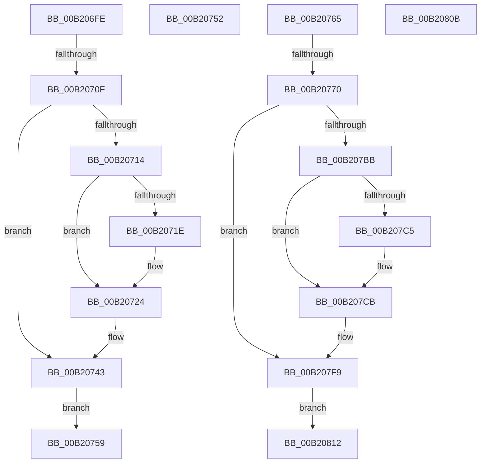

# sub_00B206FE

- RVA: `0x00B206FE`–`0x00B2081E` (길이 `288` bytes)
- VA: `0x0000000140B206FE`
- 실행 섹션: `PAGE`
- PDB 이름 있음: `아니요`; PDB Function 태그: `아니요`
- unwind 정보 RVA: `0x000887B0`
- 디코드: `70`개 명령, `288/288` bytes 표시
- 미해석 바이트: `0` (있으면 어셈블리에 `.byte`로 보존)

> 이 문서는 커널 이미지의 기계어와 PDB 기호를 분석해 생성했습니다. 4번과 5번은 함수 원형과 자료형을 바이너리 사용 방식에서 추정한 C 해석이며 원본 소스 복구 결과는 아닙니다.

## 1. Dependencies

- 직접 호출 지점: **4**; 고유 호출 대상: **3**
- 직접 호출자로 확인된 함수: **0**
- RIP 상대 이미지 참조: **5**

### Outgoing calls
- `0x00B2071E` → [ExRaiseDatatypeMisalignment](../89/ExRaiseDatatypeMisalignment_function_00899FD0.md) (function, `0x00899FD0`)
- `0x00B2077D` → [FsRtlAcquirePushLockShared](../../text/48/FsRtlAcquirePushLockShared_function_0048B034.md) (function, `0x0048B034`)
- `0x00B207B0` → [PfLockSharedRelease](../../text/48/PfLockSharedRelease_function_0048DF24.md) (function, `0x0048DF24`)
- `0x00B207C5` → [ExRaiseDatatypeMisalignment](../89/ExRaiseDatatypeMisalignment_function_00899FD0.md) (function, `0x00899FD0`)

### Direct callers
- 이 함수 시작 RVA로 연결되는 직접 call은 확인되지 않았습니다. 간접 호출은 완전히 역산할 수 없습니다.

### Static image references
- `0x00B20743` → RVA `0x00F0F228` (`.data`; read)
- `0x00B20776` → RVA `0x00E670A8` (`.data`; read)
- `0x00B20782` → RVA `0x00E66EF4` (`.data`; read)
- `0x00B2078E` → RVA `0x00E66F04` (`.data`; read)
- `0x00B2079F` → RVA `0x00E66F0C` (`.data`; read)

## 2. Other-region calls and transfers

- 다른 실행 섹션으로 향하는 call: **2**
  - `0x00B2077D` → [FsRtlAcquirePushLockShared](../../text/48/FsRtlAcquirePushLockShared_function_0048B034.md) (`PAGE` → `.text`)
  - `0x00B207B0` → [PfLockSharedRelease](../../text/48/PfLockSharedRelease_function_0048DF24.md) (`PAGE` → `.text`)
- call이 아닌 외부 분기/꼬리 이동: **6**
  - `0x00B20709` → [PfQuerySuperfetchInformation + 0x328](../90/PfQuerySuperfetchInformation_function_0090210C.md) (`tail-transfer`)
  - `0x00B20754` → [PfQuerySuperfetchInformation + 0xE9](../90/PfQuerySuperfetchInformation_function_0090210C.md) (`tail-transfer`)
  - `0x00B20760` → [PfQuerySuperfetchInformation + 0xE9](../90/PfQuerySuperfetchInformation_function_0090210C.md) (`tail-transfer`)
  - `0x00B2076A` → [PfQuerySuperfetchInformation + 0x328](../90/PfQuerySuperfetchInformation_function_0090210C.md) (`tail-transfer`)
  - `0x00B2080D` → [PfQuerySuperfetchInformation + 0xE9](../90/PfQuerySuperfetchInformation_function_0090210C.md) (`tail-transfer`)
  - `0x00B20819` → [PfQuerySuperfetchInformation + 0xE9](../90/PfQuerySuperfetchInformation_function_0090210C.md) (`tail-transfer`)

## 3. Assembly (complete function range)

```asm
00B206FE  33 DB                           xor ebx, ebx
00B20700  89 5C 24 20                     mov dword ptr [rsp + 0x20], ebx
00B20704  83 7C 24 40 04                  cmp dword ptr [rsp + 0x40], 4
00B20709  0F 85 25 1D DE FF               jne 0x140902434
00B2070F  40 84 F6                        test sil, sil
00B20712  74 2F                           je 0x140b20743
00B20714  48 8B 4C 24 38                  mov rcx, qword ptr [rsp + 0x38]
00B20719  F6 C1 03                        test cl, 3
00B2071C  74 06                           je 0x140b20724
00B2071E  E8 AD 98 D7 FF                  call 0x140899fd0
00B20723  CC                              int3
00B20724  48 B8 00 00 FF FF FF 7F 00 00   movabs rax, 0x7fffffff0000
00B2072E  48 3B C8                        cmp rcx, rax
00B20731  48 0F 43 C8                     cmovae rcx, rax
00B20735  8A 01                           mov al, byte ptr [rcx]
00B20737  88 01                           mov byte ptr [rcx], al
00B20739  8A 41 03                        mov al, byte ptr [rcx + 3]
00B2073C  88 41 03                        mov byte ptr [rcx + 3], al
00B2073F  8B 5C 24 20                     mov ebx, dword ptr [rsp + 0x20]
00B20743  8B 05 DF EA 3E 00               mov eax, dword ptr [rip + 0x3eeadf]
00B20749  48 8B 4C 24 38                  mov rcx, qword ptr [rsp + 0x38]
00B2074E  89 01                           mov dword ptr [rcx], eax
00B20750  EB 07                           jmp 0x140b20759
00B20752  8B D8                           mov ebx, eax
00B20754  E9 9C 1A DE FF                  jmp 0x1409021f5
00B20759  41 C7 06 04 00 00 00            mov dword ptr [r14], 4
00B20760  E9 90 1A DE FF                  jmp 0x1409021f5
00B20765  83 7C 24 40 1C                  cmp dword ptr [rsp + 0x40], 0x1c
00B2076A  0F 85 C4 1C DE FF               jne 0x140902434
00B20770  33 DB                           xor ebx, ebx
00B20772  89 5C 24 20                     mov dword ptr [rsp + 0x20], ebx
00B20776  48 8D 0D 2B 69 34 00            lea rcx, [rip + 0x34692b]
00B2077D  E8 B2 A8 96 FF                  call 0x14048b034
00B20782  0F 10 35 6B 67 34 00            movups xmm6, xmmword ptr [rip + 0x34676b]
00B20789  0F 11 74 24 58                  movups xmmword ptr [rsp + 0x58], xmm6
00B2078E  F2 0F 10 05 6E 67 34 00         movsd xmm0, qword ptr [rip + 0x34676e]
00B20796  0F 28 F8                        movaps xmm7, xmm0
00B20799  F2 0F 11 44 24 68               movsd qword ptr [rsp + 0x68], xmm0
00B2079F  8B 3D 67 67 34 00               mov edi, dword ptr [rip + 0x346767]
00B207A5  89 7C 24 70                     mov dword ptr [rsp + 0x70], edi
00B207A9  48 8D 0D F8 68 34 00            lea rcx, [rip + 0x3468f8]
00B207B0  E8 6F D7 96 FF                  call 0x14048df24
00B207B5  90                              nop
00B207B6  40 84 F6                        test sil, sil
00B207B9  74 3E                           je 0x140b207f9
00B207BB  48 8B 4C 24 38                  mov rcx, qword ptr [rsp + 0x38]
00B207C0  F6 C1 03                        test cl, 3
00B207C3  74 06                           je 0x140b207cb
00B207C5  E8 06 98 D7 FF                  call 0x140899fd0
00B207CA  CC                              int3
00B207CB  48 B8 00 00 FF FF FF 7F 00 00   movabs rax, 0x7fffffff0000
00B207D5  48 3B C8                        cmp rcx, rax
00B207D8  48 0F 43 C8                     cmovae rcx, rax
00B207DC  8A 01                           mov al, byte ptr [rcx]
00B207DE  88 01                           mov byte ptr [rcx], al
00B207E0  8A 41 1B                        mov al, byte ptr [rcx + 0x1b]
00B207E3  88 41 1B                        mov byte ptr [rcx + 0x1b], al
00B207E6  8B 5C 24 20                     mov ebx, dword ptr [rsp + 0x20]
00B207EA  8B 7C 24 70                     mov edi, dword ptr [rsp + 0x70]
00B207EE  F2 0F 10 7C 24 68               movsd xmm7, qword ptr [rsp + 0x68]
00B207F4  0F 10 74 24 58                  movups xmm6, xmmword ptr [rsp + 0x58]
00B207F9  48 8B 44 24 38                  mov rax, qword ptr [rsp + 0x38]
00B207FE  0F 11 30                        movups xmmword ptr [rax], xmm6
00B20801  F2 0F 11 78 10                  movsd qword ptr [rax + 0x10], xmm7
00B20806  89 78 18                        mov dword ptr [rax + 0x18], edi
00B20809  EB 07                           jmp 0x140b20812
00B2080B  8B D8                           mov ebx, eax
00B2080D  E9 E3 19 DE FF                  jmp 0x1409021f5
00B20812  41 C7 06 1C 00 00 00            mov dword ptr [r14], 0x1c
00B20819  E9 D7 19 DE FF                  jmp 0x1409021f5
```

## 4. C-style interpretation (structured pseudocode)

```c
__int64 __fastcall sub_00B206FE(__int64 a1, __int64 a2, __int64 a3, __int64 a4, __int64 a5, __int64 a6, __int64 a7, unsigned int a8)
{
    __int64 result;
    __int64 v_rbx;
    unsigned int v_stack_p20;
    unsigned __int64 v_stack_p38;
    unsigned int v_stack_p40;
    unsigned __int64 v_stack_p58;
    unsigned __int64 v_stack_p68;
    unsigned int v_stack_p70;

    v_rbx = 0;
    v_stack_p20 = 0;
    if ((unsigned __int8)(v_rsi) == 0) goto loc_00B20743;
    if ((((unsigned __int8)(a7)) & (3)) != 0) {
        result = ExRaiseDatatypeMisalignment(a7, a2, a3, a4);
    }
    if (a7 >= result) { a7 = result; }
    *(unsigned __int8 *)(a7) = (unsigned __int8)(*(unsigned __int8 *)(a7));
    *(unsigned __int8 *)(a7 + 3) = (unsigned __int8)(*(unsigned __int8 *)(a7 + 3));
loc_00B20743:
    *(unsigned int *)(a7) = (unsigned int)((unsigned int)(*(unsigned int *)(v_rip + 4123359)));
    goto loc_00B20759;
loc_00B20759:
    *(unsigned int *)(v_r14) = 4;
}
```

## 5. (Beta) C Style

```c
int64_t sub_00B206FE(int64_t Arg1, int64_t Arg2, int64_t Arg3, int64_t Arg4, uint64_t Arg5, uint64_t Arg6, void *Arg7, uint32_t Arg8)
{
    uint8_t *arg7 = (uint8_t *)Arg7;

    int64_t result;
    int64_t local_rbx;
    uint32_t v_stack_p20;
    uint64_t v_stack_p38;
    uint32_t v_stack_p40;
    uint64_t v_stack_p58;
    uint64_t v_stack_p68;
    uint32_t v_stack_p70;

    local_rbx = 0;
    v_stack_p20 = 0;
    if ((uint8_t)(local_rsi) == 0) goto loc_00B20743;
    if ((((uint8_t)(Arg7)) & (3)) != 0) {
        result = ExRaiseDatatypeMisalignment(Arg7, Arg2, Arg3, Arg4);
    }
    if (Arg7 >= result) { Arg7 = result; }
    *(uint8_t *)(arg7) = (uint8_t)(*(uint8_t *)(arg7));
    *(uint8_t *)(arg7 + 0x3) = (uint8_t)(*(uint8_t *)(arg7 + 0x3));
loc_00B20743:
    *(uint32_t *)(arg7) = (uint32_t)((uint32_t)(*(uint32_t *)(v_rip + 0x3EEADF)));
    goto loc_00B20759;
loc_00B20759:
    *(uint32_t *)(local_r14) = 4;
}
```

### 관측된 메모리 오프셋

구조체 형식이 확인되지 않은 접근은 인자 기준의 오프셋으로만 기록했습니다.

| 기준 인자 | 오프셋 표현 | 폭 (bit) | 접근 |
|---|---:|---:|---|
| `Arg7` | `+ 0x0` | `32` | `W` |

## 6. Execution-region graph

[열기: 2D/3D 그래프와 함수 탐색 컨트롤 패널](../../../control-panel.html?section=page&rva=0x00B206FE&view=graph)

- 2D 그래프는 위에서 아래로 흐르고, 3D 그래프는 빈 공간을 드래그해 회전합니다. Shift+드래그는 이동, 휠은 확대·축소, 함수 노드 선택은 대상 보고서 이동입니다.

### Static fallback


