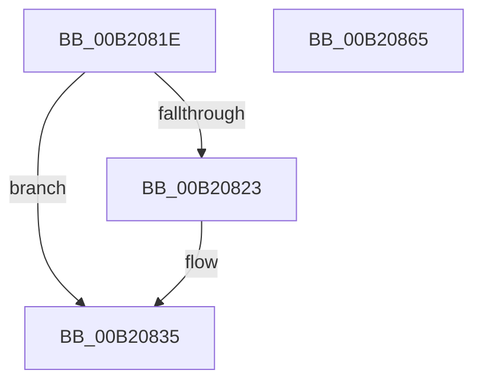

# sub_00B2081E

- RVA: `0x00B2081E`–`0x00B20874` (길이 `86` bytes)
- VA: `0x0000000140B2081E`
- 실행 섹션: `PAGE`
- PDB 이름 있음: `아니요`; PDB Function 태그: `아니요`
- unwind 정보 RVA: `0x00088800`
- 디코드: `21`개 명령, `86/86` bytes 표시
- 미해석 바이트: `0` (있으면 어셈블리에 `.byte`로 보존)

> 이 문서는 커널 이미지의 기계어와 PDB 기호를 분석해 생성했습니다. 4번과 5번은 함수 원형과 자료형을 바이너리 사용 방식에서 추정한 C 해석이며 원본 소스 복구 결과는 아닙니다.

## 1. Dependencies

- 직접 호출 지점: **2**; 고유 호출 대상: **2**
- 직접 호출자로 확인된 함수: **0**
- RIP 상대 이미지 참조: **0**

### Outgoing calls
- `0x00B20830` → [ProbeForWrite](../8E/ProbeForWrite_function_008E91C0.md) (function, `0x008E91C0`)
- `0x00B2085A` → [memcpy](../../text/6C/memcpy_function_006C6840.md) (function, `0x006C6840`)

### Direct callers
- 이 함수 시작 RVA로 연결되는 직접 call은 확인되지 않았습니다. 간접 호출은 완전히 역산할 수 없습니다.

### Static image references
- 디코드된 RIP-relative 메모리 참조가 없습니다.

## 2. Other-region calls and transfers

- 다른 실행 섹션으로 향하는 call: **1**
  - `0x00B2085A` → [memcpy](../../text/6C/memcpy_function_006C6840.md) (`PAGE` → `.text`)
- call이 아닌 외부 분기/꼬리 이동: **2**
  - `0x00B20860` → [PfpPfnPrioRequest + 0xFA](../90/PfpPfnPrioRequest_function_00902488.md) (`tail-transfer`)
  - `0x00B2086F` → [PfpPfnPrioRequest + 0xFE](../90/PfpPfnPrioRequest_function_00902488.md) (`tail-transfer`)

## 3. Assembly (complete function range)

```asm
00B2081E  45 84 FF                        test r15b, r15b
00B20821  74 12                           je 0x140b20835
00B20823  8B 56 18                        mov edx, dword ptr [rsi + 0x18]
00B20826  41 B8 08 00 00 00               mov r8d, 8
00B2082C  48 8B 4E 10                     mov rcx, qword ptr [rsi + 0x10]
00B20830  E8 8B 89 DC FF                  call 0x1408e91c0
00B20835  C7 44 24 30 C0 00 00 00         mov dword ptr [rsp + 0x30], 0xc0
00B2083D  8B 43 08                        mov eax, dword ptr [rbx + 8]
00B20840  83 C0 08                        add eax, 8
00B20843  44 8D 34 40                     lea r14d, [rax + rax*2]
00B20847  41 C1 E6 03                     shl r14d, 3
00B2084B  44 89 74 24 30                  mov dword ptr [rsp + 0x30], r14d
00B20850  45 8B C6                        mov r8d, r14d
00B20853  48 8B D3                        mov rdx, rbx
00B20856  48 8B 4E 10                     mov rcx, qword ptr [rsi + 0x10]
00B2085A  E8 E1 5F BA FF                  call 0x1406c6840
00B2085F  90                              nop
00B20860  E9 1D 1D DE FF                  jmp 0x140902582
00B20865  8B F8                           mov edi, eax
00B20867  48 8B 9C 24 88 00 00 00         mov rbx, qword ptr [rsp + 0x88]
00B2086F  E9 12 1D DE FF                  jmp 0x140902586
```

## 4. C-style interpretation (structured pseudocode)

```c
__int64 __fastcall sub_00B2081E(void)
{
    __int64 result;
    __int64 v_r14;
    unsigned int v_stack_p30;
    unsigned __int64 v_stack_p88;

    if ((unsigned __int8)(v_r15) != 0) {
        a2 = *(unsigned int *)(v_rsi + 24);
        a3 = 8;
        a1 = *(unsigned __int64 *)(v_rsi + 16);
        result = ProbeForWrite(a1, a2, a3, a4);
    }
    v_stack_p30 = 192;
    result = (unsigned int)(((unsigned int)(*(unsigned int *)(v_rbx + 8))) + (8));
    v_r14 = (unsigned int)((result + result * 2) << (3));
    v_stack_p30 = (unsigned int)(v_r14);
    result = memcpy(*(unsigned __int64 *)(v_rsi + 16), v_rbx, (unsigned int)((unsigned int)(v_r14)), a4);
}
```

## 5. (Beta) C Style

```c
void sub_00B2081E(void)
{
    int64_t result;
    int64_t local_r14;
    uint32_t v_stack_p30;
    uint64_t v_stack_p88;

    if ((uint8_t)(local_r15) != 0) {
        a2 = *(uint32_t *)(local_rsi + 0x18);
        a3 = 8;
        a1 = *(uint64_t *)(local_rsi + 0x10);
        result = ProbeForWrite(a1, a2, a3, a4);
    }
    v_stack_p30 = 192;
    result = (uint32_t)(((uint32_t)(*(uint32_t *)(local_rbx + 0x8))) + (8));
    local_r14 = (uint32_t)((result + result * 2) << (3));
    v_stack_p30 = (uint32_t)(local_r14);
    result = memcpy(*(uint64_t *)(local_rsi + 0x10), local_rbx, (uint32_t)((uint32_t)(local_r14)), a4);
}
```

## 6. Execution-region graph

[열기: 2D/3D 그래프와 함수 탐색 컨트롤 패널](../../../control-panel.html?section=page&rva=0x00B2081E&view=graph)

- 2D 그래프는 위에서 아래로 흐르고, 3D 그래프는 빈 공간을 드래그해 회전합니다. Shift+드래그는 이동, 휠은 확대·축소, 함수 노드 선택은 대상 보고서 이동입니다.

### Static fallback


