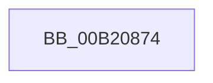

# sub_00B20874

- RVA: `0x00B20874`–`0x00B208F8` (길이 `132` bytes)
- VA: `0x0000000140B20874`
- 실행 섹션: `PAGE`
- PDB 이름 있음: `아니요`; PDB Function 태그: `아니요`
- unwind 정보 RVA: `0x000888BC`
- 디코드: `22`개 명령, `132/132` bytes 표시
- 미해석 바이트: `0` (있으면 어셈블리에 `.byte`로 보존)

> 이 문서는 커널 이미지의 기계어와 PDB 기호를 분석해 생성했습니다. 4번과 5번은 함수 원형과 자료형을 바이너리 사용 방식에서 추정한 C 해석이며 원본 소스 복구 결과는 아닙니다.

## 1. Dependencies

- 직접 호출 지점: **2**; 고유 호출 대상: **2**
- 직접 호출자로 확인된 함수: **0**
- RIP 상대 이미지 참조: **2**

### Outgoing calls
- `0x00B20877` → [PfpTraceLogPfPartitionId](../../text/5C/PfpTraceLogPfPartitionId_function_005CE1CC.md) (function, `0x005CE1CC`)
- `0x00B208ED` → [tlgWriteTransfer_EtwWriteTransfer](../../text/42/tlgWriteTransfer_EtwWriteTransfer_function_004260E0.md) (function, `0x004260E0`)

### Direct callers
- 이 함수 시작 RVA로 연결되는 직접 call은 확인되지 않았습니다. 간접 호출은 완전히 역산할 수 없습니다.

### Static image references
- `0x00B208DF` → RVA `0x00048915` (`.rdata`; read)
- `0x00B208E6` → RVA `0x00E074D8` (`.data`; read)

## 2. Other-region calls and transfers

- 다른 실행 섹션으로 향하는 call: **2**
  - `0x00B20877` → [PfpTraceLogPfPartitionId](../../text/5C/PfpTraceLogPfPartitionId_function_005CE1CC.md) (`PAGE` → `.text`)
  - `0x00B208ED` → [tlgWriteTransfer_EtwWriteTransfer](../../text/42/tlgWriteTransfer_EtwWriteTransfer_function_004260E0.md) (`PAGE` → `.text`)
- call이 아닌 외부 분기/꼬리 이동: **1**
  - `0x00B208F3` → [PfGetCompletedTrace + 0x31D](../90/PfGetCompletedTrace_function_00902950.md) (`tail-transfer`)

## 3. Assembly (complete function range)

```asm
00B20874  48 8B CF                        mov rcx, rdi
00B20877  E8 50 D9 AA FF                  call 0x1405ce1cc
00B2087C  89 44 24 38                     mov dword ptr [rsp + 0x38], eax
00B20880  48 8D 44 24 38                  lea rax, [rsp + 0x38]
00B20885  48 89 84 24 D0 00 00 00         mov qword ptr [rsp + 0xd0], rax
00B2088D  C7 84 24 D8 00 00 00 04 00 00 00  mov dword ptr [rsp + 0xd8], 4
00B20898  83 A4 24 DC 00 00 00 00         and dword ptr [rsp + 0xdc], 0
00B208A0  89 74 24 50                     mov dword ptr [rsp + 0x50], esi
00B208A4  48 8D 44 24 50                  lea rax, [rsp + 0x50]
00B208A9  48 89 84 24 E0 00 00 00         mov qword ptr [rsp + 0xe0], rax
00B208B1  C7 84 24 E8 00 00 00 04 00 00 00  mov dword ptr [rsp + 0xe8], 4
00B208BC  83 A4 24 EC 00 00 00 00         and dword ptr [rsp + 0xec], 0
00B208C4  48 8D 84 24 B0 00 00 00         lea rax, [rsp + 0xb0]
00B208CC  48 89 44 24 28                  mov qword ptr [rsp + 0x28], rax
00B208D1  C7 44 24 20 04 00 00 00         mov dword ptr [rsp + 0x20], 4
00B208D9  45 33 C9                        xor r9d, r9d
00B208DC  45 33 C0                        xor r8d, r8d
00B208DF  48 8D 15 2F 80 52 FF            lea rdx, [rip - 0xad7fd1]
00B208E6  48 8D 0D EB 6B 2E 00            lea rcx, [rip + 0x2e6beb]
00B208ED  E8 EE 57 90 FF                  call 0x1404260e0
00B208F2  90                              nop
00B208F3  E9 75 23 DE FF                  jmp 0x140902c6d
```

## 4. C-style interpretation (structured pseudocode)

```c
__int64 __fastcall sub_00B20874(__int64 a1, __int64 a2, int a3, int a4, __int64 a5, __int64 a6, __int64 a7, __int64 a8, __int64 a9, __int64 a10, __int64 a11, __int64 a12, __int64 a13, __int64 a14, __int64 a15, __int64 a16, __int64 a17, __int64 a18, __int64 a19, __int64 a20, __int64 a21, __int64 a22)
{
    __int64 result;
    unsigned int v_stack_p20;
    unsigned __int64 v_stack_p28;
    unsigned int v_stack_p38;
    unsigned int v_stack_p50;
    unsigned __int64 v_stack_pD0;
    unsigned int v_stack_pD8;
    unsigned int v_stack_pDC;
    unsigned __int64 v_stack_pE0;
    unsigned int v_stack_pE8;
    unsigned int v_stack_pEC;

    result = PfpTraceLogPfPartitionId(v_rdi, a2, a3, a4);
    v_stack_p38 = (unsigned int)(result);
    v_stack_pD0 = a7;
    v_stack_pD8 = 4;
    v_stack_p50 = (unsigned int)(v_rsi);
    v_stack_pE0 = a10;
    v_stack_pE8 = 4;
    v_stack_p28 = a22;
    v_stack_p20 = 4;
    a4 = 0;
    a3 = 0;
    result = tlgWriteTransfer_EtwWriteTransfer(v_rip + 3042283, v_rip - 11370449, a3, a4);
}
```

## 5. (Beta) C Style

```c
int64_t sub_00B20874(int64_t Arg1, int64_t Arg2, int32_t Arg3, int32_t Arg4, uint64_t Arg5, uint64_t Arg6, int64_t Arg7, uint64_t Arg8, uint64_t Arg9, int64_t Arg10, uint64_t Arg11, uint64_t Arg12, uint64_t Arg13, uint64_t Arg14, uint64_t Arg15, uint64_t Arg16, uint64_t Arg17, uint64_t Arg18, uint64_t Arg19, uint64_t Arg20, uint64_t Arg21, int64_t Arg22)
{
    int64_t result;
    uint32_t v_stack_p20;
    uint64_t v_stack_p28;
    uint32_t v_stack_p38;
    uint32_t v_stack_p50;
    uint64_t v_stack_pD0;
    uint32_t v_stack_pD8;
    uint32_t v_stack_pDC;
    uint64_t v_stack_pE0;
    uint32_t v_stack_pE8;
    uint32_t v_stack_pEC;

    result = PfpTraceLogPfPartitionId(local_rdi, Arg2, Arg3, Arg4);
    v_stack_p38 = (uint32_t)(result);
    v_stack_pD0 = Arg7;
    v_stack_pD8 = 4;
    v_stack_p50 = (uint32_t)(local_rsi);
    v_stack_pE0 = Arg10;
    v_stack_pE8 = 4;
    v_stack_p28 = Arg22;
    v_stack_p20 = 4;
    Arg4 = 0;
    Arg3 = 0;
    result = tlgWriteTransfer_EtwWriteTransfer(v_rip + 3042283, v_rip - 11370449, Arg3, Arg4);
}
```

## 6. Execution-region graph

[열기: 2D/3D 그래프와 함수 탐색 컨트롤 패널](../../../control-panel.html?section=page&rva=0x00B20874&view=graph)

- 2D 그래프는 위에서 아래로 흐르고, 3D 그래프는 빈 공간을 드래그해 회전합니다. Shift+드래그는 이동, 휠은 확대·축소, 함수 노드 선택은 대상 보고서 이동입니다.

### Static fallback


