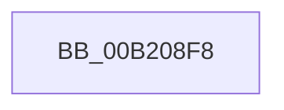

# sub_00B208F8

- RVA: `0x00B208F8`–`0x00B2095C` (길이 `100` bytes)
- VA: `0x0000000140B208F8`
- 실행 섹션: `PAGE`
- PDB 이름 있음: `아니요`; PDB Function 태그: `아니요`
- unwind 정보 RVA: `0x000888F0`
- 디코드: `22`개 명령, `100/100` bytes 표시
- 미해석 바이트: `0` (있으면 어셈블리에 `.byte`로 보존)

> 이 문서는 커널 이미지의 기계어와 PDB 기호를 분석해 생성했습니다. 4번과 5번은 함수 원형과 자료형을 바이너리 사용 방식에서 추정한 C 해석이며 원본 소스 복구 결과는 아닙니다.

## 1. Dependencies

- 직접 호출 지점: **2**; 고유 호출 대상: **2**
- 직접 호출자로 확인된 함수: **0**
- RIP 상대 이미지 참조: **2**

### Outgoing calls
- `0x00B208FB` → [PfpTraceLogPartitionId](../../text/5C/PfpTraceLogPartitionId_function_005CE1B0.md) (function, `0x005CE1B0`)
- `0x00B20951` → [tlgWriteTransfer_EtwWriteTransfer](../../text/42/tlgWriteTransfer_EtwWriteTransfer_function_004260E0.md) (function, `0x004260E0`)

### Direct callers
- 이 함수 시작 RVA로 연결되는 직접 call은 확인되지 않았습니다. 간접 호출은 완전히 역산할 수 없습니다.

### Static image references
- `0x00B20904` → RVA `0x00048A3B` (`.rdata`; read)
- `0x00B2090F` → RVA `0x00E074D8` (`.data`; read)

## 2. Other-region calls and transfers

- 다른 실행 섹션으로 향하는 call: **2**
  - `0x00B208FB` → [PfpTraceLogPartitionId](../../text/5C/PfpTraceLogPartitionId_function_005CE1B0.md) (`PAGE` → `.text`)
  - `0x00B20951` → [tlgWriteTransfer_EtwWriteTransfer](../../text/42/tlgWriteTransfer_EtwWriteTransfer_function_004260E0.md) (`PAGE` → `.text`)
- call이 아닌 외부 분기/꼬리 이동: **1**
  - `0x00B20957` → [PfpPartitionFindByHandle + 0xC2](../90/PfpPartitionFindByHandle_function_00902E48.md) (`tail-transfer`)

## 3. Assembly (complete function range)

```asm
00B208F8  48 8B CB                        mov rcx, rbx
00B208FB  E8 B0 D8 AA FF                  call 0x1405ce1b0
00B20900  83 65 13 00                     and dword ptr [rbp + 0x13], 0
00B20904  48 8D 15 30 81 52 FF            lea rdx, [rip - 0xad7ed0]
00B2090B  83 65 23 00                     and dword ptr [rbp + 0x23], 0
00B2090F  48 8D 0D C2 6B 2E 00            lea rcx, [rip + 0x2e6bc2]
00B20916  89 45 DF                        mov dword ptr [rbp - 0x21], eax
00B20919  45 33 C9                        xor r9d, r9d
00B2091C  48 8D 45 DF                     lea rax, [rbp - 0x21]
00B20920  C7 45 0F 04 00 00 00            mov dword ptr [rbp + 0xf], 4
00B20927  48 89 45 07                     mov qword ptr [rbp + 7], rax
00B2092B  45 33 C0                        xor r8d, r8d
00B2092E  48 8D 45 D7                     lea rax, [rbp - 0x29]
00B20932  89 75 D7                        mov dword ptr [rbp - 0x29], esi
00B20935  48 89 45 17                     mov qword ptr [rbp + 0x17], rax
00B20939  48 8D 45 E7                     lea rax, [rbp - 0x19]
00B2093D  48 89 44 24 28                  mov qword ptr [rsp + 0x28], rax
00B20942  C7 44 24 20 04 00 00 00         mov dword ptr [rsp + 0x20], 4
00B2094A  C7 45 1F 04 00 00 00            mov dword ptr [rbp + 0x1f], 4
00B20951  E8 8A 57 90 FF                  call 0x1404260e0
00B20956  90                              nop
00B20957  E9 AE 25 DE FF                  jmp 0x140902f0a
```

## 4. C-style interpretation (structured pseudocode)

```c
__int64 __fastcall sub_00B208F8(__int64 a1, __int64 a2, int a3, int a4)
{
    __int64 result;
    unsigned int v_stack_p20;
    unsigned __int64 v_stack_p28;

    result = PfpTraceLogPartitionId(v_rbx, a2, a3, a4);
    *(unsigned int *)(v_rbp - 33) = (unsigned int)(result);
    a4 = 0;
    *(unsigned int *)(v_rbp + 15) = 4;
    *(unsigned __int64 *)(v_rbp + 7) = v_rbp - 33;
    a3 = 0;
    *(unsigned int *)(v_rbp - 41) = (unsigned int)(v_rsi);
    *(unsigned __int64 *)(v_rbp + 23) = v_rbp - 41;
    v_stack_p28 = v_rbp - 25;
    v_stack_p20 = 4;
    *(unsigned int *)(v_rbp + 31) = 4;
    result = tlgWriteTransfer_EtwWriteTransfer(v_rip + 3042242, v_rip - 11370192, a3, a4);
}
```

## 5. (Beta) C Style

```c
int64_t sub_00B208F8(int64_t Arg1, int64_t Arg2, int32_t Arg3, int32_t Arg4)
{
    int64_t result;
    uint32_t v_stack_p20;
    uint64_t v_stack_p28;

    result = PfpTraceLogPartitionId(local_rbx, Arg2, Arg3, Arg4);
    *(uint32_t *)(local_rbp - 0x21) = (uint32_t)(result);
    Arg4 = 0;
    *(uint32_t *)(local_rbp + 0xF) = 4;
    *(uint64_t *)(local_rbp + 0x7) = local_rbp - 33;
    Arg3 = 0;
    *(uint32_t *)(local_rbp - 0x29) = (uint32_t)(local_rsi);
    *(uint64_t *)(local_rbp + 0x17) = local_rbp - 41;
    v_stack_p28 = local_rbp - 25;
    v_stack_p20 = 4;
    *(uint32_t *)(local_rbp + 0x1F) = 4;
    result = tlgWriteTransfer_EtwWriteTransfer(v_rip + 3042242, v_rip - 11370192, Arg3, Arg4);
}
```

## 6. Execution-region graph

[열기: 2D/3D 그래프와 함수 탐색 컨트롤 패널](../../../control-panel.html?section=page&rva=0x00B208F8&view=graph)

- 2D 그래프는 위에서 아래로 흐르고, 3D 그래프는 빈 공간을 드래그해 회전합니다. Shift+드래그는 이동, 휠은 확대·축소, 함수 노드 선택은 대상 보고서 이동입니다.

### Static fallback


