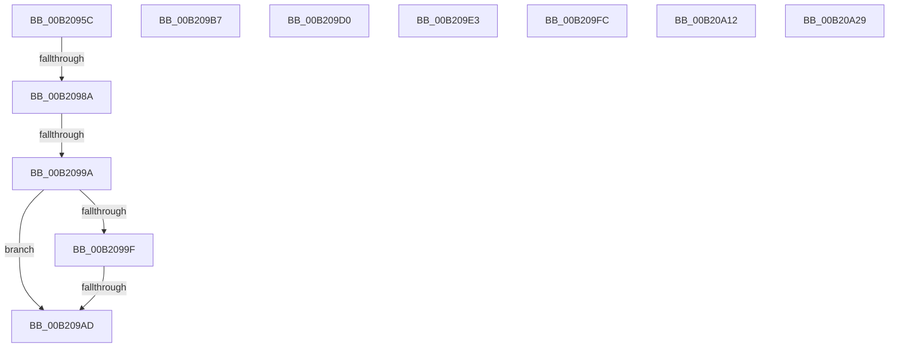

# sub_00B2095C

- RVA: `0x00B2095C`–`0x00B20A3F` (길이 `227` bytes)
- VA: `0x0000000140B2095C`
- 실행 섹션: `PAGE`
- PDB 이름 있음: `아니요`; PDB Function 태그: `아니요`
- unwind 정보 RVA: `0x00088954`
- 디코드: `58`개 명령, `227/227` bytes 표시
- 미해석 바이트: `0` (있으면 어셈블리에 `.byte`로 보존)

> 이 문서는 커널 이미지의 기계어와 PDB 기호를 분석해 생성했습니다. 4번과 5번은 함수 원형과 자료형을 바이너리 사용 방식에서 추정한 C 해석이며 원본 소스 복구 결과는 아닙니다.

## 1. Dependencies

- 직접 호출 지점: **7**; 고유 호출 대상: **7**
- 직접 호출자로 확인된 함수: **0**
- RIP 상대 이미지 참조: **0**

### Outgoing calls
- `0x00B20976` → [PsReferencePartitionByHandle](../90/PsReferencePartitionByHandle_function_0090337C.md) (function, `0x0090337C`)
- `0x00B209C5` → [MmManagePartitionUpdateAttributes](../80/MmManagePartitionUpdateAttributes_function_0080E5A4.md) (function, `0x0080E5A4`)
- `0x00B209D8` → [MmManagePartitionSetMemoryThresholds](../../text/69/MmManagePartitionSetMemoryThresholds_function_0069249C.md) (function, `0x0069249C`)
- `0x00B209F1` → [MmManagePartitionCharges](../80/MmManagePartitionCharges_function_0080DDAC.md) (function, `0x0080DDAC`)
- `0x00B20A07` → [MiOpenSpecialPurposeMemory](../80/MiOpenSpecialPurposeMemory_function_0080FA28.md) (function, `0x0080FA28`)
- `0x00B20A1E` → [MiQuerySpecialPurposeMemoryInformation](../80/MiQuerySpecialPurposeMemoryInformation_function_0080FBC8.md) (function, `0x0080FBC8`)
- `0x00B20A34` → [MmManagePartitionCreateLargePages](../80/MmManagePartitionCreateLargePages_function_0080E000.md) (function, `0x0080E000`)

### Direct callers
- 이 함수 시작 RVA로 연결되는 직접 call은 확인되지 않았습니다. 간접 호출은 완전히 역산할 수 없습니다.

### Static image references
- 디코드된 RIP-relative 메모리 참조가 없습니다.

## 2. Other-region calls and transfers

- 다른 실행 섹션으로 향하는 call: **1**
  - `0x00B209D8` → [MmManagePartitionSetMemoryThresholds](../../text/69/MmManagePartitionSetMemoryThresholds_function_0069249C.md) (`PAGE` → `.text`)
- call이 아닌 외부 분기/꼬리 이동: **10**
  - `0x00B20984` → [NtManagePartition + 0x1F2](../90/NtManagePartition_function_00902FC0.md) (`tail-transfer`)
  - `0x00B20994` → [NtManagePartition + 0x168](../90/NtManagePartition_function_00902FC0.md) (`tail-transfer`)
  - `0x00B209A7` → [NtManagePartition + 0x168](../90/NtManagePartition_function_00902FC0.md) (`tail-transfer`)
  - `0x00B209B2` → [NtManagePartition + 0x1F2](../90/NtManagePartition_function_00902FC0.md) (`tail-transfer`)
  - `0x00B209CB` → [NtManagePartition + 0x1AA](../90/NtManagePartition_function_00902FC0.md) (`tail-transfer`)
  - `0x00B209DE` → [NtManagePartition + 0x1AA](../90/NtManagePartition_function_00902FC0.md) (`tail-transfer`)
  - `0x00B209F7` → [NtManagePartition + 0x1AA](../90/NtManagePartition_function_00902FC0.md) (`tail-transfer`)
  - `0x00B20A0D` → [NtManagePartition + 0x1AA](../90/NtManagePartition_function_00902FC0.md) (`tail-transfer`)
  - `0x00B20A24` → [NtManagePartition + 0x1AA](../90/NtManagePartition_function_00902FC0.md) (`tail-transfer`)
  - `0x00B20A3A` → [NtManagePartition + 0x1AA](../90/NtManagePartition_function_00902FC0.md) (`tail-transfer`)

## 3. Assembly (complete function range)

```asm
00B2095C  48 8D 44 24 40                  lea rax, [rsp + 0x40]
00B20961  48 89 44 24 20                  mov qword ptr [rsp + 0x20], rax
00B20966  41 B9 50 73 4D 70               mov r9d, 0x704d7350
00B2096C  45 8A C6                        mov r8b, r14b
00B2096F  8B D6                           mov edx, esi
00B20971  48 8B 4C 24 48                  mov rcx, qword ptr [rsp + 0x48]
00B20976  E8 01 2A DE FF                  call 0x14090337c
00B2097B  8B F8                           mov edi, eax
00B2097D  48 8B 74 24 38                  mov rsi, qword ptr [rsp + 0x38]
00B20982  85 C0                           test eax, eax
00B20984  0F 88 28 28 DE FF               js 0x1409031b2
00B2098A  C6 44 24 31 01                  mov byte ptr [rsp + 0x31], 1
00B2098F  48 39 74 24 40                  cmp qword ptr [rsp + 0x40], rsi
00B20994  0F 85 8E 27 DE FF               jne 0x140903128
00B2099A  83 FB 01                        cmp ebx, 1
00B2099D  75 0E                           jne 0x140b209ad
00B2099F  F7 44 24 64 00 04 00 00         test dword ptr [rsp + 0x64], 0x400
00B209A7  0F 85 7B 27 DE FF               jne 0x140903128
00B209AD  BF 0D 00 00 C0                  mov edi, 0xc000000d
00B209B2  E9 FB 27 DE FF                  jmp 0x1409031b2
00B209B7  45 33 C9                        xor r9d, r9d
00B209BA  45 8A C6                        mov r8b, r14b
00B209BD  48 8D 54 24 58                  lea rdx, [rsp + 0x58]
00B209C2  48 8B CE                        mov rcx, rsi
00B209C5  E8 DA DB CE FF                  call 0x14080e5a4
00B209CA  90                              nop
00B209CB  E9 9A 27 DE FF                  jmp 0x14090316a
00B209D0  48 8D 54 24 58                  lea rdx, [rsp + 0x58]
00B209D5  48 8B CE                        mov rcx, rsi
00B209D8  E8 BF 1A B7 FF                  call 0x14069249c
00B209DD  90                              nop
00B209DE  E9 87 27 DE FF                  jmp 0x14090316a
00B209E3  45 8A CE                        mov r9b, r14b
00B209E6  4D 8B C7                        mov r8, r15
00B209E9  48 8D 54 24 58                  lea rdx, [rsp + 0x58]
00B209EE  48 8B CE                        mov rcx, rsi
00B209F1  E8 B6 D3 CE FF                  call 0x14080ddac
00B209F6  90                              nop
00B209F7  E9 6E 27 DE FF                  jmp 0x14090316a
00B209FC  45 8A C6                        mov r8b, r14b
00B209FF  48 8D 54 24 58                  lea rdx, [rsp + 0x58]
00B20A04  48 8B 0E                        mov rcx, qword ptr [rsi]
00B20A07  E8 1C F0 CE FF                  call 0x14080fa28
00B20A0C  90                              nop
00B20A0D  E9 58 27 DE FF                  jmp 0x14090316a
00B20A12  45 8A CE                        mov r9b, r14b
00B20A15  45 8B C4                        mov r8d, r12d
00B20A18  49 8B D7                        mov rdx, r15
00B20A1B  48 8B 0E                        mov rcx, qword ptr [rsi]
00B20A1E  E8 A5 F1 CE FF                  call 0x14080fbc8
00B20A23  90                              nop
00B20A24  E9 41 27 DE FF                  jmp 0x14090316a
00B20A29  45 8A C6                        mov r8b, r14b
00B20A2C  48 8D 54 24 58                  lea rdx, [rsp + 0x58]
00B20A31  48 8B CE                        mov rcx, rsi
00B20A34  E8 C7 D5 CE FF                  call 0x14080e000
00B20A39  90                              nop
00B20A3A  E9 2B 27 DE FF                  jmp 0x14090316a
```

## 4. C-style interpretation (structured pseudocode)

```c
__int64 __fastcall sub_00B2095C(__int64 a1, __int64 a2, __int64 a3, __int64 a4, __int64 a5, __int64 a6, __int64 a7, __int64 a8, __int64 a9)
{
    __int64 result;
    unsigned __int64 v_stack_p20;
    unsigned __int8 v_stack_p31;
    unsigned __int64 v_stack_p58;
    unsigned int v_stack_p64;

    v_stack_p20 = a8;
    result = PsReferencePartitionByHandle(a9, (unsigned int)((unsigned int)(v_rsi)), (unsigned __int8)(v_r14), (unsigned int)(0x704D7350ULL));
    v_stack_p31 = 1;
    if (((unsigned int)(v_rbx)) != 1) goto loc_00B209AD;
loc_00B209AD:
}
```

## 5. (Beta) C Style

```c
int64_t sub_00B2095C(int64_t Arg1, int64_t Arg2, int64_t Arg3, int64_t Arg4, uint64_t Arg5, uint64_t Arg6, int64_t Arg7, int64_t Arg8, int64_t Arg9)
{
    int64_t result;
    uint64_t v_stack_p20;
    uint8_t v_stack_p31;
    uint64_t v_stack_p58;
    uint32_t v_stack_p64;

    v_stack_p20 = Arg8;
    result = PsReferencePartitionByHandle(Arg9, (uint32_t)((uint32_t)(local_rsi)), (uint8_t)(local_r14), (uint32_t)(0x704D7350ULL));
    v_stack_p31 = 1;
    if (((uint32_t)(local_rbx)) != 1) goto loc_00B209AD;
loc_00B209AD:
}
```

## 6. Execution-region graph

[열기: 2D/3D 그래프와 함수 탐색 컨트롤 패널](../../../control-panel.html?section=page&rva=0x00B2095C&view=graph)

- 2D 그래프는 위에서 아래로 흐르고, 3D 그래프는 빈 공간을 드래그해 회전합니다. Shift+드래그는 이동, 휠은 확대·축소, 함수 노드 선택은 대상 보고서 이동입니다.

### Static fallback


