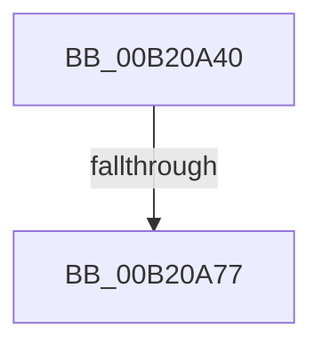

# sub_00B20A40

- RVA: `0x00B20A40`–`0x00B20B3D` (길이 `253` bytes)
- VA: `0x0000000140B20A40`
- 실행 섹션: `PAGE`
- PDB 이름 있음: `아니요`; PDB Function 태그: `아니요`
- unwind 정보 RVA: `0x000889C8`
- 디코드: `62`개 명령, `253/253` bytes 표시
- 미해석 바이트: `0` (있으면 어셈블리에 `.byte`로 보존)

> 이 문서는 커널 이미지의 기계어와 PDB 기호를 분석해 생성했습니다. 4번과 5번은 함수 원형과 자료형을 바이너리 사용 방식에서 추정한 C 해석이며 원본 소스 복구 결과는 아닙니다.

## 1. Dependencies

- 직접 호출 지점: **8**; 고유 호출 대상: **8**
- 직접 호출자로 확인된 함수: **0**
- RIP 상대 이미지 참조: **2**

### Outgoing calls
- `0x00B20A48` → [PsReferencePrimaryTokenWithTag](../../text/20/PsReferencePrimaryTokenWithTag_function_0020FF80.md) (function, `0x0020FF80`)
- `0x00B20A53` → [SeTokenIsAdmin](../9F/SeTokenIsAdmin_function_009FE650.md) (function, `0x009FE650`)
- `0x00B20A6A` → [ObFastDereferenceObject](../../text/3E/ObFastDereferenceObject_function_003ED5F0.md) (function, `0x003ED5F0`)
- `0x00B20A84` → [EtwpTiFillProcessIdentity](../../text/3B/EtwpTiFillProcessIdentity_function_003B8F30.md) (function, `0x003B8F30`)
- `0x00B20A9D` → [EtwpTiFillThreadIdentity](../../text/47/EtwpTiFillThreadIdentity_function_00471C1C.md) (function, `0x00471C1C`)
- `0x00B20AA7` → [PsGetProcessSessionId](../../text/22/PsGetProcessSessionId_function_002233A0.md) (function, `0x002233A0`)
- `0x00B20AEE` → [RtlIsSandboxedToken](../8B/RtlIsSandboxedToken_function_008B3AB0.md) (function, `0x008B3AB0`)
- `0x00B20B32` → [EtwWrite](../../text/41/EtwWrite_function_0041C720.md) (function, `0x0041C720`)

### Direct callers
- 이 함수 시작 RVA로 연결되는 직접 call은 확인되지 않았습니다. 간접 호출은 완전히 역산할 수 없습니다.

### Static image references
- `0x00B20B05` → RVA `0x000118A0` (`.rdata`; read)
- `0x00B20B19` → RVA `0x00EFFA30` (`.data`; read)

## 2. Other-region calls and transfers

- 다른 실행 섹션으로 향하는 call: **6**
  - `0x00B20A48` → [PsReferencePrimaryTokenWithTag](../../text/20/PsReferencePrimaryTokenWithTag_function_0020FF80.md) (`PAGE` → `.text`)
  - `0x00B20A6A` → [ObFastDereferenceObject](../../text/3E/ObFastDereferenceObject_function_003ED5F0.md) (`PAGE` → `.text`)
  - `0x00B20A84` → [EtwpTiFillProcessIdentity](../../text/3B/EtwpTiFillProcessIdentity_function_003B8F30.md) (`PAGE` → `.text`)
  - `0x00B20A9D` → [EtwpTiFillThreadIdentity](../../text/47/EtwpTiFillThreadIdentity_function_00471C1C.md) (`PAGE` → `.text`)
  - `0x00B20AA7` → [PsGetProcessSessionId](../../text/22/PsGetProcessSessionId_function_002233A0.md) (`PAGE` → `.text`)
  - `0x00B20B32` → [EtwWrite](../../text/41/EtwWrite_function_0041C720.md) (`PAGE` → `.text`)
- call이 아닌 외부 분기/꼬리 이동: **2**
  - `0x00B20A71` → [EtwTiLogSyscallUsage + 0x67](../90/EtwTiLogSyscallUsage_function_00903890.md) (`tail-transfer`)
  - `0x00B20B38` → [EtwTiLogSyscallUsage + 0x67](../90/EtwTiLogSyscallUsage_function_00903890.md) (`tail-transfer`)

## 3. Assembly (complete function range)

```asm
00B20A40  BA 44 66 6C 74                  mov edx, 0x746c6644
00B20A45  48 8B CE                        mov rcx, rsi
00B20A48  E8 33 F5 6E FF                  call 0x14020ff80
00B20A4D  48 8B C8                        mov rcx, rax
00B20A50  48 8B F8                        mov rdi, rax
00B20A53  E8 F8 DB ED FF                  call 0x1409fe650
00B20A58  48 8D 8E 48 02 00 00            lea rcx, [rsi + 0x248]
00B20A5F  41 B8 44 66 6C 74               mov r8d, 0x746c6644
00B20A65  48 8B D7                        mov rdx, rdi
00B20A68  8A D8                           mov bl, al
00B20A6A  E8 81 CB 8C FF                  call 0x1403ed5f0
00B20A6F  84 DB                           test bl, bl
00B20A71  0F 85 80 2E DE FF               jne 0x1409038f7
00B20A77  4C 8D 44 24 48                  lea r8, [rsp + 0x48]
00B20A7C  48 8B D6                        mov rdx, rsi
00B20A7F  48 8D 4C 24 50                  lea rcx, [rsp + 0x50]
00B20A84  E8 A7 84 89 FF                  call 0x1403b8f30
00B20A89  44 8B C0                        mov r8d, eax
00B20A8C  48 8D 4C 24 50                  lea rcx, [rsp + 0x50]
00B20A91  49 C1 E0 04                     shl r8, 4
00B20A95  49 8B D7                        mov rdx, r15
00B20A98  49 03 C8                        add rcx, r8
00B20A9B  8B D8                           mov ebx, eax
00B20A9D  E8 7A 11 95 FF                  call 0x140471c1c
00B20AA2  48 8B CE                        mov rcx, rsi
00B20AA5  03 D8                           add ebx, eax
00B20AA7  E8 F4 28 70 FF                  call 0x1402233a0
00B20AAC  89 44 24 40                     mov dword ptr [rsp + 0x40], eax
00B20AB0  BA 04 00 00 00                  mov edx, 4
00B20AB5  8B CB                           mov ecx, ebx
00B20AB7  48 8D 44 24 40                  lea rax, [rsp + 0x40]
00B20ABC  48 03 C9                        add rcx, rcx
00B20ABF  FF C3                           inc ebx
00B20AC1  83 64 CC 5C 00                  and dword ptr [rsp + rcx*8 + 0x5c], 0
00B20AC6  48 89 44 CC 50                  mov qword ptr [rsp + rcx*8 + 0x50], rax
00B20ACB  89 54 CC 58                     mov dword ptr [rsp + rcx*8 + 0x58], edx
00B20ACF  48 8D 4C 24 38                  lea rcx, [rsp + 0x38]
00B20AD4  8B C3                           mov eax, ebx
00B20AD6  FF C3                           inc ebx
00B20AD8  48 03 C0                        add rax, rax
00B20ADB  83 64 C4 5C 00                  and dword ptr [rsp + rax*8 + 0x5c], 0
00B20AE0  48 89 4C C4 50                  mov qword ptr [rsp + rax*8 + 0x50], rcx
00B20AE5  33 C9                           xor ecx, ecx
00B20AE7  89 54 C4 58                     mov dword ptr [rsp + rax*8 + 0x58], edx
00B20AEB  41 8A D6                        mov dl, r14b
00B20AEE  E8 BD 2F D9 FF                  call 0x1408b3ab0
00B20AF3  88 44 24 30                     mov byte ptr [rsp + 0x30], al
00B20AF7  48 8D 4C 24 30                  lea rcx, [rsp + 0x30]
00B20AFC  8B C3                           mov eax, ebx
00B20AFE  44 8D 4B 01                     lea r9d, [rbx + 1]
00B20B02  48 03 C0                        add rax, rax
00B20B05  48 8D 15 94 0D 4F FF            lea rdx, [rip - 0xb0f26c]
00B20B0C  45 33 C0                        xor r8d, r8d
00B20B0F  83 64 C4 5C 00                  and dword ptr [rsp + rax*8 + 0x5c], 0
00B20B14  48 89 4C C4 50                  mov qword ptr [rsp + rax*8 + 0x50], rcx
00B20B19  48 8B 0D 10 EF 3D 00            mov rcx, qword ptr [rip + 0x3def10]
00B20B20  C7 44 C4 58 01 00 00 00         mov dword ptr [rsp + rax*8 + 0x58], 1
00B20B28  48 8D 44 24 50                  lea rax, [rsp + 0x50]
00B20B2D  48 89 44 24 20                  mov qword ptr [rsp + 0x20], rax
00B20B32  E8 E9 BB 8F FF                  call 0x14041c720
00B20B37  90                              nop
00B20B38  E9 BA 2D DE FF                  jmp 0x1409038f7
```

## 4. C-style interpretation (structured pseudocode)

```c
__int64 __fastcall sub_00B20A40(__int64 a1, __int64 a2, __int64 a3, __int64 a4, __int64 a5, __int64 a6, __int64 a7, __int64 a8, __int64 a9, __int64 a10)
{
    __int64 result;
    __int64 v_rbx;
    unsigned __int64 v_stack_p20;
    unsigned __int8 v_stack_p30;
    unsigned int v_stack_p40;

    result = PsReferencePrimaryTokenWithTag(v_rsi, (unsigned int)(0x746C6644ULL), a3, a4);
    result = SeTokenIsAdmin(result, (unsigned int)(0x746C6644ULL), a3, a4);
    result = ObFastDereferenceObject(v_rsi + 584, result, (unsigned int)(0x746C6644ULL), a4);
    result = EtwpTiFillProcessIdentity(a10, v_rsi, a9, a4);
    a3 = ((unsigned int)((unsigned int)(result))) << (4);
    a1 = (a10) + (a3);
    result = EtwpTiFillThreadIdentity(a1, v_r15, a3, a4);
    v_rbx = (unsigned int)(((unsigned int)((unsigned int)(result))) + ((unsigned int)(result)));
    result = PsGetProcessSessionId(v_rsi, v_r15, a3, a4);
    v_stack_p40 = (unsigned int)(result);
    a1 = ((unsigned int)((unsigned int)(v_rbx))) + ((unsigned int)((unsigned int)(v_rbx)));
    v_rbx = (unsigned int)((v_rbx) + 1);
    *(unsigned __int64 *)(v_rsp + a1 * 8 + 80) = a8;
    *(unsigned int *)(v_rsp + a1 * 8 + 88) = 4;
    v_rbx = (unsigned int)((v_rbx) + 1);
    result = ((unsigned int)((unsigned int)(v_rbx))) + ((unsigned int)((unsigned int)(v_rbx)));
    *(unsigned __int64 *)(v_rsp + result * 8 + 80) = a7;
    a1 = 0;
    *(unsigned int *)(v_rsp + result * 8 + 88) = 4;
    result = RtlIsSandboxedToken(a1, (unsigned __int8)(v_r14), a3, a4);
    v_stack_p30 = (unsigned __int8)(result);
    result = ((unsigned int)((unsigned int)(v_rbx))) + ((unsigned int)((unsigned int)(v_rbx)));
    a3 = 0;
    *(unsigned __int64 *)(v_rsp + result * 8 + 80) = a6;
    *(unsigned int *)(v_rsp + result * 8 + 88) = 1;
    v_stack_p20 = a10;
    result = EtwWrite(*(unsigned __int64 *)(v_rip + 4058896), v_rip - 11596396, a3, v_rbx + 1);
}
```

## 5. (Beta) C Style

```c
int64_t sub_00B20A40(int64_t Arg1, int64_t Arg2, int64_t Arg3, int64_t Arg4, uint64_t Arg5, int64_t Arg6, int64_t Arg7, int64_t Arg8, int64_t Arg9, int64_t Arg10)
{
    int64_t result;
    int64_t local_rbx;
    uint64_t v_stack_p20;
    uint8_t v_stack_p30;
    uint32_t v_stack_p40;

    result = PsReferencePrimaryTokenWithTag(local_rsi, (uint32_t)(0x746C6644ULL), Arg3, Arg4);
    result = SeTokenIsAdmin(result, (uint32_t)(0x746C6644ULL), Arg3, Arg4);
    result = ObFastDereferenceObject(local_rsi + 584, result, (uint32_t)(0x746C6644ULL), Arg4);
    result = EtwpTiFillProcessIdentity(Arg10, local_rsi, Arg9, Arg4);
    Arg3 = ((uint32_t)((uint32_t)(result))) << (4);
    Arg1 = (Arg10) + (Arg3);
    result = EtwpTiFillThreadIdentity(Arg1, local_r15, Arg3, Arg4);
    local_rbx = (uint32_t)(((uint32_t)((uint32_t)(result))) + ((uint32_t)(result)));
    result = PsGetProcessSessionId(local_rsi, local_r15, Arg3, Arg4);
    v_stack_p40 = (uint32_t)(result);
    Arg1 = ((uint32_t)((uint32_t)(local_rbx))) + ((uint32_t)((uint32_t)(local_rbx)));
    local_rbx = (uint32_t)((local_rbx) + 1);
    *(uint64_t *)(local_rsp + Arg1 * 8 + 0x50) = Arg8;
    *(uint32_t *)(local_rsp + Arg1 * 8 + 0x58) = 4;
    local_rbx = (uint32_t)((local_rbx) + 1);
    result = ((uint32_t)((uint32_t)(local_rbx))) + ((uint32_t)((uint32_t)(local_rbx)));
    *(uint64_t *)(local_rsp + result * 8 + 0x50) = Arg7;
    Arg1 = 0;
    *(uint32_t *)(local_rsp + result * 8 + 0x58) = 4;
    result = RtlIsSandboxedToken(Arg1, (uint8_t)(local_r14), Arg3, Arg4);
    v_stack_p30 = (uint8_t)(result);
    result = ((uint32_t)((uint32_t)(local_rbx))) + ((uint32_t)((uint32_t)(local_rbx)));
    Arg3 = 0;
    *(uint64_t *)(local_rsp + result * 8 + 0x50) = Arg6;
    *(uint32_t *)(local_rsp + result * 8 + 0x58) = 1;
    v_stack_p20 = Arg10;
    result = EtwWrite(*(uint64_t *)(v_rip + 0x3DEF10), v_rip - 11596396, Arg3, local_rbx + 1);
}
```

## 6. Execution-region graph

[열기: 2D/3D 그래프와 함수 탐색 컨트롤 패널](../../../control-panel.html?section=page&rva=0x00B20A40&view=graph)

- 2D 그래프는 위에서 아래로 흐르고, 3D 그래프는 빈 공간을 드래그해 회전합니다. Shift+드래그는 이동, 휠은 확대·축소, 함수 노드 선택은 대상 보고서 이동입니다.

### Static fallback


