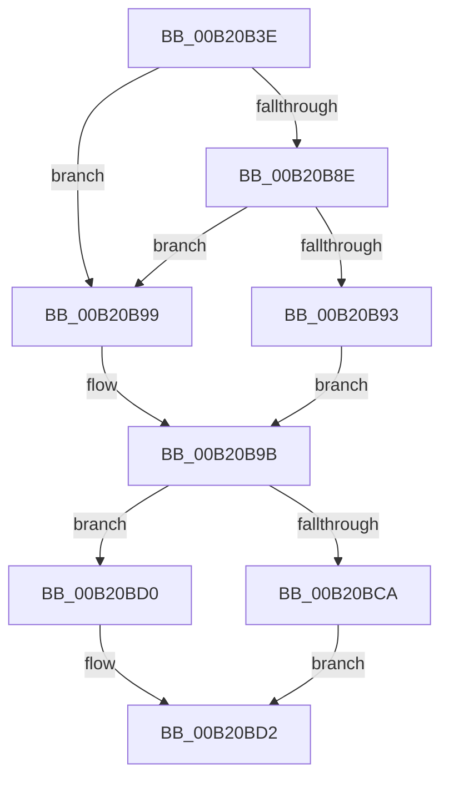

# sub_00B20B3E

- RVA: `0x00B20B3E`–`0x00B20C43` (길이 `261` bytes)
- VA: `0x0000000140B20B3E`
- 실행 섹션: `PAGE`
- PDB 이름 있음: `아니요`; PDB Function 태그: `아니요`
- unwind 정보 RVA: `0x00088A64`
- 디코드: `67`개 명령, `261/261` bytes 표시
- 미해석 바이트: `0` (있으면 어셈블리에 `.byte`로 보존)

> 이 문서는 커널 이미지의 기계어와 PDB 기호를 분석해 생성했습니다. 4번과 5번은 함수 원형과 자료형을 바이너리 사용 방식에서 추정한 C 해석이며 원본 소스 복구 결과는 아닙니다.

## 1. Dependencies

- 직접 호출 지점: **3**; 고유 호출 대상: **2**
- 직접 호출자로 확인된 함수: **0**
- RIP 상대 이미지 참조: **2**

### Outgoing calls
- `0x00B20B84` → [tlgCreate1Sz_wchar_t](../../text/42/tlgCreate1Sz_wchar_t_function_00426198.md) (function, `0x00426198`)
- `0x00B20BC0` → [tlgCreate1Sz_wchar_t](../../text/42/tlgCreate1Sz_wchar_t_function_00426198.md) (function, `0x00426198`)
- `0x00B20C38` → [tlgWriteTransfer_EtwWriteTransfer](../../text/42/tlgWriteTransfer_EtwWriteTransfer_function_004260E0.md) (function, `0x004260E0`)

### Direct callers
- 이 함수 시작 RVA로 연결되는 직접 call은 확인되지 않았습니다. 간접 호출은 완전히 역산할 수 없습니다.

### Static image references
- `0x00B20BD6` → RVA `0x00048C38` (`.rdata`; read)
- `0x00B20BE1` → RVA `0x00E074D8` (`.data`; read)

## 2. Other-region calls and transfers

- 다른 실행 섹션으로 향하는 call: **3**
  - `0x00B20B84` → [tlgCreate1Sz_wchar_t](../../text/42/tlgCreate1Sz_wchar_t_function_00426198.md) (`PAGE` → `.text`)
  - `0x00B20BC0` → [tlgCreate1Sz_wchar_t](../../text/42/tlgCreate1Sz_wchar_t_function_00426198.md) (`PAGE` → `.text`)
  - `0x00B20C38` → [tlgWriteTransfer_EtwWriteTransfer](../../text/42/tlgWriteTransfer_EtwWriteTransfer_function_004260E0.md) (`PAGE` → `.text`)
- call이 아닌 외부 분기/꼬리 이동: **1**
  - `0x00B20C3E` → [PfSnEndProcessTrace + 0x8C](../90/PfSnEndProcessTrace_function_00903E04.md) (`tail-transfer`)

## 3. Assembly (complete function range)

```asm
00B20B3E  83 64 24 7C 00                  and dword ptr [rsp + 0x7c], 0
00B20B43  48 8D 44 24 48                  lea rax, [rsp + 0x48]
00B20B48  48 89 44 24 70                  mov qword ptr [rsp + 0x70], rax
00B20B4D  48 85 DB                        test rbx, rbx
00B20B50  4C 8B CB                        mov r9, rbx
00B20B53  4C 89 7C 24 48                  mov qword ptr [rsp + 0x48], r15
00B20B58  4C 0F 45 CB                     cmovne r9, rbx
00B20B5C  C7 44 24 78 08 00 00 00         mov dword ptr [rsp + 0x78], 8
00B20B64  49 83 C1 18                     add r9, 0x18
00B20B68  48 8B C3                        mov rax, rbx
00B20B6B  48 F7 D8                        neg rax
00B20B6E  48 1B C9                        sbb rcx, rcx
00B20B71  49 23 C9                        and rcx, r9
00B20B74  48 8B C1                        mov rax, rcx
00B20B77  48 F7 D8                        neg rax
00B20B7A  48 1B D2                        sbb rdx, rdx
00B20B7D  48 23 D1                        and rdx, rcx
00B20B80  48 8D 4D 80                     lea rcx, [rbp - 0x80]
00B20B84  E8 0F 56 90 FF                  call 0x140426198
00B20B89  48 85 DB                        test rbx, rbx
00B20B8C  74 0B                           je 0x140b20b99
00B20B8E  4D 85 C9                        test r9, r9
00B20B91  74 06                           je 0x140b20b99
00B20B93  41 8B 41 3C                     mov eax, dword ptr [r9 + 0x3c]
00B20B97  EB 02                           jmp 0x140b20b9b
00B20B99  33 C0                           xor eax, eax
00B20B9B  83 65 9C 00                     and dword ptr [rbp - 0x64], 0
00B20B9F  48 8D 4D A0                     lea rcx, [rbp - 0x60]
00B20BA3  89 44 24 30                     mov dword ptr [rsp + 0x30], eax
00B20BA7  48 8D 44 24 30                  lea rax, [rsp + 0x30]
00B20BAC  48 89 45 90                     mov qword ptr [rbp - 0x70], rax
00B20BB0  49 8B C6                        mov rax, r14
00B20BB3  48 F7 D8                        neg rax
00B20BB6  44 89 55 98                     mov dword ptr [rbp - 0x68], r10d
00B20BBA  48 1B D2                        sbb rdx, rdx
00B20BBD  49 23 D6                        and rdx, r14
00B20BC0  E8 D3 55 90 FF                  call 0x140426198
00B20BC5  4D 85 F6                        test r14, r14
00B20BC8  74 06                           je 0x140b20bd0
00B20BCA  41 8B 46 3C                     mov eax, dword ptr [r14 + 0x3c]
00B20BCE  EB 02                           jmp 0x140b20bd2
00B20BD0  33 C0                           xor eax, eax
00B20BD2  83 65 BC 00                     and dword ptr [rbp - 0x44], 0
00B20BD6  48 8D 15 5B 80 52 FF            lea rdx, [rip - 0xad7fa5]
00B20BDD  83 65 CC 00                     and dword ptr [rbp - 0x34], 0
00B20BE1  48 8D 0D F0 68 2E 00            lea rcx, [rip + 0x2e68f0]
00B20BE8  83 65 DC 00                     and dword ptr [rbp - 0x24], 0
00B20BEC  45 33 C9                        xor r9d, r9d
00B20BEF  89 44 24 34                     mov dword ptr [rsp + 0x34], eax
00B20BF3  45 33 C0                        xor r8d, r8d
00B20BF6  48 8D 44 24 34                  lea rax, [rsp + 0x34]
00B20BFB  44 89 55 B8                     mov dword ptr [rbp - 0x48], r10d
00B20BFF  48 89 45 B0                     mov qword ptr [rbp - 0x50], rax
00B20C03  48 8D 44 24 38                  lea rax, [rsp + 0x38]
00B20C08  48 89 45 C0                     mov qword ptr [rbp - 0x40], rax
00B20C0C  48 8D 44 24 40                  lea rax, [rsp + 0x40]
00B20C11  48 89 45 D0                     mov qword ptr [rbp - 0x30], rax
00B20C15  48 8D 44 24 50                  lea rax, [rsp + 0x50]
00B20C1A  48 89 44 24 28                  mov qword ptr [rsp + 0x28], rax
00B20C1F  C7 44 24 20 09 00 00 00         mov dword ptr [rsp + 0x20], 9
00B20C27  89 74 24 38                     mov dword ptr [rsp + 0x38], esi
00B20C2B  44 89 55 C8                     mov dword ptr [rbp - 0x38], r10d
00B20C2F  44 89 64 24 40                  mov dword ptr [rsp + 0x40], r12d
00B20C34  44 89 55 D8                     mov dword ptr [rbp - 0x28], r10d
00B20C38  E8 A3 54 90 FF                  call 0x1404260e0
00B20C3D  90                              nop
00B20C3E  E9 4D 32 DE FF                  jmp 0x140903e90
```

## 4. C-style interpretation (structured pseudocode)

```c
__int64 __fastcall sub_00B20B3E(__int64 a1, __int64 a2, int a3, __int64 a4, __int64 a5, __int64 a6, __int64 a7, __int64 a8, __int64 a9, __int64 a10)
{
    __int64 result;
    unsigned int v_stack_p20;
    unsigned __int64 v_stack_p28;
    unsigned int v_stack_p30;
    unsigned int v_stack_p34;
    unsigned int v_stack_p38;
    unsigned int v_stack_p40;
    unsigned __int64 v_stack_p48;
    unsigned __int64 v_stack_p70;
    unsigned int v_stack_p78;
    unsigned int v_stack_p7C;

    v_stack_p70 = a9;
    v_stack_p48 = v_r15;
    a4 = v_rbx;
    if (v_rbx != 0) { a4 = v_rbx; }
    v_stack_p78 = 8;
    a4 = (a4) + (24);
    result = -(v_rbx);
    a1 = (a1) & (a4);
    result = -(a1);
    a2 = (a2) & (a1);
    result = tlgCreate1Sz_wchar_t(v_rbp - 128, a2, a3, a4);
    if (v_rbx == 0) goto loc_00B20B99;
    if (a4 == 0) goto loc_00B20B99;
    goto loc_00B20B9B;
loc_00B20B99:
    result = 0;
loc_00B20B9B:
    v_stack_p30 = 0;
    *(unsigned __int64 *)(v_rbp - 112) = a6;
    result = -(v_r14);
    *(unsigned int *)(v_rbp - 104) = (unsigned int)(v_r10);
    a2 = (a2) & (v_r14);
    result = tlgCreate1Sz_wchar_t(v_rbp - 96, a2, a3, a4);
    if (v_r14 == 0) goto loc_00B20BD0;
    goto loc_00B20BD2;
loc_00B20BD0:
    result = 0;
loc_00B20BD2:
    a4 = 0;
    v_stack_p34 = 0;
    a3 = 0;
    *(unsigned int *)(v_rbp - 72) = (unsigned int)(v_r10);
    *(unsigned __int64 *)(v_rbp - 80) = v_stack_p34;
    *(unsigned __int64 *)(v_rbp - 64) = a7;
    *(unsigned __int64 *)(v_rbp - 48) = a8;
    v_stack_p28 = a10;
    v_stack_p20 = 9;
    v_stack_p38 = (unsigned int)(v_rsi);
    *(unsigned int *)(v_rbp - 56) = (unsigned int)(v_r10);
    v_stack_p40 = (unsigned int)(v_r12);
    *(unsigned int *)(v_rbp - 40) = (unsigned int)(v_r10);
    result = tlgWriteTransfer_EtwWriteTransfer(v_rip + 3041520, v_rip - 11370405, a3, a4);
}
```

## 5. (Beta) C Style

```c
int64_t sub_00B20B3E(int64_t Arg1, int64_t Arg2, int32_t Arg3, int64_t Arg4, uint64_t Arg5, int64_t Arg6, int64_t Arg7, int64_t Arg8, int64_t Arg9, int64_t Arg10)
{
    int64_t result;
    uint32_t v_stack_p20;
    uint64_t v_stack_p28;
    uint32_t v_stack_p30;
    uint32_t v_stack_p34;
    uint32_t v_stack_p38;
    uint32_t v_stack_p40;
    uint64_t v_stack_p48;
    uint64_t v_stack_p70;
    uint32_t v_stack_p78;
    uint32_t v_stack_p7C;

    v_stack_p70 = Arg9;
    v_stack_p48 = local_r15;
    Arg4 = local_rbx;
    if (local_rbx != 0) { Arg4 = local_rbx; }
    v_stack_p78 = 8;
    Arg4 = (Arg4) + (24);
    result = -(local_rbx);
    Arg1 = (Arg1) & (Arg4);
    result = -(Arg1);
    Arg2 = (Arg2) & (Arg1);
    result = tlgCreate1Sz_wchar_t(local_rbp - 128, Arg2, Arg3, Arg4);
    if (local_rbx == 0) goto loc_00B20B99;
    if (Arg4 == 0) goto loc_00B20B99;
    goto loc_00B20B9B;
loc_00B20B99:
    result = 0;
loc_00B20B9B:
    v_stack_p30 = 0;
    *(uint64_t *)(local_rbp - 0x70) = Arg6;
    result = -(local_r14);
    *(uint32_t *)(local_rbp - 0x68) = (uint32_t)(local_r10);
    Arg2 = (Arg2) & (local_r14);
    result = tlgCreate1Sz_wchar_t(local_rbp - 96, Arg2, Arg3, Arg4);
    if (local_r14 == 0) goto loc_00B20BD0;
    goto loc_00B20BD2;
loc_00B20BD0:
    result = 0;
loc_00B20BD2:
    Arg4 = 0;
    v_stack_p34 = 0;
    Arg3 = 0;
    *(uint32_t *)(local_rbp - 0x48) = (uint32_t)(local_r10);
    *(uint64_t *)(local_rbp - 0x50) = v_stack_p34;
    *(uint64_t *)(local_rbp - 0x40) = Arg7;
    *(uint64_t *)(local_rbp - 0x30) = Arg8;
    v_stack_p28 = Arg10;
    v_stack_p20 = 9;
    v_stack_p38 = (uint32_t)(local_rsi);
    *(uint32_t *)(local_rbp - 0x38) = (uint32_t)(local_r10);
    v_stack_p40 = (uint32_t)(local_r12);
    *(uint32_t *)(local_rbp - 0x28) = (uint32_t)(local_r10);
    result = tlgWriteTransfer_EtwWriteTransfer(v_rip + 3041520, v_rip - 11370405, Arg3, Arg4);
}
```

## 6. Execution-region graph

[열기: 2D/3D 그래프와 함수 탐색 컨트롤 패널](../../../control-panel.html?section=page&rva=0x00B20B3E&view=graph)

- 2D 그래프는 위에서 아래로 흐르고, 3D 그래프는 빈 공간을 드래그해 회전합니다. Shift+드래그는 이동, 휠은 확대·축소, 함수 노드 선택은 대상 보고서 이동입니다.

### Static fallback


