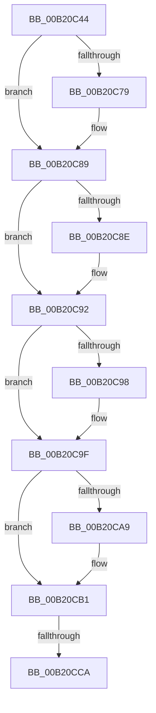

# sub_00B20C44

- RVA: `0x00B20C44`–`0x00B20CE6` (길이 `162` bytes)
- VA: `0x0000000140B20C44`
- 실행 섹션: `PAGE`
- PDB 이름 있음: `아니요`; PDB Function 태그: `아니요`
- unwind 정보 RVA: `0x00088A74`
- 디코드: `45`개 명령, `162/162` bytes 표시
- 미해석 바이트: `0` (있으면 어셈블리에 `.byte`로 보존)

> 이 문서는 커널 이미지의 기계어와 PDB 기호를 분석해 생성했습니다. 4번과 5번은 함수 원형과 자료형을 바이너리 사용 방식에서 추정한 C 해석이며 원본 소스 복구 결과는 아닙니다.

## 1. Dependencies

- 직접 호출 지점: **7**; 고유 호출 대상: **7**
- 직접 호출자로 확인된 함수: **0**
- RIP 상대 이미지 참조: **0**

### Outgoing calls
- `0x00B20C64` → [KeAbPreAcquire](../../text/21/KeAbPreAcquire_function_00210230.md) (function, `0x00210230`)
- `0x00B20C84` → [ExfAcquirePushLockSharedEx](../../text/21/ExfAcquirePushLockSharedEx_function_0021044C.md) (function, `0x0021044C`)
- `0x00B20CAC` → [ExfReleasePushLockShared](../../text/26/ExfReleasePushLockShared_function_00263440.md) (function, `0x00263440`)
- `0x00B20CB4` → [KeAbPostRelease](../../text/2E/KeAbPostRelease_function_002E1600.md) (function, `0x002E1600`)
- `0x00B20CBC` → [KeLeaveCriticalRegionThread](../../text/25/KeLeaveCriticalRegionThread_function_0025EFF0.md) (function, `0x0025EFF0`)
- `0x00B20CD3` → [DbgkpRemoveErrorPort](../71/DbgkpRemoveErrorPort_function_00711038.md) (function, `0x00711038`)
- `0x00B20CDB` → [DbgkpDereferenceErrorPort](../../text/57/DbgkpDereferenceErrorPort_function_0057FD58.md) (function, `0x0057FD58`)

### Direct callers
- 이 함수 시작 RVA로 연결되는 직접 call은 확인되지 않았습니다. 간접 호출은 완전히 역산할 수 없습니다.

### Static image references
- 디코드된 RIP-relative 메모리 참조가 없습니다.

## 2. Other-region calls and transfers

- 다른 실행 섹션으로 향하는 call: **6**
  - `0x00B20C64` → [KeAbPreAcquire](../../text/21/KeAbPreAcquire_function_00210230.md) (`PAGE` → `.text`)
  - `0x00B20C84` → [ExfAcquirePushLockSharedEx](../../text/21/ExfAcquirePushLockSharedEx_function_0021044C.md) (`PAGE` → `.text`)
  - `0x00B20CAC` → [ExfReleasePushLockShared](../../text/26/ExfReleasePushLockShared_function_00263440.md) (`PAGE` → `.text`)
  - `0x00B20CB4` → [KeAbPostRelease](../../text/2E/KeAbPostRelease_function_002E1600.md) (`PAGE` → `.text`)
  - `0x00B20CBC` → [KeLeaveCriticalRegionThread](../../text/25/KeLeaveCriticalRegionThread_function_0025EFF0.md) (`PAGE` → `.text`)
  - `0x00B20CDB` → [DbgkpDereferenceErrorPort](../../text/57/DbgkpDereferenceErrorPort_function_0057FD58.md) (`PAGE` → `.text`)
- call이 아닌 외부 분기/꼬리 이동: **2**
  - `0x00B20CC4` → [DbgkFlushErrorPort + 0x37](../90/DbgkFlushErrorPort_function_00903FA4.md) (`tail-transfer`)
  - `0x00B20CE1` → [DbgkFlushErrorPort + 0x37](../90/DbgkFlushErrorPort_function_00903FA4.md) (`tail-transfer`)

## 3. Assembly (complete function range)

```asm
00B20C44  65 4C 8B 34 25 88 01 00 00      mov r14, qword ptr gs:[0x188]
00B20C4D  45 33 FF                        xor r15d, r15d
00B20C50  45 33 C0                        xor r8d, r8d
00B20C53  33 D2                           xor edx, edx
00B20C55  48 8B CB                        mov rcx, rbx
00B20C58  41 8B FF                        mov edi, r15d
00B20C5B  66 41 FF 8E E4 01 00 00         dec word ptr [r14 + 0x1e4]
00B20C63  90                              nop
00B20C64  E8 C7 F5 6E FF                  call 0x140210230
00B20C69  48 8B E8                        mov rbp, rax
00B20C6C  45 8D 67 11                     lea r12d, [r15 + 0x11]
00B20C70  33 C0                           xor eax, eax
00B20C72  F0 4C 0F B1 23                  lock cmpxchg qword ptr [rbx], r12
00B20C77  74 10                           je 0x140b20c89
00B20C79  4C 8B CB                        mov r9, rbx
00B20C7C  4C 8B C5                        mov r8, rbp
00B20C7F  33 D2                           xor edx, edx
00B20C81  48 8B CB                        mov rcx, rbx
00B20C84  E8 C3 F7 6E FF                  call 0x14021044c
00B20C89  48 85 ED                        test rbp, rbp
00B20C8C  74 04                           je 0x140b20c92
00B20C8E  C6 45 0A 01                     mov byte ptr [rbp + 0xa], 1
00B20C92  48 3B 73 10                     cmp rsi, qword ptr [rbx + 0x10]
00B20C96  75 07                           jne 0x140b20c9f
00B20C98  48 8B 7B 08                     mov rdi, qword ptr [rbx + 8]
00B20C9C  F0 FF 07                        lock inc dword ptr [rdi]
00B20C9F  49 8B C4                        mov rax, r12
00B20CA2  F0 4C 0F B1 3B                  lock cmpxchg qword ptr [rbx], r15
00B20CA7  74 08                           je 0x140b20cb1
00B20CA9  48 8B CB                        mov rcx, rbx
00B20CAC  E8 8F 27 74 FF                  call 0x140263440
00B20CB1  48 8B CB                        mov rcx, rbx
00B20CB4  E8 47 09 7C FF                  call 0x1402e1600
00B20CB9  49 8B CE                        mov rcx, r14
00B20CBC  E8 2F E3 73 FF                  call 0x14025eff0
00B20CC1  48 85 FF                        test rdi, rdi
00B20CC4  0F 84 11 33 DE FF               je 0x140903fdb
00B20CCA  4C 8B C7                        mov r8, rdi
00B20CCD  48 8B D3                        mov rdx, rbx
00B20CD0  49 8B CE                        mov rcx, r14
00B20CD3  E8 60 03 BF FF                  call 0x140711038
00B20CD8  48 8B CF                        mov rcx, rdi
00B20CDB  E8 78 F0 A5 FF                  call 0x14057fd58
00B20CE0  90                              nop
00B20CE1  E9 F5 32 DE FF                  jmp 0x140903fdb
```

## 4. C-style interpretation (structured pseudocode)

```c
__int64 __fastcall sub_00B20C44(__int64 a1, int a2, int a3)
{
    __int64 result;
    __int64 v_r15;
    __int64 v_rdi;

    v_r15 = 0;
    a3 = 0;
    a2 = 0;
    result = KeAbPreAcquire(v_rbx, a2, a3, a4);
    result = 0;
    if (!(condition_is_equal)) {
        a4 = v_rbx;
        a3 = 0;
        a2 = 0;
        a1 = v_rbx;
        result = ExfAcquirePushLockSharedEx(a1, a2, a3, a4);
    }
    if (result != 0) {
        *(unsigned __int8 *)(result + 10) = 1;
    }
    v_rdi = 0;
    if (v_rsi == (*(unsigned __int64 *)(v_rbx + 16))) {
        v_rdi = *(unsigned __int64 *)(v_rbx + 8);
    }
    result = v_r15 + 17;
    if (v_rsi != (*(unsigned __int64 *)(v_rbx + 16))) {
        a1 = v_rbx;
        result = ExfReleasePushLockShared(a1, a2, a3, a4);
    }
    result = KeAbPostRelease(v_rbx, a2, a3, a4);
    result = KeLeaveCriticalRegionThread(*(unsigned __int64 *)(gs_base + (0 + 392)), a2, a3, a4);
    result = DbgkpRemoveErrorPort(*(unsigned __int64 *)(gs_base + (0 + 392)), v_rbx, v_rdi, a4);
    result = DbgkpDereferenceErrorPort(v_rdi, v_rbx, v_rdi, a4);
}
```

## 5. (Beta) C Style

```c
int64_t sub_00B20C44(int64_t Arg1, int32_t Arg2, int32_t Arg3)
{
    int64_t result;
    int64_t local_r15;
    int64_t local_rdi;

    local_r15 = 0;
    Arg3 = 0;
    Arg2 = 0;
    result = KeAbPreAcquire(local_rbx, Arg2, Arg3, a4);
    result = 0;
    if (!(condition_is_equal)) {
        a4 = local_rbx;
        Arg3 = 0;
        Arg2 = 0;
        Arg1 = local_rbx;
        result = ExfAcquirePushLockSharedEx(Arg1, Arg2, Arg3, a4);
    }
    if (result != 0) {
        *(uint8_t *)(result + 0xA) = 1;
    }
    local_rdi = 0;
    if (local_rsi == (*(uint64_t *)(local_rbx + 0x10))) {
        local_rdi = *(uint64_t *)(local_rbx + 0x8);
    }
    result = local_r15 + 17;
    if (local_rsi != (*(uint64_t *)(local_rbx + 0x10))) {
        Arg1 = local_rbx;
        result = ExfReleasePushLockShared(Arg1, Arg2, Arg3, a4);
    }
    result = KeAbPostRelease(local_rbx, Arg2, Arg3, a4);
    result = KeLeaveCriticalRegionThread(*(uint64_t *)(gs_base + (0 + 0x188)), Arg2, Arg3, a4);
    result = DbgkpRemoveErrorPort(*(uint64_t *)(gs_base + (0 + 0x188)), local_rbx, local_rdi, a4);
    result = DbgkpDereferenceErrorPort(local_rdi, local_rbx, local_rdi, a4);
}
```

## 6. Execution-region graph

[열기: 2D/3D 그래프와 함수 탐색 컨트롤 패널](../../../control-panel.html?section=page&rva=0x00B20C44&view=graph)

- 2D 그래프는 위에서 아래로 흐르고, 3D 그래프는 빈 공간을 드래그해 회전합니다. Shift+드래그는 이동, 휠은 확대·축소, 함수 노드 선택은 대상 보고서 이동입니다.

### Static fallback


