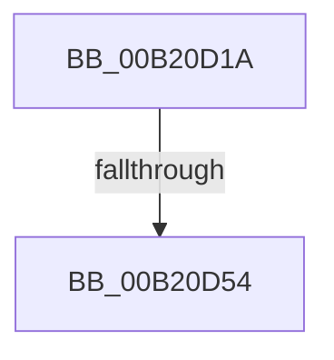

# sub_00B20D1A

- RVA: `0x00B20D1A`–`0x00B20D64` (길이 `74` bytes)
- VA: `0x0000000140B20D1A`
- 실행 섹션: `PAGE`
- PDB 이름 있음: `아니요`; PDB Function 태그: `아니요`
- unwind 정보 RVA: `0x00088B18`
- 디코드: `18`개 명령, `74/74` bytes 표시
- 미해석 바이트: `0` (있으면 어셈블리에 `.byte`로 보존)

> 이 문서는 커널 이미지의 기계어와 PDB 기호를 분석해 생성했습니다. 4번과 5번은 함수 원형과 자료형을 바이너리 사용 방식에서 추정한 C 해석이며 원본 소스 복구 결과는 아닙니다.

## 1. Dependencies

- 직접 호출 지점: **3**; 고유 호출 대상: **3**
- 직접 호출자로 확인된 함수: **0**
- RIP 상대 이미지 참조: **0**

### Outgoing calls
- `0x00B20D1F` → [SeCaptureSubjectContext](../86/SeCaptureSubjectContext_function_0086B820.md) (function, `0x0086B820`)
- `0x00B20D46` → [SepAdtIncorporatePerUserPolicy](../79/SepAdtIncorporatePerUserPolicy_function_0079FC18.md) (function, `0x0079FC18`)
- `0x00B20D59` → [SeReleaseSubjectContext](../86/SeReleaseSubjectContext_function_0086B710.md) (function, `0x0086B710`)

### Direct callers
- 이 함수 시작 RVA로 연결되는 직접 call은 확인되지 않았습니다. 간접 호출은 완전히 역산할 수 없습니다.

### Static image references
- 디코드된 RIP-relative 메모리 참조가 없습니다.

## 2. Other-region calls and transfers

- 다른 실행 섹션으로 향하는 call: **0**
- call이 아닌 외부 분기/꼬리 이동: **2**
  - `0x00B20D4E` → [SeAuditingWithTokenForSubcategory + 0x37](../90/SeAuditingWithTokenForSubcategory_function_009047D0.md) (`tail-transfer`)
  - `0x00B20D5F` → [SeAuditingWithTokenForSubcategory + 0x37](../90/SeAuditingWithTokenForSubcategory_function_009047D0.md) (`tail-transfer`)

## 3. Assembly (complete function range)

```asm
00B20D1A  48 8D 4C 24 30                  lea rcx, [rsp + 0x30]
00B20D1F  E8 FC AA D4 FF                  call 0x14086b820
00B20D24  48 8B 44 24 30                  mov rax, qword ptr [rsp + 0x30]
00B20D29  4C 8B 4C 24 40                  mov r9, qword ptr [rsp + 0x40]
00B20D2E  48 85 C0                        test rax, rax
00B20D31  4C 0F 45 C8                     cmovne r9, rax
00B20D35  48 8D 44 24 60                  lea rax, [rsp + 0x60]
00B20D3A  45 33 C0                        xor r8d, r8d
00B20D3D  B2 01                           mov dl, 1
00B20D3F  48 89 44 24 20                  mov qword ptr [rsp + 0x20], rax
00B20D44  8B CF                           mov ecx, edi
00B20D46  E8 CD EE C7 FF                  call 0x14079fc18
00B20D4B  48 85 DB                        test rbx, rbx
00B20D4E  0F 85 B3 3A DE FF               jne 0x140904807
00B20D54  48 8D 4C 24 30                  lea rcx, [rsp + 0x30]
00B20D59  E8 B2 A9 D4 FF                  call 0x14086b710
00B20D5E  90                              nop
00B20D5F  E9 A3 3A DE FF                  jmp 0x140904807
```

## 4. C-style interpretation (structured pseudocode)

```c
__int64 __fastcall sub_00B20D1A(__int64 a1, __int64 a2, int a3, __int64 a4, __int64 a5, __int64 a6, __int64 a7, __int64 a8, __int64 a9, __int64 a10, __int64 a11, __int64 a12)
{
    __int64 result;
    unsigned __int64 v_stack_p20;

    result = SeCaptureSubjectContext(a6, a2, a3, a4);
    if (a6 != 0) { a8 = a6; }
    a3 = 0;
    v_stack_p20 = a12;
    result = SepAdtIncorporatePerUserPolicy((unsigned int)((unsigned int)(v_rdi)), 1, a3, a8);
    result = SeReleaseSubjectContext(a6, 1, a3, a8);
}
```

## 5. (Beta) C Style

```c
int64_t sub_00B20D1A(int64_t Arg1, int64_t Arg2, int32_t Arg3, int64_t Arg4, uint64_t Arg5, int64_t Arg6, uint64_t Arg7, int64_t Arg8, uint64_t Arg9, uint64_t Arg10, uint64_t Arg11, int64_t Arg12)
{
    int64_t result;
    uint64_t v_stack_p20;

    result = SeCaptureSubjectContext(Arg6, Arg2, Arg3, Arg4);
    if (Arg6 != 0) { Arg8 = Arg6; }
    Arg3 = 0;
    v_stack_p20 = Arg12;
    result = SepAdtIncorporatePerUserPolicy((uint32_t)((uint32_t)(local_rdi)), 1, Arg3, Arg8);
    result = SeReleaseSubjectContext(Arg6, 1, Arg3, Arg8);
}
```

## 6. Execution-region graph

[열기: 2D/3D 그래프와 함수 탐색 컨트롤 패널](../../../control-panel.html?section=page&rva=0x00B20D1A&view=graph)

- 2D 그래프는 위에서 아래로 흐르고, 3D 그래프는 빈 공간을 드래그해 회전합니다. Shift+드래그는 이동, 휠은 확대·축소, 함수 노드 선택은 대상 보고서 이동입니다.

### Static fallback


