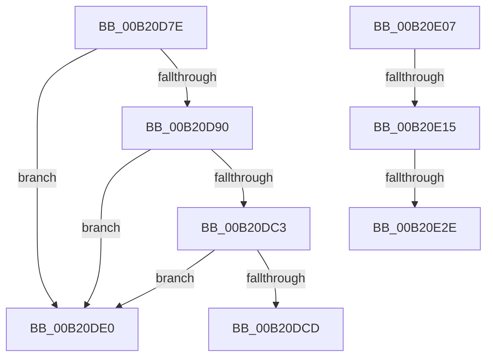

# sub_00B20D7E

- RVA: `0x00B20D7E`–`0x00B20E5A` (길이 `220` bytes)
- VA: `0x0000000140B20D7E`
- 실행 섹션: `PAGE`
- PDB 이름 있음: `아니요`; PDB Function 태그: `아니요`
- unwind 정보 RVA: `0x00088CCC`
- 디코드: `53`개 명령, `220/220` bytes 표시
- 미해석 바이트: `0` (있으면 어셈블리에 `.byte`로 보존)

> 이 문서는 커널 이미지의 기계어와 PDB 기호를 분석해 생성했습니다. 4번과 5번은 함수 원형과 자료형을 바이너리 사용 방식에서 추정한 C 해석이며 원본 소스 복구 결과는 아닙니다.

## 1. Dependencies

- 직접 호출 지점: **7**; 고유 호출 대상: **7**
- 직접 호출자로 확인된 함수: **0**
- RIP 상대 이미지 참조: **4**

### Outgoing calls
- `0x00B20D7E` → [PsAttachSiloToCurrentThread](../../text/44/PsAttachSiloToCurrentThread_function_004428C0.md) (function, `0x004428C0`)
- `0x00B20D86` → [HalAdjustResourceList](../../text/48/HalAdjustResourceList_function_0048FDC0.md) (function, `0x0048FDC0`)
- `0x00B20DD5` → [ObfDereferenceObjectWithTag](../../text/2F/ObfDereferenceObjectWithTag_function_002F78E0.md) (function, `0x002F78E0`)
- `0x00B20DF3` → [KeBugCheckEx](../../text/4F/KeBugCheckEx_function_004FD660.md) (function, `0x004FD660`)
- `0x00B20DFC` → [DbgkExitThread](../71/DbgkExitThread_function_00710A54.md) (function, `0x00710A54`)
- `0x00B20E31` → [PsGetProcessServerSilo](../../text/44/PsGetProcessServerSilo_function_0044BEE0.md) (function, `0x0044BEE0`)
- `0x00B20E4F` → [PspCatchCriticalBreak](../78/PspCatchCriticalBreak_function_00786408.md) (function, `0x00786408`)

### Direct callers
- 이 함수 시작 RVA로 연결되는 직접 call은 확인되지 않았습니다. 간접 호출은 완전히 역산할 수 없습니다.

### Static image references
- `0x00B20DA3` → RVA `0x00FC6E4C` (`ALMOSTRO`; read)
- `0x00B20DAF` → RVA `0x00FC7800` (`ALMOSTRO`; read)
- `0x00B20DBA` → RVA `0x00FC6C58` (`ALMOSTRO`; read)
- `0x00B20E48` → RVA `0x00B04F90` (` ?? ::NNGAKEGL::`string'`; read)

## 2. Other-region calls and transfers

- 다른 실행 섹션으로 향하는 call: **5**
  - `0x00B20D7E` → [PsAttachSiloToCurrentThread](../../text/44/PsAttachSiloToCurrentThread_function_004428C0.md) (`PAGE` → `.text`)
  - `0x00B20D86` → [HalAdjustResourceList](../../text/48/HalAdjustResourceList_function_0048FDC0.md) (`PAGE` → `.text`)
  - `0x00B20DD5` → [ObfDereferenceObjectWithTag](../../text/2F/ObfDereferenceObjectWithTag_function_002F78E0.md) (`PAGE` → `.text`)
  - `0x00B20DF3` → [KeBugCheckEx](../../text/4F/KeBugCheckEx_function_004FD660.md) (`PAGE` → `.text`)
  - `0x00B20E31` → [PsGetProcessServerSilo](../../text/44/PsGetProcessServerSilo_function_0044BEE0.md) (`PAGE` → `.text`)
- call이 아닌 외부 분기/꼬리 이동: **5**
  - `0x00B20DDB` → [PspExitThread + 0x1F5](../90/PspExitThread_function_00905F60.md) (`tail-transfer`)
  - `0x00B20E02` → [PspExitThread + 0x202](../90/PspExitThread_function_00905F60.md) (`tail-transfer`)
  - `0x00B20E0F` → [PspExitThread + 0x21C](../90/PspExitThread_function_00905F60.md) (`tail-transfer`)
  - `0x00B20E28` → [PspExitThread + 0x21C](../90/PspExitThread_function_00905F60.md) (`tail-transfer`)
  - `0x00B20E55` → [PspExitThread + 0x21C](../90/PspExitThread_function_00905F60.md) (`tail-transfer`)

## 3. Assembly (complete function range)

```asm
00B20D7E  E8 3D 1B 92 FF                  call 0x1404428c0
00B20D83  48 8B D8                        mov rbx, rax
00B20D86  E8 35 F0 96 FF                  call 0x14048fdc0
00B20D8B  48 3B D8                        cmp rbx, rax
00B20D8E  74 50                           je 0x140b20de0
00B20D90  48 8D 4B D0                     lea rcx, [rbx - 0x30]
00B20D94  48 C1 E9 08                     shr rcx, 8
00B20D98  44 0F B6 C1                     movzx r8d, cl
00B20D9C  0F B6 4B E8                     movzx ecx, byte ptr [rbx - 0x18]
00B20DA0  4C 33 C1                        xor r8, rcx
00B20DA3  8B 0D A3 60 4A 00               mov ecx, dword ptr [rip + 0x4a60a3]
00B20DA9  0F B6 D1                        movzx edx, cl
00B20DAC  4C 33 C2                        xor r8, rdx
00B20DAF  48 8D 0D 4A 6A 4A 00            lea rcx, [rip + 0x4a6a4a]
00B20DB6  4A 8B 0C C1                     mov rcx, qword ptr [rcx + r8*8]
00B20DBA  48 3B 0D 97 5E 4A 00            cmp rcx, qword ptr [rip + 0x4a5e97]
00B20DC1  75 1D                           jne 0x140b20de0
00B20DC3  8B 83 14 06 00 00               mov eax, dword ptr [rbx + 0x614]
00B20DC9  A8 02                           test al, 2
00B20DCB  74 13                           je 0x140b20de0
00B20DCD  BA 50 73 49 6D                  mov edx, 0x6d497350
00B20DD2  48 8B CB                        mov rcx, rbx
00B20DD5  E8 06 6B 7D FF                  call 0x1402f78e0
00B20DDA  90                              nop
00B20DDB  E9 75 53 DE FF                  jmp 0x140906155
00B20DE0  4C 89 7C 24 20                  mov qword ptr [rsp + 0x20], r15
00B20DE5  4D 8B CE                        mov r9, r14
00B20DE8  4C 8B C3                        mov r8, rbx
00B20DEB  48 8B D7                        mov rdx, rdi
00B20DEE  B9 CB 01 00 00                  mov ecx, 0x1cb
00B20DF3  E8 68 C8 9D FF                  call 0x1404fd660
00B20DF8  CC                              int3
00B20DF9  41 8B CD                        mov ecx, r13d
00B20DFC  E8 53 FC BE FF                  call 0x140710a54
00B20E01  90                              nop
00B20E02  E9 5B 53 DE FF                  jmp 0x140906162
00B20E07  8B 87 A0 05 00 00               mov eax, dword ptr [rdi + 0x5a0]
00B20E0D  A8 20                           test al, 0x20
00B20E0F  0F 84 67 53 DE FF               je 0x14090617c
00B20E15  48 8B 87 20 02 00 00            mov rax, qword ptr [rdi + 0x220]
00B20E1C  8B 88 F4 01 00 00               mov ecx, dword ptr [rax + 0x1f4]
00B20E22  F7 C1 08 00 00 40               test ecx, 0x40000008
00B20E28  0F 85 4E 53 DE FF               jne 0x14090617c
00B20E2E  49 8B CE                        mov rcx, r14
00B20E31  E8 AA B0 92 FF                  call 0x14044bee0
00B20E36  4C 8B C8                        mov r9, rax
00B20E39  4D 8D 86 38 03 00 00            lea r8, [r14 + 0x338]
00B20E40  44 89 6C 24 20                  mov dword ptr [rsp + 0x20], r13d
00B20E45  48 8B D7                        mov rdx, rdi
00B20E48  48 8D 0D 41 41 FE FF            lea rcx, [rip - 0x1bebf]
00B20E4F  E8 B4 55 C6 FF                  call 0x140786408
00B20E54  90                              nop
00B20E55  E9 22 53 DE FF                  jmp 0x14090617c
```

## 4. C-style interpretation (structured pseudocode)

```c
__int64 __fastcall sub_00B20D7E(void)
{
    __int64 result;
    unsigned __int64 v_stack_p20;

    result = PsAttachSiloToCurrentThread(a1, a2, a3, a4);
    result = HalAdjustResourceList(a1, a2, a3, a4);
    if (result == result) goto loc_00B20DE0;
    a1 = (result - 48) >> (8);
    a3 = ((unsigned __int8)(a1)) ^ (*(unsigned __int8 *)(result - 24));
    a3 = (a3) ^ ((unsigned __int8)((unsigned int)(*(unsigned int *)(v_rip + 4874403))));
    if ((*(unsigned __int64 *)(v_rip + 4876874 + a3 * 8)) != (*(unsigned __int64 *)(v_rip + 4873879))) goto loc_00B20DE0;
    if ((((unsigned __int8)((unsigned int)(*(unsigned int *)(result + 1556)))) & (2)) == 0) goto loc_00B20DE0;
    result = ObfDereferenceObjectWithTag(result, (unsigned int)(0x6D497350ULL), a3, a4);
loc_00B20DE0:
    v_stack_p20 = v_r15;
    result = KeBugCheckEx(459, v_rdi, result, v_r14);
    result = DbgkExitThread((unsigned int)((unsigned int)(v_r13)), v_rdi, result, v_r14);
}
```

## 5. (Beta) C Style

```c
void sub_00B20D7E(void)
{
    int64_t result;
    uint64_t v_stack_p20;

    result = PsAttachSiloToCurrentThread(a1, a2, a3, a4);
    result = HalAdjustResourceList(a1, a2, a3, a4);
    if (result == result) goto loc_00B20DE0;
    a1 = (result - 48) >> (8);
    a3 = ((uint8_t)(a1)) ^ (*(uint8_t *)(result - 0x18));
    a3 = (a3) ^ ((uint8_t)((uint32_t)(*(uint32_t *)(v_rip + 0x4A60A3))));
    if ((*(uint64_t *)(v_rip + 0x4A6A4A + a3 * 8)) != (*(uint64_t *)(v_rip + 0x4A5E97))) goto loc_00B20DE0;
    if ((((uint8_t)((uint32_t)(*(uint32_t *)(result + 0x614)))) & (2)) == 0) goto loc_00B20DE0;
    result = ObfDereferenceObjectWithTag(result, (uint32_t)(0x6D497350ULL), a3, a4);
loc_00B20DE0:
    v_stack_p20 = local_r15;
    result = KeBugCheckEx(459, local_rdi, result, local_r14);
    result = DbgkExitThread((uint32_t)((uint32_t)(local_r13)), local_rdi, result, local_r14);
}
```

## 6. Execution-region graph

[열기: 2D/3D 그래프와 함수 탐색 컨트롤 패널](../../../control-panel.html?section=page&rva=0x00B20D7E&view=graph)

- 2D 그래프는 위에서 아래로 흐르고, 3D 그래프는 빈 공간을 드래그해 회전합니다. Shift+드래그는 이동, 휠은 확대·축소, 함수 노드 선택은 대상 보고서 이동입니다.

### Static fallback


