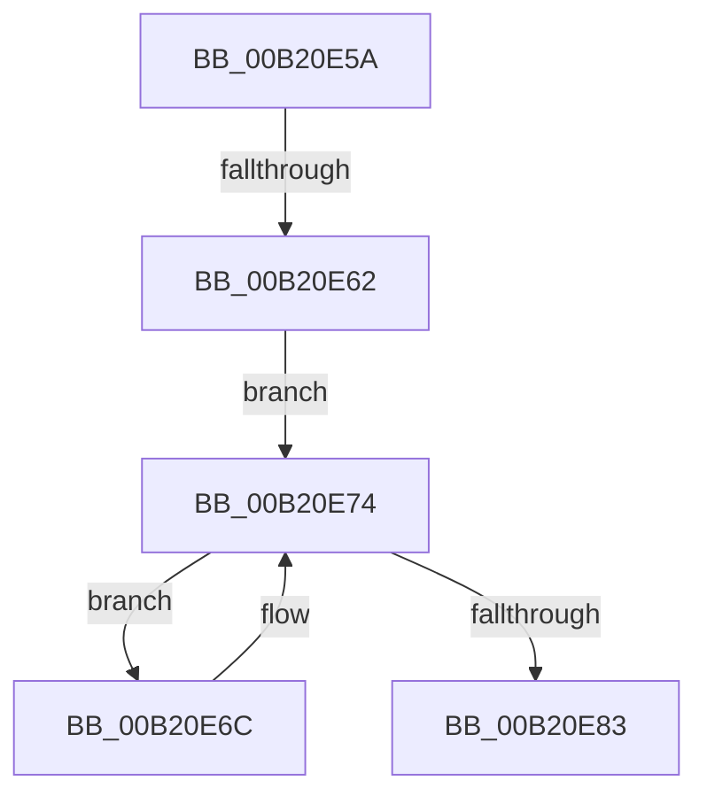

# sub_00B20E5A

- RVA: `0x00B20E5A`–`0x00B20E91` (길이 `55` bytes)
- VA: `0x0000000140B20E5A`
- 실행 섹션: `PAGE`
- PDB 이름 있음: `아니요`; PDB Function 태그: `아니요`
- unwind 정보 RVA: `0x00088CF0`
- 디코드: `15`개 명령, `55/55` bytes 표시
- 미해석 바이트: `0` (있으면 어셈블리에 `.byte`로 보존)

> 이 문서는 커널 이미지의 기계어와 PDB 기호를 분석해 생성했습니다. 4번과 5번은 함수 원형과 자료형을 바이너리 사용 방식에서 추정한 C 해석이며 원본 소스 복구 결과는 아닙니다.

## 1. Dependencies

- 직접 호출 지점: **3**; 고유 호출 대상: **2**
- 직접 호출자로 확인된 함수: **0**
- RIP 상대 이미지 참조: **0**

### Outgoing calls
- `0x00B20E6F` → [ExFreePoolWithTag](../../poolcode/B8/ExFreePoolWithTag_function_00B82870.md) (function, `0x00B82870`)
- `0x00B20E77` → [ExpInterlockedPopEntrySList](../../text/6B/ExpInterlockedPopEntrySList_function_006BA570.md) (function, `0x006BA570`)
- `0x00B20E86` → [ExFreePoolWithTag](../../poolcode/B8/ExFreePoolWithTag_function_00B82870.md) (function, `0x00B82870`)

### Direct callers
- 이 함수 시작 RVA로 연결되는 직접 call은 확인되지 않았습니다. 간접 호출은 완전히 역산할 수 없습니다.

### Static image references
- 디코드된 RIP-relative 메모리 참조가 없습니다.

## 2. Other-region calls and transfers

- 다른 실행 섹션으로 향하는 call: **3**
  - `0x00B20E6F` → [ExFreePoolWithTag](../../poolcode/B8/ExFreePoolWithTag_function_00B82870.md) (`PAGE` → `POOLCODE`)
  - `0x00B20E77` → [ExpInterlockedPopEntrySList](../../text/6B/ExpInterlockedPopEntrySList_function_006BA570.md) (`PAGE` → `.text`)
  - `0x00B20E86` → [ExFreePoolWithTag](../../poolcode/B8/ExFreePoolWithTag_function_00B82870.md) (`PAGE` → `POOLCODE`)
- call이 아닌 외부 분기/꼬리 이동: **2**
  - `0x00B20E5C` → [PspThreadIndexCleanup + 0x24](../90/PspThreadIndexCleanup_function_009067D4.md) (`tail-transfer`)
  - `0x00B20E8C` → [PspThreadIndexCleanup + 0x24](../90/PspThreadIndexCleanup_function_009067D4.md) (`tail-transfer`)

## 3. Assembly (complete function range)

```asm
00B20E5A  85 F6                           test esi, esi
00B20E5C  0F 84 96 59 DE FF               je 0x1409067f8
00B20E62  48 83 A7 00 08 00 00 00         and qword ptr [rdi + 0x800], 0
00B20E6A  EB 08                           jmp 0x140b20e74
00B20E6C  48 8B C8                        mov rcx, rax
00B20E6F  E8 FC 19 06 00                  call 0x140b82870
00B20E74  48 8B CB                        mov rcx, rbx
00B20E77  E8 F4 96 B9 FF                  call 0x1406ba570
00B20E7C  33 D2                           xor edx, edx
00B20E7E  48 85 C0                        test rax, rax
00B20E81  75 E9                           jne 0x140b20e6c
00B20E83  48 8B CB                        mov rcx, rbx
00B20E86  E8 E5 19 06 00                  call 0x140b82870
00B20E8B  90                              nop
00B20E8C  E9 67 59 DE FF                  jmp 0x1409067f8
```

## 4. C-style interpretation (structured pseudocode)

```c
__int64 __fastcall sub_00B20E5A(__int64 a1, int a2)
{
    __int64 result;

    goto loc_00B20E74;
loc_00B20E6C:
    result = ExFreePoolWithTag(result, a2, a3, a4);
loc_00B20E74:
    result = ExpInterlockedPopEntrySList(v_rbx, a2, a3, a4);
    a2 = 0;
    if (result != 0) goto loc_00B20E6C;
    result = ExFreePoolWithTag(v_rbx, a2, a3, a4);
}
```

## 5. (Beta) C Style

```c
int64_t sub_00B20E5A(int64_t Arg1, int32_t Arg2)
{
    int64_t result;

    goto loc_00B20E74;
loc_00B20E6C:
    result = ExFreePoolWithTag(result, Arg2, a3, a4);
loc_00B20E74:
    result = ExpInterlockedPopEntrySList(local_rbx, Arg2, a3, a4);
    Arg2 = 0;
    if (result != 0) goto loc_00B20E6C;
    result = ExFreePoolWithTag(local_rbx, Arg2, a3, a4);
}
```

## 6. Execution-region graph

[열기: 2D/3D 그래프와 함수 탐색 컨트롤 패널](../../../control-panel.html?section=page&rva=0x00B20E5A&view=graph)

- 2D 그래프는 위에서 아래로 흐르고, 3D 그래프는 빈 공간을 드래그해 회전합니다. Shift+드래그는 이동, 휠은 확대·축소, 함수 노드 선택은 대상 보고서 이동입니다.

### Static fallback


