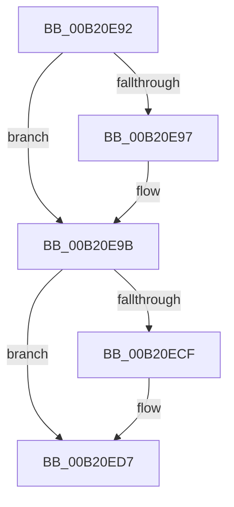

# sub_00B20E92

- RVA: `0x00B20E92`–`0x00B20EED` (길이 `91` bytes)
- VA: `0x0000000140B20E92`
- 실행 섹션: `PAGE`
- PDB 이름 있음: `아니요`; PDB Function 태그: `아니요`
- unwind 정보 RVA: `0x00088D70`
- 디코드: `23`개 명령, `91/91` bytes 표시
- 미해석 바이트: `0` (있으면 어셈블리에 `.byte`로 보존)

> 이 문서는 커널 이미지의 기계어와 PDB 기호를 분석해 생성했습니다. 4번과 5번은 함수 원형과 자료형을 바이너리 사용 방식에서 추정한 C 해석이며 원본 소스 복구 결과는 아닙니다.

## 1. Dependencies

- 직접 호출 지점: **5**; 고유 호출 대상: **4**
- 직접 호출자로 확인된 함수: **0**
- RIP 상대 이미지 참조: **0**

### Outgoing calls
- `0x00B20EA8` → [ExFreePoolWithTag](../../poolcode/B8/ExFreePoolWithTag_function_00B82870.md) (function, `0x00B82870`)
- `0x00B20EB6` → [ExFreePoolWithTag](../../poolcode/B8/ExFreePoolWithTag_function_00B82870.md) (function, `0x00B82870`)
- `0x00B20ED2` → [ExfTryToWakePushLock](../../text/26/ExfTryToWakePushLock_function_00265DD0.md) (function, `0x00265DD0`)
- `0x00B20EDA` → [KeAbPostRelease](../../text/2E/KeAbPostRelease_function_002E1600.md) (function, `0x002E1600`)
- `0x00B20EE2` → [KeLeaveCriticalRegionThread](../../text/25/KeLeaveCriticalRegionThread_function_0025EFF0.md) (function, `0x0025EFF0`)

### Direct callers
- 이 함수 시작 RVA로 연결되는 직접 call은 확인되지 않았습니다. 간접 호출은 완전히 역산할 수 없습니다.

### Static image references
- 디코드된 RIP-relative 메모리 참조가 없습니다.

## 2. Other-region calls and transfers

- 다른 실행 섹션으로 향하는 call: **5**
  - `0x00B20EA8` → [ExFreePoolWithTag](../../poolcode/B8/ExFreePoolWithTag_function_00B82870.md) (`PAGE` → `POOLCODE`)
  - `0x00B20EB6` → [ExFreePoolWithTag](../../poolcode/B8/ExFreePoolWithTag_function_00B82870.md) (`PAGE` → `POOLCODE`)
  - `0x00B20ED2` → [ExfTryToWakePushLock](../../text/26/ExfTryToWakePushLock_function_00265DD0.md) (`PAGE` → `.text`)
  - `0x00B20EDA` → [KeAbPostRelease](../../text/2E/KeAbPostRelease_function_002E1600.md) (`PAGE` → `.text`)
  - `0x00B20EE2` → [KeLeaveCriticalRegionThread](../../text/25/KeLeaveCriticalRegionThread_function_0025EFF0.md) (`PAGE` → `.text`)
- call이 아닌 외부 분기/꼬리 이동: **1**
  - `0x00B20EE8` → [PspRundownSingleProcess + 0xDB](../90/PspRundownSingleProcess_function_00906D50.md) (`tail-transfer`)

## 3. Assembly (complete function range)

```asm
00B20E92  48 85 ED                        test rbp, rbp
00B20E95  74 04                           je 0x140b20e9b
00B20E97  44 88 6D 0A                     mov byte ptr [rbp + 0xa], r13b
00B20E9B  48 8B 8F 48 06 00 00            mov rcx, qword ptr [rdi + 0x648]
00B20EA2  33 D2                           xor edx, edx
00B20EA4  48 8B 49 08                     mov rcx, qword ptr [rcx + 8]
00B20EA8  E8 C3 19 06 00                  call 0x140b82870
00B20EAD  48 8B 8F 48 06 00 00            mov rcx, qword ptr [rdi + 0x648]
00B20EB4  33 D2                           xor edx, edx
00B20EB6  E8 B5 19 06 00                  call 0x140b82870
00B20EBB  4C 89 A7 48 06 00 00            mov qword ptr [rdi + 0x648], r12
00B20EC2  F0 48 0F C1 1E                  lock xadd qword ptr [rsi], rbx
00B20EC7  80 E3 06                        and bl, 6
00B20ECA  80 FB 02                        cmp bl, 2
00B20ECD  75 08                           jne 0x140b20ed7
00B20ECF  48 8B CE                        mov rcx, rsi
00B20ED2  E8 F9 4E 74 FF                  call 0x140265dd0
00B20ED7  48 8B CE                        mov rcx, rsi
00B20EDA  E8 21 07 7C FF                  call 0x1402e1600
00B20EDF  49 8B CF                        mov rcx, r15
00B20EE2  E8 09 E1 73 FF                  call 0x14025eff0
00B20EE7  90                              nop
00B20EE8  E9 3E 5F DE FF                  jmp 0x140906e2b
```

## 4. C-style interpretation (structured pseudocode)

```c
__int64 __fastcall sub_00B20E92(__int64 a1, int a2)
{
    __int64 result;
    __int64 v_rbx;

    if (v_rbp != 0) {
        *(unsigned __int8 *)(v_rbp + 10) = (unsigned __int8)(v_r13);
    }
    a2 = 0;
    result = ExFreePoolWithTag(*(unsigned __int64 *)(*(unsigned __int64 *)(v_rdi + 1608) + 8), a2, a3, a4);
    a2 = 0;
    result = ExFreePoolWithTag(*(unsigned __int64 *)(v_rdi + 1608), a2, a3, a4);
    *(unsigned __int64 *)(v_rdi + 1608) = v_r12;
    v_rbx = (unsigned __int8)((v_rbx) & (6));
    if (((unsigned __int8)(v_rbx)) == 2) {
        a1 = v_rsi;
        result = ExfTryToWakePushLock(a1, a2, a3, a4);
    }
    result = KeAbPostRelease(v_rsi, a2, a3, a4);
    result = KeLeaveCriticalRegionThread(v_r15, a2, a3, a4);
}
```

## 5. (Beta) C Style

```c
int64_t sub_00B20E92(int64_t Arg1, int32_t Arg2)
{
    int64_t result;
    int64_t local_rbx;

    if (local_rbp != 0) {
        *(uint8_t *)(local_rbp + 0xA) = (uint8_t)(local_r13);
    }
    Arg2 = 0;
    result = ExFreePoolWithTag(*(uint64_t *)(*(uint64_t *)(local_rdi + 0x648) + 0x8), Arg2, a3, a4);
    Arg2 = 0;
    result = ExFreePoolWithTag(*(uint64_t *)(local_rdi + 0x648), Arg2, a3, a4);
    *(uint64_t *)(local_rdi + 0x648) = local_r12;
    local_rbx = (uint8_t)((local_rbx) & (6));
    if (((uint8_t)(local_rbx)) == 2) {
        Arg1 = local_rsi;
        result = ExfTryToWakePushLock(Arg1, Arg2, a3, a4);
    }
    result = KeAbPostRelease(local_rsi, Arg2, a3, a4);
    result = KeLeaveCriticalRegionThread(local_r15, Arg2, a3, a4);
}
```

## 6. Execution-region graph

[열기: 2D/3D 그래프와 함수 탐색 컨트롤 패널](../../../control-panel.html?section=page&rva=0x00B20E92&view=graph)

- 2D 그래프는 위에서 아래로 흐르고, 3D 그래프는 빈 공간을 드래그해 회전합니다. Shift+드래그는 이동, 휠은 확대·축소, 함수 노드 선택은 대상 보고서 이동입니다.

### Static fallback


