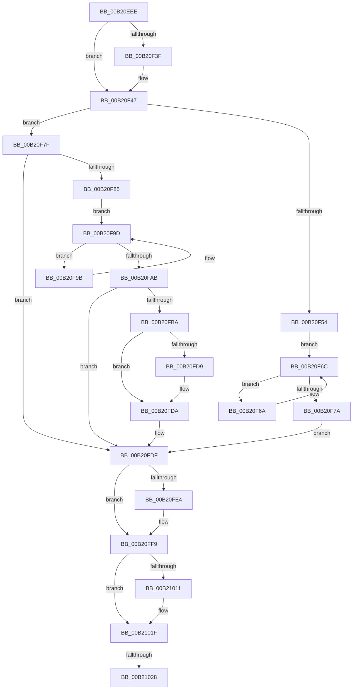

# sub_00B20EEE

- RVA: `0x00B20EEE`–`0x00B21031` (길이 `323` bytes)
- VA: `0x0000000140B20EEE`
- 실행 섹션: `PAGE`
- PDB 이름 있음: `아니요`; PDB Function 태그: `아니요`
- unwind 정보 RVA: `0x00088DE8`
- 디코드: `88`개 명령, `323/323` bytes 표시
- 미해석 바이트: `0` (있으면 어셈블리에 `.byte`로 보존)

> 이 문서는 커널 이미지의 기계어와 PDB 기호를 분석해 생성했습니다. 4번과 5번은 함수 원형과 자료형을 바이너리 사용 방식에서 추정한 C 해석이며 원본 소스 복구 결과는 아닙니다.

## 1. Dependencies

- 직접 호출 지점: **8**; 고유 호출 대상: **8**
- 직접 호출자로 확인된 함수: **0**
- RIP 상대 이미지 참조: **2**

### Outgoing calls
- `0x00B20F23` → [AlpcpReferenceBlob](../89/AlpcpReferenceBlob_function_00890110.md) (function, `0x00890110`)
- `0x00B20F42` → [ExfTryToWakePushLock](../../text/26/ExfTryToWakePushLock_function_00265DD0.md) (function, `0x00265DD0`)
- `0x00B20F4A` → [KeAbPostRelease](../../text/2E/KeAbPostRelease_function_002E1600.md) (function, `0x002E1600`)
- `0x00B20FCB` → [DbgPrintEx](../../text/35/DbgPrintEx_function_00359290.md) (function, `0x00359290`)
- `0x00B20FE7` → [AlpcpForceUnlinkSecureView](../74/AlpcpForceUnlinkSecureView_function_0074C604.md) (function, `0x0074C604`)
- `0x00B20FF4` → [AlpcpDereferenceBlobEx](../88/AlpcpDereferenceBlobEx_function_0088AF00.md) (function, `0x0088AF00`)
- `0x00B21001` → [KeAbPreAcquire](../../text/21/KeAbPreAcquire_function_00210230.md) (function, `0x00210230`)
- `0x00B2101A` → [ExfAcquirePushLockExclusiveEx](../../text/20/ExfAcquirePushLockExclusiveEx_function_0020FC90.md) (function, `0x0020FC90`)

### Direct callers
- 이 함수 시작 RVA로 연결되는 직접 call은 확인되지 않았습니다. 간접 호출은 완전히 역산할 수 없습니다.

### Static image references
- `0x00B20FBF` → RVA `0x00B01360` (` ?? ::NNGAKEGL::`string'`; read)
- `0x00B20FD0` → RVA `0x00F475F8` (`.data`; read)

## 2. Other-region calls and transfers

- 다른 실행 섹션으로 향하는 call: **5**
  - `0x00B20F42` → [ExfTryToWakePushLock](../../text/26/ExfTryToWakePushLock_function_00265DD0.md) (`PAGE` → `.text`)
  - `0x00B20F4A` → [KeAbPostRelease](../../text/2E/KeAbPostRelease_function_002E1600.md) (`PAGE` → `.text`)
  - `0x00B20FCB` → [DbgPrintEx](../../text/35/DbgPrintEx_function_00359290.md) (`PAGE` → `.text`)
  - `0x00B21001` → [KeAbPreAcquire](../../text/21/KeAbPreAcquire_function_00210230.md) (`PAGE` → `.text`)
  - `0x00B2101A` → [ExfAcquirePushLockExclusiveEx](../../text/20/ExfAcquirePushLockExclusiveEx_function_0020FC90.md) (`PAGE` → `.text`)
- call이 아닌 외부 분기/꼬리 이동: **2**
  - `0x00B21022` → [AlpcpCleanupProcessViews + 0x7E](../90/AlpcpCleanupProcessViews_function_00907964.md) (`tail-transfer`)
  - `0x00B2102C` → [AlpcpCleanupProcessViews + 0x7E](../90/AlpcpCleanupProcessViews_function_00907964.md) (`tail-transfer`)

## 3. Assembly (complete function range)

```asm
00B20EEE  48 8B 4C 24 50                  mov rcx, qword ptr [rsp + 0x50]
00B20EF3  33 C0                           xor eax, eax
00B20EF5  48 83 C7 B0                     add rdi, -0x50
00B20EF9  48 3B CF                        cmp rcx, rdi
00B20EFC  48 0F 44 C5                     cmove rax, rbp
00B20F00  48 8B E8                        mov rbp, rax
00B20F03  4C 8B E0                        mov r12, rax
00B20F06  41 8D 46 01                     lea eax, [r14 + 1]
00B20F0A  45 33 F6                        xor r14d, r14d
00B20F0D  48 3B CF                        cmp rcx, rdi
00B20F10  44 0F 44 F0                     cmove r14d, eax
00B20F14  48 8B C7                        mov rax, rdi
00B20F17  48 0F 44 C1                     cmove rax, rcx
00B20F1B  48 8B CF                        mov rcx, rdi
00B20F1E  48 89 44 24 50                  mov qword ptr [rsp + 0x50], rax
00B20F23  E8 E8 F1 D6 FF                  call 0x140890110
00B20F28  48 F7 D8                        neg rax
00B20F2B  48 8B C3                        mov rax, rbx
00B20F2E  4D 1B FF                        sbb r15, r15
00B20F31  4C 23 FF                        and r15, rdi
00B20F34  F0 48 0F C1 06                  lock xadd qword ptr [rsi], rax
00B20F39  24 06                           and al, 6
00B20F3B  3C 02                           cmp al, 2
00B20F3D  75 08                           jne 0x140b20f47
00B20F3F  48 8B CE                        mov rcx, rsi
00B20F42  E8 89 4E 74 FF                  call 0x140265dd0
00B20F47  48 8B CE                        mov rcx, rsi
00B20F4A  E8 B1 06 7C FF                  call 0x1402e1600
00B20F4F  48 85 ED                        test rbp, rbp
00B20F52  75 2B                           jne 0x140b20f7f
00B20F54  49 B8 B0 03 00 00 80 F7 FF FF   movabs r8, 0xfffff780000003b0
00B20F5E  49 B9 08 00 00 00 80 F7 FF FF   movabs r9, 0xfffff78000000008
00B20F68  EB 02                           jmp 0x140b20f6c
00B20F6A  F3 90                           pause
00B20F6C  49 8B 08                        mov rcx, qword ptr [r8]
00B20F6F  49 8B 29                        mov rbp, qword ptr [r9]
00B20F72  49 8B 00                        mov rax, qword ptr [r8]
00B20F75  48 3B C8                        cmp rcx, rax
00B20F78  75 F0                           jne 0x140b20f6a
00B20F7A  48 2B E9                        sub rbp, rcx
00B20F7D  EB 60                           jmp 0x140b20fdf
00B20F7F  41 83 FE 64                     cmp r14d, 0x64
00B20F83  76 5A                           jbe 0x140b20fdf
00B20F85  49 B8 B0 03 00 00 80 F7 FF FF   movabs r8, 0xfffff780000003b0
00B20F8F  49 B9 08 00 00 00 80 F7 FF FF   movabs r9, 0xfffff78000000008
00B20F99  EB 02                           jmp 0x140b20f9d
00B20F9B  F3 90                           pause
00B20F9D  49 8B 10                        mov rdx, qword ptr [r8]
00B20FA0  49 8B 09                        mov rcx, qword ptr [r9]
00B20FA3  49 8B 00                        mov rax, qword ptr [r8]
00B20FA6  48 3B D0                        cmp rdx, rax
00B20FA9  75 F0                           jne 0x140b20f9b
00B20FAB  49 2B CC                        sub rcx, r12
00B20FAE  48 2B CA                        sub rcx, rdx
00B20FB1  48 81 F9 00 46 C3 23            cmp rcx, 0x23c34600
00B20FB8  76 25                           jbe 0x140b20fdf
00B20FBA  4C 8B 4C 24 50                  mov r9, qword ptr [rsp + 0x50]
00B20FBF  4C 8D 05 9A 03 FE FF            lea r8, [rip - 0x1fc66]
00B20FC6  33 D2                           xor edx, edx
00B20FC8  8D 4A 69                        lea ecx, [rdx + 0x69]
00B20FCB  E8 C0 82 83 FF                  call 0x140359290
00B20FD0  80 3D 21 66 42 00 00            cmp byte ptr [rip + 0x426621], 0
00B20FD7  74 01                           je 0x140b20fda
00B20FD9  CC                              int3
00B20FDA  45 33 F6                        xor r14d, r14d
00B20FDD  33 ED                           xor ebp, ebp
00B20FDF  4D 85 FF                        test r15, r15
00B20FE2  74 15                           je 0x140b20ff9
00B20FE4  49 8B CF                        mov rcx, r15
00B20FE7  E8 18 B6 C2 FF                  call 0x14074c604
00B20FEC  BA 01 00 00 00                  mov edx, 1
00B20FF1  49 8B CF                        mov rcx, r15
00B20FF4  E8 07 9F D6 FF                  call 0x14088af00
00B20FF9  45 33 C0                        xor r8d, r8d
00B20FFC  33 D2                           xor edx, edx
00B20FFE  48 8B CE                        mov rcx, rsi
00B21001  E8 2A F2 6E FF                  call 0x140210230
00B21006  F0 48 0F BA 2E 00               lock bts qword ptr [rsi], 0
00B2100C  48 8B F8                        mov rdi, rax
00B2100F  73 0E                           jae 0x140b2101f
00B21011  4C 8B C6                        mov r8, rsi
00B21014  48 8B D0                        mov rdx, rax
00B21017  48 8B CE                        mov rcx, rsi
00B2101A  E8 71 EC 6E FF                  call 0x14020fc90
00B2101F  48 85 FF                        test rdi, rdi
00B21022  0F 84 BA 69 DE FF               je 0x1409079e2
00B21028  C6 47 0A 01                     mov byte ptr [rdi + 0xa], 1
00B2102C  E9 B1 69 DE FF                  jmp 0x1409079e2
```

## 4. C-style interpretation (structured pseudocode)

```c
__int64 __fastcall sub_00B20EEE(__int64 a1, __int64 a2, __int64 a3, __int64 a4, __int64 a5, __int64 a6, __int64 a7, __int64 a8, __int64 a9, __int64 a10)
{
    __int64 result;
    __int64 v_r14;
    __int64 v_r15;
    __int64 v_rbp;
    __int64 v_rdi;
    unsigned __int64 v_stack_p50;

    result = 0;
    v_rdi = (v_rdi) + (-80);
    if (a10 == v_rdi) { result = v_rbp; }
    v_r14 = 0;
    if (a10 == v_rdi) { v_r14 = (unsigned int)(v_r14 + 1); }
    result = v_rdi;
    if (a10 == v_rdi) { result = a10; }
    v_stack_p50 = result;
    result = AlpcpReferenceBlob(v_rdi, a2, a3, a4);
    result = -(result);
    v_r15 = (v_r15) & (v_rdi);
    result = (unsigned __int8)((v_rbx) & (6));
    if (((unsigned __int8)(result)) == 2) {
        a1 = v_rsi;
        result = ExfTryToWakePushLock(a1, a2, a3, a4);
    }
    result = KeAbPostRelease(v_rsi, a2, a3, a4);
    if (result != 0) goto loc_00B20F7F;
    goto loc_00B20F6C;
loc_00B20F6A:
loc_00B20F6C:
    if ((*(unsigned __int64 *)(a3)) != (*(unsigned __int64 *)(a3))) goto loc_00B20F6A;
    v_rbp = (*(unsigned __int64 *)(a4)) - (*(unsigned __int64 *)(a3));
    goto loc_00B20FDF;
loc_00B20F7F:
    if (((unsigned int)(v_r14)) <= 100) goto loc_00B20FDF;
    goto loc_00B20F9D;
loc_00B20F9B:
loc_00B20F9D:
    if ((*(unsigned __int64 *)(a3)) != (*(unsigned __int64 *)(a3))) goto loc_00B20F9B;
    a1 = (*(unsigned __int64 *)(a4)) - (result);
    a1 = (a1) - (*(unsigned __int64 *)(a3));
    if (a1 <= 0x23C34600ULL) goto loc_00B20FDF;
    a2 = 0;
    result = DbgPrintEx(a2 + 105, a2, v_rip - 130150, a10);
    if ((*(unsigned __int8 *)(v_rip + 4351521)) != 0) {
    }
    v_r14 = 0;
    v_rbp = 0;
loc_00B20FDF:
    if (v_r15 != 0) {
        a1 = v_r15;
        result = AlpcpForceUnlinkSecureView(a1, a2, v_rip - 130150, a10);
        a2 = 1;
        a1 = v_r15;
        result = AlpcpDereferenceBlobEx(a1, a2, v_rip - 130150, a10);
    }
    a3 = 0;
    a2 = 0;
    result = KeAbPreAcquire(v_rsi, a2, a3, a10);
    if (!(condition_is_above_or_equal)) {
        a3 = v_rsi;
        a2 = result;
        a1 = v_rsi;
        result = ExfAcquirePushLockExclusiveEx(a1, a2, a3, a10);
    }
    *(unsigned __int8 *)(result + 10) = 1;
}
```

## 5. (Beta) C Style

```c
int64_t sub_00B20EEE(int64_t Arg1, int64_t Arg2, int64_t Arg3, int64_t Arg4, uint64_t Arg5, uint64_t Arg6, uint64_t Arg7, uint64_t Arg8, uint64_t Arg9, int64_t Arg10)
{
    int64_t result;
    int64_t local_r14;
    int64_t local_r15;
    int64_t local_rbp;
    int64_t local_rdi;
    uint64_t v_stack_p50;

    result = 0;
    local_rdi = (local_rdi) + (-80);
    if (Arg10 == local_rdi) { result = local_rbp; }
    local_r14 = 0;
    if (Arg10 == local_rdi) { local_r14 = (uint32_t)(local_r14 + 1); }
    result = local_rdi;
    if (Arg10 == local_rdi) { result = Arg10; }
    v_stack_p50 = result;
    result = AlpcpReferenceBlob(local_rdi, Arg2, Arg3, Arg4);
    result = -(result);
    local_r15 = (local_r15) & (local_rdi);
    result = (uint8_t)((local_rbx) & (6));
    if (((uint8_t)(result)) == 2) {
        Arg1 = local_rsi;
        result = ExfTryToWakePushLock(Arg1, Arg2, Arg3, Arg4);
    }
    result = KeAbPostRelease(local_rsi, Arg2, Arg3, Arg4);
    if (result != 0) goto loc_00B20F7F;
    goto loc_00B20F6C;
loc_00B20F6A:
loc_00B20F6C:
    if ((*(uint64_t *)(Arg3)) != (*(uint64_t *)(Arg3))) goto loc_00B20F6A;
    local_rbp = (*(uint64_t *)(Arg4)) - (*(uint64_t *)(Arg3));
    goto loc_00B20FDF;
loc_00B20F7F:
    if (((uint32_t)(local_r14)) <= 100) goto loc_00B20FDF;
    goto loc_00B20F9D;
loc_00B20F9B:
loc_00B20F9D:
    if ((*(uint64_t *)(Arg3)) != (*(uint64_t *)(Arg3))) goto loc_00B20F9B;
    Arg1 = (*(uint64_t *)(Arg4)) - (result);
    Arg1 = (Arg1) - (*(uint64_t *)(Arg3));
    if (Arg1 <= 0x23C34600ULL) goto loc_00B20FDF;
    Arg2 = 0;
    result = DbgPrintEx(Arg2 + 105, Arg2, v_rip - 130150, Arg10);
    if ((*(uint8_t *)(v_rip + 0x426621)) != 0) {
    }
    local_r14 = 0;
    local_rbp = 0;
loc_00B20FDF:
    if (local_r15 != 0) {
        Arg1 = local_r15;
        result = AlpcpForceUnlinkSecureView(Arg1, Arg2, v_rip - 130150, Arg10);
        Arg2 = 1;
        Arg1 = local_r15;
        result = AlpcpDereferenceBlobEx(Arg1, Arg2, v_rip - 130150, Arg10);
    }
    Arg3 = 0;
    Arg2 = 0;
    result = KeAbPreAcquire(local_rsi, Arg2, Arg3, Arg10);
    if (!(condition_is_above_or_equal)) {
        Arg3 = local_rsi;
        Arg2 = result;
        Arg1 = local_rsi;
        result = ExfAcquirePushLockExclusiveEx(Arg1, Arg2, Arg3, Arg10);
    }
    *(uint8_t *)(result + 0xA) = 1;
}
```

## 6. Execution-region graph

[열기: 2D/3D 그래프와 함수 탐색 컨트롤 패널](../../../control-panel.html?section=page&rva=0x00B20EEE&view=graph)

- 2D 그래프는 위에서 아래로 흐르고, 3D 그래프는 빈 공간을 드래그해 회전합니다. Shift+드래그는 이동, 휠은 확대·축소, 함수 노드 선택은 대상 보고서 이동입니다.

### Static fallback


