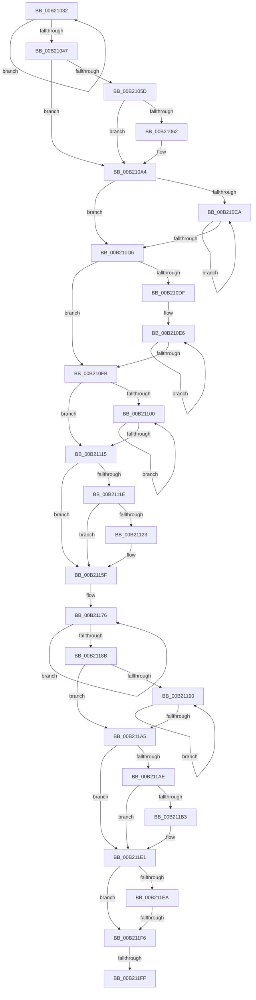

# sub_00B21032

- RVA: `0x00B21032`–`0x00B2123F` (길이 `525` bytes)
- VA: `0x0000000140B21032`
- 실행 섹션: `PAGE`
- PDB 이름 있음: `아니요`; PDB Function 태그: `아니요`
- unwind 정보 RVA: `0x00088E40`
- 디코드: `121`개 명령, `525/525` bytes 표시
- 미해석 바이트: `0` (있으면 어셈블리에 `.byte`로 보존)

> 이 문서는 커널 이미지의 기계어와 PDB 기호를 분석해 생성했습니다. 4번과 5번은 함수 원형과 자료형을 바이너리 사용 방식에서 추정한 C 해석이며 원본 소스 복구 결과는 아닙니다.

## 1. Dependencies

- 직접 호출 지점: **0**; 고유 호출 대상: **0**
- 직접 호출자로 확인된 함수: **0**
- RIP 상대 이미지 참조: **14**

### Outgoing calls
- 직접 디코드된 call 명령이 없습니다.

### Direct callers
- 이 함수 시작 RVA로 연결되는 직접 call은 확인되지 않았습니다. 간접 호출은 완전히 역산할 수 없습니다.

### Static image references
- `0x00B21047` → RVA `0x00E62658` (`.data`; read)
- `0x00B21054` → RVA `0x00E62610` (`.data`; read)
- `0x00B21071` → RVA `0x00E62648` (`.data`; read)
- `0x00B2107E` → RVA `0x00E62640` (`.data`; read)
- `0x00B21088` → RVA `0x00E62610` (`.data`; write)
- `0x00B2108F` → RVA `0x00E62618` (`.data`; read)
- `0x00B21096` → RVA `0x00E62628` (`.data`; write)
- `0x00B2109D` → RVA `0x00E62630` (`.data`; write)
- `0x00B210A4` → RVA `0x012018C0` (`CFGRO`; read)
- `0x00B210AB` → RVA `0x012018D0` (`CFGRO`; read)
- `0x00B21115` → RVA `0x00E62660` (`.data`; read)
- `0x00B2115F` → RVA `0x00FC7280` (`ALMOSTRO`; read)
- `0x00B211A5` → RVA `0x00E62668` (`.data`; read)
- `0x00B211EA` → RVA `0x00FC7290` (`ALMOSTRO`; read)

## 2. Other-region calls and transfers

- 다른 실행 섹션으로 향하는 call: **0**
- call이 아닌 외부 분기/꼬리 이동: **3**
  - `0x00B211F0` → [PspProcessDelete + 0x47C](../90/PspProcessDelete_function_00907B90.md) (`tail-transfer`)
  - `0x00B211F9` → [PspProcessDelete + 0x481](../90/PspProcessDelete_function_00907B90.md) (`tail-transfer`)
  - `0x00B2123A` → [PspProcessDelete + 0x47C](../90/PspProcessDelete_function_00907B90.md) (`tail-transfer`)

## 3. Assembly (complete function range)

```asm
00B21032  41 0F B6 01                     movzx eax, byte ptr [r9]
00B21036  8B CF                           mov ecx, edi
00B21038  48 2B D0                        sub rdx, rax
00B2103B  4D 03 CC                        add r9, r12
00B2103E  48 D3 CA                        ror rdx, cl
00B21041  41 83 C2 FF                     add r10d, -1
00B21045  75 EB                           jne 0x140b21032
00B21047  48 39 15 0A 16 34 00            cmp qword ptr [rip + 0x34160a], rdx
00B2104E  41 BD 0B 01 00 00               mov r13d, 0x10b
00B21054  48 8B 15 B5 15 34 00            mov rdx, qword ptr [rip + 0x3415b5]
00B2105B  74 47                           je 0x140b210a4
00B2105D  48 85 D2                        test rdx, rdx
00B21060  75 42                           jne 0x140b210a4
00B21062  C7 44 24 30 03 83 84 00         mov dword ptr [rsp + 0x30], 0x848303
00B2106A  0F 57 C0                        xorps xmm0, xmm0
00B2106D  8B 54 24 30                     mov edx, dword ptr [rsp + 0x30]
00B21071  48 8B 3D D0 15 34 00            mov rdi, qword ptr [rip + 0x3415d0]
00B21078  81 F2 03 03 00 00               xor edx, 0x303
00B2107E  4C 8B 05 BB 15 34 00            mov r8, qword ptr [rip + 0x3415bb]
00B21085  C1 CA 0F                        ror edx, 0xf
00B21088  48 89 15 81 15 34 00            mov qword ptr [rip + 0x341581], rdx
00B2108F  0F 11 05 82 15 34 00            movups xmmword ptr [rip + 0x341582], xmm0
00B21096  4C 89 2D 8B 15 34 00            mov qword ptr [rip + 0x34158b], r13
00B2109D  4C 89 1D 8C 15 34 00            mov qword ptr [rip + 0x34158c], r11
00B210A4  48 8B 35 15 08 6E 00            mov rsi, qword ptr [rip + 0x6e0815]
00B210AB  8B 2D 1F 08 6E 00               mov ebp, dword ptr [rip + 0x6e081f]
00B210B1  4C 8B DE                        mov r11, rsi
00B210B4  48 8B C6                        mov rax, rsi
00B210B7  44 8D 14 AD 00 00 00 00         lea r10d, [rbp*4]
00B210BF  41 8B CA                        mov ecx, r10d
00B210C2  48 03 CE                        add rcx, rsi
00B210C5  48 3B F1                        cmp rsi, rcx
00B210C8  73 0C                           jae 0x140b210d6
00B210CA  0F 18 00                        prefetchnta byte ptr [rax]
00B210CD  48 83 C0 40                     add rax, 0x40
00B210D1  48 3B C1                        cmp rax, rcx
00B210D4  72 F4                           jb 0x140b210ca
00B210D6  4D 8B C8                        mov r9, r8
00B210D9  41 83 FA 08                     cmp r10d, 8
00B210DD  72 1C                           jb 0x140b210fb
00B210DF  41 8B C2                        mov eax, r10d
00B210E2  48 C1 E8 03                     shr rax, 3
00B210E6  4D 2B 0B                        sub r9, qword ptr [r11]
00B210E9  8B CF                           mov ecx, edi
00B210EB  49 D3 C9                        ror r9, cl
00B210EE  49 83 C3 08                     add r11, 8
00B210F2  41 83 C2 F8                     add r10d, -8
00B210F6  49 2B C4                        sub rax, r12
00B210F9  75 EB                           jne 0x140b210e6
00B210FB  45 85 D2                        test r10d, r10d
00B210FE  74 15                           je 0x140b21115
00B21100  41 0F B6 03                     movzx eax, byte ptr [r11]
00B21104  8B CF                           mov ecx, edi
00B21106  4C 2B C8                        sub r9, rax
00B21109  4D 03 DC                        add r11, r12
00B2110C  49 D3 C9                        ror r9, cl
00B2110F  41 83 C2 FF                     add r10d, -1
00B21113  75 EB                           jne 0x140b21100
00B21115  4C 39 0D 44 15 34 00            cmp qword ptr [rip + 0x341544], r9
00B2111C  74 41                           je 0x140b2115f
00B2111E  48 85 D2                        test rdx, rdx
00B21121  75 3C                           jne 0x140b2115f
00B21123  C7 44 24 34 00 00 09 01         mov dword ptr [rsp + 0x34], 0x1090000
00B2112B  0F 57 C0                        xorps xmm0, xmm0
00B2112E  8B 54 24 34                     mov edx, dword ptr [rsp + 0x34]
00B21132  48 8B 3D 0F 15 34 00            mov rdi, qword ptr [rip + 0x34150f]
00B21139  4C 8B 05 00 15 34 00            mov r8, qword ptr [rip + 0x341500]
00B21140  C1 C2 10                        rol edx, 0x10
00B21143  48 89 15 C6 14 34 00            mov qword ptr [rip + 0x3414c6], rdx
00B2114A  0F 11 05 C7 14 34 00            movups xmmword ptr [rip + 0x3414c7], xmm0
00B21151  4C 89 2D D0 14 34 00            mov qword ptr [rip + 0x3414d0], r13
00B21158  48 89 35 D1 14 34 00            mov qword ptr [rip + 0x3414d1], rsi
00B2115F  4C 8D 1D 1A 61 4A 00            lea r11, [rip + 0x4a611a]
00B21166  4D 8B D3                        mov r10, r11
00B21169  0F 18 05 10 61 4A 00            prefetchnta byte ptr [rip + 0x4a6110]
00B21170  41 B9 20 00 00 00               mov r9d, 0x20
00B21176  4D 2B 02                        sub r8, qword ptr [r10]
00B21179  8B CF                           mov ecx, edi
00B2117B  49 D3 C8                        ror r8, cl
00B2117E  49 83 C2 08                     add r10, 8
00B21182  41 83 C1 F8                     add r9d, -8
00B21186  4D 2B F4                        sub r14, r12
00B21189  75 EB                           jne 0x140b21176
00B2118B  45 85 C9                        test r9d, r9d
00B2118E  74 15                           je 0x140b211a5
00B21190  41 0F B6 02                     movzx eax, byte ptr [r10]
00B21194  8B CF                           mov ecx, edi
00B21196  4C 2B C0                        sub r8, rax
00B21199  4D 03 D4                        add r10, r12
00B2119C  49 D3 C8                        ror r8, cl
00B2119F  41 83 C1 FF                     add r9d, -1
00B211A3  75 EB                           jne 0x140b21190
00B211A5  4C 39 05 BC 14 34 00            cmp qword ptr [rip + 0x3414bc], r8
00B211AC  74 33                           je 0x140b211e1
00B211AE  48 85 D2                        test rdx, rdx
00B211B1  75 2E                           jne 0x140b211e1
00B211B3  C7 44 24 38 90 10 00 00         mov dword ptr [rsp + 0x38], 0x1090
00B211BB  0F 57 C0                        xorps xmm0, xmm0
00B211BE  8B 54 24 38                     mov edx, dword ptr [rsp + 0x38]
00B211C2  C1 C2 1C                        rol edx, 0x1c
00B211C5  48 89 15 44 14 34 00            mov qword ptr [rip + 0x341444], rdx
00B211CC  0F 11 05 45 14 34 00            movups xmmword ptr [rip + 0x341445], xmm0
00B211D3  4C 89 2D 4E 14 34 00            mov qword ptr [rip + 0x34144e], r13
00B211DA  4C 89 1D 4F 14 34 00            mov qword ptr [rip + 0x34144f], r11
00B211E1  48 39 35 98 60 4A 00            cmp qword ptr [rip + 0x4a6098], rsi
00B211E8  75 0C                           jne 0x140b211f6
00B211EA  39 2D A0 60 4A 00               cmp dword ptr [rip + 0x4a60a0], ebp
00B211F0  0F 84 16 6E DE FF               je 0x14090800c
00B211F6  48 85 D2                        test rdx, rdx
00B211F9  0F 85 12 6E DE FF               jne 0x140908011
00B211FF  C7 44 24 3C 24 03 24 04         mov dword ptr [rsp + 0x3c], 0x4240324
00B21207  0F 57 C0                        xorps xmm0, xmm0
00B2120A  8B 54 24 3C                     mov edx, dword ptr [rsp + 0x3c]
00B2120E  48 8B 05 6B 60 4A 00            mov rax, qword ptr [rip + 0x4a606b]
00B21215  81 F2 24 03 00 00               xor edx, 0x324
00B2121B  C1 CA 72                        ror edx, 0x72
00B2121E  48 89 15 EB 13 34 00            mov qword ptr [rip + 0x3413eb], rdx
00B21225  0F 11 05 EC 13 34 00            movups xmmword ptr [rip + 0x3413ec], xmm0
00B2122C  4C 89 2D F5 13 34 00            mov qword ptr [rip + 0x3413f5], r13
00B21233  48 89 05 F6 13 34 00            mov qword ptr [rip + 0x3413f6], rax
00B2123A  E9 CD 6D DE FF                  jmp 0x14090800c
```

## 4. C-style interpretation (structured pseudocode)

```c
__int64 __fastcall sub_00B21032(__int64 a1, __int64 a2, __int64 a3, __int64 a4, __int64 a5, unsigned int a6, unsigned int a7)
{
    __int64 result;
    __int64 v_r10;
    __int64 v_r11;
    __int64 v_r14;
    __int64 v_rdi;
    unsigned int v_stack_p30;
    unsigned int v_stack_p34;
    unsigned int v_stack_p38;
    unsigned int v_stack_p3C;

    a2 = (a2) - (*(unsigned __int8 *)(a4));
    a4 = (a4) + (v_r12);
    v_r10 = (unsigned int)((v_r10) + (-1));
    if (condition_is_not_equal) goto loc_00B21032;
    if ((*(unsigned __int64 *)(v_rip + 3413514)) == a2) goto loc_00B210A4;
    if (*(unsigned __int64 *)(v_rip + 3413429) == 0) {
        v_stack_p30 = 0x848303ULL;
        a2 = a6;
        v_rdi = *(unsigned __int64 *)(v_rip + 3413456);
        a2 = (unsigned int)((a2) ^ (771));
        a3 = *(unsigned __int64 *)(v_rip + 3413435);
        *(unsigned __int64 *)(v_rip + 3413377) = a2;
        *(unsigned __int64 *)(v_rip + 3413378) = v_xmm0;
        *(unsigned __int64 *)(v_rip + 3413387) = 267;
        *(unsigned __int64 *)(v_rip + 3413388) = v_r11;
    }
    a1 = ((unsigned int)((unsigned int)((unsigned int)(*(unsigned int *)(v_rip + 7211039)) * 4))) + (*(unsigned __int64 *)(v_rip + 7211029));
    if ((*(unsigned __int64 *)(v_rip + 7211029)) >= a1) goto loc_00B210D6;
loc_00B210CA:
    result = (*(unsigned __int64 *)(v_rip + 7211029)) + (64);
    if (result < a1) goto loc_00B210CA;
loc_00B210D6:
    if (((unsigned int)((unsigned int)(*(unsigned int *)(v_rip + 7211039)) * 4)) < 8) goto loc_00B210FB;
    result = ((unsigned int)((unsigned int)((unsigned int)(*(unsigned int *)(v_rip + 7211039)) * 4))) >> (3);
loc_00B210E6:
    a4 = (a3) - (*(unsigned __int64 *)(*(unsigned __int64 *)(v_rip + 7211029)));
    v_r11 = (*(unsigned __int64 *)(v_rip + 7211029)) + (8);
    v_r10 = (unsigned int)(((unsigned int)(*(unsigned int *)(v_rip + 7211039)) * 4) + (-8));
    result = (result) - (v_r12);
    if (condition_is_not_equal) goto loc_00B210E6;
loc_00B210FB:
    if ((unsigned int)(v_r10) == 0) goto loc_00B21115;
loc_00B21100:
    a4 = (a4) - (*(unsigned __int8 *)(v_r11));
    v_r11 = (v_r11) + (v_r12);
    v_r10 = (unsigned int)((v_r10) + (-1));
    if (condition_is_not_equal) goto loc_00B21100;
loc_00B21115:
    if ((*(unsigned __int64 *)(v_rip + 3413316)) == a4) goto loc_00B2115F;
    if (a2 == 0) {
        v_stack_p34 = 0x1090000ULL;
        a2 = v_stack_p34;
        v_rdi = *(unsigned __int64 *)(v_rip + 3413263);
        a3 = *(unsigned __int64 *)(v_rip + 3413248);
        *(unsigned __int64 *)(v_rip + 3413190) = a2;
        *(unsigned __int64 *)(v_rip + 3413191) = v_xmm0;
        *(unsigned __int64 *)(v_rip + 3413200) = 267;
        *(unsigned __int64 *)(v_rip + 3413201) = *(unsigned __int64 *)(v_rip + 7211029);
    }
loc_00B21176:
    a3 = (a3) - (*(unsigned __int64 *)(v_rip + 4874522));
    v_r10 = (v_rip + 4874522) + (8);
    a4 = (unsigned int)((32) + (-8));
    v_r14 = (v_r14) - (v_r12);
    if (condition_is_not_equal) goto loc_00B21176;
    if ((unsigned int)(a4) == 0) goto loc_00B211A5;
loc_00B21190:
    a3 = (a3) - (*(unsigned __int8 *)(v_r10));
    v_r10 = (v_r10) + (v_r12);
    a4 = (unsigned int)((a4) + (-1));
    if (condition_is_not_equal) goto loc_00B21190;
loc_00B211A5:
    if ((*(unsigned __int64 *)(v_rip + 3413180)) == a3) goto loc_00B211E1;
    if (a2 == 0) {
        v_stack_p38 = 0x1090ULL;
        a2 = a7;
        *(unsigned __int64 *)(v_rip + 3413060) = a2;
        *(unsigned __int64 *)(v_rip + 3413061) = v_xmm0;
        *(unsigned __int64 *)(v_rip + 3413070) = 267;
        *(unsigned __int64 *)(v_rip + 3413071) = v_rip + 4874522;
    }
    if ((*(unsigned __int64 *)(v_rip + 4874392)) != (*(unsigned __int64 *)(v_rip + 7211029))) goto loc_00B211F6;
loc_00B211F6:
    v_stack_p3C = 0x4240324ULL;
    a2 = (unsigned int)(((unsigned int)(v_stack_p3C)) ^ (804));
    *(unsigned __int64 *)(v_rip + 3412971) = a2;
    *(unsigned __int64 *)(v_rip + 3412972) = v_xmm0;
    *(unsigned __int64 *)(v_rip + 3412981) = 267;
    *(unsigned __int64 *)(v_rip + 3412982) = *(unsigned __int64 *)(v_rip + 4874347);
}
```

## 5. (Beta) C Style

```c
int64_t sub_00B21032(int64_t Arg1, int64_t Arg2, int64_t Arg3, void *Arg4, uint64_t Arg5, uint32_t Arg6, uint32_t Arg7)
{
    uint8_t *arg4 = (uint8_t *)Arg4;

    int64_t result;
    int64_t local_r10;
    int64_t local_r11;
    int64_t local_r14;
    int64_t local_rdi;
    uint32_t v_stack_p30;
    uint32_t v_stack_p34;
    uint32_t v_stack_p38;
    uint32_t v_stack_p3C;

    Arg2 = (Arg2) - (*(uint8_t *)(arg4));
    Arg4 = (Arg4) + (local_r12);
    local_r10 = (uint32_t)((local_r10) + (-1));
    if (condition_is_not_equal) goto loc_00B21032;
    if ((*(uint64_t *)(v_rip + 0x34160A)) == Arg2) goto loc_00B210A4;
    if (*(uint64_t *)(v_rip + 0x3415B5) == 0) {
        v_stack_p30 = 0x848303ULL;
        Arg2 = Arg6;
        local_rdi = *(uint64_t *)(v_rip + 0x3415D0);
        Arg2 = (uint32_t)((Arg2) ^ (771));
        Arg3 = *(uint64_t *)(v_rip + 0x3415BB);
        *(uint64_t *)(v_rip + 0x341581) = Arg2;
        *(uint64_t *)(v_rip + 0x341582) = v_xmm0;
        *(uint64_t *)(v_rip + 0x34158B) = 267;
        *(uint64_t *)(v_rip + 0x34158C) = local_r11;
    }
    Arg1 = ((uint32_t)((uint32_t)((uint32_t)(*(uint32_t *)(v_rip + 0x6E081F)) * 4))) + (*(uint64_t *)(v_rip + 0x6E0815));
    if ((*(uint64_t *)(v_rip + 0x6E0815)) >= Arg1) goto loc_00B210D6;
loc_00B210CA:
    result = (*(uint64_t *)(v_rip + 0x6E0815)) + (64);
    if (result < Arg1) goto loc_00B210CA;
loc_00B210D6:
    if (((uint32_t)((uint32_t)(*(uint32_t *)(v_rip + 0x6E081F)) * 4)) < 8) goto loc_00B210FB;
    result = ((uint32_t)((uint32_t)((uint32_t)(*(uint32_t *)(v_rip + 0x6E081F)) * 4))) >> (3);
loc_00B210E6:
    Arg4 = (Arg3) - (*(uint64_t *)(*(uint64_t *)(v_rip + 0x6E0815)));
    local_r11 = (*(uint64_t *)(v_rip + 0x6E0815)) + (8);
    local_r10 = (uint32_t)(((uint32_t)(*(uint32_t *)(v_rip + 0x6E081F)) * 4) + (-8));
    result = (result) - (local_r12);
    if (condition_is_not_equal) goto loc_00B210E6;
loc_00B210FB:
    if ((uint32_t)(local_r10) == 0) goto loc_00B21115;
loc_00B21100:
    Arg4 = (Arg4) - (*(uint8_t *)(local_r11));
    local_r11 = (local_r11) + (local_r12);
    local_r10 = (uint32_t)((local_r10) + (-1));
    if (condition_is_not_equal) goto loc_00B21100;
loc_00B21115:
    if ((*(uint64_t *)(v_rip + 0x341544)) == Arg4) goto loc_00B2115F;
    if (Arg2 == 0) {
        v_stack_p34 = 0x1090000ULL;
        Arg2 = v_stack_p34;
        local_rdi = *(uint64_t *)(v_rip + 0x34150F);
        Arg3 = *(uint64_t *)(v_rip + 0x341500);
        *(uint64_t *)(v_rip + 0x3414C6) = Arg2;
        *(uint64_t *)(v_rip + 0x3414C7) = v_xmm0;
        *(uint64_t *)(v_rip + 0x3414D0) = 267;
        *(uint64_t *)(v_rip + 0x3414D1) = *(uint64_t *)(v_rip + 0x6E0815);
    }
loc_00B21176:
    Arg3 = (Arg3) - (*(uint64_t *)(v_rip + 0x4A611A));
    local_r10 = (v_rip + 4874522) + (8);
    Arg4 = (uint32_t)((32) + (-8));
    local_r14 = (local_r14) - (local_r12);
    if (condition_is_not_equal) goto loc_00B21176;
    if ((uint32_t)(Arg4) == 0) goto loc_00B211A5;
loc_00B21190:
    Arg3 = (Arg3) - (*(uint8_t *)(local_r10));
    local_r10 = (local_r10) + (local_r12);
    Arg4 = (uint32_t)((Arg4) + (-1));
    if (condition_is_not_equal) goto loc_00B21190;
loc_00B211A5:
    if ((*(uint64_t *)(v_rip + 0x3414BC)) == Arg3) goto loc_00B211E1;
    if (Arg2 == 0) {
        v_stack_p38 = 0x1090ULL;
        Arg2 = Arg7;
        *(uint64_t *)(v_rip + 0x341444) = Arg2;
        *(uint64_t *)(v_rip + 0x341445) = v_xmm0;
        *(uint64_t *)(v_rip + 0x34144E) = 267;
        *(uint64_t *)(v_rip + 0x34144F) = v_rip + 4874522;
    }
    if ((*(uint64_t *)(v_rip + 0x4A6098)) != (*(uint64_t *)(v_rip + 0x6E0815))) goto loc_00B211F6;
loc_00B211F6:
    v_stack_p3C = 0x4240324ULL;
    Arg2 = (uint32_t)(((uint32_t)(v_stack_p3C)) ^ (804));
    *(uint64_t *)(v_rip + 0x3413EB) = Arg2;
    *(uint64_t *)(v_rip + 0x3413EC) = v_xmm0;
    *(uint64_t *)(v_rip + 0x3413F5) = 267;
    *(uint64_t *)(v_rip + 0x3413F6) = *(uint64_t *)(v_rip + 0x4A606B);
}
```

### 관측된 메모리 오프셋

구조체 형식이 확인되지 않은 접근은 인자 기준의 오프셋으로만 기록했습니다.

| 기준 인자 | 오프셋 표현 | 폭 (bit) | 접근 |
|---|---:|---:|---|
| `Arg4` | `+ 0x0` | `8` | `R` |

## 6. Execution-region graph

[열기: 2D/3D 그래프와 함수 탐색 컨트롤 패널](../../../control-panel.html?section=page&rva=0x00B21032&view=graph)

- 2D 그래프는 위에서 아래로 흐르고, 3D 그래프는 빈 공간을 드래그해 회전합니다. Shift+드래그는 이동, 휠은 확대·축소, 함수 노드 선택은 대상 보고서 이동입니다.

### Static fallback


