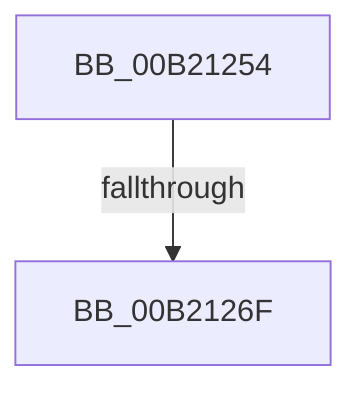

# sub_00B21254

- RVA: `0x00B21254`–`0x00B21279` (길이 `37` bytes)
- VA: `0x0000000140B21254`
- 실행 섹션: `PAGE`
- PDB 이름 있음: `아니요`; PDB Function 태그: `아니요`
- unwind 정보 RVA: `0x00089188`
- 디코드: `9`개 명령, `37/37` bytes 표시
- 미해석 바이트: `0` (있으면 어셈블리에 `.byte`로 보존)

> 이 문서는 커널 이미지의 기계어와 PDB 기호를 분석해 생성했습니다. 4번과 5번은 함수 원형과 자료형을 바이너리 사용 방식에서 추정한 C 해석이며 원본 소스 복구 결과는 아닙니다.

## 1. Dependencies

- 직접 호출 지점: **2**; 고유 호출 대상: **2**
- 직접 호출자로 확인된 함수: **0**
- RIP 상대 이미지 참조: **0**

### Outgoing calls
- `0x00B21257` → [KeAbPostRelease](../../text/2E/KeAbPostRelease_function_002E1600.md) (function, `0x002E1600`)
- `0x00B21262` → [ExpWnfFreeScopeInstance](../A7/ExpWnfFreeScopeInstance_function_00A77614.md) (function, `0x00A77614`)

### Direct callers
- 이 함수 시작 RVA로 연결되는 직접 call은 확인되지 않았습니다. 간접 호출은 완전히 역산할 수 없습니다.

### Static image references
- 디코드된 RIP-relative 메모리 참조가 없습니다.

## 2. Other-region calls and transfers

- 다른 실행 섹션으로 향하는 call: **1**
  - `0x00B21257` → [KeAbPostRelease](../../text/2E/KeAbPostRelease_function_002E1600.md) (`PAGE` → `.text`)
- call이 아닌 외부 분기/꼬리 이동: **2**
  - `0x00B21269` → [sub_0090B2DA + 0xE8](../90/Unknown_function_0090B2DA.md) (`tail-transfer`)
  - `0x00B21274` → [sub_0090B2DA + 0xF3](../90/Unknown_function_0090B2DA.md) (`tail-transfer`)

## 3. Assembly (complete function range)

```asm
00B21254  49 8B CE                        mov rcx, r14
00B21257  E8 A4 03 7C FF                  call 0x1402e1600
00B2125C  48 8B 4D C0                     mov rcx, qword ptr [rbp - 0x40]
00B21260  33 D2                           xor edx, edx
00B21262  E8 AD 63 F5 FF                  call 0x140a77614
00B21267  84 DB                           test bl, bl
00B21269  0F 85 53 A1 DE FF               jne 0x14090b3c2
00B2126F  BE 34 00 00 C0                  mov esi, 0xc0000034
00B21274  E9 54 A1 DE FF                  jmp 0x14090b3cd
```

## 4. C-style interpretation (structured pseudocode)

```c
__int64 __fastcall sub_00B21254(__int64 a1, int a2)
{
    __int64 result;

    result = KeAbPostRelease(v_r14, a2, a3, a4);
    a2 = 0;
    result = ExpWnfFreeScopeInstance(*(unsigned __int64 *)(v_rbp - 64), a2, a3, a4);
}
```

## 5. (Beta) C Style

```c
int64_t sub_00B21254(int64_t Arg1, int32_t Arg2)
{
    int64_t result;

    result = KeAbPostRelease(local_r14, Arg2, a3, a4);
    Arg2 = 0;
    result = ExpWnfFreeScopeInstance(*(uint64_t *)(local_rbp - 0x40), Arg2, a3, a4);
}
```

## 6. Execution-region graph

[열기: 2D/3D 그래프와 함수 탐색 컨트롤 패널](../../../control-panel.html?section=page&rva=0x00B21254&view=graph)

- 2D 그래프는 위에서 아래로 흐르고, 3D 그래프는 빈 공간을 드래그해 회전합니다. Shift+드래그는 이동, 휠은 확대·축소, 함수 노드 선택은 대상 보고서 이동입니다.

### Static fallback


