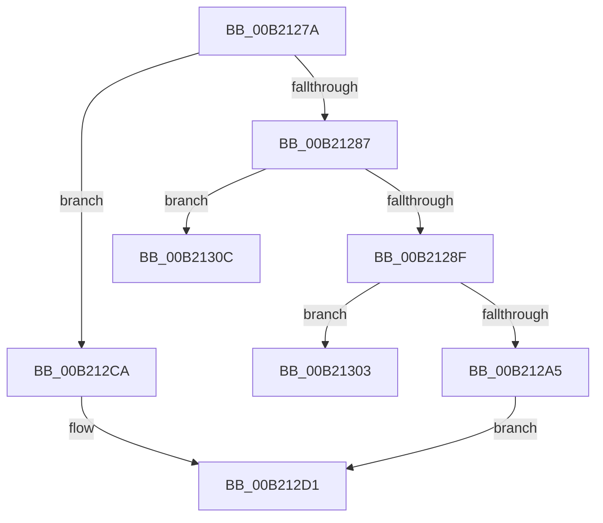

# sub_00B2127A

- RVA: `0x00B2127A`–`0x00B21315` (길이 `155` bytes)
- VA: `0x0000000140B2127A`
- 실행 섹션: `PAGE`
- PDB 이름 있음: `아니요`; PDB Function 태그: `아니요`
- unwind 정보 RVA: `0x000895B4`
- 디코드: `43`개 명령, `155/155` bytes 표시
- 미해석 바이트: `0` (있으면 어셈블리에 `.byte`로 보존)

> 이 문서는 커널 이미지의 기계어와 PDB 기호를 분석해 생성했습니다. 4번과 5번은 함수 원형과 자료형을 바이너리 사용 방식에서 추정한 C 해석이며 원본 소스 복구 결과는 아닙니다.

## 1. Dependencies

- 직접 호출 지점: **0**; 고유 호출 대상: **0**
- 직접 호출자로 확인된 함수: **0**
- RIP 상대 이미지 참조: **0**

### Outgoing calls
- 직접 디코드된 call 명령이 없습니다.

### Direct callers
- 이 함수 시작 RVA로 연결되는 직접 call은 확인되지 않았습니다. 간접 호출은 완전히 역산할 수 없습니다.

### Static image references
- 디코드된 RIP-relative 메모리 참조가 없습니다.

## 2. Other-region calls and transfers

- 다른 실행 섹션으로 향하는 call: **0**
- call이 아닌 외부 분기/꼬리 이동: **3**
  - `0x00B212FE` → [sub_0090DD33 + 0xF](../90/Unknown_function_0090DD33.md) (`tail-transfer`)
  - `0x00B21307` → [sub_0090DD33 + 0x6A](../90/Unknown_function_0090DD33.md) (`tail-transfer`)
  - `0x00B21310` → [sub_0090DD33 + 0x6A](../90/Unknown_function_0090DD33.md) (`tail-transfer`)

## 3. Assembly (complete function range)

```asm
00B2127A  8D 82 00 28 FF FF               lea eax, [rdx - 0xd800]
00B21280  3D FF 07 00 00                  cmp eax, 0x7ff
00B21285  77 43                           ja 0x140b212ca
00B21287  81 FA FF DB 00 00               cmp edx, 0xdbff
00B2128D  77 7D                           ja 0x140b2130c
00B2128F  45 0F B7 01                     movzx r8d, word ptr [r9]
00B21293  49 83 C1 02                     add r9, 2
00B21297  41 8D 80 00 24 FF FF            lea eax, [r8 - 0xdc00]
00B2129E  3D FF 03 00 00                  cmp eax, 0x3ff
00B212A3  77 5E                           ja 0x140b21303
00B212A5  C1 E2 0A                        shl edx, 0xa
00B212A8  81 C2 00 24 A0 FC               add edx, 0xfca02400
00B212AE  41 03 D0                        add edx, r8d
00B212B1  8B C2                           mov eax, edx
00B212B3  C1 E8 12                        shr eax, 0x12
00B212B6  0C F0                           or al, 0xf0
00B212B8  88 01                           mov byte ptr [rcx], al
00B212BA  8B C2                           mov eax, edx
00B212BC  25 00 F0 03 00                  and eax, 0x3f000
00B212C1  48 FF C1                        inc rcx
00B212C4  0F BA E8 13                     bts eax, 0x13
00B212C8  EB 07                           jmp 0x140b212d1
00B212CA  8B C2                           mov eax, edx
00B212CC  0D 00 00 0E 00                  or eax, 0xe0000
00B212D1  C1 E8 0C                        shr eax, 0xc
00B212D4  49 83 EA 02                     sub r10, 2
00B212D8  88 01                           mov byte ptr [rcx], al
00B212DA  8B C2                           mov eax, edx
00B212DC  25 C0 0F 00 00                  and eax, 0xfc0
00B212E1  48 FF C1                        inc rcx
00B212E4  0F BA E8 0D                     bts eax, 0xd
00B212E8  80 E2 3F                        and dl, 0x3f
00B212EB  C1 E8 06                        shr eax, 6
00B212EE  80 CA 80                        or dl, 0x80
00B212F1  88 01                           mov byte ptr [rcx], al
00B212F3  49 83 EA 02                     sub r10, 2
00B212F7  88 51 01                        mov byte ptr [rcx + 1], dl
00B212FA  48 83 C1 02                     add rcx, 2
00B212FE  E9 3F CA DE FF                  jmp 0x14090dd42
00B21303  49 83 E9 04                     sub r9, 4
00B21307  E9 91 CA DE FF                  jmp 0x14090dd9d
00B2130C  49 83 E9 02                     sub r9, 2
00B21310  E9 88 CA DE FF                  jmp 0x14090dd9d
```

## 4. C-style interpretation (structured pseudocode)

```c
__int64 __fastcall sub_00B2127A(__int64 a1, __int64 a2, __int64 a3, __int64 a4)
{
    __int64 result;
    __int64 v_r10;

    if (((unsigned int)(a2 - 55296)) > 0x7FFULL) goto loc_00B212CA;
    if (((unsigned int)(a2)) > 0xDBFFULL) goto loc_00B2130C;
    a4 = (a4) + (2);
    if (((unsigned int)(*(unsigned __int16 *)(a4) - 56320)) > 0x3FFULL) goto loc_00B21303;
    a2 = (unsigned int)((a2) << (10));
    a2 = (unsigned int)((a2) + (0xFCA02400ULL));
    a2 = (unsigned int)((a2) + ((unsigned int)(*(unsigned __int16 *)(a4))));
    result = (unsigned int)(((unsigned int)((unsigned int)(a2))) >> (18));
    result = (unsigned __int8)((result) | (240));
    *(unsigned __int8 *)(a1) = (unsigned __int8)(result);
    result = (unsigned int)(((unsigned int)((unsigned int)(a2))) & (0x3F000ULL));
    a1 = (a1) + 1;
    goto loc_00B212D1;
loc_00B212CA:
    result = (unsigned int)(((unsigned int)((unsigned int)(a2))) | (0xE0000ULL));
loc_00B212D1:
    result = (unsigned int)((result) >> (12));
    v_r10 = (v_r10) - (2);
    *(unsigned __int8 *)(a1) = (unsigned __int8)(result);
    result = (unsigned int)(((unsigned int)((unsigned int)(a2))) & (0xFC0ULL));
    a1 = (a1) + 1;
    a2 = (unsigned __int8)((a2) & (63));
    result = (unsigned int)((result) >> (6));
    a2 = (unsigned __int8)((a2) | (128));
    *(unsigned __int8 *)(a1) = (unsigned __int8)(result);
    v_r10 = (v_r10) - (2);
    *(unsigned __int8 *)(a1 + 1) = (unsigned __int8)(a2);
    a1 = (a1) + (2);
loc_00B21303:
    a4 = (a4) - (4);
loc_00B2130C:
    a4 = (a4) - (2);
}
```

## 5. (Beta) C Style

```c
int64_t sub_00B2127A(void *Arg1, void *Arg2, int64_t Arg3, void *Arg4)
{
    uint8_t *arg1 = (uint8_t *)Arg1;
    uint8_t *arg2 = (uint8_t *)Arg2;
    uint8_t *arg4 = (uint8_t *)Arg4;

    int64_t result;
    int64_t local_r10;

    if (((uint32_t)(Arg2 - 55296)) > 0x7FFULL) goto loc_00B212CA;
    if (((uint32_t)(Arg2)) > 0xDBFFULL) goto loc_00B2130C;
    Arg4 = (Arg4) + (2);
    if (((uint32_t)(*(uint16_t *)(arg4) - 56320)) > 0x3FFULL) goto loc_00B21303;
    Arg2 = (uint32_t)((Arg2) << (10));
    Arg2 = (uint32_t)((Arg2) + (0xFCA02400ULL));
    Arg2 = (uint32_t)((Arg2) + ((uint32_t)(*(uint16_t *)(arg4))));
    result = (uint32_t)(((uint32_t)((uint32_t)(Arg2))) >> (18));
    result = (uint8_t)((result) | (240));
    *(uint8_t *)(arg1) = (uint8_t)(result);
    result = (uint32_t)(((uint32_t)((uint32_t)(Arg2))) & (0x3F000ULL));
    Arg1 = (Arg1) + 1;
    goto loc_00B212D1;
loc_00B212CA:
    result = (uint32_t)(((uint32_t)((uint32_t)(Arg2))) | (0xE0000ULL));
loc_00B212D1:
    result = (uint32_t)((result) >> (12));
    local_r10 = (local_r10) - (2);
    *(uint8_t *)(arg1) = (uint8_t)(result);
    result = (uint32_t)(((uint32_t)((uint32_t)(Arg2))) & (0xFC0ULL));
    Arg1 = (Arg1) + 1;
    Arg2 = (uint8_t)((Arg2) & (63));
    result = (uint32_t)((result) >> (6));
    Arg2 = (uint8_t)((Arg2) | (128));
    *(uint8_t *)(arg1) = (uint8_t)(result);
    local_r10 = (local_r10) - (2);
    *(uint8_t *)(arg1 + 0x1) = (uint8_t)(Arg2);
    Arg1 = (Arg1) + (2);
loc_00B21303:
    Arg4 = (Arg4) - (4);
loc_00B2130C:
    Arg4 = (Arg4) - (2);
}
```

### 관측된 메모리 오프셋

구조체 형식이 확인되지 않은 접근은 인자 기준의 오프셋으로만 기록했습니다.

| 기준 인자 | 오프셋 표현 | 폭 (bit) | 접근 |
|---|---:|---:|---|
| `Arg1` | `+ 0x0` | `8` | `W` |
| `Arg2` | `- 0xD800` | `32` | `R` |
| `Arg4` | `+ 0x0` | `16` | `R` |

## 6. Execution-region graph

[열기: 2D/3D 그래프와 함수 탐색 컨트롤 패널](../../../control-panel.html?section=page&rva=0x00B2127A&view=graph)

- 2D 그래프는 위에서 아래로 흐르고, 3D 그래프는 빈 공간을 드래그해 회전합니다. Shift+드래그는 이동, 휠은 확대·축소, 함수 노드 선택은 대상 보고서 이동입니다.

### Static fallback


