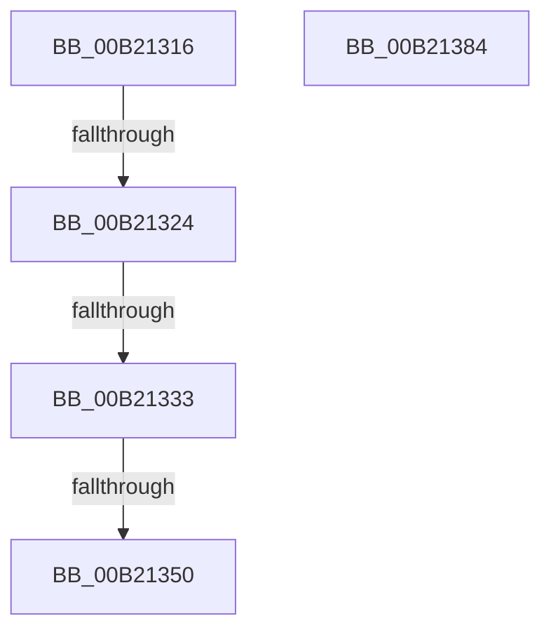

# sub_00B21316

- RVA: `0x00B21316`–`0x00B21391` (길이 `123` bytes)
- VA: `0x0000000140B21316`
- 실행 섹션: `PAGE`
- PDB 이름 있음: `아니요`; PDB Function 태그: `아니요`
- unwind 정보 RVA: `0x00089728`
- 디코드: `34`개 명령, `123/123` bytes 표시
- 미해석 바이트: `0` (있으면 어셈블리에 `.byte`로 보존)

> 이 문서는 커널 이미지의 기계어와 PDB 기호를 분석해 생성했습니다. 4번과 5번은 함수 원형과 자료형을 바이너리 사용 방식에서 추정한 C 해석이며 원본 소스 복구 결과는 아닙니다.

## 1. Dependencies

- 직접 호출 지점: **0**; 고유 호출 대상: **0**
- 직접 호출자로 확인된 함수: **0**
- RIP 상대 이미지 참조: **0**

### Outgoing calls
- 직접 디코드된 call 명령이 없습니다.

### Direct callers
- 이 함수 시작 RVA로 연결되는 직접 call은 확인되지 않았습니다. 간접 호출은 완전히 역산할 수 없습니다.

### Static image references
- 디코드된 RIP-relative 메모리 참조가 없습니다.

## 2. Other-region calls and transfers

- 다른 실행 섹션으로 향하는 call: **0**
- call이 아닌 외부 분기/꼬리 이동: **5**
  - `0x00B2131E` → [sub_0090E189 + 0xF8](../90/Unknown_function_0090E189.md) (`tail-transfer`)
  - `0x00B2132D` → [sub_0090E189 + 0xF8](../90/Unknown_function_0090E189.md) (`tail-transfer`)
  - `0x00B2134A` → [sub_0090E189 + 0xF8](../90/Unknown_function_0090E189.md) (`tail-transfer`)
  - `0x00B2137F` → [sub_0090E2AA + 0xF3](../90/Unknown_function_0090E2AA.md) (`tail-transfer`)
  - `0x00B2138C` → [sub_0090E098 + 0xAC](../90/Unknown_function_0090E098.md) (`tail-transfer`)

## 3. Assembly (complete function range)

```asm
00B21316  C1 E9 04                        shr ecx, 4
00B21319  FF C9                           dec ecx
00B2131B  83 F9 0F                        cmp ecx, 0xf
00B2131E  0F 87 5D CF DE FF               ja 0x14090e281
00B21324  41 8B CE                        mov ecx, r14d
00B21327  80 E1 C0                        and cl, 0xc0
00B2132A  80 F9 80                        cmp cl, 0x80
00B2132D  0F 85 4E CF DE FF               jne 0x14090e281
00B21333  41 0F BE 51 01                  movsx edx, byte ptr [r9 + 1]
00B21338  41 83 E6 3F                     and r14d, 0x3f
00B2133C  C1 E6 06                        shl esi, 6
00B2133F  8B CA                           mov ecx, edx
00B21341  80 E1 C0                        and cl, 0xc0
00B21344  41 0B F6                        or esi, r14d
00B21347  80 F9 80                        cmp cl, 0x80
00B2134A  0F 85 31 CF DE FF               jne 0x14090e281
00B21350  C1 E6 06                        shl esi, 6
00B21353  83 E2 3F                        and edx, 0x3f
00B21356  0B F2                           or esi, edx
00B21358  49 83 C1 02                     add r9, 2
00B2135C  8B CE                           mov ecx, esi
00B2135E  66 41 23 F5                     and si, r13w
00B21362  C1 E9 0A                        shr ecx, 0xa
00B21365  66 41 23 CF                     and cx, r15w
00B21369  66 41 2B CC                     sub cx, r12w
00B2136D  66 89 08                        mov word ptr [rax], cx
00B21370  48 83 C0 02                     add rax, 2
00B21374  B9 00 24 00 00                  mov ecx, 0x2400
00B21379  66 2B F1                        sub si, cx
00B2137C  0F B7 F6                        movzx esi, si
00B2137F  E9 19 D0 DE FF                  jmp 0x14090e39d
00B21384  66 44 89 30                     mov word ptr [rax], r14w
00B21388  48 83 C0 02                     add rax, 2
00B2138C  E9 B3 CD DE FF                  jmp 0x14090e144
```

## 4. C-style interpretation (structured pseudocode)

```c
__int64 __fastcall sub_00B21316(int a1, __int64 a2, __int64 a3, __int64 a4)
{
    __int64 result;
    __int64 v_r14;
    __int64 v_rsi;

    a1 = (unsigned int)((a1) >> (4));
    a1 = (unsigned int)((a1) - 1);
    a1 = (unsigned __int8)(((unsigned int)((unsigned int)(v_r14))) & (192));
    v_r14 = (unsigned int)((v_r14) & (63));
    v_rsi = (unsigned int)((v_rsi) << (6));
    a1 = (unsigned __int8)(((unsigned int)((unsigned int)((__int8)(*(unsigned __int8 *)(a4 + 1))))) & (192));
    v_rsi = (unsigned int)((v_rsi) | ((unsigned int)(v_r14)));
    v_rsi = (unsigned int)((v_rsi) << (6));
    a2 = (unsigned int)(((__int8)(*(unsigned __int8 *)(a4 + 1))) & (63));
    v_rsi = (unsigned int)((v_rsi) | ((unsigned int)(a2)));
    a4 = (a4) + (2);
    v_rsi = (unsigned __int16)((v_rsi) & ((unsigned __int16)(v_r13)));
    a1 = (unsigned int)(((unsigned int)((unsigned int)(v_rsi))) >> (10));
    a1 = (unsigned __int16)((a1) & ((unsigned __int16)(v_r15)));
    a1 = (unsigned __int16)((a1) - ((unsigned __int16)(v_r12)));
    *(unsigned __int16 *)(result) = (unsigned __int16)(a1);
    result = (result) + (2);
    v_rsi = (unsigned __int16)((v_rsi) - ((unsigned __int16)((unsigned int)(0x2400ULL))));
}
```

## 5. (Beta) C Style

```c
int64_t sub_00B21316(int32_t Arg1, int64_t Arg2, int64_t Arg3, void *Arg4)
{
    uint8_t *arg4 = (uint8_t *)Arg4;

    int64_t result;
    int64_t local_r14;
    int64_t local_rsi;

    Arg1 = (uint32_t)((Arg1) >> (4));
    Arg1 = (uint32_t)((Arg1) - 1);
    Arg1 = (uint8_t)(((uint32_t)((uint32_t)(local_r14))) & (192));
    local_r14 = (uint32_t)((local_r14) & (63));
    local_rsi = (uint32_t)((local_rsi) << (6));
    Arg1 = (uint8_t)(((uint32_t)((uint32_t)((int8_t)(*(uint8_t *)(arg4 + 0x1))))) & (192));
    local_rsi = (uint32_t)((local_rsi) | ((uint32_t)(local_r14)));
    local_rsi = (uint32_t)((local_rsi) << (6));
    Arg2 = (uint32_t)(((int8_t)(*(uint8_t *)(arg4 + 0x1))) & (63));
    local_rsi = (uint32_t)((local_rsi) | ((uint32_t)(Arg2)));
    Arg4 = (Arg4) + (2);
    local_rsi = (uint16_t)((local_rsi) & ((uint16_t)(local_r13)));
    Arg1 = (uint32_t)(((uint32_t)((uint32_t)(local_rsi))) >> (10));
    Arg1 = (uint16_t)((Arg1) & ((uint16_t)(local_r15)));
    Arg1 = (uint16_t)((Arg1) - ((uint16_t)(local_r12)));
    *(uint16_t *)(result) = (uint16_t)(Arg1);
    result = (result) + (2);
    local_rsi = (uint16_t)((local_rsi) - ((uint16_t)((uint32_t)(0x2400ULL))));
}
```

### 관측된 메모리 오프셋

구조체 형식이 확인되지 않은 접근은 인자 기준의 오프셋으로만 기록했습니다.

| 기준 인자 | 오프셋 표현 | 폭 (bit) | 접근 |
|---|---:|---:|---|
| `Arg4` | `+ 0x1` | `8` | `R` |

## 6. Execution-region graph

[열기: 2D/3D 그래프와 함수 탐색 컨트롤 패널](../../../control-panel.html?section=page&rva=0x00B21316&view=graph)

- 2D 그래프는 위에서 아래로 흐르고, 3D 그래프는 빈 공간을 드래그해 회전합니다. Shift+드래그는 이동, 휠은 확대·축소, 함수 노드 선택은 대상 보고서 이동입니다.

### Static fallback


