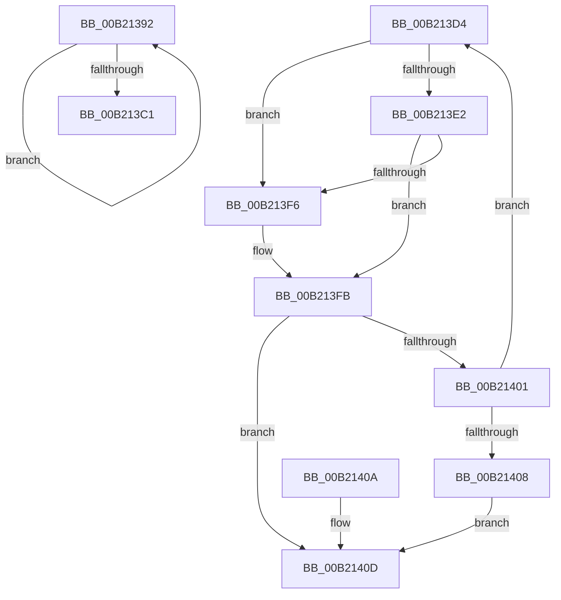

# sub_00B21392

- RVA: `0x00B21392`–`0x00B21421` (길이 `143` bytes)
- VA: `0x0000000140B21392`
- 실행 섹션: `PAGE`
- PDB 이름 있음: `아니요`; PDB Function 태그: `아니요`
- unwind 정보 RVA: `0x0008980C`
- 디코드: `41`개 명령, `143/143` bytes 표시
- 미해석 바이트: `0` (있으면 어셈블리에 `.byte`로 보존)

> 이 문서는 커널 이미지의 기계어와 PDB 기호를 분석해 생성했습니다. 4번과 5번은 함수 원형과 자료형을 바이너리 사용 방식에서 추정한 C 해석이며 원본 소스 복구 결과는 아닙니다.

## 1. Dependencies

- 직접 호출 지점: **0**; 고유 호출 대상: **0**
- 직접 호출자로 확인된 함수: **0**
- RIP 상대 이미지 참조: **0**

### Outgoing calls
- 직접 디코드된 call 명령이 없습니다.

### Direct callers
- 이 함수 시작 RVA로 연결되는 직접 call은 확인되지 않았습니다. 간접 호출은 완전히 역산할 수 없습니다.

### Static image references
- 디코드된 RIP-relative 메모리 참조가 없습니다.

## 2. Other-region calls and transfers

- 다른 실행 섹션으로 향하는 call: **0**
- call이 아닌 외부 분기/꼬리 이동: **2**
  - `0x00B213CF` → [RtlGenerate8dot3Name + 0x22B](../90/RtlGenerate8dot3Name_function_0090E950.md) (`tail-transfer`)
  - `0x00B2141C` → [RtlGenerate8dot3Name + 0x35D](../90/RtlGenerate8dot3Name_function_0090E950.md) (`tail-transfer`)

## 3. Assembly (complete function range)

```asm
00B21392  0F B6 47 03                     movzx eax, byte ptr [rdi + 3]
00B21396  41 0F B7 CA                     movzx ecx, r10w
00B2139A  66 83 E1 0F                     and cx, 0xf
00B2139E  8B D6                           mov edx, esi
00B213A0  66 83 F9 09                     cmp cx, 9
00B213A4  66 0F 47 D5                     cmova dx, bp
00B213A8  41 03 C0                        add eax, r8d
00B213AB  66 03 D1                        add dx, cx
00B213AE  66 41 C1 EA 04                  shr r10w, 4
00B213B3  41 FF C0                        inc r8d
00B213B6  66 89 54 47 04                  mov word ptr [rdi + rax*2 + 4], dx
00B213BB  41 83 F8 04                     cmp r8d, 4
00B213BF  72 D1                           jb 0x140b21392
00B213C1  80 47 03 04                     add byte ptr [rdi + 3], 4
00B213C5  41 B9 2E 00 00 00               mov r9d, 0x2e
00B213CB  C6 47 02 01                     mov byte ptr [rdi + 2], 1
00B213CF  E9 A7 D7 DE FF                  jmp 0x14090eb7b
00B213D4  8B C1                           mov eax, ecx
00B213D6  44 0F B7 44 47 04               movzx r8d, word ptr [rdi + rax*2 + 4]
00B213DC  41 83 F8 7F                     cmp r8d, 0x7f
00B213E0  76 14                           jbe 0x140b213f6
00B213E2  41 8B C0                        mov eax, r8d
00B213E5  4C 8B 44 24 28                  mov r8, qword ptr [rsp + 0x28]
00B213EA  41 38 5C 40 01                  cmp byte ptr [r8 + rax*2 + 1], bl
00B213EF  B8 02 00 00 00                  mov eax, 2
00B213F4  75 05                           jne 0x140b213fb
00B213F6  B8 01 00 00 00                  mov eax, 1
00B213FB  03 D0                           add edx, eax
00B213FD  3B D5                           cmp edx, ebp
00B213FF  77 0C                           ja 0x140b2140d
00B21401  FF C1                           inc ecx
00B21403  41 3B C9                        cmp ecx, r9d
00B21406  72 CC                           jb 0x140b213d4
00B21408  EB 03                           jmp 0x140b2140d
00B2140A  8D 48 FF                        lea ecx, [rax - 1]
00B2140D  B8 27 04 00 C0                  mov eax, 0xc0000427
00B21412  88 4F 03                        mov byte ptr [rdi + 3], cl
00B21415  84 C9                           test cl, cl
00B21417  0F 44 D8                        cmove ebx, eax
00B2141A  8B C3                           mov eax, ebx
00B2141C  E9 8C D8 DE FF                  jmp 0x14090ecad
```

## 4. C-style interpretation (structured pseudocode)

```c
__int64 __fastcall sub_00B21392(__int64 a1, __int64 a2, int a3)
{
    __int64 result;
    __int64 v_r10;
    unsigned __int64 v_stack_p28;

    a1 = (unsigned __int16)(((unsigned __int16)(v_r10)) & (15));
    a2 = (unsigned int)((unsigned int)(v_rsi));
    if (((unsigned __int16)(a1)) > 9) { a2 = (unsigned __int16)(v_rbp); }
    result = (unsigned int)((*(unsigned __int8 *)(v_rdi + 3)) + (a3));
    a2 = (unsigned __int16)((a2) + ((unsigned __int16)(a1)));
    v_r10 = (unsigned __int16)((v_r10) >> (4));
    a3 = (unsigned int)((a3) + 1);
    *(unsigned __int16 *)(v_rdi + result * 2 + 4) = (unsigned __int16)(a2);
    if (a3 < 4) goto loc_00B21392;
    *(unsigned __int8 *)(v_rdi + 2) = 1;
}
```

## 5. (Beta) C Style

```c
int64_t sub_00B21392(int64_t Arg1, int64_t Arg2, int32_t Arg3)
{
    int64_t result;
    int64_t local_r10;
    uint64_t v_stack_p28;

    Arg1 = (uint16_t)(((uint16_t)(local_r10)) & (15));
    Arg2 = (uint32_t)((uint32_t)(local_rsi));
    if (((uint16_t)(Arg1)) > 9) { Arg2 = (uint16_t)(local_rbp); }
    result = (uint32_t)((*(uint8_t *)(local_rdi + 0x3)) + (Arg3));
    Arg2 = (uint16_t)((Arg2) + ((uint16_t)(Arg1)));
    local_r10 = (uint16_t)((local_r10) >> (4));
    Arg3 = (uint32_t)((Arg3) + 1);
    *(uint16_t *)(local_rdi + result * 2 + 0x4) = (uint16_t)(Arg2);
    if (Arg3 < 4) goto loc_00B21392;
    *(uint8_t *)(local_rdi + 0x2) = 1;
}
```

## 6. Execution-region graph

[열기: 2D/3D 그래프와 함수 탐색 컨트롤 패널](../../../control-panel.html?section=page&rva=0x00B21392&view=graph)

- 2D 그래프는 위에서 아래로 흐르고, 3D 그래프는 빈 공간을 드래그해 회전합니다. Shift+드래그는 이동, 휠은 확대·축소, 함수 노드 선택은 대상 보고서 이동입니다.

### Static fallback


