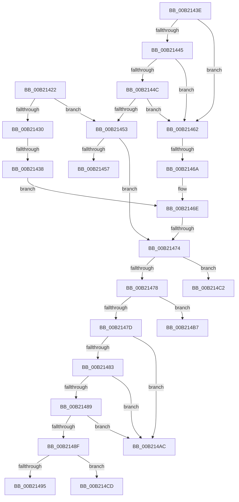

# sub_00B21422

- RVA: `0x00B21422`–`0x00B214D8` (길이 `182` bytes)
- VA: `0x0000000140B21422`
- 실행 섹션: `PAGE`
- PDB 이름 있음: `아니요`; PDB Function 태그: `아니요`
- unwind 정보 RVA: `0x0008A120`
- 디코드: `48`개 명령, `182/182` bytes 표시
- 미해석 바이트: `0` (있으면 어셈블리에 `.byte`로 보존)

> 이 문서는 커널 이미지의 기계어와 PDB 기호를 분석해 생성했습니다. 4번과 5번은 함수 원형과 자료형을 바이너리 사용 방식에서 추정한 C 해석이며 원본 소스 복구 결과는 아닙니다.

## 1. Dependencies

- 직접 호출 지점: **1**; 고유 호출 대상: **1**
- 직접 호출자로 확인된 함수: **0**
- RIP 상대 이미지 참조: **1**

### Outgoing calls
- `0x00B21427` → [PopIsHibernateSupported](../AA/PopIsHibernateSupported_function_00AA3DFC.md) (function, `0x00AA3DFC`)

### Direct callers
- 이 함수 시작 RVA로 연결되는 직접 call은 확인되지 않았습니다. 간접 호출은 완전히 역산할 수 없습니다.

### Static image references
- `0x00B21495` → RVA `0x00FC6D44` (`ALMOSTRO`; read)

## 2. Other-region calls and transfers

- 다른 실행 섹션으로 향하는 call: **0**
- call이 아닌 외부 분기/꼬리 이동: **9**
  - `0x00B21432` → [PopPowerAggregatorDetermineTargetSystemPowerState + 0xB1](../91/PopPowerAggregatorDetermineTargetSystemPowerState_function_009106A8.md) (`tail-transfer`)
  - `0x00B2145D` → [PopPowerAggregatorDetermineTargetSystemPowerState + 0xB8](../91/PopPowerAggregatorDetermineTargetSystemPowerState_function_009106A8.md) (`tail-transfer`)
  - `0x00B21464` → [PopPowerAggregatorDetermineTargetSystemPowerState + 0xB1](../91/PopPowerAggregatorDetermineTargetSystemPowerState_function_009106A8.md) (`tail-transfer`)
  - `0x00B2146E` → [PopPowerAggregatorDetermineTargetSystemPowerState + 0xB1](../91/PopPowerAggregatorDetermineTargetSystemPowerState_function_009106A8.md) (`tail-transfer`)
  - `0x00B214A7` → [PopPowerAggregatorDetermineTargetSystemPowerState + 0xA9](../91/PopPowerAggregatorDetermineTargetSystemPowerState_function_009106A8.md) (`tail-transfer`)
  - `0x00B214B2` → [PopPowerAggregatorDetermineTargetSystemPowerState + 0xA9](../91/PopPowerAggregatorDetermineTargetSystemPowerState_function_009106A8.md) (`tail-transfer`)
  - `0x00B214BD` → [PopPowerAggregatorDetermineTargetSystemPowerState + 0xA9](../91/PopPowerAggregatorDetermineTargetSystemPowerState_function_009106A8.md) (`tail-transfer`)
  - `0x00B214C8` → [PopPowerAggregatorDetermineTargetSystemPowerState + 0xA9](../91/PopPowerAggregatorDetermineTargetSystemPowerState_function_009106A8.md) (`tail-transfer`)
  - `0x00B214D3` → [PopPowerAggregatorDetermineTargetSystemPowerState + 0xB8](../91/PopPowerAggregatorDetermineTargetSystemPowerState_function_009106A8.md) (`tail-transfer`)

## 3. Assembly (complete function range)

```asm
00B21422  48 8D 4C 24 20                  lea rcx, [rsp + 0x20]
00B21427  E8 D0 29 F8 FF                  call 0x140aa3dfc
00B2142C  84 C0                           test al, al
00B2142E  74 23                           je 0x140b21453
00B21430  84 DB                           test bl, bl
00B21432  0F 84 21 F3 DE FF               je 0x140910759
00B21438  45 39 4A 58                     cmp dword ptr [r10 + 0x58], r9d
00B2143C  EB 30                           jmp 0x140b2146e
00B2143E  44 38 4C 24 23                  cmp byte ptr [rsp + 0x23], r9b
00B21443  75 1D                           jne 0x140b21462
00B21445  44 38 4C 24 24                  cmp byte ptr [rsp + 0x24], r9b
00B2144A  75 16                           jne 0x140b21462
00B2144C  44 38 4C 24 25                  cmp byte ptr [rsp + 0x25], r9b
00B21451  75 0F                           jne 0x140b21462
00B21453  84 DB                           test bl, bl
00B21455  75 1D                           jne 0x140b21474
00B21457  41 B9 BB 00 00 C0               mov r9d, 0xc00000bb
00B2145D  E9 FE F2 DE FF                  jmp 0x140910760
00B21462  84 DB                           test bl, bl
00B21464  0F 84 EF F2 DE FF               je 0x140910759
00B2146A  45 39 4A 3C                     cmp dword ptr [r10 + 0x3c], r9d
00B2146E  0F 85 E5 F2 DE FF               jne 0x140910759
00B21474  85 F6                           test esi, esi
00B21476  75 4A                           jne 0x140b214c2
00B21478  45 85 C0                        test r8d, r8d
00B2147B  74 3A                           je 0x140b214b7
00B2147D  41 83 E8 02                     sub r8d, 2
00B21481  74 29                           je 0x140b214ac
00B21483  41 83 E8 01                     sub r8d, 1
00B21487  74 23                           je 0x140b214ac
00B21489  41 83 E8 01                     sub r8d, 1
00B2148D  74 1D                           je 0x140b214ac
00B2148F  41 83 F8 01                     cmp r8d, 1
00B21493  75 38                           jne 0x140b214cd
00B21495  8B 05 A9 58 4A 00               mov eax, dword ptr [rip + 0x4a58a9]
00B2149B  F7 D8                           neg eax
00B2149D  45 1B C0                        sbb r8d, r8d
00B214A0  41 83 E0 05                     and r8d, 5
00B214A4  41 FF C0                        inc r8d
00B214A7  E9 A5 F2 DE FF                  jmp 0x140910751
00B214AC  41 B8 05 00 00 00               mov r8d, 5
00B214B2  E9 9A F2 DE FF                  jmp 0x140910751
00B214B7  41 B8 04 00 00 00               mov r8d, 4
00B214BD  E9 8F F2 DE FF                  jmp 0x140910751
00B214C2  41 B8 01 00 00 00               mov r8d, 1
00B214C8  E9 84 F2 DE FF                  jmp 0x140910751
00B214CD  41 B9 0D 00 00 C0               mov r9d, 0xc000000d
00B214D3  E9 88 F2 DE FF                  jmp 0x140910760
```

## 4. C-style interpretation (structured pseudocode)

```c
__int64 __fastcall sub_00B21422(__int64 a1, __int64 a2, int a3, int a4)
{
    __int64 result;
    unsigned __int64 v_stack_p20;
    unsigned __int8 v_stack_p23;
    unsigned __int8 v_stack_p24;
    unsigned __int8 v_stack_p25;

    result = PopIsHibernateSupported(v_stack_p20, a2, a3, a4);
    if ((unsigned __int8)(result) == 0) goto loc_00B21453;
    goto loc_00B2146E;
loc_00B21453:
    if ((unsigned __int8)(v_rbx) != 0) goto loc_00B21474;
loc_00B2146E:
loc_00B21474:
    if ((unsigned int)(v_rsi) != 0) goto loc_00B214C2;
    if (a3 == 0) goto loc_00B214B7;
    a3 = (unsigned int)((a3) - (2));
    if (condition_is_equal) goto loc_00B214AC;
    a3 = (unsigned int)((a3) - (1));
    if (condition_is_equal) goto loc_00B214AC;
    a3 = (unsigned int)((a3) - (1));
    if (condition_is_equal) goto loc_00B214AC;
    if (a3 != 1) goto loc_00B214CD;
    result = (unsigned int)(-((unsigned int)(*(unsigned int *)(v_rip + 4872361))));
    a3 = (unsigned int)((a3) & (5));
    a3 = (unsigned int)((a3) + 1);
loc_00B214AC:
loc_00B214B7:
loc_00B214C2:
loc_00B214CD:
}
```

## 5. (Beta) C Style

```c
int64_t sub_00B21422(int64_t Arg1, int64_t Arg2, int32_t Arg3, int32_t Arg4)
{
    int64_t result;
    uint64_t v_stack_p20;
    uint8_t v_stack_p23;
    uint8_t v_stack_p24;
    uint8_t v_stack_p25;

    result = PopIsHibernateSupported(v_stack_p20, Arg2, Arg3, Arg4);
    if ((uint8_t)(result) == 0) goto loc_00B21453;
    goto loc_00B2146E;
loc_00B21453:
    if ((uint8_t)(local_rbx) != 0) goto loc_00B21474;
loc_00B2146E:
loc_00B21474:
    if ((uint32_t)(local_rsi) != 0) goto loc_00B214C2;
    if (Arg3 == 0) goto loc_00B214B7;
    Arg3 = (uint32_t)((Arg3) - (2));
    if (condition_is_equal) goto loc_00B214AC;
    Arg3 = (uint32_t)((Arg3) - (1));
    if (condition_is_equal) goto loc_00B214AC;
    Arg3 = (uint32_t)((Arg3) - (1));
    if (condition_is_equal) goto loc_00B214AC;
    if (Arg3 != 1) goto loc_00B214CD;
    result = (uint32_t)(-((uint32_t)(*(uint32_t *)(v_rip + 0x4A58A9))));
    Arg3 = (uint32_t)((Arg3) & (5));
    Arg3 = (uint32_t)((Arg3) + 1);
loc_00B214AC:
loc_00B214B7:
loc_00B214C2:
loc_00B214CD:
}
```

## 6. Execution-region graph

[열기: 2D/3D 그래프와 함수 탐색 컨트롤 패널](../../../control-panel.html?section=page&rva=0x00B21422&view=graph)

- 2D 그래프는 위에서 아래로 흐르고, 3D 그래프는 빈 공간을 드래그해 회전합니다. Shift+드래그는 이동, 휠은 확대·축소, 함수 노드 선택은 대상 보고서 이동입니다.

### Static fallback


