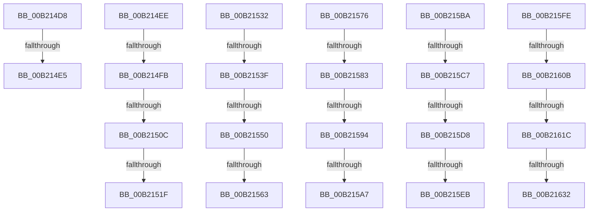

# sub_00B214D8

- RVA: `0x00B214D8`–`0x00B21645` (길이 `365` bytes)
- VA: `0x0000000140B214D8`
- 실행 섹션: `PAGE`
- PDB 이름 있음: `아니요`; PDB Function 태그: `아니요`
- unwind 정보 RVA: `0x0008A178`
- 디코드: `74`개 명령, `365/365` bytes 표시
- 미해석 바이트: `0` (있으면 어셈블리에 `.byte`로 보존)

> 이 문서는 커널 이미지의 기계어와 PDB 기호를 분석해 생성했습니다. 4번과 5번은 함수 원형과 자료형을 바이너리 사용 방식에서 추정한 C 해석이며 원본 소스 복구 결과는 아닙니다.

## 1. Dependencies

- 직접 호출 지점: **0**; 고유 호출 대상: **0**
- 직접 호출자로 확인된 함수: **0**
- RIP 상대 이미지 참조: **3**

### Outgoing calls
- 직접 디코드된 call 명령이 없습니다.

### Direct callers
- 이 함수 시작 RVA로 연결되는 직접 call은 확인되지 않았습니다. 간접 호출은 완전히 역산할 수 없습니다.

### Static image references
- `0x00B214D8` → RVA `0x00F0CEC3` (`.data`; read)
- `0x00B214EE` → RVA `0x00F0CEC4` (`.data`; read)
- `0x00B2151F` → RVA `0x00F0CEC5` (`.data`; read)

## 2. Other-region calls and transfers

- 다른 실행 섹션으로 향하는 call: **0**
- call이 아닌 외부 분기/꼬리 이동: **22**
  - `0x00B214DF` → [PopVerifySystemPowerPolicy + 0xCF](../91/PopVerifySystemPowerPolicy_function_00910A8C.md) (`tail-transfer`)
  - `0x00B214E9` → [PopVerifySystemPowerPolicy + 0xCF](../91/PopVerifySystemPowerPolicy_function_00910A8C.md) (`tail-transfer`)
  - `0x00B214F5` → [PopVerifySystemPowerPolicy + 0x1C8](../91/PopVerifySystemPowerPolicy_function_00910A8C.md) (`tail-transfer`)
  - `0x00B21506` → [PopVerifySystemPowerPolicy + 0x1C8](../91/PopVerifySystemPowerPolicy_function_00910A8C.md) (`tail-transfer`)
  - `0x00B21519` → [PopVerifySystemPowerPolicy + 0x1C8](../91/PopVerifySystemPowerPolicy_function_00910A8C.md) (`tail-transfer`)
  - `0x00B2152D` → [PopVerifySystemPowerPolicy + 0x1C8](../91/PopVerifySystemPowerPolicy_function_00910A8C.md) (`tail-transfer`)
  - `0x00B21539` → [PopVerifySystemPowerPolicy + 0x200](../91/PopVerifySystemPowerPolicy_function_00910A8C.md) (`tail-transfer`)
  - `0x00B2154A` → [PopVerifySystemPowerPolicy + 0x200](../91/PopVerifySystemPowerPolicy_function_00910A8C.md) (`tail-transfer`)
  - `0x00B2155D` → [PopVerifySystemPowerPolicy + 0x200](../91/PopVerifySystemPowerPolicy_function_00910A8C.md) (`tail-transfer`)
  - `0x00B21571` → [PopVerifySystemPowerPolicy + 0x200](../91/PopVerifySystemPowerPolicy_function_00910A8C.md) (`tail-transfer`)
  - `0x00B2157D` → [PopVerifySystemPowerPolicy + 0x23C](../91/PopVerifySystemPowerPolicy_function_00910A8C.md) (`tail-transfer`)
  - `0x00B2158E` → [PopVerifySystemPowerPolicy + 0x23C](../91/PopVerifySystemPowerPolicy_function_00910A8C.md) (`tail-transfer`)
  - `0x00B215A1` → [PopVerifySystemPowerPolicy + 0x23C](../91/PopVerifySystemPowerPolicy_function_00910A8C.md) (`tail-transfer`)
  - `0x00B215B5` → [PopVerifySystemPowerPolicy + 0x23C](../91/PopVerifySystemPowerPolicy_function_00910A8C.md) (`tail-transfer`)
  - `0x00B215C1` → [PopVerifySystemPowerPolicy + 0x278](../91/PopVerifySystemPowerPolicy_function_00910A8C.md) (`tail-transfer`)
  - `0x00B215D2` → [PopVerifySystemPowerPolicy + 0x278](../91/PopVerifySystemPowerPolicy_function_00910A8C.md) (`tail-transfer`)
  - `0x00B215E5` → [PopVerifySystemPowerPolicy + 0x278](../91/PopVerifySystemPowerPolicy_function_00910A8C.md) (`tail-transfer`)
  - `0x00B215F9` → [PopVerifySystemPowerPolicy + 0x278](../91/PopVerifySystemPowerPolicy_function_00910A8C.md) (`tail-transfer`)
  - `0x00B21605` → [PopVerifySystemPowerPolicy + 0x2D8](../91/PopVerifySystemPowerPolicy_function_00910A8C.md) (`tail-transfer`)
  - `0x00B21616` → [PopVerifySystemPowerPolicy + 0x2D8](../91/PopVerifySystemPowerPolicy_function_00910A8C.md) (`tail-transfer`)
  - `0x00B2162C` → [PopVerifySystemPowerPolicy + 0x2D8](../91/PopVerifySystemPowerPolicy_function_00910A8C.md) (`tail-transfer`)
  - `0x00B21640` → [PopVerifySystemPowerPolicy + 0x2D8](../91/PopVerifySystemPowerPolicy_function_00910A8C.md) (`tail-transfer`)

## 3. Assembly (complete function range)

```asm
00B214D8  44 38 3D E4 B9 3E 00            cmp byte ptr [rip + 0x3eb9e4], r15b
00B214DF  0F 84 76 F6 DE FF               je 0x140910b5b
00B214E5  44 89 6A 48                     mov dword ptr [rdx + 0x48], r13d
00B214E9  E9 6D F6 DE FF                  jmp 0x140910b5b
00B214EE  44 38 3D CF B9 3E 00            cmp byte ptr [rip + 0x3eb9cf], r15b
00B214F5  0F 85 59 F7 DE FF               jne 0x140910c54
00B214FB  45 8B CD                        mov r9d, r13d
00B214FE  8A 05 BF B9 3E 00               mov al, byte ptr [rip + 0x3eb9bf]
00B21504  84 C0                           test al, al
00B21506  0F 85 48 F7 DE FF               jne 0x140910c54
00B2150C  44 38 3D B1 B9 3E 00            cmp byte ptr [rip + 0x3eb9b1], r15b
00B21513  45 8B CD                        mov r9d, r13d
00B21516  44 8B CE                        mov r9d, esi
00B21519  0F 85 35 F7 DE FF               jne 0x140910c54
00B2151F  44 38 3D 9F B9 3E 00            cmp byte ptr [rip + 0x3eb99f], r15b
00B21526  45 8B CC                        mov r9d, r12d
00B21529  44 0F 44 CD                     cmove r9d, ebp
00B2152D  E9 22 F7 DE FF                  jmp 0x140910c54
00B21532  44 38 3D 8B B9 3E 00            cmp byte ptr [rip + 0x3eb98b], r15b
00B21539  0F 85 4D F7 DE FF               jne 0x140910c8c
00B2153F  45 8B CD                        mov r9d, r13d
00B21542  8A 05 7B B9 3E 00               mov al, byte ptr [rip + 0x3eb97b]
00B21548  84 C0                           test al, al
00B2154A  0F 85 3C F7 DE FF               jne 0x140910c8c
00B21550  44 38 3D 6D B9 3E 00            cmp byte ptr [rip + 0x3eb96d], r15b
00B21557  45 8B CD                        mov r9d, r13d
00B2155A  44 8B CE                        mov r9d, esi
00B2155D  0F 85 29 F7 DE FF               jne 0x140910c8c
00B21563  44 38 3D 5B B9 3E 00            cmp byte ptr [rip + 0x3eb95b], r15b
00B2156A  45 8B CC                        mov r9d, r12d
00B2156D  44 0F 44 CD                     cmove r9d, ebp
00B21571  E9 16 F7 DE FF                  jmp 0x140910c8c
00B21576  44 38 3D 47 B9 3E 00            cmp byte ptr [rip + 0x3eb947], r15b
00B2157D  0F 85 45 F7 DE FF               jne 0x140910cc8
00B21583  45 8B CD                        mov r9d, r13d
00B21586  8A 05 37 B9 3E 00               mov al, byte ptr [rip + 0x3eb937]
00B2158C  84 C0                           test al, al
00B2158E  0F 85 34 F7 DE FF               jne 0x140910cc8
00B21594  44 38 3D 29 B9 3E 00            cmp byte ptr [rip + 0x3eb929], r15b
00B2159B  45 8B CD                        mov r9d, r13d
00B2159E  44 8B CE                        mov r9d, esi
00B215A1  0F 85 21 F7 DE FF               jne 0x140910cc8
00B215A7  44 38 3D 17 B9 3E 00            cmp byte ptr [rip + 0x3eb917], r15b
00B215AE  45 8B CC                        mov r9d, r12d
00B215B1  44 0F 44 CD                     cmove r9d, ebp
00B215B5  E9 0E F7 DE FF                  jmp 0x140910cc8
00B215BA  44 38 3D 03 B9 3E 00            cmp byte ptr [rip + 0x3eb903], r15b
00B215C1  0F 85 3D F7 DE FF               jne 0x140910d04
00B215C7  45 8B CD                        mov r9d, r13d
00B215CA  8A 05 F3 B8 3E 00               mov al, byte ptr [rip + 0x3eb8f3]
00B215D0  84 C0                           test al, al
00B215D2  0F 85 2C F7 DE FF               jne 0x140910d04
00B215D8  44 38 3D E5 B8 3E 00            cmp byte ptr [rip + 0x3eb8e5], r15b
00B215DF  45 8B CD                        mov r9d, r13d
00B215E2  44 8B CE                        mov r9d, esi
00B215E5  0F 85 19 F7 DE FF               jne 0x140910d04
00B215EB  44 38 3D D3 B8 3E 00            cmp byte ptr [rip + 0x3eb8d3], r15b
00B215F2  45 8B CC                        mov r9d, r12d
00B215F5  44 0F 44 CD                     cmove r9d, ebp
00B215F9  E9 06 F7 DE FF                  jmp 0x140910d04
00B215FE  44 38 3D BF B8 3E 00            cmp byte ptr [rip + 0x3eb8bf], r15b
00B21605  0F 85 59 F7 DE FF               jne 0x140910d64
00B2160B  45 8B CD                        mov r9d, r13d
00B2160E  8A 05 AF B8 3E 00               mov al, byte ptr [rip + 0x3eb8af]
00B21614  84 C0                           test al, al
00B21616  0F 85 48 F7 DE FF               jne 0x140910d64
00B2161C  44 38 3D A1 B8 3E 00            cmp byte ptr [rip + 0x3eb8a1], r15b
00B21623  45 8B CD                        mov r9d, r13d
00B21626  41 B9 03 00 00 00               mov r9d, 3
00B2162C  0F 85 32 F7 DE FF               jne 0x140910d64
00B21632  44 38 3D 8C B8 3E 00            cmp byte ptr [rip + 0x3eb88c], r15b
00B21639  45 8B CC                        mov r9d, r12d
00B2163C  44 0F 44 CF                     cmove r9d, edi
00B21640  E9 1F F7 DE FF                  jmp 0x140910d64
```

## 4. C-style interpretation (structured pseudocode)

```c
__int64 __fastcall sub_00B214D8(__int64 a1, __int64 a2)
{
    *(unsigned int *)(a2 + 72) = (unsigned int)(v_r13);
}
```

## 5. (Beta) C Style

```c
int64_t sub_00B214D8(int64_t Arg1, void *Arg2)
{
    uint8_t *arg2 = (uint8_t *)Arg2;

    *(uint32_t *)(arg2 + 0x48) = (uint32_t)(local_r13);
}
```

### 관측된 메모리 오프셋

구조체 형식이 확인되지 않은 접근은 인자 기준의 오프셋으로만 기록했습니다.

| 기준 인자 | 오프셋 표현 | 폭 (bit) | 접근 |
|---|---:|---:|---|
| `Arg2` | `+ 0x48` | `32` | `W` |

## 6. Execution-region graph

[열기: 2D/3D 그래프와 함수 탐색 컨트롤 패널](../../../control-panel.html?section=page&rva=0x00B214D8&view=graph)

- 2D 그래프는 위에서 아래로 흐르고, 3D 그래프는 빈 공간을 드래그해 회전합니다. Shift+드래그는 이동, 휠은 확대·축소, 함수 노드 선택은 대상 보고서 이동입니다.

### Static fallback


