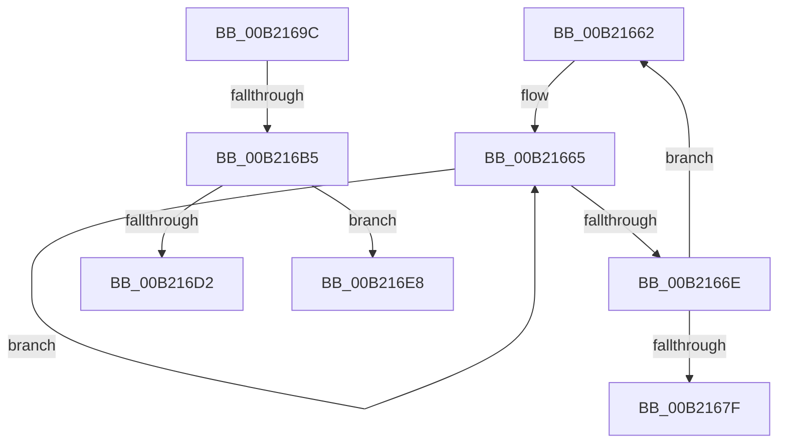

# sub_00B21662

- RVA: `0x00B21662`–`0x00B216EF` (길이 `141` bytes)
- VA: `0x0000000140B21662`
- 실행 섹션: `PAGE`
- PDB 이름 있음: `아니요`; PDB Function 태그: `아니요`
- unwind 정보 RVA: `0x0008A1E4`
- 디코드: `35`개 명령, `141/141` bytes 표시
- 미해석 바이트: `0` (있으면 어셈블리에 `.byte`로 보존)

> 이 문서는 커널 이미지의 기계어와 PDB 기호를 분석해 생성했습니다. 4번과 5번은 함수 원형과 자료형을 바이너리 사용 방식에서 추정한 C 해석이며 원본 소스 복구 결과는 아닙니다.

## 1. Dependencies

- 직접 호출 지점: **2**; 고유 호출 대상: **2**
- 직접 호출자로 확인된 함수: **0**
- RIP 상대 이미지 참조: **2**

### Outgoing calls
- `0x00B2168E` → [PopLogSleepDisabled](../91/PopLogSleepDisabled_function_009102D8.md) (function, `0x009102D8`)
- `0x00B216A7` → [ExAllocatePool2](../../poolcode/B8/ExAllocatePool2_function_00B820F0.md) (function, `0x00B820F0`)

### Direct callers
- 이 함수 시작 RVA로 연결되는 직접 call은 확인되지 않았습니다. 간접 호출은 완전히 역산할 수 없습니다.

### Static image references
- `0x00B216C6` → RVA `0x00F0CBB8` (`.data`; read)
- `0x00B216DC` → RVA `0x00F0CBB8` (`.data`; write)

## 2. Other-region calls and transfers

- 다른 실행 섹션으로 향하는 call: **1**
  - `0x00B216A7` → [ExAllocatePool2](../../poolcode/B8/ExAllocatePool2_function_00B820F0.md) (`PAGE` → `POOLCODE`)
- call이 아닌 외부 분기/꼬리 이동: **3**
  - `0x00B21697` → [PopFilterCapabilities + 0x281](../91/PopFilterCapabilities_function_0091141C.md) (`tail-transfer`)
  - `0x00B216AF` → [PopFilterCapabilities + 0x166](../91/PopFilterCapabilities_function_0091141C.md) (`tail-transfer`)
  - `0x00B216E3` → [PopFilterCapabilities + 0x166](../91/PopFilterCapabilities_function_0091141C.md) (`tail-transfer`)

## 3. Assembly (complete function range)

```asm
00B21662  49 8B C7                        mov rax, r15
00B21665  48 FF C0                        inc rax
00B21668  66 39 34 42                     cmp word ptr [rdx + rax*2], si
00B2166C  75 F7                           jne 0x140b21665
00B2166E  4D 8D 0C 41                     lea r9, [r9 + rax*2]
00B21672  49 83 C1 02                     add r9, 2
00B21676  49 8D 14 09                     lea rdx, [r9 + rcx]
00B2167A  66 39 32                        cmp word ptr [rdx], si
00B2167D  75 E3                           jne 0x140b21662
00B2167F  BA 1F 00 00 00                  mov edx, 0x1f
00B21684  4C 8B C1                        mov r8, rcx
00B21687  49 83 C1 02                     add r9, 2
00B2168B  8D 4A E5                        lea ecx, [rdx - 0x1b]
00B2168E  E8 45 EC DE FF                  call 0x1409102d8
00B21693  48 8B 4D 40                     mov rcx, qword ptr [rbp + 0x40]
00B21697  E9 01 00 DF FF                  jmp 0x14091169d
00B2169C  45 8B C7                        mov r8d, r15d
00B2169F  BA 20 00 00 00                  mov edx, 0x20
00B216A4  49 8B CD                        mov rcx, r13
00B216A7  E8 44 0A 06 00                  call 0x140b820f0
00B216AC  48 85 C0                        test rax, rax
00B216AF  0F 84 CD FE DE FF               je 0x140911582
00B216B5  C7 40 18 0E 00 00 00            mov dword ptr [rax + 0x18], 0xe
00B216BC  66 C7 40 10 01 01               mov word ptr [rax + 0x10], 0x101
00B216C2  C6 40 12 01                     mov byte ptr [rax + 0x12], 1
00B216C6  48 8B 0D EB B4 3E 00            mov rcx, qword ptr [rip + 0x3eb4eb]
00B216CD  48 39 39                        cmp qword ptr [rcx], rdi
00B216D0  75 16                           jne 0x140b216e8
00B216D2  48 89 38                        mov qword ptr [rax], rdi
00B216D5  48 89 48 08                     mov qword ptr [rax + 8], rcx
00B216D9  48 89 01                        mov qword ptr [rcx], rax
00B216DC  48 89 05 D5 B4 3E 00            mov qword ptr [rip + 0x3eb4d5], rax
00B216E3  E9 9A FE DE FF                  jmp 0x140911582
00B216E8  B9 03 00 00 00                  mov ecx, 3
00B216ED  CD 29                           int 0x29
```

## 4. C-style interpretation (structured pseudocode)

```c
__int64 __fastcall sub_00B21662(__int64 a1, __int64 a2, __int64 a3, __int64 a4)
{
    __int64 result;

loc_00B21665:
    result = (v_r15) + 1;
    if ((*(unsigned __int16 *)(a2 + result * 2)) != ((unsigned __int16)(v_rsi))) goto loc_00B21665;
    a4 = (a4 + result * 2) + (2);
    if ((*(unsigned __int16 *)(a4 + a1 * 1)) != ((unsigned __int16)(v_rsi))) goto loc_00B21662;
    a4 = (a4) + (2);
    result = PopLogSleepDisabled(31 - 27, 31, a1, a4);
}
```

## 5. (Beta) C Style

```c
int64_t sub_00B21662(int64_t Arg1, int64_t Arg2, int64_t Arg3, void *Arg4)
{
    uint8_t *arg4 = (uint8_t *)Arg4;

    int64_t result;

loc_00B21665:
    result = (local_r15) + 1;
    if ((*(uint16_t *)(Arg2 + result * 2)) != ((uint16_t)(local_rsi))) goto loc_00B21665;
    Arg4 = (Arg4 + result * 2) + (2);
    if ((*(uint16_t *)(arg4 + Arg1 * 1)) != ((uint16_t)(local_rsi))) goto loc_00B21662;
    Arg4 = (Arg4) + (2);
    result = PopLogSleepDisabled(31 - 27, 31, Arg1, Arg4);
}
```

### 관측된 메모리 오프셋

구조체 형식이 확인되지 않은 접근은 인자 기준의 오프셋으로만 기록했습니다.

| 기준 인자 | 오프셋 표현 | 폭 (bit) | 접근 |
|---|---:|---:|---|
| `Arg4` | `+ 0x0` | `16` | `R` |
| `Arg4` | `+ 0x0 + rax*2` | `64` | `R` |
| `Arg4` | `+ 0x0 + rcx*1` | `64` | `R` |

## 6. Execution-region graph

[열기: 2D/3D 그래프와 함수 탐색 컨트롤 패널](../../../control-panel.html?section=page&rva=0x00B21662&view=graph)

- 2D 그래프는 위에서 아래로 흐르고, 3D 그래프는 빈 공간을 드래그해 회전합니다. Shift+드래그는 이동, 휠은 확대·축소, 함수 노드 선택은 대상 보고서 이동입니다.

### Static fallback


