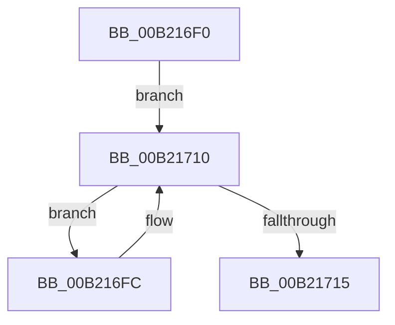

# sub_00B216F0

- RVA: `0x00B216F0`–`0x00B2173C` (길이 `76` bytes)
- VA: `0x0000000140B216F0`
- 실행 섹션: `PAGE`
- PDB 이름 있음: `아니요`; PDB Function 태그: `아니요`
- unwind 정보 RVA: `0x0008A210`
- 디코드: `22`개 명령, `76/76` bytes 표시
- 미해석 바이트: `0` (있으면 어셈블리에 `.byte`로 보존)

> 이 문서는 커널 이미지의 기계어와 PDB 기호를 분석해 생성했습니다. 4번과 5번은 함수 원형과 자료형을 바이너리 사용 방식에서 추정한 C 해석이며 원본 소스 복구 결과는 아닙니다.

## 1. Dependencies

- 직접 호출 지점: **2**; 고유 호출 대상: **2**
- 직접 호출자로 확인된 함수: **0**
- RIP 상대 이미지 참조: **1**

### Outgoing calls
- `0x00B21722` → [PopLogSleepDisabled](../91/PopLogSleepDisabled_function_009102D8.md) (function, `0x009102D8`)
- `0x00B21731` → [ExFreePoolWithTag](../../poolcode/B8/ExFreePoolWithTag_function_00B82870.md) (function, `0x00B82870`)

### Direct callers
- 이 함수 시작 RVA로 연결되는 직접 call은 확인되지 않았습니다. 간접 호출은 완전히 역산할 수 없습니다.

### Static image references
- `0x00B216F0` → RVA `0x00F0EA70` (`.data`; read)

## 2. Other-region calls and transfers

- 다른 실행 섹션으로 향하는 call: **1**
  - `0x00B21731` → [ExFreePoolWithTag](../../poolcode/B8/ExFreePoolWithTag_function_00B82870.md) (`PAGE` → `POOLCODE`)
- call이 아닌 외부 분기/꼬리 이동: **1**
  - `0x00B21737` → [PopLogDisabledSleepReason + 0x46](../91/PopLogDisabledSleepReason_function_00911730.md) (`tail-transfer`)

## 3. Assembly (complete function range)

```asm
00B216F0  48 8B 0D 79 D3 3E 00            mov rcx, qword ptr [rip + 0x3ed379]
00B216F7  4C 8B C6                        mov r8, rsi
00B216FA  EB 14                           jmp 0x140b21710
00B216FC  8B 41 10                        mov eax, dword ptr [rcx + 0x10]
00B216FF  41 89 00                        mov dword ptr [r8], eax
00B21702  4D 8D 40 08                     lea r8, [r8 + 8]
00B21706  8B 41 14                        mov eax, dword ptr [rcx + 0x14]
00B21709  41 89 40 FC                     mov dword ptr [r8 - 4], eax
00B2170D  48 8B 09                        mov rcx, qword ptr [rcx]
00B21710  49 3B CE                        cmp rcx, r14
00B21713  75 E7                           jne 0x140b216fc
00B21715  4C 8B CD                        mov r9, rbp
00B21718  4C 8B C6                        mov r8, rsi
00B2171B  8B D7                           mov edx, edi
00B2171D  B9 0D 00 00 00                  mov ecx, 0xd
00B21722  E8 B1 EB DE FF                  call 0x1409102d8
00B21727  BA 63 62 75 66                  mov edx, 0x66756263
00B2172C  48 8B CE                        mov rcx, rsi
00B2172F  8B D8                           mov ebx, eax
00B21731  E8 3A 11 06 00                  call 0x140b82870
00B21736  90                              nop
00B21737  E9 3A 00 DF FF                  jmp 0x140911776
```

## 4. C-style interpretation (structured pseudocode)

```c
__int64 __fastcall sub_00B216F0(void)
{
    __int64 result;

    goto loc_00B21710;
loc_00B216FC:
    *(unsigned int *)(v_rsi) = (unsigned int)((unsigned int)(*(unsigned int *)(*(unsigned __int64 *)(v_rip + 4117369) + 16)));
    *(unsigned int *)(v_rsi + 8 - 4) = (unsigned int)((unsigned int)(*(unsigned int *)(*(unsigned __int64 *)(v_rip + 4117369) + 20)));
loc_00B21710:
    if ((*(unsigned __int64 *)(*(unsigned __int64 *)(v_rip + 4117369))) != v_r14) goto loc_00B216FC;
    result = PopLogSleepDisabled(13, (unsigned int)((unsigned int)(v_rdi)), v_rsi, v_rbp);
    result = ExFreePoolWithTag(v_rsi, (unsigned int)(0x66756263ULL), v_rsi, v_rbp);
}
```

## 5. (Beta) C Style

```c
void sub_00B216F0(void)
{
    int64_t result;

    goto loc_00B21710;
loc_00B216FC:
    *(uint32_t *)(local_rsi) = (uint32_t)((uint32_t)(*(uint32_t *)(*(uint64_t *)(v_rip + 0x3ED379) + 0x10)));
    *(uint32_t *)(local_rsi + 0x8 - 0x4) = (uint32_t)((uint32_t)(*(uint32_t *)(*(uint64_t *)(v_rip + 0x3ED379) + 0x14)));
loc_00B21710:
    if ((*(uint64_t *)(*(uint64_t *)(v_rip + 0x3ED379))) != local_r14) goto loc_00B216FC;
    result = PopLogSleepDisabled(13, (uint32_t)((uint32_t)(local_rdi)), local_rsi, local_rbp);
    result = ExFreePoolWithTag(local_rsi, (uint32_t)(0x66756263ULL), local_rsi, local_rbp);
}
```

## 6. Execution-region graph

[열기: 2D/3D 그래프와 함수 탐색 컨트롤 패널](../../../control-panel.html?section=page&rva=0x00B216F0&view=graph)

- 2D 그래프는 위에서 아래로 흐르고, 3D 그래프는 빈 공간을 드래그해 회전합니다. Shift+드래그는 이동, 휠은 확대·축소, 함수 노드 선택은 대상 보고서 이동입니다.

### Static fallback


