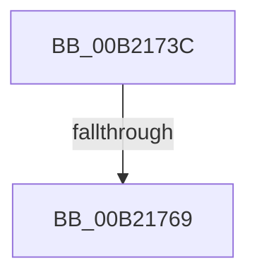

# sub_00B2173C

- RVA: `0x00B2173C`–`0x00B21798` (길이 `92` bytes)
- VA: `0x0000000140B2173C`
- 실행 섹션: `PAGE`
- PDB 이름 있음: `아니요`; PDB Function 태그: `아니요`
- unwind 정보 RVA: `0x0008A240`
- 디코드: `23`개 명령, `92/92` bytes 표시
- 미해석 바이트: `0` (있으면 어셈블리에 `.byte`로 보존)

> 이 문서는 커널 이미지의 기계어와 PDB 기호를 분석해 생성했습니다. 4번과 5번은 함수 원형과 자료형을 바이너리 사용 방식에서 추정한 C 해석이며 원본 소스 복구 결과는 아닙니다.

## 1. Dependencies

- 직접 호출 지점: **3**; 고유 호출 대상: **3**
- 직접 호출자로 확인된 함수: **0**
- RIP 상대 이미지 참조: **0**

### Outgoing calls
- `0x00B21745` → [ExFreePoolWithTag](../../poolcode/B8/ExFreePoolWithTag_function_00B82870.md) (function, `0x00B82870`)
- `0x00B21758` → [ExAllocatePool2](../../poolcode/B8/ExAllocatePool2_function_00B820F0.md) (function, `0x00B820F0`)
- `0x00B2178D` → [ZwQueryDirectoryObject](../../text/6A/ZwQueryDirectoryObject_function_006AFAB0.md) (function, `0x006AFAB0`)

### Direct callers
- 이 함수 시작 RVA로 연결되는 직접 call은 확인되지 않았습니다. 간접 호출은 완전히 역산할 수 없습니다.

### Static image references
- 디코드된 RIP-relative 메모리 참조가 없습니다.

## 2. Other-region calls and transfers

- 다른 실행 섹션으로 향하는 call: **3**
  - `0x00B21745` → [ExFreePoolWithTag](../../poolcode/B8/ExFreePoolWithTag_function_00B82870.md) (`PAGE` → `POOLCODE`)
  - `0x00B21758` → [ExAllocatePool2](../../poolcode/B8/ExAllocatePool2_function_00B820F0.md) (`PAGE` → `POOLCODE`)
  - `0x00B2178D` → [ZwQueryDirectoryObject](../../text/6A/ZwQueryDirectoryObject_function_006AFAB0.md) (`PAGE` → `.text`)
- call이 아닌 외부 분기/꼬리 이동: **2**
  - `0x00B21763` → [IopGetLegacyVetoListDrivers + 0x22B](../91/IopGetLegacyVetoListDrivers_function_00911814.md) (`tail-transfer`)
  - `0x00B21793` → [IopGetLegacyVetoListDrivers + 0x119](../91/IopGetLegacyVetoListDrivers_function_00911814.md) (`tail-transfer`)

## 3. Assembly (complete function range)

```asm
00B2173C  44 8B 65 6F                     mov r12d, dword ptr [rbp + 0x6f]
00B21740  33 D2                           xor edx, edx
00B21742  48 8B CE                        mov rcx, rsi
00B21745  E8 26 11 06 00                  call 0x140b82870
00B2174A  41 8B D4                        mov edx, r12d
00B2174D  B9 00 01 00 00                  mov ecx, 0x100
00B21752  41 B8 50 70 69 6F               mov r8d, 0x6f697050
00B21758  E8 93 09 06 00                  call 0x140b820f0
00B2175D  48 8B F0                        mov rsi, rax
00B21760  48 85 C0                        test rax, rax
00B21763  0F 84 D6 02 DF FF               je 0x140911a3f
00B21769  48 8B 4D 7F                     mov rcx, qword ptr [rbp + 0x7f]
00B2176D  48 8D 45 6F                     lea rax, [rbp + 0x6f]
00B21771  48 89 44 24 30                  mov qword ptr [rsp + 0x30], rax
00B21776  41 B1 01                        mov r9b, 1
00B21779  48 8D 45 77                     lea rax, [rbp + 0x77]
00B2177D  45 8B C4                        mov r8d, r12d
00B21780  48 89 44 24 28                  mov qword ptr [rsp + 0x28], rax
00B21785  48 8B D6                        mov rdx, rsi
00B21788  44 88 6C 24 20                  mov byte ptr [rsp + 0x20], r13b
00B2178D  E8 1E E3 B8 FF                  call 0x1406afab0
00B21792  90                              nop
00B21793  E9 95 01 DF FF                  jmp 0x14091192d
```

## 4. C-style interpretation (structured pseudocode)

```c
__int64 __fastcall sub_00B2173C(__int64 a1, int a2)
{
    __int64 result;
    unsigned __int8 v_stack_p20;
    unsigned __int64 v_stack_p28;
    unsigned __int64 v_stack_p30;

    a2 = 0;
    result = ExFreePoolWithTag(v_rsi, a2, a3, a4);
    result = ExAllocatePool2(256, (unsigned int)((unsigned int)((unsigned int)(*(unsigned int *)(v_rbp + 111)))), (unsigned int)(0x6F697050ULL), a4);
    v_stack_p30 = v_rbp + 111;
    v_stack_p28 = v_rbp + 119;
    v_stack_p20 = (unsigned __int8)(v_r13);
    result = ZwQueryDirectoryObject(*(unsigned __int64 *)(v_rbp + 127), result, (unsigned int)((unsigned int)((unsigned int)(*(unsigned int *)(v_rbp + 111)))), 1);
}
```

## 5. (Beta) C Style

```c
int64_t sub_00B2173C(int64_t Arg1, int32_t Arg2)
{
    int64_t result;
    uint8_t v_stack_p20;
    uint64_t v_stack_p28;
    uint64_t v_stack_p30;

    Arg2 = 0;
    result = ExFreePoolWithTag(local_rsi, Arg2, a3, a4);
    result = ExAllocatePool2(256, (uint32_t)((uint32_t)((uint32_t)(*(uint32_t *)(local_rbp + 0x6F)))), (uint32_t)(0x6F697050ULL), a4);
    v_stack_p30 = local_rbp + 111;
    v_stack_p28 = local_rbp + 119;
    v_stack_p20 = (uint8_t)(local_r13);
    result = ZwQueryDirectoryObject(*(uint64_t *)(local_rbp + 0x7F), result, (uint32_t)((uint32_t)((uint32_t)(*(uint32_t *)(local_rbp + 0x6F)))), 1);
}
```

## 6. Execution-region graph

[열기: 2D/3D 그래프와 함수 탐색 컨트롤 패널](../../../control-panel.html?section=page&rva=0x00B2173C&view=graph)

- 2D 그래프는 위에서 아래로 흐르고, 3D 그래프는 빈 공간을 드래그해 회전합니다. Shift+드래그는 이동, 휠은 확대·축소, 함수 노드 선택은 대상 보고서 이동입니다.

### Static fallback


