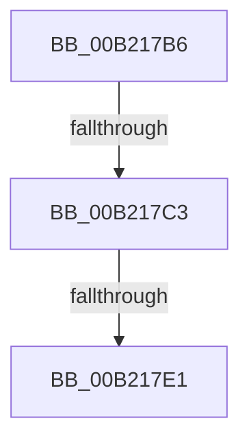

# sub_00B217B6

- RVA: `0x00B217B6`–`0x00B218E0` (길이 `298` bytes)
- VA: `0x0000000140B217B6`
- 실행 섹션: `PAGE`
- PDB 이름 있음: `아니요`; PDB Function 태그: `아니요`
- unwind 정보 RVA: `0x0008A648`
- 디코드: `54`개 명령, `298/298` bytes 표시
- 미해석 바이트: `0` (있으면 어셈블리에 `.byte`로 보존)

> 이 문서는 커널 이미지의 기계어와 PDB 기호를 분석해 생성했습니다. 4번과 5번은 함수 원형과 자료형을 바이너리 사용 방식에서 추정한 C 해석이며 원본 소스 복구 결과는 아닙니다.

## 1. Dependencies

- 직접 호출 지점: **2**; 고유 호출 대상: **2**
- 직접 호출자로 확인된 함수: **0**
- RIP 상대 이미지 참조: **2**

### Outgoing calls
- `0x00B217D4` → [tlgKeywordOn](../../text/42/tlgKeywordOn_function_0042EAA0.md) (function, `0x0042EAA0`)
- `0x00B218D5` → [tlgWriteTransfer_EtwWriteTransfer](../../text/42/tlgWriteTransfer_EtwWriteTransfer_function_004260E0.md) (function, `0x004260E0`)

### Direct callers
- 이 함수 시작 RVA로 연결되는 직접 call은 확인되지 않았습니다. 간접 호출은 완전히 역산할 수 없습니다.

### Static image references
- `0x00B217B6` → RVA `0x00E07748` (`.data`; read)
- `0x00B217E7` → RVA `0x00051056` (`.rdata`; read)

## 2. Other-region calls and transfers

- 다른 실행 섹션으로 향하는 call: **2**
  - `0x00B217D4` → [tlgKeywordOn](../../text/42/tlgKeywordOn_function_0042EAA0.md) (`PAGE` → `.text`)
  - `0x00B218D5` → [tlgWriteTransfer_EtwWriteTransfer](../../text/42/tlgWriteTransfer_EtwWriteTransfer_function_004260E0.md) (`PAGE` → `.text`)
- call이 아닌 외부 분기/꼬리 이동: **3**
  - `0x00B217BD` → [PopPowerAggregatorDiagTraceHandleIntent + 0x139](../91/PopPowerAggregatorDiagTraceHandleIntent_function_00914A04.md) (`tail-transfer`)
  - `0x00B217DB` → [PopPowerAggregatorDiagTraceHandleIntent + 0x139](../91/PopPowerAggregatorDiagTraceHandleIntent_function_00914A04.md) (`tail-transfer`)
  - `0x00B218DB` → [PopPowerAggregatorDiagTraceHandleIntent + 0x139](../91/PopPowerAggregatorDiagTraceHandleIntent_function_00914A04.md) (`tail-transfer`)

## 3. Assembly (complete function range)

```asm
00B217B6  83 3D 8B 5F 2E 00 05            cmp dword ptr [rip + 0x2e5f8b], 5
00B217BD  0F 86 7A 33 DF FF               jbe 0x140914b3d
00B217C3  48 BA 00 00 00 00 00 40 00 00   movabs rdx, 0x400000000000
00B217CD  48 8D 0D 74 5F 2E 00            lea rcx, [rip + 0x2e5f74]
00B217D4  E8 C7 D2 90 FF                  call 0x14042eaa0
00B217D9  84 C0                           test al, al
00B217DB  0F 84 5C 33 DF FF               je 0x140914b3d
00B217E1  8B 85 E0 00 00 00               mov eax, dword ptr [rbp + 0xe0]
00B217E7  48 8D 15 68 F8 52 FF            lea rdx, [rip - 0xad0798]
00B217EE  89 44 24 38                     mov dword ptr [rsp + 0x38], eax
00B217F2  48 8D 0D 4F 5F 2E 00            lea rcx, [rip + 0x2e5f4f]
00B217F9  48 8D 44 24 38                  lea rax, [rsp + 0x38]
00B217FE  44 89 4C 24 44                  mov dword ptr [rsp + 0x44], r9d
00B21803  48 89 45 10                     mov qword ptr [rbp + 0x10], rax
00B21807  45 33 C9                        xor r9d, r9d
00B2180A  8B 85 F0 00 00 00               mov eax, dword ptr [rbp + 0xf0]
00B21810  89 44 24 3C                     mov dword ptr [rsp + 0x3c], eax
00B21814  48 8D 44 24 3C                  lea rax, [rsp + 0x3c]
00B21819  48 89 45 20                     mov qword ptr [rbp + 0x20], rax
00B2181D  48 8D 44 24 40                  lea rax, [rsp + 0x40]
00B21822  48 89 45 30                     mov qword ptr [rbp + 0x30], rax
00B21826  48 8D 44 24 44                  lea rax, [rsp + 0x44]
00B2182B  48 89 45 40                     mov qword ptr [rbp + 0x40], rax
00B2182F  48 8D 44 24 48                  lea rax, [rsp + 0x48]
00B21834  48 89 45 50                     mov qword ptr [rbp + 0x50], rax
00B21838  48 8D 45 78                     lea rax, [rbp + 0x78]
00B2183C  48 89 45 60                     mov qword ptr [rbp + 0x60], rax
00B21840  8B 44 24 34                     mov eax, dword ptr [rsp + 0x34]
00B21844  89 45 78                        mov dword ptr [rbp + 0x78], eax
00B21847  48 8D 44 24 30                  lea rax, [rsp + 0x30]
00B2184C  48 89 85 80 00 00 00            mov qword ptr [rbp + 0x80], rax
00B21853  48 8D 44 24 58                  lea rax, [rsp + 0x58]
00B21858  48 89 85 90 00 00 00            mov qword ptr [rbp + 0x90], rax
00B2185F  48 8D 45 F0                     lea rax, [rbp - 0x10]
00B21863  44 88 44 24 30                  mov byte ptr [rsp + 0x30], r8b
00B21868  45 33 C0                        xor r8d, r8d
00B2186B  48 89 44 24 28                  mov qword ptr [rsp + 0x28], rax
00B21870  C7 44 24 20 0B 00 00 00         mov dword ptr [rsp + 0x20], 0xb
00B21878  48 C7 45 18 04 00 00 00         mov qword ptr [rbp + 0x18], 4
00B21880  48 C7 45 28 04 00 00 00         mov qword ptr [rbp + 0x28], 4
00B21888  44 89 54 24 40                  mov dword ptr [rsp + 0x40], r10d
00B2188D  48 C7 45 38 04 00 00 00         mov qword ptr [rbp + 0x38], 4
00B21895  48 C7 45 48 04 00 00 00         mov qword ptr [rbp + 0x48], 4
00B2189D  44 89 5C 24 48                  mov dword ptr [rsp + 0x48], r11d
00B218A2  48 C7 45 58 04 00 00 00         mov qword ptr [rbp + 0x58], 4
00B218AA  48 C7 45 68 02 00 00 00         mov qword ptr [rbp + 0x68], 2
00B218B2  48 89 75 70                     mov qword ptr [rbp + 0x70], rsi
00B218B6  44 89 75 7C                     mov dword ptr [rbp + 0x7c], r14d
00B218BA  48 89 BD 88 00 00 00            mov qword ptr [rbp + 0x88], rdi
00B218C1  48 C7 44 24 58 00 00 00 01      mov qword ptr [rsp + 0x58], 0x1000000
00B218CA  48 C7 85 98 00 00 00 08 00 00 00  mov qword ptr [rbp + 0x98], 8
00B218D5  E8 06 48 90 FF                  call 0x1404260e0
00B218DA  90                              nop
00B218DB  E9 5D 32 DF FF                  jmp 0x140914b3d
```

## 4. C-style interpretation (structured pseudocode)

```c
__int64 __fastcall sub_00B217B6(__int64 a1, __int64 a2, int a3, int a4, __int64 a5, __int64 a6, __int64 a7, __int64 a8, __int64 a9, __int64 a10, __int64 a11)
{
    __int64 result;
    unsigned int v_stack_p20;
    unsigned __int64 v_stack_p28;
    unsigned __int8 v_stack_p30;
    unsigned int v_stack_p34;
    unsigned int v_stack_p38;
    unsigned int v_stack_p3C;
    unsigned int v_stack_p40;
    unsigned int v_stack_p44;
    unsigned int v_stack_p48;
    unsigned __int64 v_stack_p58;

    result = tlgKeywordOn(v_rip + 3039092, a2, a3, a4);
    v_stack_p38 = (unsigned int)((unsigned int)(*(unsigned int *)(v_rbp + 224)));
    v_stack_p44 = a4;
    *(unsigned __int64 *)(v_rbp + 16) = a7;
    a4 = 0;
    v_stack_p3C = (unsigned int)((unsigned int)(*(unsigned int *)(v_rbp + 240)));
    *(unsigned __int64 *)(v_rbp + 32) = v_stack_p3C;
    *(unsigned __int64 *)(v_rbp + 48) = a8;
    *(unsigned __int64 *)(v_rbp + 64) = v_stack_p44;
    *(unsigned __int64 *)(v_rbp + 80) = a9;
    *(unsigned __int64 *)(v_rbp + 96) = v_rbp + 120;
    *(unsigned int *)(v_rbp + 120) = (unsigned int)((unsigned int)(v_stack_p34));
    *(unsigned __int64 *)(v_rbp + 128) = a6;
    *(unsigned __int64 *)(v_rbp + 144) = a11;
    v_stack_p30 = (unsigned __int8)(a3);
    a3 = 0;
    v_stack_p28 = v_rbp - 16;
    v_stack_p20 = 11;
    *(unsigned __int64 *)(v_rbp + 24) = 4;
    *(unsigned __int64 *)(v_rbp + 40) = 4;
    v_stack_p40 = (unsigned int)(v_r10);
    *(unsigned __int64 *)(v_rbp + 56) = 4;
    *(unsigned __int64 *)(v_rbp + 72) = 4;
    v_stack_p48 = (unsigned int)(v_r11);
    *(unsigned __int64 *)(v_rbp + 88) = 4;
    *(unsigned __int64 *)(v_rbp + 104) = 2;
    *(unsigned __int64 *)(v_rbp + 112) = v_rsi;
    *(unsigned int *)(v_rbp + 124) = (unsigned int)(v_r14);
    *(unsigned __int64 *)(v_rbp + 136) = v_rdi;
    v_stack_p58 = 0x1000000ULL;
    *(unsigned __int64 *)(v_rbp + 152) = 8;
    result = tlgWriteTransfer_EtwWriteTransfer(v_rip + 3039055, v_rip - 11339672, a3, a4);
}
```

## 5. (Beta) C Style

```c
int64_t sub_00B217B6(int64_t Arg1, int64_t Arg2, int32_t Arg3, int32_t Arg4, uint64_t Arg5, int64_t Arg6, int64_t Arg7, int64_t Arg8, int64_t Arg9, uint64_t Arg10, int64_t Arg11)
{
    int64_t result;
    uint32_t v_stack_p20;
    uint64_t v_stack_p28;
    uint8_t v_stack_p30;
    uint32_t v_stack_p34;
    uint32_t v_stack_p38;
    uint32_t v_stack_p3C;
    uint32_t v_stack_p40;
    uint32_t v_stack_p44;
    uint32_t v_stack_p48;
    uint64_t v_stack_p58;

    result = tlgKeywordOn(v_rip + 3039092, Arg2, Arg3, Arg4);
    v_stack_p38 = (uint32_t)((uint32_t)(*(uint32_t *)(local_rbp + 0xE0)));
    v_stack_p44 = Arg4;
    *(uint64_t *)(local_rbp + 0x10) = Arg7;
    Arg4 = 0;
    v_stack_p3C = (uint32_t)((uint32_t)(*(uint32_t *)(local_rbp + 0xF0)));
    *(uint64_t *)(local_rbp + 0x20) = v_stack_p3C;
    *(uint64_t *)(local_rbp + 0x30) = Arg8;
    *(uint64_t *)(local_rbp + 0x40) = v_stack_p44;
    *(uint64_t *)(local_rbp + 0x50) = Arg9;
    *(uint64_t *)(local_rbp + 0x60) = local_rbp + 120;
    *(uint32_t *)(local_rbp + 0x78) = (uint32_t)((uint32_t)(v_stack_p34));
    *(uint64_t *)(local_rbp + 0x80) = Arg6;
    *(uint64_t *)(local_rbp + 0x90) = Arg11;
    v_stack_p30 = (uint8_t)(Arg3);
    Arg3 = 0;
    v_stack_p28 = local_rbp - 16;
    v_stack_p20 = 11;
    *(uint64_t *)(local_rbp + 0x18) = 4;
    *(uint64_t *)(local_rbp + 0x28) = 4;
    v_stack_p40 = (uint32_t)(local_r10);
    *(uint64_t *)(local_rbp + 0x38) = 4;
    *(uint64_t *)(local_rbp + 0x48) = 4;
    v_stack_p48 = (uint32_t)(local_r11);
    *(uint64_t *)(local_rbp + 0x58) = 4;
    *(uint64_t *)(local_rbp + 0x68) = 2;
    *(uint64_t *)(local_rbp + 0x70) = local_rsi;
    *(uint32_t *)(local_rbp + 0x7C) = (uint32_t)(local_r14);
    *(uint64_t *)(local_rbp + 0x88) = local_rdi;
    v_stack_p58 = 0x1000000ULL;
    *(uint64_t *)(local_rbp + 0x98) = 8;
    result = tlgWriteTransfer_EtwWriteTransfer(v_rip + 3039055, v_rip - 11339672, Arg3, Arg4);
}
```

## 6. Execution-region graph

[열기: 2D/3D 그래프와 함수 탐색 컨트롤 패널](../../../control-panel.html?section=page&rva=0x00B217B6&view=graph)

- 2D 그래프는 위에서 아래로 흐르고, 3D 그래프는 빈 공간을 드래그해 회전합니다. Shift+드래그는 이동, 휠은 확대·축소, 함수 노드 선택은 대상 보고서 이동입니다.

### Static fallback


