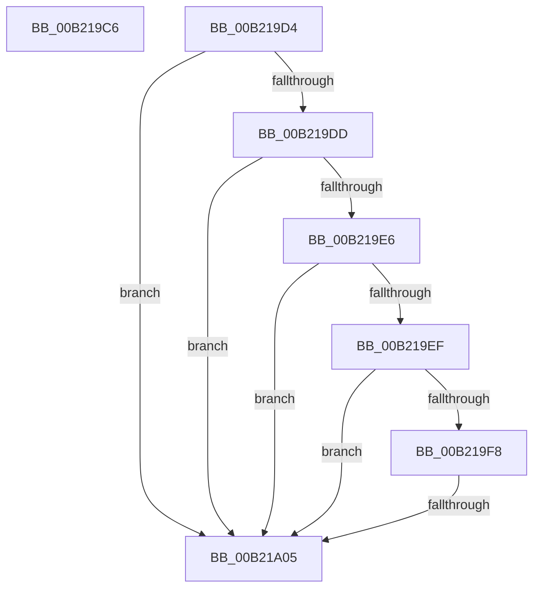

# sub_00B219C6

- RVA: `0x00B219C6`–`0x00B21A1A` (길이 `84` bytes)
- VA: `0x0000000140B219C6`
- 실행 섹션: `PAGE`
- PDB 이름 있음: `아니요`; PDB Function 태그: `아니요`
- unwind 정보 RVA: `0x0008A750`
- 디코드: `18`개 명령, `84/84` bytes 표시
- 미해석 바이트: `0` (있으면 어셈블리에 `.byte`로 보존)

> 이 문서는 커널 이미지의 기계어와 PDB 기호를 분석해 생성했습니다. 4번과 5번은 함수 원형과 자료형을 바이너리 사용 방식에서 추정한 C 해석이며 원본 소스 복구 결과는 아닙니다.

## 1. Dependencies

- 직접 호출 지점: **0**; 고유 호출 대상: **0**
- 직접 호출자로 확인된 함수: **0**
- RIP 상대 이미지 참조: **5**

### Outgoing calls
- 직접 디코드된 call 명령이 없습니다.

### Direct callers
- 이 함수 시작 RVA로 연결되는 직접 call은 확인되지 않았습니다. 간접 호출은 완전히 역산할 수 없습니다.

### Static image references
- `0x00B219D4` → RVA `0x00F07790` (`.data`; read)
- `0x00B219DD` → RVA `0x00F07788` (`.data`; read)
- `0x00B219E6` → RVA `0x00F077A0` (`.data`; read)
- `0x00B219EF` → RVA `0x00F07798` (`.data`; read)
- `0x00B219F8` → RVA `0x00F07780` (`.data`; read)

## 2. Other-region calls and transfers

- 다른 실행 섹션으로 향하는 call: **0**
- call이 아닌 외부 분기/꼬리 이동: **3**
  - `0x00B219CF` → [PpmSetProfilePolicySetting + 0x499](../91/PpmSetProfilePolicySetting_function_00915A44.md) (`tail-transfer`)
  - `0x00B219FF` → [PpmSetProfilePolicySetting + 0x1CE](../91/PpmSetProfilePolicySetting_function_00915A44.md) (`tail-transfer`)
  - `0x00B21A15` → [PpmSetProfilePolicySetting + 0x1D3](../91/PpmSetProfilePolicySetting_function_00915A44.md) (`tail-transfer`)

## 3. Assembly (complete function range)

```asm
00B219C6  4D 85 44 D2 38                  test qword ptr [r10 + rdx*8 + 0x38], r8
00B219CB  45 0F 44 F1                     cmove r14d, r9d
00B219CF  E9 09 45 DF FF                  jmp 0x140915edd
00B219D4  48 39 3D B5 5D 3E 00            cmp qword ptr [rip + 0x3e5db5], rdi
00B219DB  74 28                           je 0x140b21a05
00B219DD  48 39 3D A4 5D 3E 00            cmp qword ptr [rip + 0x3e5da4], rdi
00B219E4  74 1F                           je 0x140b21a05
00B219E6  48 39 3D B3 5D 3E 00            cmp qword ptr [rip + 0x3e5db3], rdi
00B219ED  74 16                           je 0x140b21a05
00B219EF  48 39 3D A2 5D 3E 00            cmp qword ptr [rip + 0x3e5da2], rdi
00B219F6  74 0D                           je 0x140b21a05
00B219F8  48 39 3D 81 5D 3E 00            cmp qword ptr [rip + 0x3e5d81], rdi
00B219FF  0F 85 0D 42 DF FF               jne 0x140915c12
00B21A05  44 8B 44 24 48                  mov r8d, dword ptr [rsp + 0x48]
00B21A0A  41 3B CF                        cmp ecx, r15d
00B21A0D  45 0F B6 C0                     movzx r8d, r8b
00B21A11  44 0F 44 C2                     cmove r8d, edx
00B21A15  E9 FD 41 DF FF                  jmp 0x140915c17
```

## 4. C-style interpretation (structured pseudocode)

```c
void __fastcall sub_00B219C6(int a1, __int64 a2, __int64 a3, int a4)
{
    __int64 v_r14;
    unsigned int v_stack_p48;

    if (((*(unsigned __int64 *)(v_r10 + a2 * 8 + 56)) & (a3)) == 0) { v_r14 = a4; }
}
```

## 5. (Beta) C Style

```c
void sub_00B219C6(int32_t Arg1, int64_t Arg2, int64_t Arg3, int32_t Arg4)
{
    int64_t local_r14;
    uint32_t v_stack_p48;

    if (((*(uint64_t *)(local_r10 + Arg2 * 8 + 0x38)) & (Arg3)) == 0) { local_r14 = Arg4; }
}
```

## 6. Execution-region graph

[열기: 2D/3D 그래프와 함수 탐색 컨트롤 패널](../../../control-panel.html?section=page&rva=0x00B219C6&view=graph)

- 2D 그래프는 위에서 아래로 흐르고, 3D 그래프는 빈 공간을 드래그해 회전합니다. Shift+드래그는 이동, 휠은 확대·축소, 함수 노드 선택은 대상 보고서 이동입니다.

### Static fallback


