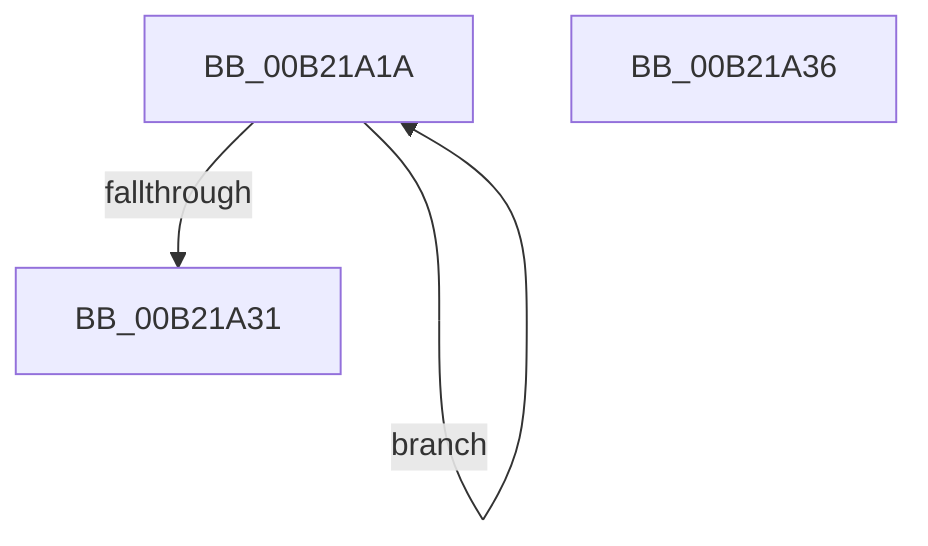

# sub_00B21A1A

- RVA: `0x00B21A1A`–`0x00B21A3D` (길이 `35` bytes)
- VA: `0x0000000140B21A1A`
- 실행 섹션: `PAGE`
- PDB 이름 있음: `아니요`; PDB Function 태그: `아니요`
- unwind 정보 RVA: `0x0008A790`
- 디코드: `11`개 명령, `35/35` bytes 표시
- 미해석 바이트: `0` (있으면 어셈블리에 `.byte`로 보존)

> 이 문서는 커널 이미지의 기계어와 PDB 기호를 분석해 생성했습니다. 4번과 5번은 함수 원형과 자료형을 바이너리 사용 방식에서 추정한 C 해석이며 원본 소스 복구 결과는 아닙니다.

## 1. Dependencies

- 직접 호출 지점: **0**; 고유 호출 대상: **0**
- 직접 호출자로 확인된 함수: **0**
- RIP 상대 이미지 참조: **0**

### Outgoing calls
- 직접 디코드된 call 명령이 없습니다.

### Direct callers
- 이 함수 시작 RVA로 연결되는 직접 call은 확인되지 않았습니다. 간접 호출은 완전히 역산할 수 없습니다.

### Static image references
- 디코드된 RIP-relative 메모리 참조가 없습니다.

## 2. Other-region calls and transfers

- 다른 실행 섹션으로 향하는 call: **0**
- call이 아닌 외부 분기/꼬리 이동: **1**
  - `0x00B21A31` → [PopDispatchPowerSettingCallbacks + 0xE0](../91/PopDispatchPowerSettingCallbacks_function_00916190.md) (`tail-transfer`)

## 3. Assembly (complete function range)

```asm
00B21A1A  33 C9                           xor ecx, ecx
00B21A1C  0F B6 C0                        movzx eax, al
00B21A1F  48 39 0A                        cmp qword ptr [rdx], rcx
00B21A22  48 8D 52 08                     lea rdx, [rdx + 8]
00B21A26  0F 44 C8                        cmove ecx, eax
00B21A29  8A C1                           mov al, cl
00B21A2B  49 83 E8 01                     sub r8, 1
00B21A2F  75 E9                           jne 0x140b21a1a
00B21A31  E9 3A 48 DF FF                  jmp 0x140916270
00B21A36  B9 03 00 00 00                  mov ecx, 3
00B21A3B  CD 29                           int 0x29
```

## 4. C-style interpretation (structured pseudocode)

```c
__int64 __fastcall sub_00B21A1A(int a1, __int64 a2, __int64 a3)
{
    a1 = 0;
    if ((*(unsigned __int64 *)(a2)) == 0) { a1 = (unsigned int)((unsigned __int8)(result)); }
    a3 = (a3) - (1);
    if (condition_is_not_equal) goto loc_00B21A1A;
}
```

## 5. (Beta) C Style

```c
int64_t sub_00B21A1A(int32_t Arg1, void *Arg2, int64_t Arg3)
{
    uint8_t *arg2 = (uint8_t *)Arg2;

    Arg1 = 0;
    if ((*(uint64_t *)(arg2)) == 0) { Arg1 = (uint32_t)((uint8_t)(result)); }
    Arg3 = (Arg3) - (1);
    if (condition_is_not_equal) goto loc_00B21A1A;
}
```

### 관측된 메모리 오프셋

구조체 형식이 확인되지 않은 접근은 인자 기준의 오프셋으로만 기록했습니다.

| 기준 인자 | 오프셋 표현 | 폭 (bit) | 접근 |
|---|---:|---:|---|
| `Arg2` | `+ 0x0` | `64` | `R` |
| `Arg2` | `+ 0x8` | `64` | `R` |

## 6. Execution-region graph

[열기: 2D/3D 그래프와 함수 탐색 컨트롤 패널](../../../control-panel.html?section=page&rva=0x00B21A1A&view=graph)

- 2D 그래프는 위에서 아래로 흐르고, 3D 그래프는 빈 공간을 드래그해 회전합니다. Shift+드래그는 이동, 휠은 확대·축소, 함수 노드 선택은 대상 보고서 이동입니다.

### Static fallback


