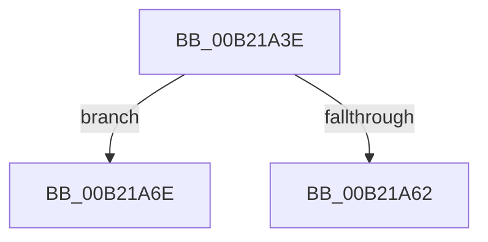

# sub_00B21A3E

- RVA: `0x00B21A3E`–`0x00B21A89` (길이 `75` bytes)
- VA: `0x0000000140B21A3E`
- 실행 섹션: `PAGE`
- PDB 이름 있음: `아니요`; PDB Function 태그: `아니요`
- unwind 정보 RVA: `0x0008A850`
- 디코드: `19`개 명령, `75/75` bytes 표시
- 미해석 바이트: `0` (있으면 어셈블리에 `.byte`로 보존)

> 이 문서는 커널 이미지의 기계어와 PDB 기호를 분석해 생성했습니다. 4번과 5번은 함수 원형과 자료형을 바이너리 사용 방식에서 추정한 C 해석이며 원본 소스 복구 결과는 아닙니다.

## 1. Dependencies

- 직접 호출 지점: **3**; 고유 호출 대상: **3**
- 직접 호출자로 확인된 함수: **0**
- RIP 상대 이미지 참조: **2**

### Outgoing calls
- `0x00B21A42` → [RtlFreeAnsiString](../9C/RtlFreeAnsiString_function_009C0800.md) (function, `0x009C0800`)
- `0x00B21A57` → [RtlStringFromGUIDEx](../91/RtlStringFromGUIDEx_function_00915450.md) (function, `0x00915450`)
- `0x00B21A7E` → [BiLogMessage](../A3/BiLogMessage_function_00A3D3A8.md) (function, `0x00A3D3A8`)

### Direct callers
- 이 함수 시작 RVA로 연결되는 직접 call은 확인되지 않았습니다. 간접 호출은 완전히 역산할 수 없습니다.

### Static image references
- `0x00B21A62` → RVA `0x00B0B1F0` (` ?? ::NNGAKEGL::`string'`; read)
- `0x00B21A72` → RVA `0x00B0B250` (` ?? ::NNGAKEGL::`string'`; read)

## 2. Other-region calls and transfers

- 다른 실행 섹션으로 향하는 call: **0**
- call이 아닌 외부 분기/꼬리 이동: **2**
  - `0x00B21A69` → [BcdOpenObject + 0x152](../91/BcdOpenObject_function_00916704.md) (`tail-transfer`)
  - `0x00B21A84` → [BcdOpenObject + 0x115](../91/BcdOpenObject_function_00916704.md) (`tail-transfer`)

## 3. Assembly (complete function range)

```asm
00B21A3E  48 8D 4D D8                     lea rcx, [rbp - 0x28]
00B21A42  E8 B9 ED E9 FF                  call 0x1409c0800
00B21A47  48 83 65 E0 00                  and qword ptr [rbp - 0x20], 0
00B21A4C  48 8D 55 D8                     lea rdx, [rbp - 0x28]
00B21A50  41 B0 01                        mov r8b, 1
00B21A53  48 8D 4D E8                     lea rcx, [rbp - 0x18]
00B21A57  E8 F4 39 DF FF                  call 0x140915450
00B21A5C  8B D8                           mov ebx, eax
00B21A5E  85 C0                           test eax, eax
00B21A60  79 0C                           jns 0x140b21a6e
00B21A62  48 8D 15 87 97 FE FF            lea rdx, [rip - 0x16879]
00B21A69  E9 E8 4D DF FF                  jmp 0x140916856
00B21A6E  48 8B 7D E0                     mov rdi, qword ptr [rbp - 0x20]
00B21A72  48 8D 15 D7 97 FE FF            lea rdx, [rip - 0x16829]
00B21A79  4C 8B C7                        mov r8, rdi
00B21A7C  8B CE                           mov ecx, esi
00B21A7E  E8 25 B9 F1 FF                  call 0x140a3d3a8
00B21A83  90                              nop
00B21A84  E9 90 4D DF FF                  jmp 0x140916819
```

## 4. C-style interpretation (structured pseudocode)

```c
__int64 __fastcall sub_00B21A3E(void)
{
    __int64 result;

    result = RtlFreeAnsiString(v_rbp - 40, a2, a3, a4);
    result = RtlStringFromGUIDEx(v_rbp - 24, v_rbp - 40, 1, a4);
    if (!sign_flag) goto loc_00B21A6E;
loc_00B21A6E:
    result = BiLogMessage((unsigned int)((unsigned int)(v_rsi)), v_rip - 92201, *(unsigned __int64 *)(v_rbp - 32), a4);
}
```

## 5. (Beta) C Style

```c
void sub_00B21A3E(void)
{
    int64_t result;

    result = RtlFreeAnsiString(local_rbp - 40, a2, a3, a4);
    result = RtlStringFromGUIDEx(local_rbp - 24, local_rbp - 40, 1, a4);
    if (!sign_flag) goto loc_00B21A6E;
loc_00B21A6E:
    result = BiLogMessage((uint32_t)((uint32_t)(local_rsi)), v_rip - 92201, *(uint64_t *)(local_rbp - 0x20), a4);
}
```

## 6. Execution-region graph

[열기: 2D/3D 그래프와 함수 탐색 컨트롤 패널](../../../control-panel.html?section=page&rva=0x00B21A3E&view=graph)

- 2D 그래프는 위에서 아래로 흐르고, 3D 그래프는 빈 공간을 드래그해 회전합니다. Shift+드래그는 이동, 휠은 확대·축소, 함수 노드 선택은 대상 보고서 이동입니다.

### Static fallback


