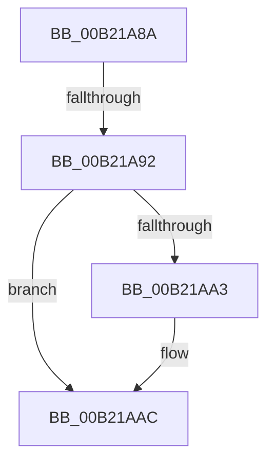

# sub_00B21A8A

- RVA: `0x00B21A8A`–`0x00B21AB8` (길이 `46` bytes)
- VA: `0x0000000140B21A8A`
- 실행 섹션: `PAGE`
- PDB 이름 있음: `아니요`; PDB Function 태그: `아니요`
- unwind 정보 RVA: `0x0008A870`
- 디코드: `10`개 명령, `46/46` bytes 표시
- 미해석 바이트: `0` (있으면 어셈블리에 `.byte`로 보존)

> 이 문서는 커널 이미지의 기계어와 PDB 기호를 분석해 생성했습니다. 4번과 5번은 함수 원형과 자료형을 바이너리 사용 방식에서 추정한 C 해석이며 원본 소스 복구 결과는 아닙니다.

## 1. Dependencies

- 직접 호출 지점: **1**; 고유 호출 대상: **1**
- 직접 호출자로 확인된 함수: **0**
- RIP 상대 이미지 참조: **1**

### Outgoing calls
- `0x00B21AA7` → [ZwClose](../../text/6A/ZwClose_function_006AD2B0.md) (function, `0x006AD2B0`)

### Direct callers
- 이 함수 시작 RVA로 연결되는 직접 call은 확인되지 않았습니다. 간접 호출은 완전히 역산할 수 없습니다.

### Static image references
- `0x00B21A98` → RVA `0x00EF05E0` (`.data`; read)

## 2. Other-region calls and transfers

- 다른 실행 섹션으로 향하는 call: **1**
  - `0x00B21AA7` → [ZwClose](../../text/6A/ZwClose_function_006AD2B0.md) (`PAGE` → `.text`)
- call이 아닌 외부 분기/꼬리 이동: **2**
  - `0x00B21A8C` → [BiAcquireBcdSyncMutant + 0x59](../91/BiAcquireBcdSyncMutant_function_00916898.md) (`tail-transfer`)
  - `0x00B21AB3` → [BiAcquireBcdSyncMutant + 0x31](../91/BiAcquireBcdSyncMutant_function_00916898.md) (`tail-transfer`)

## 3. Assembly (complete function range)

```asm
00B21A8A  85 C0                           test eax, eax
00B21A8C  0F 88 5F 4E DF FF               js 0x1409168f1
00B21A92  48 8B 4D 18                     mov rcx, qword ptr [rbp + 0x18]
00B21A96  33 C0                           xor eax, eax
00B21A98  F0 48 0F B1 0D 3F EB 3C 00      lock cmpxchg qword ptr [rip + 0x3ceb3f], rcx
00B21AA1  74 09                           je 0x140b21aac
00B21AA3  48 8B 4D 18                     mov rcx, qword ptr [rbp + 0x18]
00B21AA7  E8 04 B8 B8 FF                  call 0x1406ad2b0
00B21AAC  48 8B 0D 2D EB 3C 00            mov rcx, qword ptr [rip + 0x3ceb2d]
00B21AB3  E9 11 4E DF FF                  jmp 0x1409168c9
```

## 4. C-style interpretation (structured pseudocode)

```c
__int64 __fastcall sub_00B21A8A(void)
{
    __int64 result;

    result = 0;
    if (!(condition_is_equal)) {
        a1 = *(unsigned __int64 *)(v_rbp + 24);
        result = ZwClose(a1, a2, a3, a4);
    }
}
```

## 5. (Beta) C Style

```c
void sub_00B21A8A(void)
{
    int64_t result;

    result = 0;
    if (!(condition_is_equal)) {
        a1 = *(uint64_t *)(local_rbp + 0x18);
        result = ZwClose(a1, a2, a3, a4);
    }
}
```

## 6. Execution-region graph

[열기: 2D/3D 그래프와 함수 탐색 컨트롤 패널](../../../control-panel.html?section=page&rva=0x00B21A8A&view=graph)

- 2D 그래프는 위에서 아래로 흐르고, 3D 그래프는 빈 공간을 드래그해 회전합니다. Shift+드래그는 이동, 휠은 확대·축소, 함수 노드 선택은 대상 보고서 이동입니다.

### Static fallback


