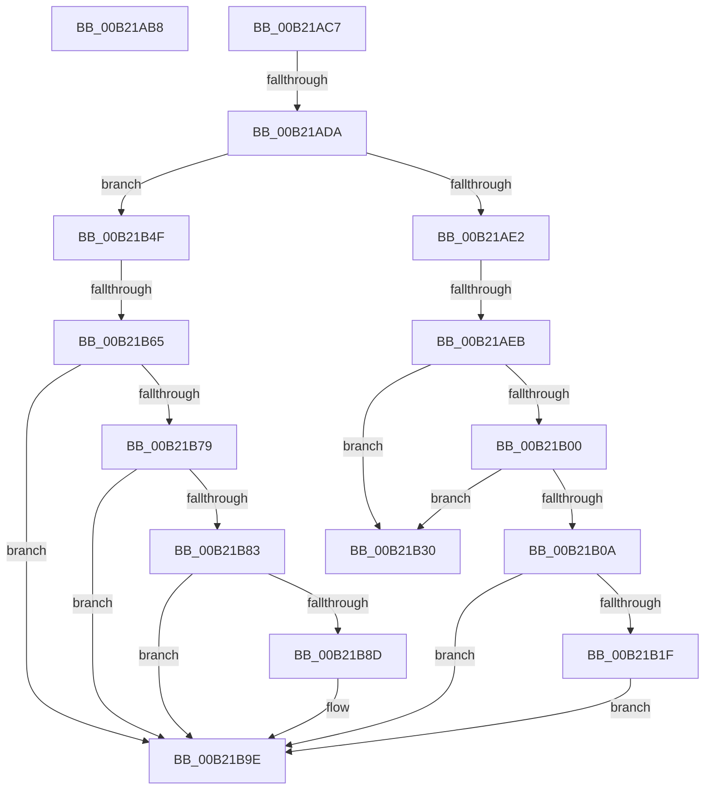

# sub_00B21AB8

- RVA: `0x00B21AB8`–`0x00B21BAF` (길이 `247` bytes)
- VA: `0x0000000140B21AB8`
- 실행 섹션: `PAGE`
- PDB 이름 있음: `아니요`; PDB Function 태그: `아니요`
- unwind 정보 RVA: `0x0008AD30`
- 디코드: `66`개 명령, `247/247` bytes 표시
- 미해석 바이트: `0` (있으면 어셈블리에 `.byte`로 보존)

> 이 문서는 커널 이미지의 기계어와 PDB 기호를 분석해 생성했습니다. 4번과 5번은 함수 원형과 자료형을 바이너리 사용 방식에서 추정한 C 해석이며 원본 소스 복구 결과는 아닙니다.

## 1. Dependencies

- 직접 호출 지점: **9**; 고유 호출 대상: **6**
- 직접 호출자로 확인된 함수: **0**
- RIP 상대 이미지 참조: **0**

### Outgoing calls
- `0x00B21ABC` → [ObfDereferenceObject](../../text/2F/ObfDereferenceObject_function_002F9350.md) (function, `0x002F9350`)
- `0x00B21AF1` → [PspLockJobShared](../91/PspLockJobShared_function_0091A490.md) (function, `0x0091A490`)
- `0x00B21B16` → [PspSendJobNotification](../../text/49/PspSendJobNotification_function_0049EC28.md) (function, `0x0049EC28`)
- `0x00B21B36` → [PspUnlockJob](../91/PspUnlockJob_function_00919E00.md) (function, `0x00919E00`)
- `0x00B21B44` → [PspTerminateAllProcessesInJobHierarchy](../91/PspTerminateAllProcessesInJobHierarchy_function_00917B7C.md) (function, `0x00917B7C`)
- `0x00B21B58` → [PspTerminateAllProcessesInJobHierarchy](../91/PspTerminateAllProcessesInJobHierarchy_function_00917B7C.md) (function, `0x00917B7C`)
- `0x00B21B6B` → [PspLockJobExclusive](../91/PspLockJobExclusive_function_0091A4B8.md) (function, `0x0091A4B8`)
- `0x00B21B99` → [PspSendJobNotification](../../text/49/PspSendJobNotification_function_0049EC28.md) (function, `0x0049EC28`)
- `0x00B21BA4` → [PspUnlockJob](../91/PspUnlockJob_function_00919E00.md) (function, `0x00919E00`)

### Direct callers
- 이 함수 시작 RVA로 연결되는 직접 call은 확인되지 않았습니다. 간접 호출은 완전히 역산할 수 없습니다.

### Static image references
- 디코드된 RIP-relative 메모리 참조가 없습니다.

## 2. Other-region calls and transfers

- 다른 실행 섹션으로 향하는 call: **3**
  - `0x00B21ABC` → [ObfDereferenceObject](../../text/2F/ObfDereferenceObject_function_002F9350.md) (`PAGE` → `.text`)
  - `0x00B21B16` → [PspSendJobNotification](../../text/49/PspSendJobNotification_function_0049EC28.md) (`PAGE` → `.text`)
  - `0x00B21B99` → [PspSendJobNotification](../../text/49/PspSendJobNotification_function_0049EC28.md) (`PAGE` → `.text`)
- call이 아닌 외부 분기/꼬리 이동: **6**
  - `0x00B21AC2` → [PspEnforceLimitsJobPostCallback + 0x202](../91/PspEnforceLimitsJobPostCallback_function_00919720.md) (`tail-transfer`)
  - `0x00B21AD4` → [PspEnforceLimitsJobPostCallback + 0x210](../91/PspEnforceLimitsJobPostCallback_function_00919720.md) (`tail-transfer`)
  - `0x00B21AE5` → [PspEnforceLimitsJobPostCallback + 0x210](../91/PspEnforceLimitsJobPostCallback_function_00919720.md) (`tail-transfer`)
  - `0x00B21B4A` → [PspEnforceLimitsJobPostCallback + 0x210](../91/PspEnforceLimitsJobPostCallback_function_00919720.md) (`tail-transfer`)
  - `0x00B21B5F` → [PspEnforceLimitsJobPostCallback + 0x210](../91/PspEnforceLimitsJobPostCallback_function_00919720.md) (`tail-transfer`)
  - `0x00B21BAA` → [PspEnforceLimitsJobPostCallback + 0x210](../91/PspEnforceLimitsJobPostCallback_function_00919720.md) (`tail-transfer`)

## 3. Assembly (complete function range)

```asm
00B21AB8  48 8B 4E 10                     mov rcx, qword ptr [rsi + 0x10]
00B21ABC  E8 8F 78 7D FF                  call 0x1402f9350
00B21AC1  90                              nop
00B21AC2  E9 5B 7E DF FF                  jmp 0x140919922
00B21AC7  48 8B 4C 24 50                  mov rcx, qword ptr [rsp + 0x50]
00B21ACC  48 03 4C 24 78                  add rcx, qword ptr [rsp + 0x78]
00B21AD1  48 3B CA                        cmp rcx, rdx
00B21AD4  0F 86 56 7E DF FF               jbe 0x140919930
00B21ADA  8B 44 24 20                     mov eax, dword ptr [rsp + 0x20]
00B21ADE  85 C0                           test eax, eax
00B21AE0  74 6D                           je 0x140b21b4f
00B21AE2  83 F8 01                        cmp eax, 1
00B21AE5  0F 85 45 7E DF FF               jne 0x140919930
00B21AEB  48 8B D7                        mov rdx, rdi
00B21AEE  48 8B CB                        mov rcx, rbx
00B21AF1  E8 9A 89 DF FF                  call 0x14091a490
00B21AF6  48 83 BB 28 02 00 00 00         cmp qword ptr [rbx + 0x228], 0
00B21AFE  74 30                           je 0x140b21b30
00B21B00  8B 83 50 04 00 00               mov eax, dword ptr [rbx + 0x450]
00B21B06  A8 02                           test al, 2
00B21B08  74 26                           je 0x140b21b30
00B21B0A  45 33 C9                        xor r9d, r9d
00B21B0D  45 33 C0                        xor r8d, r8d
00B21B10  49 8B D6                        mov rdx, r14
00B21B13  48 8B CB                        mov rcx, rbx
00B21B16  E8 0D D1 97 FF                  call 0x14049ec28
00B21B1B  85 C0                           test eax, eax
00B21B1D  78 7F                           js 0x140b21b9e
00B21B1F  83 A3 00 01 00 00 FB            and dword ptr [rbx + 0x100], 0xfffffffb
00B21B26  48 83 A3 E8 00 00 00 00         and qword ptr [rbx + 0xe8], 0
00B21B2E  EB 6E                           jmp 0x140b21b9e
00B21B30  48 8B D7                        mov rdx, rdi
00B21B33  48 8B CB                        mov rcx, rbx
00B21B36  E8 C5 82 DF FF                  call 0x140919e00
00B21B3B  45 8A C6                        mov r8b, r14b
00B21B3E  41 8B D7                        mov edx, r15d
00B21B41  48 8B CB                        mov rcx, rbx
00B21B44  E8 33 60 DF FF                  call 0x140917b7c
00B21B49  90                              nop
00B21B4A  E9 E1 7D DF FF                  jmp 0x140919930
00B21B4F  45 8A C6                        mov r8b, r14b
00B21B52  41 8B D7                        mov edx, r15d
00B21B55  48 8B CB                        mov rcx, rbx
00B21B58  E8 1F 60 DF FF                  call 0x140917b7c
00B21B5D  84 C0                           test al, al
00B21B5F  0F 84 CB 7D DF FF               je 0x140919930
00B21B65  48 8B D7                        mov rdx, rdi
00B21B68  48 8B CB                        mov rcx, rbx
00B21B6B  E8 48 89 DF FF                  call 0x14091a4b8
00B21B70  83 BB D8 00 00 00 00            cmp dword ptr [rbx + 0xd8], 0
00B21B77  75 25                           jne 0x140b21b9e
00B21B79  48 83 BB 28 02 00 00 00         cmp qword ptr [rbx + 0x228], 0
00B21B81  74 1B                           je 0x140b21b9e
00B21B83  8B 83 50 04 00 00               mov eax, dword ptr [rbx + 0x450]
00B21B89  A8 02                           test al, 2
00B21B8B  74 11                           je 0x140b21b9e
00B21B8D  45 33 C9                        xor r9d, r9d
00B21B90  45 33 C0                        xor r8d, r8d
00B21B93  49 8B D6                        mov rdx, r14
00B21B96  48 8B CB                        mov rcx, rbx
00B21B99  E8 8A D0 97 FF                  call 0x14049ec28
00B21B9E  48 8B D7                        mov rdx, rdi
00B21BA1  48 8B CB                        mov rcx, rbx
00B21BA4  E8 57 82 DF FF                  call 0x140919e00
00B21BA9  90                              nop
00B21BAA  E9 81 7D DF FF                  jmp 0x140919930
```

## 4. C-style interpretation (structured pseudocode)

```c
__int64 __fastcall sub_00B21AB8(__int64 a1, __int64 a2, int a3, int a4)
{
    __int64 result;
    unsigned int v_stack_p20;
    unsigned __int64 v_stack_p50;
    unsigned __int64 v_stack_p78;

    result = ObfDereferenceObject(*(unsigned __int64 *)(v_rsi + 16), a2, a3, a4);
}
```

## 5. (Beta) C Style

```c
int64_t sub_00B21AB8(int64_t Arg1, int64_t Arg2, int32_t Arg3, int32_t Arg4)
{
    int64_t result;
    uint32_t v_stack_p20;
    uint64_t v_stack_p50;
    uint64_t v_stack_p78;

    result = ObfDereferenceObject(*(uint64_t *)(local_rsi + 0x10), Arg2, Arg3, Arg4);
}
```

## 6. Execution-region graph

[열기: 2D/3D 그래프와 함수 탐색 컨트롤 패널](../../../control-panel.html?section=page&rva=0x00B21AB8&view=graph)

- 2D 그래프는 위에서 아래로 흐르고, 3D 그래프는 빈 공간을 드래그해 회전합니다. Shift+드래그는 이동, 휠은 확대·축소, 함수 노드 선택은 대상 보고서 이동입니다.

### Static fallback


