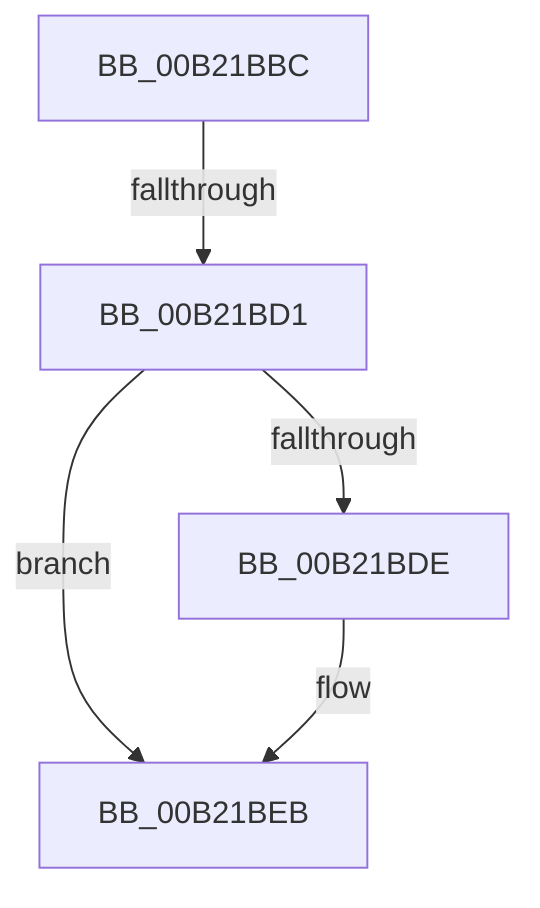

# sub_00B21BBC

- RVA: `0x00B21BBC`–`0x00B21BF9` (길이 `61` bytes)
- VA: `0x0000000140B21BBC`
- 실행 섹션: `PAGE`
- PDB 이름 있음: `아니요`; PDB Function 태그: `아니요`
- unwind 정보 RVA: `0x0008B25C`
- 디코드: `15`개 명령, `61/61` bytes 표시
- 미해석 바이트: `0` (있으면 어셈블리에 `.byte`로 보존)

> 이 문서는 커널 이미지의 기계어와 PDB 기호를 분석해 생성했습니다. 4번과 5번은 함수 원형과 자료형을 바이너리 사용 방식에서 추정한 C 해석이며 원본 소스 복구 결과는 아닙니다.

## 1. Dependencies

- 직접 호출 지점: **4**; 고유 호출 대상: **4**
- 직접 호출자로 확인된 함수: **0**
- RIP 상대 이미지 참조: **1**

### Outgoing calls
- `0x00B21BC3` → [ExReleaseFastMutex](../../text/25/ExReleaseFastMutex_function_002519C0.md) (function, `0x002519C0`)
- `0x00B21BD4` → [DbgkpMarkProcessPeb](../AC/DbgkpMarkProcessPeb_function_00AC8D0C.md) (function, `0x00AC8D0C`)
- `0x00B21BE6` → [PsTerminateProcess](../90/PsTerminateProcess_function_00904C64.md) (function, `0x00904C64`)
- `0x00B21BEE` → [ObfDereferenceObject](../../text/2F/ObfDereferenceObject_function_002F9350.md) (function, `0x002F9350`)

### Direct callers
- 이 함수 시작 RVA로 연결되는 직접 call은 확인되지 않았습니다. 간접 호출은 완전히 역산할 수 없습니다.

### Static image references
- `0x00B21BBC` → RVA `0x00F8F220` (`.data`; read)

## 2. Other-region calls and transfers

- 다른 실행 섹션으로 향하는 call: **2**
  - `0x00B21BC3` → [ExReleaseFastMutex](../../text/25/ExReleaseFastMutex_function_002519C0.md) (`PAGE` → `.text`)
  - `0x00B21BEE` → [ObfDereferenceObject](../../text/2F/ObfDereferenceObject_function_002F9350.md) (`PAGE` → `.text`)
- call이 아닌 외부 분기/꼬리 이동: **2**
  - `0x00B21BCB` → [DbgkpCloseObject + 0x7C](../91/DbgkpCloseObject_function_0091D5F0.md) (`tail-transfer`)
  - `0x00B21BF4` → [DbgkpCloseObject + 0x7C](../91/DbgkpCloseObject_function_0091D5F0.md) (`tail-transfer`)

## 3. Assembly (complete function range)

```asm
00B21BBC  48 8D 0D 5D D6 46 00            lea rcx, [rip + 0x46d65d]
00B21BC3  E8 F8 FD 72 FF                  call 0x1402519c0
00B21BC8  F6 C3 01                        test bl, 1
00B21BCB  0F 84 9B BA DF FF               je 0x14091d66c
00B21BD1  48 8B CF                        mov rcx, rdi
00B21BD4  E8 33 71 FA FF                  call 0x140ac8d0c
00B21BD9  F6 C3 02                        test bl, 2
00B21BDC  74 0D                           je 0x140b21beb
00B21BDE  BA 54 03 00 C0                  mov edx, 0xc0000354
00B21BE3  48 8B CF                        mov rcx, rdi
00B21BE6  E8 79 30 DE FF                  call 0x140904c64
00B21BEB  48 8B CD                        mov rcx, rbp
00B21BEE  E8 5D 77 7D FF                  call 0x1402f9350
00B21BF3  90                              nop
00B21BF4  E9 73 BA DF FF                  jmp 0x14091d66c
```

## 4. C-style interpretation (structured pseudocode)

```c
__int64 __fastcall sub_00B21BBC(void)
{
    __int64 result;

    result = ExReleaseFastMutex(v_rip + 4642397, a2, a3, a4);
    result = DbgkpMarkProcessPeb(v_rdi, a2, a3, a4);
    if ((((unsigned __int8)(v_rbx)) & (2)) != 0) {
        a2 = 0xC0000354ULL;
        a1 = v_rdi;
        result = PsTerminateProcess(a1, a2, a3, a4);
    }
    result = ObfDereferenceObject(v_rbp, a2, a3, a4);
}
```

## 5. (Beta) C Style

```c
void sub_00B21BBC(void)
{
    int64_t result;

    result = ExReleaseFastMutex(v_rip + 4642397, a2, a3, a4);
    result = DbgkpMarkProcessPeb(local_rdi, a2, a3, a4);
    if ((((uint8_t)(local_rbx)) & (2)) != 0) {
        a2 = 0xC0000354ULL;
        a1 = local_rdi;
        result = PsTerminateProcess(a1, a2, a3, a4);
    }
    result = ObfDereferenceObject(local_rbp, a2, a3, a4);
}
```

## 6. Execution-region graph

[열기: 2D/3D 그래프와 함수 탐색 컨트롤 패널](../../../control-panel.html?section=page&rva=0x00B21BBC&view=graph)

- 2D 그래프는 위에서 아래로 흐르고, 3D 그래프는 빈 공간을 드래그해 회전합니다. Shift+드래그는 이동, 휠은 확대·축소, 함수 노드 선택은 대상 보고서 이동입니다.

### Static fallback


