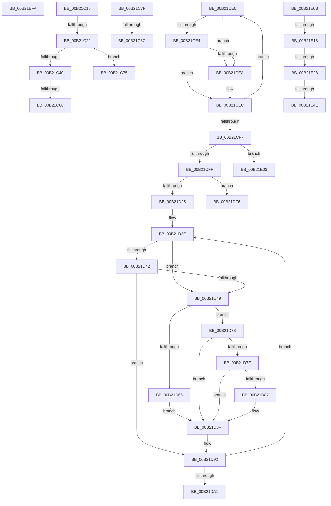

# sub_00B21BFA

- RVA: `0x00B21BFA`–`0x00B21E9D` (길이 `675` bytes)
- VA: `0x0000000140B21BFA`
- 실행 섹션: `PAGE`
- PDB 이름 있음: `아니요`; PDB Function 태그: `아니요`
- unwind 정보 RVA: `0x0008B548`
- 디코드: `162`개 명령, `675/675` bytes 표시
- 미해석 바이트: `0` (있으면 어셈블리에 `.byte`로 보존)

> 이 문서는 커널 이미지의 기계어와 PDB 기호를 분석해 생성했습니다. 4번과 5번은 함수 원형과 자료형을 바이너리 사용 방식에서 추정한 C 해석이며 원본 소스 복구 결과는 아닙니다.

## 1. Dependencies

- 직접 호출 지점: **6**; 고유 호출 대상: **4**
- 직접 호출자로 확인된 함수: **0**
- RIP 상대 이미지 참조: **0**

### Outgoing calls
- `0x00B21C35` → [SepCheckAndCopySelfRelativeSD](../../text/4B/SepCheckAndCopySelfRelativeSD_function_004B596C.md) (function, `0x004B596C`)
- `0x00B21C57` → [SepCheckAndCopySelfRelativeSD](../../text/4B/SepCheckAndCopySelfRelativeSD_function_004B596C.md) (function, `0x004B596C`)
- `0x00B21D12` → [ExAllocatePool2](../../poolcode/B8/ExAllocatePool2_function_00B820F0.md) (function, `0x00B820F0`)
- `0x00B21E1B` → [SepSDContainsAttributeACE](../7A/SepSDContainsAttributeACE_function_007A3794.md) (function, `0x007A3794`)
- `0x00B21E3A` → [SepCheckAndCopySelfRelativeSD](../../text/4B/SepCheckAndCopySelfRelativeSD_function_004B596C.md) (function, `0x004B596C`)
- `0x00B21E60` → [SepSecurityDescriptorStrictLength](../91/SepSecurityDescriptorStrictLength_function_0091E6E0.md) (function, `0x0091E6E0`)

### Direct callers
- 이 함수 시작 RVA로 연결되는 직접 call은 확인되지 않았습니다. 간접 호출은 완전히 역산할 수 없습니다.

### Static image references
- 디코드된 RIP-relative 메모리 참조가 없습니다.

## 2. Other-region calls and transfers

- 다른 실행 섹션으로 향하는 call: **4**
  - `0x00B21C35` → [SepCheckAndCopySelfRelativeSD](../../text/4B/SepCheckAndCopySelfRelativeSD_function_004B596C.md) (`PAGE` → `.text`)
  - `0x00B21C57` → [SepCheckAndCopySelfRelativeSD](../../text/4B/SepCheckAndCopySelfRelativeSD_function_004B596C.md) (`PAGE` → `.text`)
  - `0x00B21D12` → [ExAllocatePool2](../../poolcode/B8/ExAllocatePool2_function_00B820F0.md) (`PAGE` → `POOLCODE`)
  - `0x00B21E3A` → [SepCheckAndCopySelfRelativeSD](../../text/4B/SepCheckAndCopySelfRelativeSD_function_004B596C.md) (`PAGE` → `.text`)
- call이 아닌 외부 분기/꼬리 이동: **14**
  - `0x00B21C10` → [SepAdtOpenObjectAuditAlarm + 0x265](../91/SepAdtOpenObjectAuditAlarm_function_0091F23C.md) (`tail-transfer`)
  - `0x00B21C1C` → [SepAdtOpenObjectAuditAlarm + 0x2F1](../91/SepAdtOpenObjectAuditAlarm_function_0091F23C.md) (`tail-transfer`)
  - `0x00B21C60` → [SepAdtOpenObjectAuditAlarm + 0x585](../91/SepAdtOpenObjectAuditAlarm_function_0091F23C.md) (`tail-transfer`)
  - `0x00B21C70` → [SepAdtOpenObjectAuditAlarm + 0x51D](../91/SepAdtOpenObjectAuditAlarm_function_0091F23C.md) (`tail-transfer`)
  - `0x00B21C7A` → [SepAdtOpenObjectAuditAlarm + 0x518](../91/SepAdtOpenObjectAuditAlarm_function_0091F23C.md) (`tail-transfer`)
  - `0x00B21C86` → [SepAdtOpenObjectAuditAlarm + 0x376](../91/SepAdtOpenObjectAuditAlarm_function_0091F23C.md) (`tail-transfer`)
  - `0x00B21CDB` → [SepAdtOpenObjectAuditAlarm + 0x376](../91/SepAdtOpenObjectAuditAlarm_function_0091F23C.md) (`tail-transfer`)
  - `0x00B21DF1` → [SepAdtOpenObjectAuditAlarm + 0x42F](../91/SepAdtOpenObjectAuditAlarm_function_0091F23C.md) (`tail-transfer`)
  - `0x00B21DFE` → [SepAdtOpenObjectAuditAlarm + 0x509](../91/SepAdtOpenObjectAuditAlarm_function_0091F23C.md) (`tail-transfer`)
  - `0x00B21E06` → [SepAdtOpenObjectAuditAlarm + 0x42F](../91/SepAdtOpenObjectAuditAlarm_function_0091F23C.md) (`tail-transfer`)
  - `0x00B21E12` → [SepAdtOpenObjectAuditAlarm + 0x4EF](../91/SepAdtOpenObjectAuditAlarm_function_0091F23C.md) (`tail-transfer`)
  - `0x00B21E22` → [SepAdtOpenObjectAuditAlarm + 0x4EF](../91/SepAdtOpenObjectAuditAlarm_function_0091F23C.md) (`tail-transfer`)
  - `0x00B21E48` → [SepAdtOpenObjectAuditAlarm + 0x4FB](../91/SepAdtOpenObjectAuditAlarm_function_0091F23C.md) (`tail-transfer`)
  - `0x00B21E98` → [SepAdtOpenObjectAuditAlarm + 0x4EF](../91/SepAdtOpenObjectAuditAlarm_function_0091F23C.md) (`tail-transfer`)

## 3. Assembly (complete function range)

```asm
00B21BFA  C7 45 68 02 00 00 00            mov dword ptr [rbp + 0x68], 2
00B21C01  0F B7 01                        movzx eax, word ptr [rcx]
00B21C04  03 C3                           add eax, ebx
00B21C06  48 89 8D 80 00 00 00            mov qword ptr [rbp + 0x80], rcx
00B21C0D  89 45 6C                        mov dword ptr [rbp + 0x6c], eax
00B21C10  E9 8C D8 DF FF                  jmp 0x14091f4a1
00B21C15  48 8B 4B 48                     mov rcx, qword ptr [rbx + 0x48]
00B21C19  48 85 C9                        test rcx, rcx
00B21C1C  0F 84 0B D9 DF FF               je 0x14091f52d
00B21C22  48 8B 49 38                     mov rcx, qword ptr [rcx + 0x38]
00B21C26  4C 8D 4C 24 21                  lea r9, [rsp + 0x21]
00B21C2B  4C 8D 44 24 28                  lea r8, [rsp + 0x28]
00B21C30  48 8D 54 24 40                  lea rdx, [rsp + 0x40]
00B21C35  E8 32 3D 99 FF                  call 0x1404b596c
00B21C3A  8B F8                           mov edi, eax
00B21C3C  85 C0                           test eax, eax
00B21C3E  78 35                           js 0x140b21c75
00B21C40  48 8B 4B 48                     mov rcx, qword ptr [rbx + 0x48]
00B21C44  4C 8D 4C 24 22                  lea r9, [rsp + 0x22]
00B21C49  4C 8D 44 24 2C                  lea r8, [rsp + 0x2c]
00B21C4E  48 8D 54 24 48                  lea rdx, [rsp + 0x48]
00B21C53  48 8B 49 40                     mov rcx, qword ptr [rcx + 0x40]
00B21C57  E8 10 3D 99 FF                  call 0x1404b596c
00B21C5C  8B F8                           mov edi, eax
00B21C5E  85 C0                           test eax, eax
00B21C60  0F 89 5B DB DF FF               jns 0x14091f7c1
00B21C66  48 8B 5C 24 40                  mov rbx, qword ptr [rsp + 0x40]
00B21C6B  4C 8B 74 24 48                  mov r14, qword ptr [rsp + 0x48]
00B21C70  E9 E4 DA DF FF                  jmp 0x14091f759
00B21C75  48 8B 5C 24 40                  mov rbx, qword ptr [rsp + 0x40]
00B21C7A  E9 D5 DA DF FF                  jmp 0x14091f754
00B21C7F  48 8B 40 48                     mov rax, qword ptr [rax + 0x48]
00B21C83  48 85 C0                        test rax, rax
00B21C86  0F 84 26 D9 DF FF               je 0x14091f5b2
00B21C8C  0F 10 40 58                     movups xmm0, xmmword ptr [rax + 0x58]
00B21C90  0F 11 43 04                     movups xmmword ptr [rbx + 4], xmm0
00B21C94  0F 10 48 68                     movups xmm1, xmmword ptr [rax + 0x68]
00B21C98  0F 11 4B 14                     movups xmmword ptr [rbx + 0x14], xmm1
00B21C9C  0F 10 40 78                     movups xmm0, xmmword ptr [rax + 0x78]
00B21CA0  0F 11 43 24                     movups xmmword ptr [rbx + 0x24], xmm0
00B21CA4  0F 10 88 88 00 00 00            movups xmm1, xmmword ptr [rax + 0x88]
00B21CAB  0F 11 4B 34                     movups xmmword ptr [rbx + 0x34], xmm1
00B21CAF  0F 10 80 98 00 00 00            movups xmm0, xmmword ptr [rax + 0x98]
00B21CB6  0F 11 43 44                     movups xmmword ptr [rbx + 0x44], xmm0
00B21CBA  0F 10 88 A8 00 00 00            movups xmm1, xmmword ptr [rax + 0xa8]
00B21CC1  0F 11 4B 54                     movups xmmword ptr [rbx + 0x54], xmm1
00B21CC5  0F 10 80 B8 00 00 00            movups xmm0, xmmword ptr [rax + 0xb8]
00B21CCC  0F 11 43 64                     movups xmmword ptr [rbx + 0x64], xmm0
00B21CD0  0F 10 88 C8 00 00 00            movups xmm1, xmmword ptr [rax + 0xc8]
00B21CD7  0F 11 4B 74                     movups xmmword ptr [rbx + 0x74], xmm1
00B21CDB  E9 D2 D8 DF FF                  jmp 0x14091f5b2
00B21CE0  85 D2                           test edx, edx
00B21CE2  74 06                           je 0x140b21cea
00B21CE4  66 45 85 20                     test word ptr [r8], r12w
00B21CE8  74 02                           je 0x140b21cec
00B21CEA  03 C6                           add eax, esi
00B21CEC  03 D6                           add edx, esi
00B21CEE  49 83 C0 30                     add r8, 0x30
00B21CF2  41 3B D6                        cmp edx, r14d
00B21CF5  72 E9                           jb 0x140b21ce0
00B21CF7  85 C0                           test eax, eax
00B21CF9  0F 84 04 01 00 00               je 0x140b21e03
00B21CFF  48 8D 14 40                     lea rdx, [rax + rax*2]
00B21D03  B9 00 01 00 00                  mov ecx, 0x100
00B21D08  48 C1 E2 03                     shl rdx, 3
00B21D0C  41 B8 53 65 41 70               mov r8d, 0x70416553
00B21D12  E8 D9 03 06 00                  call 0x140b820f0
00B21D17  48 89 44 24 60                  mov qword ptr [rsp + 0x60], rax
00B21D1C  48 85 C0                        test rax, rax
00B21D1F  0F 84 D1 00 00 00               je 0x140b21df6
00B21D25  4C 8B 9D A0 04 00 00            mov r11, qword ptr [rbp + 0x4a0]
00B21D2C  4D 8D 4D 04                     lea r9, [r13 + 4]
00B21D30  45 33 C0                        xor r8d, r8d
00B21D33  33 D2                           xor edx, edx
00B21D35  4D 8B D3                        mov r10, r11
00B21D38  45 33 ED                        xor r13d, r13d
00B21D3B  4C 8B F8                        mov r15, rax
00B21D3E  85 D2                           test edx, edx
00B21D40  74 07                           je 0x140b21d49
00B21D42  66 45 85 61 FE                  test word ptr [r9 - 2], r12w
00B21D47  74 49                           je 0x140b21d92
00B21D49  4B 8D 0C 40                     lea rcx, [r8 + r8*2]
00B21D4D  41 0F 10 01                     movups xmm0, xmmword ptr [r9]
00B21D51  F3 41 0F 7F 04 CF               movdqu xmmword ptr [r15 + rcx*8], xmm0
00B21D57  41 0F B7 41 FC                  movzx eax, word ptr [r9 - 4]
00B21D5C  66 41 89 44 CF 12               mov word ptr [r15 + rcx*8 + 0x12], ax
00B21D62  85 D2                           test edx, edx
00B21D64  75 0D                           jne 0x140b21d73
00B21D66  66 41 89 74 CF 10               mov word ptr [r15 + rcx*8 + 0x10], si
00B21D6C  45 89 6C CF 14                  mov dword ptr [r15 + rcx*8 + 0x14], r13d
00B21D71  EB 1C                           jmp 0x140b21d8f
00B21D73  66 45 89 6C CF 10               mov word ptr [r15 + rcx*8 + 0x10], r13w
00B21D79  4D 85 DB                        test r11, r11
00B21D7C  74 11                           je 0x140b21d8f
00B21D7E  44 38 AD 78 04 00 00            cmp byte ptr [rbp + 0x478], r13b
00B21D85  74 08                           je 0x140b21d8f
00B21D87  41 8B 02                        mov eax, dword ptr [r10]
00B21D8A  41 89 44 CF 14                  mov dword ptr [r15 + rcx*8 + 0x14], eax
00B21D8F  44 03 C6                        add r8d, esi
00B21D92  03 D6                           add edx, esi
00B21D94  49 83 C1 30                     add r9, 0x30
00B21D98  49 83 C2 04                     add r10, 4
00B21D9C  41 3B D6                        cmp edx, r14d
00B21D9F  72 9D                           jb 0x140b21d3e
00B21DA1  8B 45 B8                        mov eax, dword ptr [rbp - 0x48]
00B21DA4  43 8D 0C 40                     lea ecx, [r8 + r8*2]
00B21DA8  48 C1 E0 05                     shl rax, 5
00B21DAC  C1 E1 03                        shl ecx, 3
00B21DAF  C7 44 05 C8 09 00 00 00         mov dword ptr [rbp + rax - 0x38], 9
00B21DB7  8B 45 B8                        mov eax, dword ptr [rbp - 0x48]
00B21DBA  48 C1 E0 05                     shl rax, 5
00B21DBE  89 4C 05 CC                     mov dword ptr [rbp + rax - 0x34], ecx
00B21DC2  8B 45 B8                        mov eax, dword ptr [rbp - 0x48]
00B21DC5  48 C1 E0 05                     shl rax, 5
00B21DC9  4C 89 7C 05 E0                  mov qword ptr [rbp + rax - 0x20], r15
00B21DCE  8B 45 B8                        mov eax, dword ptr [rbp - 0x48]
00B21DD1  4C 8B 7D 88                     mov r15, qword ptr [rbp - 0x78]
00B21DD5  48 C1 E0 05                     shl rax, 5
00B21DD9  48 C7 44 05 D8 04 00 00 00      mov qword ptr [rbp + rax - 0x28], 4
00B21DE2  8B 4D B8                        mov ecx, dword ptr [rbp - 0x48]
00B21DE5  03 CE                           add ecx, esi
00B21DE7  C7 45 B4 35 12 00 00            mov dword ptr [rbp - 0x4c], 0x1235
00B21DEE  89 4D B8                        mov dword ptr [rbp - 0x48], ecx
00B21DF1  E9 75 D8 DF FF                  jmp 0x14091f66b
00B21DF6  BF 9A 00 00 C0                  mov edi, 0xc000009a
00B21DFB  45 33 ED                        xor r13d, r13d
00B21DFE  E9 42 D9 DF FF                  jmp 0x14091f745
00B21E03  45 33 ED                        xor r13d, r13d
00B21E06  E9 60 D8 DF FF                  jmp 0x14091f66b
00B21E0B  81 7D B4 30 12 00 00            cmp dword ptr [rbp - 0x4c], 0x1230
00B21E12  0F 85 13 D9 DF FF               jne 0x14091f72b
00B21E18  49 8B CF                        mov rcx, r15
00B21E1B  E8 74 19 C8 FF                  call 0x1407a3794
00B21E20  84 C0                           test al, al
00B21E22  0F 84 03 D9 DF FF               je 0x14091f72b
00B21E28  4C 8D 4C 24 20                  lea r9, [rsp + 0x20]
00B21E2D  49 8B CF                        mov rcx, r15
00B21E30  4C 8D 44 24 28                  lea r8, [rsp + 0x28]
00B21E35  48 8D 54 24 58                  lea rdx, [rsp + 0x58]
00B21E3A  E8 2D 3B 99 FF                  call 0x1404b596c
00B21E3F  4C 8B 7C 24 58                  mov r15, qword ptr [rsp + 0x58]
00B21E44  8B F8                           mov edi, eax
00B21E46  85 C0                           test eax, eax
00B21E48  0F 88 E9 D8 DF FF               js 0x14091f737
00B21E4E  8B 45 B8                        mov eax, dword ptr [rbp - 0x48]
00B21E51  49 8B CF                        mov rcx, r15
00B21E54  48 C1 E0 05                     shl rax, 5
00B21E58  C7 44 05 C8 1F 00 00 00         mov dword ptr [rbp + rax - 0x38], 0x1f
00B21E60  E8 7B C8 DF FF                  call 0x14091e6e0
00B21E65  8B 4D B8                        mov ecx, dword ptr [rbp - 0x48]
00B21E68  48 C1 E1 05                     shl rcx, 5
00B21E6C  89 44 0D CC                     mov dword ptr [rbp + rcx - 0x34], eax
00B21E70  8B 45 B8                        mov eax, dword ptr [rbp - 0x48]
00B21E73  48 C1 E0 05                     shl rax, 5
00B21E77  4C 89 7C 05 E0                  mov qword ptr [rbp + rax - 0x20], r15
00B21E7C  8B 45 B8                        mov eax, dword ptr [rbp - 0x48]
00B21E7F  48 C1 E0 05                     shl rax, 5
00B21E83  48 C7 44 05 D0 20 00 00 00      mov qword ptr [rbp + rax - 0x30], 0x20
00B21E8C  8B 45 B8                        mov eax, dword ptr [rbp - 0x48]
00B21E8F  48 C1 E0 05                     shl rax, 5
00B21E93  4C 89 6C 05 D8                  mov qword ptr [rbp + rax - 0x28], r13
00B21E98  E9 8E D8 DF FF                  jmp 0x14091f72b
```

## 4. C-style interpretation (structured pseudocode)

```c
__int64 __fastcall sub_00B21BFA(__int64 a1)
{
    __int64 result;
    unsigned __int64 v_stack_p20;
    unsigned __int64 v_stack_p21;
    unsigned __int64 v_stack_p22;
    unsigned __int64 v_stack_p28;
    unsigned __int64 v_stack_p2C;
    unsigned __int64 v_stack_p40;
    unsigned __int64 v_stack_p48;
    unsigned __int64 v_stack_p58;
    unsigned __int64 v_stack_p60;

    *(unsigned int *)(v_rbp + 104) = 2;
    result = (unsigned int)((*(unsigned __int16 *)(a1)) + ((unsigned int)(v_rbx)));
    *(unsigned __int64 *)(v_rbp + 128) = a1;
    *(unsigned int *)(v_rbp + 108) = (unsigned int)(result);
}
```

## 5. (Beta) C Style

```c
int64_t sub_00B21BFA(void *Arg1)
{
    uint8_t *arg1 = (uint8_t *)Arg1;

    int64_t result;
    uint64_t v_stack_p20;
    uint64_t v_stack_p21;
    uint64_t v_stack_p22;
    uint64_t v_stack_p28;
    uint64_t v_stack_p2C;
    uint64_t v_stack_p40;
    uint64_t v_stack_p48;
    uint64_t v_stack_p58;
    uint64_t v_stack_p60;

    *(uint32_t *)(local_rbp + 0x68) = 2;
    result = (uint32_t)((*(uint16_t *)(arg1)) + ((uint32_t)(local_rbx)));
    *(void **)(local_rbp + 0x80) = Arg1;
    *(uint32_t *)(local_rbp + 0x6C) = (uint32_t)(result);
}
```

### 관측된 메모리 오프셋

구조체 형식이 확인되지 않은 접근은 인자 기준의 오프셋으로만 기록했습니다.

| 기준 인자 | 오프셋 표현 | 폭 (bit) | 접근 |
|---|---:|---:|---|
| `Arg1` | `+ 0x0` | `16` | `R` |

## 6. Execution-region graph

[열기: 2D/3D 그래프와 함수 탐색 컨트롤 패널](../../../control-panel.html?section=page&rva=0x00B21BFA&view=graph)

- 2D 그래프는 위에서 아래로 흐르고, 3D 그래프는 빈 공간을 드래그해 회전합니다. Shift+드래그는 이동, 휠은 확대·축소, 함수 노드 선택은 대상 보고서 이동입니다.

### Static fallback


