# sub_00B21E9E

- RVA: `0x00B21E9E`–`0x00B2229F` (길이 `1,025` bytes)
- VA: `0x0000000140B21E9E`
- 실행 섹션: `PAGE`
- PDB 이름 있음: `아니요`; PDB Function 태그: `아니요`
- unwind 정보 RVA: `0x0008B584`
- 디코드: `235`개 명령, `1,025/1,025` bytes 표시
- 미해석 바이트: `0` (있으면 어셈블리에 `.byte`로 보존)

> 이 문서는 커널 이미지의 기계어와 PDB 기호를 분석해 생성했습니다. 4번과 5번은 함수 원형과 자료형을 바이너리 사용 방식에서 추정한 C 해석이며 원본 소스 복구 결과는 아닙니다.

## 1. Dependencies

- 직접 호출 지점: **15**; 고유 호출 대상: **10**
- 직접 호출자로 확인된 함수: **0**
- RIP 상대 이미지 참조: **1**

### Outgoing calls
- `0x00B21E9E` → [PsGetCurrentThreadProcess](../../text/47/PsGetCurrentThreadProcess_function_0047C7E0.md) (function, `0x0047C7E0`)
- `0x00B21EAB` → [PsGetAllocatedFullProcessImageNameEx](../91/PsGetAllocatedFullProcessImageNameEx_function_0091D6F0.md) (function, `0x0091D6F0`)
- `0x00B22008` → [ObNormalizeHandleValue](../91/ObNormalizeHandleValue_function_0091E6A8.md) (function, `0x0091E6A8`)
- `0x00B22065` → [SepCheckAndCopySelfRelativeSD](../../text/4B/SepCheckAndCopySelfRelativeSD_function_004B596C.md) (function, `0x004B596C`)
- `0x00B22088` → [SepCheckAndCopySelfRelativeSD](../../text/4B/SepCheckAndCopySelfRelativeSD_function_004B596C.md) (function, `0x004B596C`)
- `0x00B220D2` → [ExAllocatePool2](../../poolcode/B8/ExAllocatePool2_function_00B820F0.md) (function, `0x00B820F0`)
- `0x00B220F1` → [memset](../../text/6C/memset_function_006C6C40.md) (function, `0x006C6C40`)
- `0x00B22193` → [memcpy](../../text/6C/memcpy_function_006C6840.md) (function, `0x006C6840`)
- `0x00B221AF` → [memcpy](../../text/6C/memcpy_function_006C6840.md) (function, `0x006C6840`)
- `0x00B22232` → [SepAdtLogAuditRecord](../../text/22/SepAdtLogAuditRecord_function_00224B6C.md) (function, `0x00224B6C`)
- `0x00B2223C` → [ExFreePoolWithTag](../../poolcode/B8/ExFreePoolWithTag_function_00B82870.md) (function, `0x00B82870`)
- `0x00B22254` → [ExFreePoolWithTag](../../poolcode/B8/ExFreePoolWithTag_function_00B82870.md) (function, `0x00B82870`)
- `0x00B2226A` → [ExFreePoolWithTag](../../poolcode/B8/ExFreePoolWithTag_function_00B82870.md) (function, `0x00B82870`)
- `0x00B22280` → [ExFreePoolWithTag](../../poolcode/B8/ExFreePoolWithTag_function_00B82870.md) (function, `0x00B82870`)
- `0x00B2228B` → [SepAuditFailed](../86/SepAuditFailed_function_0086EE20.md) (function, `0x0086EE20`)

### Direct callers
- 이 함수 시작 RVA로 연결되는 직접 call은 확인되지 않았습니다. 간접 호출은 완전히 역산할 수 없습니다.

### Static image references
- `0x00B21F3C` → RVA `0x000013A8` (`.rdata`; read)

## 2. Other-region calls and transfers

- 다른 실행 섹션으로 향하는 call: **12**
  - `0x00B21E9E` → [PsGetCurrentThreadProcess](../../text/47/PsGetCurrentThreadProcess_function_0047C7E0.md) (`PAGE` → `.text`)
  - `0x00B22065` → [SepCheckAndCopySelfRelativeSD](../../text/4B/SepCheckAndCopySelfRelativeSD_function_004B596C.md) (`PAGE` → `.text`)
  - `0x00B22088` → [SepCheckAndCopySelfRelativeSD](../../text/4B/SepCheckAndCopySelfRelativeSD_function_004B596C.md) (`PAGE` → `.text`)
  - `0x00B220D2` → [ExAllocatePool2](../../poolcode/B8/ExAllocatePool2_function_00B820F0.md) (`PAGE` → `POOLCODE`)
  - `0x00B220F1` → [memset](../../text/6C/memset_function_006C6C40.md) (`PAGE` → `.text`)
  - `0x00B22193` → [memcpy](../../text/6C/memcpy_function_006C6840.md) (`PAGE` → `.text`)
  - `0x00B221AF` → [memcpy](../../text/6C/memcpy_function_006C6840.md) (`PAGE` → `.text`)
  - `0x00B22232` → [SepAdtLogAuditRecord](../../text/22/SepAdtLogAuditRecord_function_00224B6C.md) (`PAGE` → `.text`)
  - `0x00B2223C` → [ExFreePoolWithTag](../../poolcode/B8/ExFreePoolWithTag_function_00B82870.md) (`PAGE` → `POOLCODE`)
  - `0x00B22254` → [ExFreePoolWithTag](../../poolcode/B8/ExFreePoolWithTag_function_00B82870.md) (`PAGE` → `POOLCODE`)
  - `0x00B2226A` → [ExFreePoolWithTag](../../poolcode/B8/ExFreePoolWithTag_function_00B82870.md) (`PAGE` → `POOLCODE`)
  - `0x00B22280` → [ExFreePoolWithTag](../../poolcode/B8/ExFreePoolWithTag_function_00B82870.md) (`PAGE` → `POOLCODE`)
- call이 아닌 외부 분기/꼬리 이동: **1**
  - `0x00B2229A` → [SepAdtStagingEvent + 0x94](../91/SepAdtStagingEvent_function_0091F948.md) (`tail-transfer`)

## 3. Assembly (complete function range)

```asm
00B21E9E  E8 3D A9 95 FF                  call 0x14047c7e0
00B21EA3  48 8D 54 24 50                  lea rdx, [rsp + 0x50]
00B21EA8  48 8B C8                        mov rcx, rax
00B21EAB  E8 40 B8 DF FF                  call 0x14091d6f0
00B21EB0  8B F8                           mov edi, eax
00B21EB2  85 C0                           test eax, eax
00B21EB4  0F 88 8E 03 00 00               js 0x140b22248
00B21EBA  48 8B 95 E8 03 00 00            mov rdx, qword ptr [rbp + 0x3e8]
00B21EC1  48 8B 8D F0 03 00 00            mov rcx, qword ptr [rbp + 0x3f0]
00B21EC8  48 85 D2                        test rdx, rdx
00B21ECB  74 0D                           je 0x140b21eda
00B21ECD  48 8B 5A 18                     mov rbx, qword ptr [rdx + 0x18]
00B21ED1  48 8B 82 98 00 00 00            mov rax, qword ptr [rdx + 0x98]
00B21ED8  EB 07                           jmp 0x140b21ee1
00B21EDA  48 8B 81 98 00 00 00            mov rax, qword ptr [rcx + 0x98]
00B21EE1  F7 85 F8 03 00 00 00 00 00 02   test dword ptr [rbp + 0x3f8], 0x2000000
00B21EEB  4C 8B 00                        mov r8, qword ptr [rax]
00B21EEE  48 8B 41 18                     mov rax, qword ptr [rcx + 0x18]
00B21EF2  B9 82 00 00 00                  mov ecx, 0x82
00B21EF7  C7 44 24 60 03 00 00 00         mov dword ptr [rsp + 0x60], 3
00B21EFF  C7 44 24 64 D2 12 00 00         mov dword ptr [rsp + 0x64], 0x12d2
00B21F07  66 89 4C 24 70                  mov word ptr [rsp + 0x70], cx
00B21F0C  44 8D 49 8E                     lea r9d, [rcx - 0x72]
00B21F10  44 8D 79 86                     lea r15d, [rcx - 0x7a]
00B21F14  75 0F                           jne 0x140b21f25
00B21F16  66 44 89 7C 24 72               mov word ptr [rsp + 0x72], r15w
00B21F1C  40 38 B5 08 04 00 00            cmp byte ptr [rbp + 0x408], sil
00B21F23  75 06                           jne 0x140b21f2b
00B21F25  66 44 89 4C 24 72               mov word ptr [rsp + 0x72], r9w
00B21F2B  C7 44 24 78 04 00 00 00         mov dword ptr [rsp + 0x78], 4
00B21F33  41 0F B6 48 01                  movzx ecx, byte ptr [r8 + 1]
00B21F38  4C 89 45 90                     mov qword ptr [rbp - 0x70], r8
00B21F3C  4C 8D 05 65 F4 4D FF            lea r8, [rip - 0xb20b9b]
00B21F43  C7 45 98 01 00 00 00            mov dword ptr [rbp - 0x68], 1
00B21F4A  4C 89 45 B0                     mov qword ptr [rbp - 0x50], r8
00B21F4E  C7 45 B8 05 00 00 00            mov dword ptr [rbp - 0x48], 5
00B21F55  8D 0C 8D 08 00 00 00            lea ecx, [rcx*4 + 8]
00B21F5C  89 4C 24 7C                     mov dword ptr [rsp + 0x7c], ecx
00B21F60  B9 20 00 00 00                  mov ecx, 0x20
00B21F65  89 4D 9C                        mov dword ptr [rbp - 0x64], ecx
00B21F68  44 89 7D BC                     mov dword ptr [rbp - 0x44], r15d
00B21F6C  48 89 5D C0                     mov qword ptr [rbp - 0x40], rbx
00B21F70  48 85 D2                        test rdx, rdx
00B21F73  75 04                           jne 0x140b21f79
00B21F75  48 89 45 C0                     mov qword ptr [rbp - 0x40], rax
00B21F79  C7 45 D8 01 00 00 00            mov dword ptr [rbp - 0x28], 1
00B21F80  89 4D DC                        mov dword ptr [rbp - 0x24], ecx
00B21F83  4C 89 45 F0                     mov qword ptr [rbp - 0x10], r8
00B21F87  C7 44 24 68 04 00 00 00         mov dword ptr [rsp + 0x68], 4
00B21F8F  4D 85 ED                        test r13, r13
00B21F92  75 0A                           jne 0x140b21f9e
00B21F94  BF 0D 00 00 C0                  mov edi, 0xc000000d
00B21F99  E9 AA 02 00 00                  jmp 0x140b22248
00B21F9E  41 0F B7 45 00                  movzx eax, word ptr [r13]
00B21FA3  48 8B 8D E0 03 00 00            mov rcx, qword ptr [rbp + 0x3e0]
00B21FAA  41 03 C1                        add eax, r9d
00B21FAD  C7 45 F8 01 00 00 00            mov dword ptr [rbp - 8], 1
00B21FB4  89 45 FC                        mov dword ptr [rbp - 4], eax
00B21FB7  4C 89 6D 10                     mov qword ptr [rbp + 0x10], r13
00B21FBB  48 85 C9                        test rcx, rcx
00B21FBE  74 30                           je 0x140b21ff0
00B21FC0  0F B7 44 24 32                  movzx eax, word ptr [rsp + 0x32]
00B21FC5  66 83 F8 75                     cmp ax, 0x75
00B21FC9  74 11                           je 0x140b21fdc
00B21FCB  BA 81 00 00 00                  mov edx, 0x81
00B21FD0  C7 45 18 01 00 00 00            mov dword ptr [rbp + 0x18], 1
00B21FD7  66 3B C2                        cmp ax, dx
00B21FDA  75 07                           jne 0x140b21fe3
00B21FDC  C7 45 18 02 00 00 00            mov dword ptr [rbp + 0x18], 2
00B21FE3  0F B7 01                        movzx eax, word ptr [rcx]
00B21FE6  41 03 C1                        add eax, r9d
00B21FE9  48 89 4D 30                     mov qword ptr [rbp + 0x30], rcx
00B21FED  89 45 1C                        mov dword ptr [rbp + 0x1c], eax
00B21FF0  48 8B 44 24 58                  mov rax, qword ptr [rsp + 0x58]
00B21FF5  C7 45 38 0B 00 00 00            mov dword ptr [rbp + 0x38], 0xb
00B21FFC  44 89 7D 3C                     mov dword ptr [rbp + 0x3c], r15d
00B22000  48 85 C0                        test rax, rax
00B22003  74 0E                           je 0x140b22013
00B22005  48 8B 08                        mov rcx, qword ptr [rax]
00B22008  E8 9B C6 DF FF                  call 0x14091e6a8
00B2200D  48 89 45 40                     mov qword ptr [rbp + 0x40], rax
00B22011  EB 04                           jmp 0x140b22017
00B22013  48 21 75 40                     and qword ptr [rbp + 0x40], rsi
00B22017  48 8B 4C 24 50                  mov rcx, qword ptr [rsp + 0x50]
00B2201C  4C 8D 44 24 38                  lea r8, [rsp + 0x38]
00B22021  48 8B 85 10 04 00 00            mov rax, qword ptr [rbp + 0x410]
00B22028  48 8D 54 24 40                  lea rdx, [rsp + 0x40]
00B2202D  48 89 45 60                     mov qword ptr [rbp + 0x60], rax
00B22031  C7 45 58 0B 00 00 00            mov dword ptr [rbp + 0x58], 0xb
00B22038  44 89 7D 5C                     mov dword ptr [rbp + 0x5c], r15d
00B2203C  C7 45 78 02 00 00 00            mov dword ptr [rbp + 0x78], 2
00B22043  0F B7 01                        movzx eax, word ptr [rcx]
00B22046  41 03 C1                        add eax, r9d
00B22049  48 89 8D 90 00 00 00            mov qword ptr [rbp + 0x90], rcx
00B22050  89 45 7C                        mov dword ptr [rbp + 0x7c], eax
00B22053  4C 8D 4C 24 30                  lea r9, [rsp + 0x30]
00B22058  C7 44 24 68 09 00 00 00         mov dword ptr [rsp + 0x68], 9
00B22060  49 8B 4C 24 38                  mov rcx, qword ptr [r12 + 0x38]
00B22065  E8 02 39 99 FF                  call 0x1404b596c
00B2206A  8B F8                           mov edi, eax
00B2206C  85 C0                           test eax, eax
00B2206E  0F 88 CF 01 00 00               js 0x140b22243
00B22074  49 8B 4C 24 40                  mov rcx, qword ptr [r12 + 0x40]
00B22079  4C 8D 4C 24 31                  lea r9, [rsp + 0x31]
00B2207E  4C 8D 44 24 34                  lea r8, [rsp + 0x34]
00B22083  48 8D 54 24 48                  lea rdx, [rsp + 0x48]
00B22088  E8 DF 38 99 FF                  call 0x1404b596c
00B2208D  4C 8B 74 24 48                  mov r14, qword ptr [rsp + 0x48]
00B22092  8B F8                           mov edi, eax
00B22094  48 8B 74 24 40                  mov rsi, qword ptr [rsp + 0x40]
00B22099  85 C0                           test eax, eax
00B2209B  0F 88 A7 01 00 00               js 0x140b22248
00B220A1  48 85 F6                        test rsi, rsi
00B220A4  75 08                           jne 0x140b220ae
00B220A6  4D 85 F6                        test r14, r14
00B220A9  75 03                           jne 0x140b220ae
00B220AB  45 33 FF                        xor r15d, r15d
00B220AE  8B 44 24 34                     mov eax, dword ptr [rsp + 0x34]
00B220B2  B9 00 01 00 00                  mov ecx, 0x100
00B220B7  41 2B C7                        sub eax, r15d
00B220BA  41 B8 53 65 41 70               mov r8d, 0x70416553
00B220C0  44 8B 7C 24 38                  mov r15d, dword ptr [rsp + 0x38]
00B220C5  45 8D AF 98 00 00 00            lea r13d, [r15 + 0x98]
00B220CC  44 03 E8                        add r13d, eax
00B220CF  41 8B D5                        mov edx, r13d
00B220D2  E8 19 00 06 00                  call 0x140b820f0
00B220D7  48 8B D8                        mov rbx, rax
00B220DA  48 85 C0                        test rax, rax
00B220DD  75 0A                           jne 0x140b220e9
00B220DF  BF 9A 00 00 C0                  mov edi, 0xc000009a
00B220E4  E9 5F 01 00 00                  jmp 0x140b22248
00B220E9  45 8B C5                        mov r8d, r13d
00B220EC  33 D2                           xor edx, edx
00B220EE  48 8B CB                        mov rcx, rbx
00B220F1  E8 4A 4B BA FF                  call 0x1406c6c40
00B220F6  0F B6 8D 08 04 00 00            movzx ecx, byte ptr [rbp + 0x408]
00B220FD  8B 85 00 04 00 00               mov eax, dword ptr [rbp + 0x400]
00B22103  84 C9                           test cl, cl
00B22105  89 8B 88 00 00 00               mov dword ptr [rbx + 0x88], ecx
00B2210B  0F 44 85 F8 03 00 00            cmove eax, dword ptr [rbp + 0x3f8]
00B22112  C7 83 84 00 00 00 04 00 00 00   mov dword ptr [rbx + 0x84], 4
00B2211C  0F BA F0 19                     btr eax, 0x19
00B22120  89 03                           mov dword ptr [rbx], eax
00B22122  41 0F 10 44 24 58               movups xmm0, xmmword ptr [r12 + 0x58]
00B22128  0F 11 43 04                     movups xmmword ptr [rbx + 4], xmm0
00B2212C  41 0F 10 4C 24 68               movups xmm1, xmmword ptr [r12 + 0x68]
00B22132  0F 11 4B 14                     movups xmmword ptr [rbx + 0x14], xmm1
00B22136  41 0F 10 44 24 78               movups xmm0, xmmword ptr [r12 + 0x78]
00B2213C  0F 11 43 24                     movups xmmword ptr [rbx + 0x24], xmm0
00B22140  41 0F 10 8C 24 88 00 00 00      movups xmm1, xmmword ptr [r12 + 0x88]
00B22149  0F 11 4B 34                     movups xmmword ptr [rbx + 0x34], xmm1
00B2214D  41 0F 10 84 24 98 00 00 00      movups xmm0, xmmword ptr [r12 + 0x98]
00B22156  0F 11 43 44                     movups xmmword ptr [rbx + 0x44], xmm0
00B2215A  41 0F 10 8C 24 A8 00 00 00      movups xmm1, xmmword ptr [r12 + 0xa8]
00B22163  0F 11 4B 54                     movups xmmword ptr [rbx + 0x54], xmm1
00B22167  41 0F 10 84 24 B8 00 00 00      movups xmm0, xmmword ptr [r12 + 0xb8]
00B22170  0F 11 43 64                     movups xmmword ptr [rbx + 0x64], xmm0
00B22174  41 0F 10 8C 24 C8 00 00 00      movups xmm1, xmmword ptr [r12 + 0xc8]
00B2217D  0F 11 4B 74                     movups xmmword ptr [rbx + 0x74], xmm1
00B22181  48 85 F6                        test rsi, rsi
00B22184  74 12                           je 0x140b22198
00B22186  4D 8B C7                        mov r8, r15
00B22189  48 8D 8B 90 00 00 00            lea rcx, [rbx + 0x90]
00B22190  48 8B D6                        mov rdx, rsi
00B22193  E8 A8 46 BA FF                  call 0x1406c6840
00B22198  4D 85 F6                        test r14, r14
00B2219B  74 17                           je 0x140b221b4
00B2219D  44 8B 44 24 34                  mov r8d, dword ptr [rsp + 0x34]
00B221A2  49 8D 8F 90 00 00 00            lea rcx, [r15 + 0x90]
00B221A9  48 03 CB                        add rcx, rbx
00B221AC  49 8B D6                        mov rdx, r14
00B221AF  E8 8C 46 BA FF                  call 0x1406c6840
00B221B4  8B 44 24 68                     mov eax, dword ptr [rsp + 0x68]
00B221B8  48 C1 E0 05                     shl rax, 5
00B221BC  C7 44 04 78 1D 00 00 00         mov dword ptr [rsp + rax + 0x78], 0x1d
00B221C4  8B 44 24 68                     mov eax, dword ptr [rsp + 0x68]
00B221C8  48 C1 E0 05                     shl rax, 5
00B221CC  44 89 6C 04 7C                  mov dword ptr [rsp + rax + 0x7c], r13d
00B221D1  8B 44 24 68                     mov eax, dword ptr [rsp + 0x68]
00B221D5  48 C1 E0 05                     shl rax, 5
00B221D9  48 89 5C 05 90                  mov qword ptr [rbp + rax - 0x70], rbx
00B221DE  8B 44 24 68                     mov eax, dword ptr [rsp + 0x68]
00B221E2  FF C0                           inc eax
00B221E4  89 44 24 68                     mov dword ptr [rsp + 0x68], eax
00B221E8  8B C8                           mov ecx, eax
00B221EA  48 C1 E1 05                     shl rcx, 5
00B221EE  C7 44 0C 78 1E 00 00 00         mov dword ptr [rsp + rcx + 0x78], 0x1e
00B221F6  8B 44 24 68                     mov eax, dword ptr [rsp + 0x68]
00B221FA  48 C1 E0 05                     shl rax, 5
00B221FE  44 89 6C 04 7C                  mov dword ptr [rsp + rax + 0x7c], r13d
00B22203  8B 44 24 68                     mov eax, dword ptr [rsp + 0x68]
00B22207  48 C1 E0 05                     shl rax, 5
00B2220B  33 D2                           xor edx, edx
00B2220D  48 89 5C 05 90                  mov qword ptr [rbp + rax - 0x70], rbx
00B22212  8B 44 24 68                     mov eax, dword ptr [rsp + 0x68]
00B22216  48 8D 0C 82                     lea rcx, [rdx + rax*4]
00B2221A  48 FF C2                        inc rdx
00B2221D  48 83 64 CD 80 00               and qword ptr [rbp + rcx*8 - 0x80], 0
00B22223  48 83 FA 02                     cmp rdx, 2
00B22227  7C E9                           jl 0x140b22212
00B22229  FF 44 24 68                     inc dword ptr [rsp + 0x68]
00B2222D  48 8D 4C 24 60                  lea rcx, [rsp + 0x60]
00B22232  E8 35 29 70 FF                  call 0x140224b6c
00B22237  33 D2                           xor edx, edx
00B22239  48 8B CB                        mov rcx, rbx
00B2223C  E8 2F 06 06 00                  call 0x140b82870
00B22241  EB 05                           jmp 0x140b22248
00B22243  48 8B 74 24 40                  mov rsi, qword ptr [rsp + 0x40]
00B22248  48 8B 4C 24 50                  mov rcx, qword ptr [rsp + 0x50]
00B2224D  48 85 C9                        test rcx, rcx
00B22250  74 07                           je 0x140b22259
00B22252  33 D2                           xor edx, edx
00B22254  E8 17 06 06 00                  call 0x140b82870
00B22259  80 7C 24 30 00                  cmp byte ptr [rsp + 0x30], 0
00B2225E  74 0F                           je 0x140b2226f
00B22260  48 85 F6                        test rsi, rsi
00B22263  74 0A                           je 0x140b2226f
00B22265  33 D2                           xor edx, edx
00B22267  48 8B CE                        mov rcx, rsi
00B2226A  E8 01 06 06 00                  call 0x140b82870
00B2226F  80 7C 24 31 00                  cmp byte ptr [rsp + 0x31], 0
00B22274  74 0F                           je 0x140b22285
00B22276  4D 85 F6                        test r14, r14
00B22279  74 0A                           je 0x140b22285
00B2227B  33 D2                           xor edx, edx
00B2227D  49 8B CE                        mov rcx, r14
00B22280  E8 EB 05 06 00                  call 0x140b82870
00B22285  85 FF                           test edi, edi
00B22287  79 07                           jns 0x140b22290
00B22289  8B CF                           mov ecx, edi
00B2228B  E8 90 CB D4 FF                  call 0x14086ee20
00B22290  C1 EF 1F                        shr edi, 0x1f
00B22293  40 80 F7 01                     xor dil, 1
00B22297  40 8A C7                        mov al, dil
00B2229A  E9 3D D7 DF FF                  jmp 0x14091f9dc
```

## 4. C-style interpretation (structured pseudocode)

```c
__int64 __fastcall sub_00B21E9E(__int64 a1, __int64 a2, __int64 a3, __int64 a4, __int64 a5, unsigned __int8 a6, unsigned int a7, __int64 a8, __int64 a9, __int64 a10, __int64 a11, __int64 a12, unsigned int a13)
{
    __int64 result;
    __int64 v_r13;
    __int64 v_r15;
    __int64 v_rdi;
    unsigned __int64 v_stack_p31;
    unsigned __int16 v_stack_p32;
    unsigned __int64 v_stack_p34;
    unsigned int v_stack_p60;
    unsigned int v_stack_p64;
    unsigned int v_stack_p68;
    unsigned __int16 v_stack_p70;
    unsigned __int16 v_stack_p72;
    unsigned int v_stack_p78;
    unsigned int v_stack_p7C;

    result = PsGetCurrentThreadProcess(a1, a2, a3, a4);
    result = PsGetAllocatedFullProcessImageNameEx(result, a10, a3, a4);
    if (sign_flag) goto loc_00B22248;
    if (*(unsigned __int64 *)(v_rbp + 1000) == 0) goto loc_00B21EDA;
    goto loc_00B21EE1;
loc_00B21EDA:
loc_00B21EE1:
    v_stack_p60 = 3;
    v_stack_p64 = 0x12D2ULL;
    v_stack_p70 = 130;
    if (((*(unsigned int *)(v_rbp + 1016)) & (0x2000000ULL)) != 0) goto loc_00B21F25;
    v_stack_p72 = (unsigned __int16)(130 - 122);
    if ((*(unsigned __int8 *)(v_rbp + 1032)) == ((unsigned __int8)(v_rsi))) {
        v_stack_p72 = (unsigned __int16)(130 - 114);
    }
    v_stack_p78 = 4;
    *(unsigned __int64 *)(v_rbp - 112) = *(unsigned __int64 *)(*(unsigned __int64 *)(*(unsigned __int64 *)(v_rbp + 1008) + 152));
    *(unsigned int *)(v_rbp - 104) = 1;
    *(unsigned __int64 *)(v_rbp - 80) = v_rip - 11668379;
    *(unsigned int *)(v_rbp - 72) = 5;
    v_stack_p7C = (unsigned int)(*(unsigned __int8 *)(*(unsigned __int64 *)(*(unsigned __int64 *)(*(unsigned __int64 *)(v_rbp + 1008) + 152)) + 1) * 4 + 8);
    *(unsigned int *)(v_rbp - 100) = 32;
    *(unsigned int *)(v_rbp - 68) = (unsigned int)(130 - 122);
    *(unsigned __int64 *)(v_rbp - 64) = *(unsigned __int64 *)(*(unsigned __int64 *)(v_rbp + 1000) + 24);
    if (*(unsigned __int64 *)(v_rbp + 1000) == 0) {
        *(unsigned __int64 *)(v_rbp - 64) = *(unsigned __int64 *)(*(unsigned __int64 *)(v_rbp + 1008) + 24);
    }
    *(unsigned int *)(v_rbp - 40) = 1;
    *(unsigned int *)(v_rbp - 36) = 32;
    *(unsigned __int64 *)(v_rbp - 16) = v_rip - 11668379;
    v_stack_p68 = 4;
    if (v_r13 != 0) goto loc_00B21F9E;
    goto loc_00B22248;
loc_00B21F9E:
    result = (unsigned int)((*(unsigned __int16 *)(v_r13)) + ((unsigned int)(130 - 114)));
    *(unsigned int *)(v_rbp - 8) = 1;
    *(unsigned int *)(v_rbp - 4) = (unsigned int)(result);
    *(unsigned __int64 *)(v_rbp + 16) = v_r13;
    if (*(unsigned __int64 *)(v_rbp + 992) == 0) goto loc_00B21FF0;
    if (((unsigned __int16)(v_stack_p32)) == 117) goto loc_00B21FDC;
    *(unsigned int *)(v_rbp + 24) = 1;
    if (((unsigned __int16)(v_stack_p32)) == 129) {
        *(unsigned int *)(v_rbp + 24) = 2;
    }
    result = (unsigned int)((*(unsigned __int16 *)(*(unsigned __int64 *)(v_rbp + 992))) + ((unsigned int)(130 - 114)));
    *(unsigned __int64 *)(v_rbp + 48) = *(unsigned __int64 *)(v_rbp + 992);
    *(unsigned int *)(v_rbp + 28) = (unsigned int)(result);
loc_00B21FF0:
    *(unsigned int *)(v_rbp + 56) = 11;
    *(unsigned int *)(v_rbp + 60) = (unsigned int)(130 - 122);
    if (a11 == 0) goto loc_00B22013;
    result = ObNormalizeHandleValue(*(unsigned __int64 *)(a11), 129, v_rip - 11668379, 130 - 114);
    *(unsigned __int64 *)(v_rbp + 64) = result;
    goto loc_00B22017;
loc_00B22013:
loc_00B22017:
    *(unsigned __int64 *)(v_rbp + 96) = *(unsigned __int64 *)(v_rbp + 1040);
    *(unsigned int *)(v_rbp + 88) = 11;
    *(unsigned int *)(v_rbp + 92) = (unsigned int)(130 - 122);
    *(unsigned int *)(v_rbp + 120) = 2;
    result = (unsigned int)((*(unsigned __int16 *)(a10)) + ((unsigned int)(130 - 114)));
    *(unsigned __int64 *)(v_rbp + 144) = a10;
    *(unsigned int *)(v_rbp + 124) = (unsigned int)(result);
    v_stack_p68 = 9;
    result = SepCheckAndCopySelfRelativeSD(*(unsigned __int64 *)(v_r12 + 56), a8, a7, a6);
    if (sign_flag) goto loc_00B22243;
    result = SepCheckAndCopySelfRelativeSD(*(unsigned __int64 *)(v_r12 + 64), a9, v_stack_p34, v_stack_p31);
    if (sign_flag) goto loc_00B22248;
    if (a8 != 0) goto loc_00B220AE;
    v_r15 = 130 - 122;
    if (a9 == 0) {
        v_r15 = 0;
    }
    result = (unsigned int)(((unsigned int)(v_stack_p34)) - (0));
    v_r13 = (unsigned int)(((unsigned int)(a7) + 152) + ((unsigned int)(result)));
    result = ExAllocatePool2(256, (unsigned int)((unsigned int)(v_r13)), (unsigned int)(0x70416553ULL), v_stack_p31);
    if (result != 0) goto loc_00B220E9;
    goto loc_00B22248;
loc_00B220E9:
    a2 = 0;
    result = memset(result, a2, (unsigned int)((unsigned int)(v_r13)), v_stack_p31);
    *(unsigned int *)(result + 136) = (unsigned int)(*(unsigned __int8 *)(v_rbp + 1032));
    result = (unsigned int)(*(unsigned int *)(v_rbp + 1024));
    if ((unsigned __int8)(*(unsigned __int8 *)(v_rbp + 1032)) == 0) { result = *(unsigned int *)(v_rbp + 1016); }
    *(unsigned int *)(result + 132) = 4;
    *(unsigned int *)(result) = (unsigned int)(result);
    *(unsigned __int64 *)(result + 4) = v_xmm0;
    *(unsigned __int64 *)(result + 20) = v_xmm1;
    *(unsigned __int64 *)(result + 36) = v_xmm0;
    *(unsigned __int64 *)(result + 52) = v_xmm1;
    *(unsigned __int64 *)(result + 68) = v_xmm0;
    *(unsigned __int64 *)(result + 84) = v_xmm1;
    *(unsigned __int64 *)(result + 100) = v_xmm0;
    *(unsigned __int64 *)(result + 116) = v_xmm1;
    if (a8 != 0) {
        a3 = (unsigned int)(a7);
        a1 = result + 144;
        a2 = a8;
        result = memcpy(a1, a2, a3, v_stack_p31);
    }
    if (a9 != 0) {
        a3 = v_stack_p34;
        a1 = (unsigned int)(a7) + 144;
        a1 = (a1) + (result);
        a2 = a9;
        result = memcpy(a1, a2, a3, v_stack_p31);
    }
    result = ((unsigned int)(a13)) << (5);
    *(unsigned int *)(v_rsp + result * 1 + 120) = 29;
    result = ((unsigned int)(a13)) << (5);
    *(unsigned int *)(v_rsp + result * 1 + 124) = (unsigned int)(v_r13);
    result = ((unsigned int)(a13)) << (5);
    *(unsigned __int64 *)(v_rbp + result * 1 - 112) = result;
    result = (unsigned int)(((unsigned int)(a13)) + 1);
    v_stack_p68 = (unsigned int)(result);
    a1 = ((unsigned int)((unsigned int)(result))) << (5);
    *(unsigned int *)(v_rsp + a1 * 1 + 120) = 30;
    result = ((unsigned int)(a13)) << (5);
    *(unsigned int *)(v_rsp + result * 1 + 124) = (unsigned int)(v_r13);
    result = ((unsigned int)(a13)) << (5);
    a2 = 0;
    *(unsigned __int64 *)(v_rbp + result * 1 - 112) = result;
loc_00B22212:
    a2 = (a2) + 1;
    if (a2 < 2) goto loc_00B22212;
    result = SepAdtLogAuditRecord(a12, a2, a3, v_stack_p31);
    a2 = 0;
    result = ExFreePoolWithTag(result, a2, a3, v_stack_p31);
    goto loc_00B22248;
loc_00B22243:
loc_00B22248:
    if (a10 != 0) {
        a2 = 0;
        result = ExFreePoolWithTag(a10, a2, a3, v_stack_p31);
    }
    if (a6 == 0) goto loc_00B2226F;
    if (a8 != 0) {
        a2 = 0;
        a1 = a8;
        result = ExFreePoolWithTag(a1, a2, a3, v_stack_p31);
    }
    if (v_stack_p31 == 0) goto loc_00B22285;
    if (a9 != 0) {
        a2 = 0;
        a1 = a9;
        result = ExFreePoolWithTag(a1, a2, a3, v_stack_p31);
    }
    if (sign_flag) {
        a1 = (unsigned int)((unsigned int)(0xC000009AULL));
        result = SepAuditFailed(a1, a2, a3, v_stack_p31);
    }
    v_rdi = (unsigned int)(((unsigned int)(0xC000009AULL)) >> (31));
    v_rdi = (unsigned __int8)((v_rdi) ^ (1));
}
```

## 5. (Beta) C Style

```c
int64_t sub_00B21E9E(int64_t Arg1, int64_t Arg2, int64_t Arg3, int64_t Arg4, uint64_t Arg5, uint8_t Arg6, void *Arg7, int64_t Arg8, int64_t Arg9, void *Arg10, int64_t Arg11, int64_t Arg12, uint32_t Arg13)
{
    uint8_t *arg7 = (uint8_t *)Arg7;
    uint8_t *arg10 = (uint8_t *)Arg10;

    int64_t result;
    int64_t local_r13;
    int64_t local_r15;
    int64_t local_rdi;
    uint64_t v_stack_p31;
    uint16_t v_stack_p32;
    uint64_t v_stack_p34;
    uint32_t v_stack_p60;
    uint32_t v_stack_p64;
    uint32_t v_stack_p68;
    uint16_t v_stack_p70;
    uint16_t v_stack_p72;
    uint32_t v_stack_p78;
    uint32_t v_stack_p7C;

    result = PsGetCurrentThreadProcess(Arg1, Arg2, Arg3, Arg4);
    result = PsGetAllocatedFullProcessImageNameEx(result, Arg10, Arg3, Arg4);
    if (sign_flag) goto loc_00B22248;
    if (*(uint64_t *)(local_rbp + 0x3E8) == 0) goto loc_00B21EDA;
    goto loc_00B21EE1;
loc_00B21EDA:
loc_00B21EE1:
    v_stack_p60 = 3;
    v_stack_p64 = 0x12D2ULL;
    v_stack_p70 = 130;
    if (((*(uint32_t *)(local_rbp + 0x3F8)) & (0x2000000ULL)) != 0) goto loc_00B21F25;
    v_stack_p72 = (uint16_t)(130 - 122);
    if ((*(uint8_t *)(local_rbp + 0x408)) == ((uint8_t)(local_rsi))) {
        v_stack_p72 = (uint16_t)(130 - 114);
    }
    v_stack_p78 = 4;
    *(uint64_t *)(local_rbp - 0x70) = *(uint64_t *)(*(uint64_t *)(*(uint64_t *)(local_rbp + 0x3F0) + 0x98));
    *(uint32_t *)(local_rbp - 0x68) = 1;
    *(uint64_t *)(local_rbp - 0x50) = v_rip - 11668379;
    *(uint32_t *)(local_rbp - 0x48) = 5;
    v_stack_p7C = (uint32_t)(*(uint8_t *)(*(uint64_t *)(*(uint64_t *)(*(uint64_t *)(local_rbp + 0x3F0) + 0x98)) + 0x1) * 4 + 8);
    *(uint32_t *)(local_rbp - 0x64) = 32;
    *(uint32_t *)(local_rbp - 0x44) = (uint32_t)(130 - 122);
    *(uint64_t *)(local_rbp - 0x40) = *(uint64_t *)(*(uint64_t *)(local_rbp + 0x3E8) + 0x18);
    if (*(uint64_t *)(local_rbp + 0x3E8) == 0) {
        *(uint64_t *)(local_rbp - 0x40) = *(uint64_t *)(*(uint64_t *)(local_rbp + 0x3F0) + 0x18);
    }
    *(uint32_t *)(local_rbp - 0x28) = 1;
    *(uint32_t *)(local_rbp - 0x24) = 32;
    *(uint64_t *)(local_rbp - 0x10) = v_rip - 11668379;
    v_stack_p68 = 4;
    if (local_r13 != 0) goto loc_00B21F9E;
    goto loc_00B22248;
loc_00B21F9E:
    result = (uint32_t)((*(uint16_t *)(local_r13)) + ((uint32_t)(130 - 114)));
    *(uint32_t *)(local_rbp - 0x8) = 1;
    *(uint32_t *)(local_rbp - 0x4) = (uint32_t)(result);
    *(uint64_t *)(local_rbp + 0x10) = local_r13;
    if (*(uint64_t *)(local_rbp + 0x3E0) == 0) goto loc_00B21FF0;
    if (((uint16_t)(v_stack_p32)) == 117) goto loc_00B21FDC;
    *(uint32_t *)(local_rbp + 0x18) = 1;
    if (((uint16_t)(v_stack_p32)) == 129) {
        *(uint32_t *)(local_rbp + 0x18) = 2;
    }
    result = (uint32_t)((*(uint16_t *)(*(uint64_t *)(local_rbp + 0x3E0))) + ((uint32_t)(130 - 114)));
    *(uint64_t *)(local_rbp + 0x30) = *(uint64_t *)(local_rbp + 0x3E0);
    *(uint32_t *)(local_rbp + 0x1C) = (uint32_t)(result);
loc_00B21FF0:
    *(uint32_t *)(local_rbp + 0x38) = 11;
    *(uint32_t *)(local_rbp + 0x3C) = (uint32_t)(130 - 122);
    if (Arg11 == 0) goto loc_00B22013;
    result = ObNormalizeHandleValue(*(uint64_t *)(Arg11), 129, v_rip - 11668379, 130 - 114);
    *(uint64_t *)(local_rbp + 0x40) = result;
    goto loc_00B22017;
loc_00B22013:
loc_00B22017:
    *(uint64_t *)(local_rbp + 0x60) = *(uint64_t *)(local_rbp + 0x410);
    *(uint32_t *)(local_rbp + 0x58) = 11;
    *(uint32_t *)(local_rbp + 0x5C) = (uint32_t)(130 - 122);
    *(uint32_t *)(local_rbp + 0x78) = 2;
    result = (uint32_t)((*(uint16_t *)(arg10)) + ((uint32_t)(130 - 114)));
    *(void **)(local_rbp + 0x90) = Arg10;
    *(uint32_t *)(local_rbp + 0x7C) = (uint32_t)(result);
    v_stack_p68 = 9;
    result = SepCheckAndCopySelfRelativeSD(*(uint64_t *)(local_r12 + 0x38), Arg8, Arg7, Arg6);
    if (sign_flag) goto loc_00B22243;
    result = SepCheckAndCopySelfRelativeSD(*(uint64_t *)(local_r12 + 0x40), Arg9, v_stack_p34, v_stack_p31);
    if (sign_flag) goto loc_00B22248;
    if (Arg8 != 0) goto loc_00B220AE;
    local_r15 = 130 - 122;
    if (Arg9 == 0) {
        local_r15 = 0;
    }
    result = (uint32_t)(((uint32_t)(v_stack_p34)) - (0));
    local_r13 = (uint32_t)(((uint32_t)(Arg7) + 152) + ((uint32_t)(result)));
    result = ExAllocatePool2(256, (uint32_t)((uint32_t)(local_r13)), (uint32_t)(0x70416553ULL), v_stack_p31);
    if (result != 0) goto loc_00B220E9;
    goto loc_00B22248;
loc_00B220E9:
    Arg2 = 0;
    result = memset(result, Arg2, (uint32_t)((uint32_t)(local_r13)), v_stack_p31);
    *(uint32_t *)(result + 0x88) = (uint32_t)(*(uint8_t *)(local_rbp + 0x408));
    result = (uint32_t)(*(uint32_t *)(local_rbp + 0x400));
    if ((uint8_t)(*(uint8_t *)(local_rbp + 0x408)) == 0) { result = *(uint32_t *)(local_rbp + 0x3F8); }
    *(uint32_t *)(result + 0x84) = 4;
    *(uint32_t *)(result) = (uint32_t)(result);
    *(uint64_t *)(result + 0x4) = v_xmm0;
    *(uint64_t *)(result + 0x14) = v_xmm1;
    *(uint64_t *)(result + 0x24) = v_xmm0;
    *(uint64_t *)(result + 0x34) = v_xmm1;
    *(uint64_t *)(result + 0x44) = v_xmm0;
    *(uint64_t *)(result + 0x54) = v_xmm1;
    *(uint64_t *)(result + 0x64) = v_xmm0;
    *(uint64_t *)(result + 0x74) = v_xmm1;
    if (Arg8 != 0) {
        Arg3 = (uint32_t)(Arg7);
        Arg1 = result + 144;
        Arg2 = Arg8;
        result = memcpy(Arg1, Arg2, Arg3, v_stack_p31);
    }
    if (Arg9 != 0) {
        Arg3 = v_stack_p34;
        Arg1 = (uint32_t)(Arg7) + 144;
        Arg1 = (Arg1) + (result);
        Arg2 = Arg9;
        result = memcpy(Arg1, Arg2, Arg3, v_stack_p31);
    }
    result = ((uint32_t)(Arg13)) << (5);
    *(uint32_t *)(local_rsp + result * 1 + 0x78) = 29;
    result = ((uint32_t)(Arg13)) << (5);
    *(uint32_t *)(local_rsp + result * 1 + 0x7C) = (uint32_t)(local_r13);
    result = ((uint32_t)(Arg13)) << (5);
    *(uint64_t *)(local_rbp + result * 1 - 0x70) = result;
    result = (uint32_t)(((uint32_t)(Arg13)) + 1);
    v_stack_p68 = (uint32_t)(result);
    Arg1 = ((uint32_t)((uint32_t)(result))) << (5);
    *(uint32_t *)(local_rsp + Arg1 * 1 + 0x78) = 30;
    result = ((uint32_t)(Arg13)) << (5);
    *(uint32_t *)(local_rsp + result * 1 + 0x7C) = (uint32_t)(local_r13);
    result = ((uint32_t)(Arg13)) << (5);
    Arg2 = 0;
    *(uint64_t *)(local_rbp + result * 1 - 0x70) = result;
loc_00B22212:
    Arg2 = (Arg2) + 1;
    if (Arg2 < 2) goto loc_00B22212;
    result = SepAdtLogAuditRecord(Arg12, Arg2, Arg3, v_stack_p31);
    Arg2 = 0;
    result = ExFreePoolWithTag(result, Arg2, Arg3, v_stack_p31);
    goto loc_00B22248;
loc_00B22243:
loc_00B22248:
    if (Arg10 != NULL) {
        Arg2 = 0;
        result = ExFreePoolWithTag(Arg10, Arg2, Arg3, v_stack_p31);
    }
    if (Arg6 == 0) goto loc_00B2226F;
    if (Arg8 != 0) {
        Arg2 = 0;
        Arg1 = Arg8;
        result = ExFreePoolWithTag(Arg1, Arg2, Arg3, v_stack_p31);
    }
    if (v_stack_p31 == 0) goto loc_00B22285;
    if (Arg9 != 0) {
        Arg2 = 0;
        Arg1 = Arg9;
        result = ExFreePoolWithTag(Arg1, Arg2, Arg3, v_stack_p31);
    }
    if (sign_flag) {
        Arg1 = (uint32_t)((uint32_t)(0xC000009AULL));
        result = SepAuditFailed(Arg1, Arg2, Arg3, v_stack_p31);
    }
    local_rdi = (uint32_t)(((uint32_t)(0xC000009AULL)) >> (31));
    local_rdi = (uint8_t)((local_rdi) ^ (1));
}
```

### 관측된 메모리 오프셋

구조체 형식이 확인되지 않은 접근은 인자 기준의 오프셋으로만 기록했습니다.

| 기준 인자 | 오프셋 표현 | 폭 (bit) | 접근 |
|---|---:|---:|---|
| `Arg7` | `+ 0x90` | `64` | `R` |
| `Arg7` | `+ 0x98` | `32` | `R` |
| `Arg10` | `+ 0x0` | `16` | `R` |

## 6. Execution-region graph

[열기: 2D/3D 그래프와 함수 탐색 컨트롤 패널](../../../control-panel.html?section=page&rva=0x00B21E9E&view=graph)

- 2D 그래프는 위에서 아래로 흐르고, 3D 그래프는 빈 공간을 드래그해 회전합니다. Shift+드래그는 이동, 휠은 확대·축소, 함수 노드 선택은 대상 보고서 이동입니다.

### Static fallback

```mermaid
flowchart TD
  bb_00B21E9E[BB_00B21E9E]
  bb_00B21EBA[BB_00B21EBA]
  bb_00B21ECD[BB_00B21ECD]
  bb_00B21EDA[BB_00B21EDA]
  bb_00B21EE1[BB_00B21EE1]
  bb_00B21F16[BB_00B21F16]
  bb_00B21F25[BB_00B21F25]
  bb_00B21F2B[BB_00B21F2B]
  bb_00B21F75[BB_00B21F75]
  bb_00B21F79[BB_00B21F79]
  bb_00B21F94[BB_00B21F94]
  bb_00B21F9E[BB_00B21F9E]
  bb_00B21FC0[BB_00B21FC0]
  bb_00B21FCB[BB_00B21FCB]
  bb_00B21FDC[BB_00B21FDC]
  bb_00B21FE3[BB_00B21FE3]
  bb_00B21FF0[BB_00B21FF0]
  bb_00B22005[BB_00B22005]
  bb_00B22013[BB_00B22013]
  bb_00B22017[BB_00B22017]
  bb_00B22074[BB_00B22074]
  bb_00B220A1[BB_00B220A1]
  bb_00B220A6[BB_00B220A6]
  bb_00B220AB[BB_00B220AB]
  bb_00B220AE[BB_00B220AE]
  bb_00B220DF[BB_00B220DF]
  bb_00B220E9[BB_00B220E9]
  bb_00B22186[BB_00B22186]
  bb_00B22198[BB_00B22198]
  bb_00B2219D[BB_00B2219D]
  bb_00B221B4[BB_00B221B4]
  bb_00B22212[BB_00B22212]
  bb_00B22229[BB_00B22229]
  bb_00B22243[BB_00B22243]
  bb_00B22248[BB_00B22248]
  bb_00B22252[BB_00B22252]
  bb_00B22259[BB_00B22259]
  bb_00B22260[BB_00B22260]
  bb_00B22265[BB_00B22265]
  bb_00B2226F[BB_00B2226F]
  bb_00B22276[BB_00B22276]
  bb_00B2227B[BB_00B2227B]
  bb_00B22285[BB_00B22285]
  bb_00B22289[BB_00B22289]
  bb_00B22290[BB_00B22290]
  bb_00B21E9E -->|branch| bb_00B22248
  bb_00B21E9E -->|fallthrough| bb_00B21EBA
  bb_00B21EBA -->|branch| bb_00B21EDA
  bb_00B21EBA -->|fallthrough| bb_00B21ECD
  bb_00B21ECD -->|branch| bb_00B21EE1
  bb_00B21EDA -->|flow| bb_00B21EE1
  bb_00B21EE1 -->|branch| bb_00B21F25
  bb_00B21EE1 -->|fallthrough| bb_00B21F16
  bb_00B21F16 -->|branch| bb_00B21F2B
  bb_00B21F16 -->|fallthrough| bb_00B21F25
  bb_00B21F25 -->|flow| bb_00B21F2B
  bb_00B21F2B -->|branch| bb_00B21F79
  bb_00B21F2B -->|fallthrough| bb_00B21F75
  bb_00B21F75 -->|flow| bb_00B21F79
  bb_00B21F79 -->|branch| bb_00B21F9E
  bb_00B21F79 -->|fallthrough| bb_00B21F94
  bb_00B21F94 -->|branch| bb_00B22248
  bb_00B21F9E -->|branch| bb_00B21FF0
  bb_00B21F9E -->|fallthrough| bb_00B21FC0
  bb_00B21FC0 -->|branch| bb_00B21FDC
  bb_00B21FC0 -->|fallthrough| bb_00B21FCB
  bb_00B21FCB -->|branch| bb_00B21FE3
  bb_00B21FCB -->|fallthrough| bb_00B21FDC
  bb_00B21FDC -->|flow| bb_00B21FE3
  bb_00B21FE3 -->|flow| bb_00B21FF0
  bb_00B21FF0 -->|branch| bb_00B22013
  bb_00B21FF0 -->|fallthrough| bb_00B22005
  bb_00B22005 -->|branch| bb_00B22017
  bb_00B22013 -->|flow| bb_00B22017
  bb_00B22017 -->|branch| bb_00B22243
  bb_00B22017 -->|fallthrough| bb_00B22074
  bb_00B22074 -->|branch| bb_00B22248
  bb_00B22074 -->|fallthrough| bb_00B220A1
  bb_00B220A1 -->|branch| bb_00B220AE
  bb_00B220A1 -->|fallthrough| bb_00B220A6
  bb_00B220A6 -->|branch| bb_00B220AE
  bb_00B220A6 -->|fallthrough| bb_00B220AB
  bb_00B220AB -->|flow| bb_00B220AE
  bb_00B220AE -->|branch| bb_00B220E9
  bb_00B220AE -->|fallthrough| bb_00B220DF
  bb_00B220DF -->|branch| bb_00B22248
  bb_00B220E9 -->|branch| bb_00B22198
  bb_00B220E9 -->|fallthrough| bb_00B22186
  bb_00B22186 -->|flow| bb_00B22198
  bb_00B22198 -->|branch| bb_00B221B4
  bb_00B22198 -->|fallthrough| bb_00B2219D
  bb_00B2219D -->|flow| bb_00B221B4
  bb_00B221B4 -->|flow| bb_00B22212
  bb_00B22212 -->|branch| bb_00B22212
  bb_00B22212 -->|fallthrough| bb_00B22229
  bb_00B22229 -->|branch| bb_00B22248
  bb_00B22243 -->|flow| bb_00B22248
  bb_00B22248 -->|branch| bb_00B22259
  bb_00B22248 -->|fallthrough| bb_00B22252
  bb_00B22252 -->|flow| bb_00B22259
  bb_00B22259 -->|branch| bb_00B2226F
  bb_00B22259 -->|fallthrough| bb_00B22260
  bb_00B22260 -->|branch| bb_00B2226F
  bb_00B22260 -->|fallthrough| bb_00B22265
  bb_00B22265 -->|flow| bb_00B2226F
  bb_00B2226F -->|branch| bb_00B22285
  bb_00B2226F -->|fallthrough| bb_00B22276
  bb_00B22276 -->|branch| bb_00B22285
  bb_00B22276 -->|fallthrough| bb_00B2227B
  bb_00B2227B -->|flow| bb_00B22285
  bb_00B22285 -->|branch| bb_00B22290
  bb_00B22285 -->|fallthrough| bb_00B22289
  bb_00B22289 -->|flow| bb_00B22290
```


