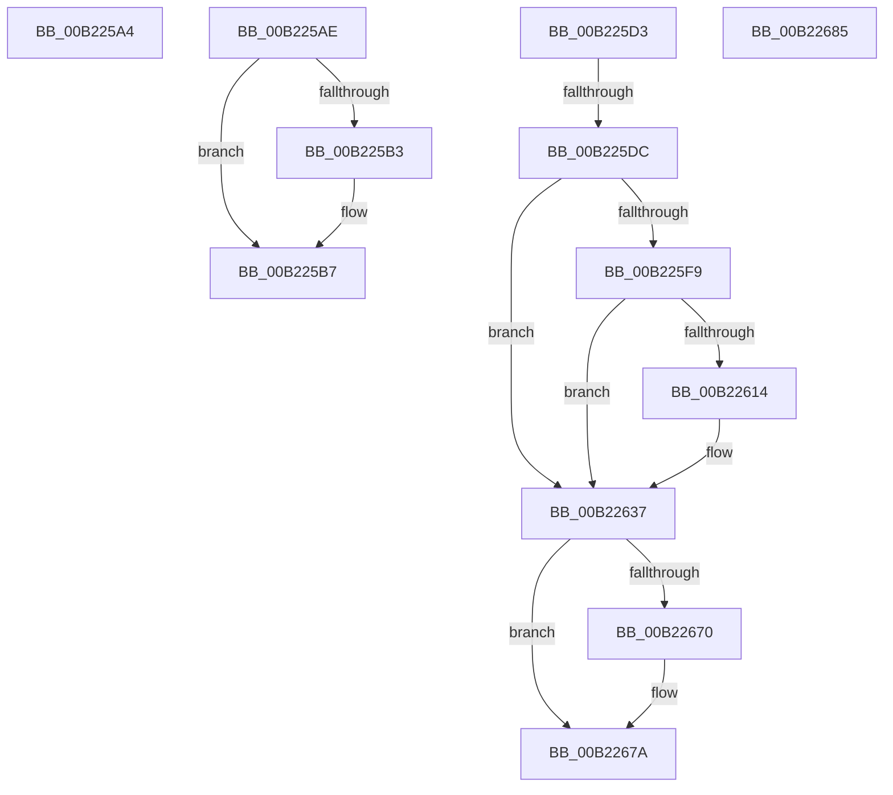

# sub_00B225A4

- RVA: `0x00B225A4`–`0x00B226A3` (길이 `255` bytes)
- VA: `0x0000000140B225A4`
- 실행 섹션: `PAGE`
- PDB 이름 있음: `아니요`; PDB Function 태그: `아니요`
- unwind 정보 RVA: `0x0008CF5C`
- 디코드: `61`개 명령, `255/255` bytes 표시
- 미해석 바이트: `0` (있으면 어셈블리에 `.byte`로 보존)

> 이 문서는 커널 이미지의 기계어와 PDB 기호를 분석해 생성했습니다. 4번과 5번은 함수 원형과 자료형을 바이너리 사용 방식에서 추정한 C 해석이며 원본 소스 복구 결과는 아닙니다.

## 1. Dependencies

- 직접 호출 지점: **8**; 고유 호출 대상: **8**
- 직접 호출자로 확인된 함수: **0**
- RIP 상대 이미지 참조: **1**

### Outgoing calls
- `0x00B225ED` → [EtwpGetSchematizedFilterSize](../9F/EtwpGetSchematizedFilterSize_function_009FE308.md) (function, `0x009FE308`)
- `0x00B22607` → [ExAllocatePool2](../../poolcode/B8/ExAllocatePool2_function_00B820F0.md) (function, `0x00B820F0`)
- `0x00B22632` → [EtwpCopySchematizedFilters](../8C/EtwpCopySchematizedFilters_function_008C380C.md) (function, `0x008C380C`)
- `0x00B22666` → [guard_dispatch_icall](../../text/6B/guard_dispatch_icall_function_006BAAD0.md) (function, `0x006BAAD0`)
- `0x00B22675` → [ExFreePoolWithTag](../../poolcode/B8/ExFreePoolWithTag_function_00B82870.md) (function, `0x00B82870`)
- `0x00B22688` → [ExfReleasePushLock](../../text/26/ExfReleasePushLock_function_002638D0.md) (function, `0x002638D0`)
- `0x00B22690` → [KeAbPostRelease](../../text/2E/KeAbPostRelease_function_002E1600.md) (function, `0x002E1600`)
- `0x00B22695` → [KeLeaveCriticalRegion](../../text/25/KeLeaveCriticalRegion_function_0025D8B0.md) (function, `0x0025D8B0`)

### Direct callers
- 이 함수 시작 RVA로 연결되는 직접 call은 확인되지 않았습니다. 간접 호출은 완전히 역산할 수 없습니다.

### Static image references
- `0x00B2263C` → RVA `0x000112D0` (`.rdata`; read)

## 2. Other-region calls and transfers

- 다른 실행 섹션으로 향하는 call: **6**
  - `0x00B22607` → [ExAllocatePool2](../../poolcode/B8/ExAllocatePool2_function_00B820F0.md) (`PAGE` → `POOLCODE`)
  - `0x00B22666` → [guard_dispatch_icall](../../text/6B/guard_dispatch_icall_function_006BAAD0.md) (`PAGE` → `.text`)
  - `0x00B22675` → [ExFreePoolWithTag](../../poolcode/B8/ExFreePoolWithTag_function_00B82870.md) (`PAGE` → `POOLCODE`)
  - `0x00B22688` → [ExfReleasePushLock](../../text/26/ExfReleasePushLock_function_002638D0.md) (`PAGE` → `.text`)
  - `0x00B22690` → [KeAbPostRelease](../../text/2E/KeAbPostRelease_function_002E1600.md) (`PAGE` → `.text`)
  - `0x00B22695` → [KeLeaveCriticalRegion](../../text/25/KeLeaveCriticalRegion_function_0025D8B0.md) (`PAGE` → `.text`)
- call이 아닌 외부 분기/꼬리 이동: **5**
  - `0x00B225A9` → [EtwpRegisterKMProvider + 0x181](../92/EtwpRegisterKMProvider_function_009209A4.md) (`tail-transfer`)
  - `0x00B225CE` → [EtwpRegisterKMProvider + 0x1BC](../92/EtwpRegisterKMProvider_function_009209A4.md) (`tail-transfer`)
  - `0x00B225D6` → [EtwpRegisterKMProvider + 0xC8](../92/EtwpRegisterKMProvider_function_009209A4.md) (`tail-transfer`)
  - `0x00B22680` → [EtwpRegisterKMProvider + 0xC8](../92/EtwpRegisterKMProvider_function_009209A4.md) (`tail-transfer`)
  - `0x00B2269E` → [EtwpRegisterKMProvider + 0xB3](../92/EtwpRegisterKMProvider_function_009209A4.md) (`tail-transfer`)

## 3. Assembly (complete function range)

```asm
00B225A4  B8 0D 00 00 C0                  mov eax, 0xc000000d
00B225A9  E9 77 E5 DF FF                  jmp 0x140920b25
00B225AE  48 85 FF                        test rdi, rdi
00B225B1  74 04                           je 0x140b225b7
00B225B3  C6 47 0A 01                     mov byte ptr [rdi + 0xa], 1
00B225B7  65 48 8B 0C 25 88 01 00 00      mov rcx, qword ptr gs:[0x188]
00B225C0  48 8B 86 90 02 00 00            mov rax, qword ptr [rsi + 0x290]
00B225C7  48 89 88 A0 02 00 00            mov qword ptr [rax + 0x2a0], rcx
00B225CE  E9 8D E5 DF FF                  jmp 0x140920b60
00B225D3  39 75 97                        cmp dword ptr [rbp - 0x69], esi
00B225D6  0F 84 90 E4 DF FF               je 0x140920a6c
00B225DC  0F 57 C0                        xorps xmm0, xmm0
00B225DF  49 8B CE                        mov rcx, r14
00B225E2  0F 11 45 C7                     movups xmmword ptr [rbp - 0x39], xmm0
00B225E6  0F B7 53 64                     movzx edx, word ptr [rbx + 0x64]
00B225EA  45 33 ED                        xor r13d, r13d
00B225ED  E8 16 BD ED FF                  call 0x1409fe308
00B225F2  44 8B F8                        mov r15d, eax
00B225F5  85 C0                           test eax, eax
00B225F7  74 3E                           je 0x140b22637
00B225F9  41 8B D7                        mov edx, r15d
00B225FC  B9 00 01 00 00                  mov ecx, 0x100
00B22601  41 B8 45 74 77 46               mov r8d, 0x46777445
00B22607  E8 E4 FA 05 00                  call 0x140b820f0
00B2260C  48 8B F0                        mov rsi, rax
00B2260F  48 85 C0                        test rax, rax
00B22612  74 23                           je 0x140b22637
00B22614  48 89 45 C7                     mov qword ptr [rbp - 0x39], rax
00B22618  4C 8D 6D C7                     lea r13, [rbp - 0x39]
00B2261C  44 89 7D CF                     mov dword ptr [rbp - 0x31], r15d
00B22620  49 8B D6                        mov rdx, r14
00B22623  C7 45 D3 00 00 00 80            mov dword ptr [rbp - 0x2d], 0x80000000
00B2262A  48 8B C8                        mov rcx, rax
00B2262D  44 0F B7 43 64                  movzx r8d, word ptr [rbx + 0x64]
00B22632  E8 D5 11 DA FF                  call 0x1408c380c
00B22637  48 8B 44 24 50                  mov rax, qword ptr [rsp + 0x50]
00B2263C  48 8D 0D 8D EC 4E FF            lea rcx, [rip - 0xb11373]
00B22643  4C 8B 4D A7                     mov r9, qword ptr [rbp - 0x59]
00B22647  BA 01 00 00 00                  mov edx, 1
00B2264C  44 8A 45 9B                     mov r8b, byte ptr [rbp - 0x65]
00B22650  48 89 44 24 30                  mov qword ptr [rsp + 0x30], rax
00B22655  48 8B 45 AF                     mov rax, qword ptr [rbp - 0x51]
00B22659  4C 89 6C 24 28                  mov qword ptr [rsp + 0x28], r13
00B2265E  48 89 44 24 20                  mov qword ptr [rsp + 0x20], rax
00B22663  49 8B C4                        mov rax, r12
00B22666  E8 65 84 B9 FF                  call 0x1406baad0
00B2266B  48 85 F6                        test rsi, rsi
00B2266E  74 0A                           je 0x140b2267a
00B22670  33 D2                           xor edx, edx
00B22672  48 8B CE                        mov rcx, rsi
00B22675  E8 F6 01 06 00                  call 0x140b82870
00B2267A  4C 8B 7D B7                     mov r15, qword ptr [rbp - 0x49]
00B2267E  33 F6                           xor esi, esi
00B22680  E9 E7 E3 DF FF                  jmp 0x140920a6c
00B22685  48 8B CB                        mov rcx, rbx
00B22688  E8 43 12 74 FF                  call 0x1402638d0
00B2268D  48 8B CB                        mov rcx, rbx
00B22690  E8 6B EF 7B FF                  call 0x1402e1600
00B22695  E8 16 B2 73 FF                  call 0x14025d8b0
00B2269A  8B 5C 24 48                     mov ebx, dword ptr [rsp + 0x48]
00B2269E  E9 B4 E3 DF FF                  jmp 0x140920a57
```

## 4. C-style interpretation (structured pseudocode)

```c
__int64 __fastcall sub_00B225A4(void)
{
    unsigned __int64 v_stack_p20;
    unsigned __int64 v_stack_p28;
    unsigned __int64 v_stack_p30;
    unsigned int v_stack_p48;
    unsigned __int64 v_stack_p50;
}
```

## 5. (Beta) C Style

```c
void sub_00B225A4(void)
{
    uint64_t v_stack_p20;
    uint64_t v_stack_p28;
    uint64_t v_stack_p30;
    uint32_t v_stack_p48;
    uint64_t v_stack_p50;
}
```

## 6. Execution-region graph

[열기: 2D/3D 그래프와 함수 탐색 컨트롤 패널](../../../control-panel.html?section=page&rva=0x00B225A4&view=graph)

- 2D 그래프는 위에서 아래로 흐르고, 3D 그래프는 빈 공간을 드래그해 회전합니다. Shift+드래그는 이동, 휠은 확대·축소, 함수 노드 선택은 대상 보고서 이동입니다.

### Static fallback


