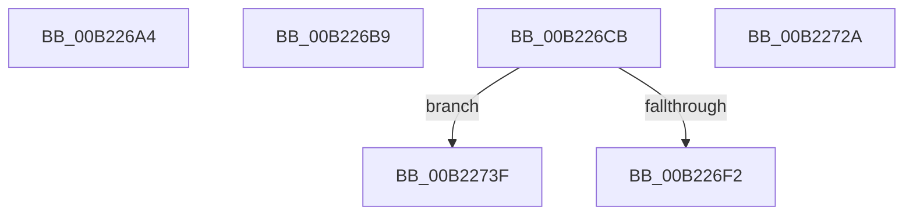

# sub_00B226A4

- RVA: `0x00B226A4`–`0x00B22756` (길이 `178` bytes)
- VA: `0x0000000140B226A4`
- 실행 섹션: `PAGE`
- PDB 이름 있음: `아니요`; PDB Function 태그: `아니요`
- unwind 정보 RVA: `0x0008D140`
- 디코드: `41`개 명령, `178/178` bytes 표시
- 미해석 바이트: `0` (있으면 어셈블리에 `.byte`로 보존)

> 이 문서는 커널 이미지의 기계어와 PDB 기호를 분석해 생성했습니다. 4번과 5번은 함수 원형과 자료형을 바이너리 사용 방식에서 추정한 C 해석이며 원본 소스 복구 결과는 아닙니다.

## 1. Dependencies

- 직접 호출 지점: **6**; 고유 호출 대상: **5**
- 직접 호출자로 확인된 함수: **0**
- RIP 상대 이미지 참조: **0**

### Outgoing calls
- `0x00B226A7` → [KeAbPostRelease](../../text/2E/KeAbPostRelease_function_002E1600.md) (function, `0x002E1600`)
- `0x00B226BC` → [KeAbPostRelease](../../text/2E/KeAbPostRelease_function_002E1600.md) (function, `0x002E1600`)
- `0x00B226E3` → [AlpcpReturnMessageOnInsufficientBuffer](../A2/AlpcpReturnMessageOnInsufficientBuffer_function_00A2EF7C.md) (function, `0x00A2EF7C`)
- `0x00B226F5` → [AlpcpUnlockMessage](../89/AlpcpUnlockMessage_function_00897AE0.md) (function, `0x00897AE0`)
- `0x00B2271F` → [AlpcpExposeCapturedContextAttribute](../A4/AlpcpExposeCapturedContextAttribute_function_00A4A72C.md) (function, `0x00A4A72C`)
- `0x00B2274B` → [AlpcpCancelMessage](../89/AlpcpCancelMessage_function_00894120.md) (function, `0x00894120`)

### Direct callers
- 이 함수 시작 RVA로 연결되는 직접 call은 확인되지 않았습니다. 간접 호출은 완전히 역산할 수 없습니다.

### Static image references
- 디코드된 RIP-relative 메모리 참조가 없습니다.

## 2. Other-region calls and transfers

- 다른 실행 섹션으로 향하는 call: **2**
  - `0x00B226A7` → [KeAbPostRelease](../../text/2E/KeAbPostRelease_function_002E1600.md) (`PAGE` → `.text`)
  - `0x00B226BC` → [KeAbPostRelease](../../text/2E/KeAbPostRelease_function_002E1600.md) (`PAGE` → `.text`)
- call이 아닌 외부 분기/꼬리 이동: **5**
  - `0x00B226B4` → [AlpcpProcessSynchronousRequest + 0xAD](../92/AlpcpProcessSynchronousRequest_function_00921FCC.md) (`tail-transfer`)
  - `0x00B226C6` → [AlpcpProcessSynchronousRequest + 0x31E](../92/AlpcpProcessSynchronousRequest_function_00921FCC.md) (`tail-transfer`)
  - `0x00B22725` → [AlpcpProcessSynchronousRequest + 0x312](../92/AlpcpProcessSynchronousRequest_function_00921FCC.md) (`tail-transfer`)
  - `0x00B2273A` → [AlpcpProcessSynchronousRequest + 0x312](../92/AlpcpProcessSynchronousRequest_function_00921FCC.md) (`tail-transfer`)
  - `0x00B22751` → [AlpcpProcessSynchronousRequest + 0x312](../92/AlpcpProcessSynchronousRequest_function_00921FCC.md) (`tail-transfer`)

## 3. Assembly (complete function range)

```asm
00B226A4  48 8B CB                        mov rcx, rbx
00B226A7  E8 54 EF 7B FF                  call 0x1402e1600
00B226AC  4C 8B A4 24 20 01 00 00         mov r12, qword ptr [rsp + 0x120]
00B226B4  E9 C0 F9 DF FF                  jmp 0x140922079
00B226B9  48 8B CB                        mov rcx, rbx
00B226BC  E8 3F EF 7B FF                  call 0x1402e1600
00B226C1  B8 37 00 00 C0                  mov eax, 0xc0000037
00B226C6  E9 1F FC DF FF                  jmp 0x1409222ea
00B226CB  0F 57 C0                        xorps xmm0, xmm0
00B226CE  0F 11 44 24 68                  movups xmmword ptr [rsp + 0x68], xmm0
00B226D3  0F 11 44 24 78                  movups xmmword ptr [rsp + 0x78], xmm0
00B226D8  4C 8D 44 24 68                  lea r8, [rsp + 0x68]
00B226DD  48 8B D3                        mov rdx, rbx
00B226E0  48 8B CE                        mov rcx, rsi
00B226E3  E8 94 C8 F0 FF                  call 0x140a2ef7c
00B226E8  44 8B E0                        mov r12d, eax
00B226EB  3D 23 00 00 C0                  cmp eax, 0xc0000023
00B226F0  75 4D                           jne 0x140b2273f
00B226F2  48 8B CB                        mov rcx, rbx
00B226F5  E8 E6 53 D7 FF                  call 0x140897ae0
00B226FA  90                              nop
00B226FB  48 8B 84 24 38 01 00 00         mov rax, qword ptr [rsp + 0x138]
00B22703  8B 54 24 40                     mov edx, dword ptr [rsp + 0x40]
00B22707  48 89 10                        mov qword ptr [rax], rdx
00B2270A  4C 8B 8C 24 40 01 00 00         mov r9, qword ptr [rsp + 0x140]
00B22712  44 8B 44 24 30                  mov r8d, dword ptr [rsp + 0x30]
00B22717  48 8D 54 24 68                  lea rdx, [rsp + 0x68]
00B2271C  41 8B CD                        mov ecx, r13d
00B2271F  E8 08 80 F2 FF                  call 0x140a4a72c
00B22724  90                              nop
00B22725  E9 B4 FB DF FF                  jmp 0x1409222de
00B2272A  44 8B E0                        mov r12d, eax
00B2272D  4C 8B BC 24 10 01 00 00         mov r15, qword ptr [rsp + 0x110]
00B22735  48 8B 74 24 48                  mov rsi, qword ptr [rsp + 0x48]
00B2273A  E9 9F FB DF FF                  jmp 0x1409222de
00B2273F  41 B8 00 00 01 00               mov r8d, 0x10000
00B22745  48 8B D3                        mov rdx, rbx
00B22748  48 8B CE                        mov rcx, rsi
00B2274B  E8 D0 19 D7 FF                  call 0x140894120
00B22750  90                              nop
00B22751  E9 88 FB DF FF                  jmp 0x1409222de
```

## 4. C-style interpretation (structured pseudocode)

```c
__int64 __fastcall sub_00B226A4(__int64 a1, __int64 a2, __int64 a3, __int64 a4, __int64 a5, __int64 a6, __int64 a7, __int64 a8, __int64 a9, __int64 a10, __int64 a11, __int64 a12, __int64 a13, __int64 a14, __int64 a15, __int64 a16, __int64 a17, __int64 a18, __int64 a19, __int64 a20, __int64 a21, __int64 a22, __int64 a23, __int64 a24, __int64 a25, __int64 a26, __int64 a27, __int64 a28, __int64 a29, __int64 a30, __int64 a31, __int64 a32, __int64 a33, __int64 a34, __int64 a35, __int64 a36)
{
    __int64 result;
    unsigned __int64 v_stack_p110;
    unsigned __int64 v_stack_p138;
    unsigned __int64 v_stack_p140;
    unsigned int v_stack_p30;
    unsigned int v_stack_p40;
    unsigned __int64 v_stack_p48;
    unsigned __int64 v_stack_p68;
    unsigned __int64 v_stack_p78;

    result = KeAbPostRelease(v_rbx, a2, a3, a4);
}
```

## 5. (Beta) C Style

```c
int64_t sub_00B226A4(int64_t Arg1, int64_t Arg2, int64_t Arg3, int64_t Arg4, uint64_t Arg5, uint64_t Arg6, uint64_t Arg7, uint64_t Arg8, uint64_t Arg9, uint64_t Arg10, uint64_t Arg11, uint64_t Arg12, uint64_t Arg13, uint64_t Arg14, uint64_t Arg15, uint64_t Arg16, uint64_t Arg17, uint64_t Arg18, uint64_t Arg19, uint64_t Arg20, uint64_t Arg21, uint64_t Arg22, uint64_t Arg23, uint64_t Arg24, uint64_t Arg25, uint64_t Arg26, uint64_t Arg27, uint64_t Arg28, uint64_t Arg29, uint64_t Arg30, uint64_t Arg31, uint64_t Arg32, uint64_t Arg33, uint64_t Arg34, uint64_t Arg35, int64_t Arg36)
{
    int64_t result;
    uint64_t v_stack_p110;
    uint64_t v_stack_p138;
    uint64_t v_stack_p140;
    uint32_t v_stack_p30;
    uint32_t v_stack_p40;
    uint64_t v_stack_p48;
    uint64_t v_stack_p68;
    uint64_t v_stack_p78;

    result = KeAbPostRelease(local_rbx, Arg2, Arg3, Arg4);
}
```

## 6. Execution-region graph

[열기: 2D/3D 그래프와 함수 탐색 컨트롤 패널](../../../control-panel.html?section=page&rva=0x00B226A4&view=graph)

- 2D 그래프는 위에서 아래로 흐르고, 3D 그래프는 빈 공간을 드래그해 회전합니다. Shift+드래그는 이동, 휠은 확대·축소, 함수 노드 선택은 대상 보고서 이동입니다.

### Static fallback


