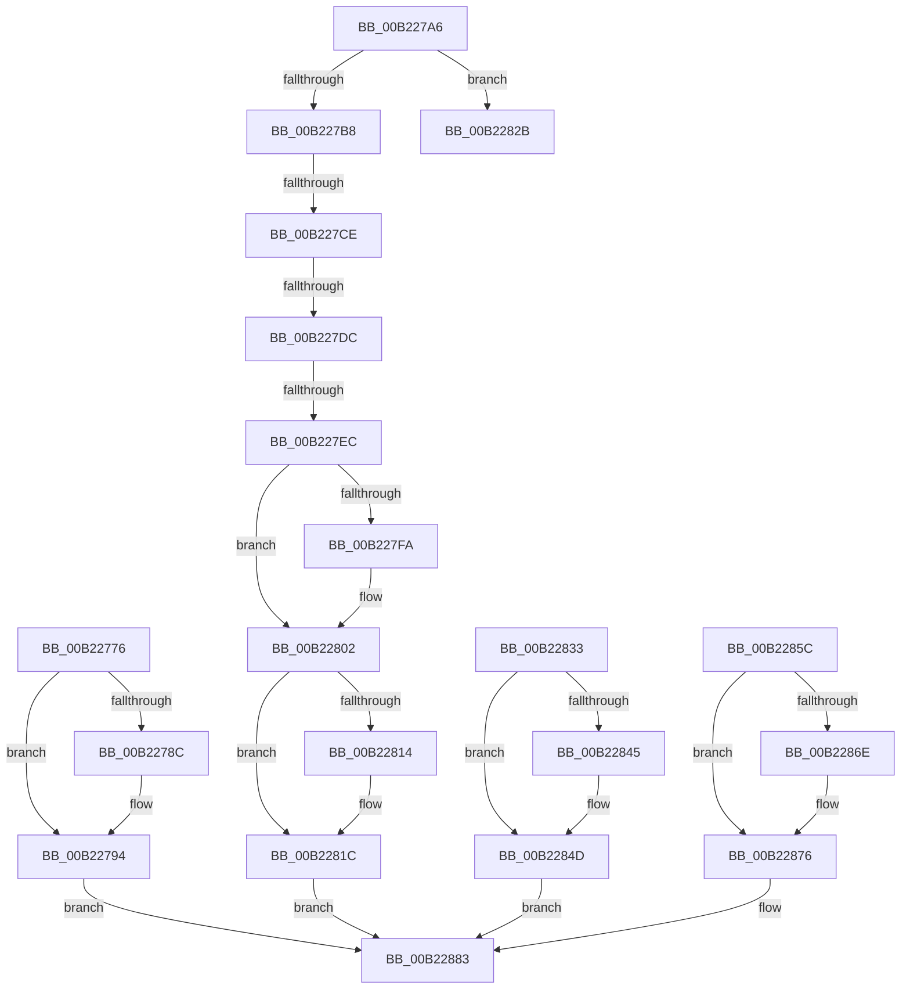

# sub_00B22776

- RVA: `0x00B22776`–`0x00B22892` (길이 `284` bytes)
- VA: `0x0000000140B22776`
- 실행 섹션: `PAGE`
- PDB 이름 있음: `아니요`; PDB Function 태그: `아니요`
- unwind 정보 RVA: `0x0008D338`
- 디코드: `73`개 명령, `284/284` bytes 표시
- 미해석 바이트: `0` (있으면 어셈블리에 `.byte`로 보존)

> 이 문서는 커널 이미지의 기계어와 PDB 기호를 분석해 생성했습니다. 4번과 5번은 함수 원형과 자료형을 바이너리 사용 방식에서 추정한 C 해석이며 원본 소스 복구 결과는 아닙니다.

## 1. Dependencies

- 직접 호출 지점: **16**; 고유 호출 대상: **5**
- 직접 호출자로 확인된 함수: **0**
- RIP 상대 이미지 참조: **0**

### Outgoing calls
- `0x00B22779` → [KeAbPostRelease](../../text/2E/KeAbPostRelease_function_002E1600.md) (function, `0x002E1600`)
- `0x00B2278F` → [ExfReleasePushLockShared](../../text/26/ExfReleasePushLockShared_function_00263440.md) (function, `0x00263440`)
- `0x00B22797` → [KeAbPostRelease](../../text/2E/KeAbPostRelease_function_002E1600.md) (function, `0x002E1600`)
- `0x00B227CE` → [PsGetProcessJob](../../text/47/PsGetProcessJob_function_0047AE30.md) (function, `0x0047AE30`)
- `0x00B227DF` → [PsGetJobEffectiveFreezeCount](../../text/5E/PsGetJobEffectiveFreezeCount_function_005E2D40.md) (function, `0x005E2D40`)
- `0x00B227FD` → [ExfReleasePushLockShared](../../text/26/ExfReleasePushLockShared_function_00263440.md) (function, `0x00263440`)
- `0x00B22805` → [KeAbPostRelease](../../text/2E/KeAbPostRelease_function_002E1600.md) (function, `0x002E1600`)
- `0x00B22817` → [ExfReleasePushLockShared](../../text/26/ExfReleasePushLockShared_function_00263440.md) (function, `0x00263440`)
- `0x00B2281F` → [KeAbPostRelease](../../text/2E/KeAbPostRelease_function_002E1600.md) (function, `0x002E1600`)
- `0x00B22836` → [KeAbPostRelease](../../text/2E/KeAbPostRelease_function_002E1600.md) (function, `0x002E1600`)
- `0x00B22848` → [ExfReleasePushLockShared](../../text/26/ExfReleasePushLockShared_function_00263440.md) (function, `0x00263440`)
- `0x00B22850` → [KeAbPostRelease](../../text/2E/KeAbPostRelease_function_002E1600.md) (function, `0x002E1600`)
- `0x00B2285F` → [KeAbPostRelease](../../text/2E/KeAbPostRelease_function_002E1600.md) (function, `0x002E1600`)
- `0x00B22871` → [ExfReleasePushLockShared](../../text/26/ExfReleasePushLockShared_function_00263440.md) (function, `0x00263440`)
- `0x00B22879` → [KeAbPostRelease](../../text/2E/KeAbPostRelease_function_002E1600.md) (function, `0x002E1600`)
- `0x00B22886` → [ObfDereferenceObject](../../text/2F/ObfDereferenceObject_function_002F9350.md) (function, `0x002F9350`)

### Direct callers
- 이 함수 시작 RVA로 연결되는 직접 call은 확인되지 않았습니다. 간접 호출은 완전히 역산할 수 없습니다.

### Static image references
- 디코드된 RIP-relative 메모리 참조가 없습니다.

## 2. Other-region calls and transfers

- 다른 실행 섹션으로 향하는 call: **16**
  - `0x00B22779` → [KeAbPostRelease](../../text/2E/KeAbPostRelease_function_002E1600.md) (`PAGE` → `.text`)
  - `0x00B2278F` → [ExfReleasePushLockShared](../../text/26/ExfReleasePushLockShared_function_00263440.md) (`PAGE` → `.text`)
  - `0x00B22797` → [KeAbPostRelease](../../text/2E/KeAbPostRelease_function_002E1600.md) (`PAGE` → `.text`)
  - `0x00B227CE` → [PsGetProcessJob](../../text/47/PsGetProcessJob_function_0047AE30.md) (`PAGE` → `.text`)
  - `0x00B227DF` → [PsGetJobEffectiveFreezeCount](../../text/5E/PsGetJobEffectiveFreezeCount_function_005E2D40.md) (`PAGE` → `.text`)
  - `0x00B227FD` → [ExfReleasePushLockShared](../../text/26/ExfReleasePushLockShared_function_00263440.md) (`PAGE` → `.text`)
  - `0x00B22805` → [KeAbPostRelease](../../text/2E/KeAbPostRelease_function_002E1600.md) (`PAGE` → `.text`)
  - `0x00B22817` → [ExfReleasePushLockShared](../../text/26/ExfReleasePushLockShared_function_00263440.md) (`PAGE` → `.text`)
  - `0x00B2281F` → [KeAbPostRelease](../../text/2E/KeAbPostRelease_function_002E1600.md) (`PAGE` → `.text`)
  - `0x00B22836` → [KeAbPostRelease](../../text/2E/KeAbPostRelease_function_002E1600.md) (`PAGE` → `.text`)
  - `0x00B22848` → [ExfReleasePushLockShared](../../text/26/ExfReleasePushLockShared_function_00263440.md) (`PAGE` → `.text`)
  - `0x00B22850` → [KeAbPostRelease](../../text/2E/KeAbPostRelease_function_002E1600.md) (`PAGE` → `.text`)
  - `0x00B2285F` → [KeAbPostRelease](../../text/2E/KeAbPostRelease_function_002E1600.md) (`PAGE` → `.text`)
  - `0x00B22871` → [ExfReleasePushLockShared](../../text/26/ExfReleasePushLockShared_function_00263440.md) (`PAGE` → `.text`)
  - `0x00B22879` → [KeAbPostRelease](../../text/2E/KeAbPostRelease_function_002E1600.md) (`PAGE` → `.text`)
  - `0x00B22886` → [ObfDereferenceObject](../../text/2F/ObfDereferenceObject_function_002F9350.md) (`PAGE` → `.text`)
- call이 아닌 외부 분기/꼬리 이동: **5**
  - `0x00B227C8` → [AlpcpDispatchConnectionRequest + 0x11D](../92/AlpcpDispatchConnectionRequest_function_0092353C.md) (`tail-transfer`)
  - `0x00B227D6` → [AlpcpDispatchConnectionRequest + 0x118](../92/AlpcpDispatchConnectionRequest_function_0092353C.md) (`tail-transfer`)
  - `0x00B227E6` → [AlpcpDispatchConnectionRequest + 0x118](../92/AlpcpDispatchConnectionRequest_function_0092353C.md) (`tail-transfer`)
  - `0x00B2282E` → [AlpcpDispatchConnectionRequest + 0x11D](../92/AlpcpDispatchConnectionRequest_function_0092353C.md) (`tail-transfer`)
  - `0x00B2288D` → [AlpcpDispatchConnectionRequest + 0x1B6](../92/AlpcpDispatchConnectionRequest_function_0092353C.md) (`tail-transfer`)

## 3. Assembly (complete function range)

```asm
00B22776  48 8B CB                        mov rcx, rbx
00B22779  E8 82 EE 7B FF                  call 0x1402e1600
00B2277E  B8 11 00 00 00                  mov eax, 0x11
00B22783  33 C9                           xor ecx, ecx
00B22785  F0 48 0F B1 0F                  lock cmpxchg qword ptr [rdi], rcx
00B2278A  74 08                           je 0x140b22794
00B2278C  48 8B CF                        mov rcx, rdi
00B2278F  E8 AC 0C 74 FF                  call 0x140263440
00B22794  48 8B CF                        mov rcx, rdi
00B22797  E8 64 EE 7B FF                  call 0x1402e1600
00B2279C  BB 37 00 00 C0                  mov ebx, 0xc0000037
00B227A1  E9 DD 00 00 00                  jmp 0x140b22883
00B227A6  49 8B 46 08                     mov rax, qword ptr [r14 + 8]
00B227AA  BA 01 00 00 00                  mov edx, 1
00B227AF  F7 40 28 00 02 00 00            test dword ptr [rax + 0x28], 0x200
00B227B6  75 73                           jne 0x140b2282b
00B227B8  48 8B 45 18                     mov rax, qword ptr [rbp + 0x18]
00B227BC  4C 8B F9                        mov r15, rcx
00B227BF  84 C2                           test dl, al
00B227C1  48 0F 44 C8                     cmove rcx, rax
00B227C5  48 85 C9                        test rcx, rcx
00B227C8  0F 84 8B 0E E0 FF               je 0x140923659
00B227CE  E8 5D 86 95 FF                  call 0x14047ae30
00B227D3  48 85 C0                        test rax, rax
00B227D6  0F 84 78 0E E0 FF               je 0x140923654
00B227DC  48 8B C8                        mov rcx, rax
00B227DF  E8 5C 05 AC FF                  call 0x1405e2d40
00B227E4  85 C0                           test eax, eax
00B227E6  0F 84 68 0E E0 FF               je 0x140923654
00B227EC  BE 11 00 00 00                  mov esi, 0x11
00B227F1  8B C6                           mov eax, esi
00B227F3  F0 4C 0F B1 3B                  lock cmpxchg qword ptr [rbx], r15
00B227F8  74 08                           je 0x140b22802
00B227FA  48 8B CB                        mov rcx, rbx
00B227FD  E8 3E 0C 74 FF                  call 0x140263440
00B22802  48 8B CB                        mov rcx, rbx
00B22805  E8 F6 ED 7B FF                  call 0x1402e1600
00B2280A  48 8B C6                        mov rax, rsi
00B2280D  F0 4C 0F B1 3F                  lock cmpxchg qword ptr [rdi], r15
00B22812  74 08                           je 0x140b2281c
00B22814  48 8B CF                        mov rcx, rdi
00B22817  E8 24 0C 74 FF                  call 0x140263440
00B2281C  48 8B CF                        mov rcx, rdi
00B2281F  E8 DC ED 7B FF                  call 0x1402e1600
00B22824  BB 36 00 00 C0                  mov ebx, 0xc0000036
00B22829  EB 58                           jmp 0x140b22883
00B2282B  45 33 FF                        xor r15d, r15d
00B2282E  E9 26 0E E0 FF                  jmp 0x140923659
00B22833  48 8B CB                        mov rcx, rbx
00B22836  E8 C5 ED 7B FF                  call 0x1402e1600
00B2283B  48 8B C6                        mov rax, rsi
00B2283E  F0 4C 0F B1 3F                  lock cmpxchg qword ptr [rdi], r15
00B22843  74 08                           je 0x140b2284d
00B22845  48 8B CF                        mov rcx, rdi
00B22848  E8 F3 0B 74 FF                  call 0x140263440
00B2284D  48 8B CF                        mov rcx, rdi
00B22850  E8 AB ED 7B FF                  call 0x1402e1600
00B22855  BB 23 00 00 C0                  mov ebx, 0xc0000023
00B2285A  EB 27                           jmp 0x140b22883
00B2285C  48 8B CB                        mov rcx, rbx
00B2285F  E8 9C ED 7B FF                  call 0x1402e1600
00B22864  48 8B C6                        mov rax, rsi
00B22867  F0 4C 0F B1 3F                  lock cmpxchg qword ptr [rdi], r15
00B2286C  74 08                           je 0x140b22876
00B2286E  48 8B CF                        mov rcx, rdi
00B22871  E8 CA 0B 74 FF                  call 0x140263440
00B22876  48 8B CF                        mov rcx, rdi
00B22879  E8 82 ED 7B FF                  call 0x1402e1600
00B2287E  BB 01 00 00 C0                  mov ebx, 0xc0000001
00B22883  48 8B CD                        mov rcx, rbp
00B22886  E8 C5 6A 7D FF                  call 0x1402f9350
00B2288B  8B C3                           mov eax, ebx
00B2288D  E9 60 0E E0 FF                  jmp 0x1409236f2
```

## 4. C-style interpretation (structured pseudocode)

```c
__int64 __fastcall sub_00B22776(void)
{
    __int64 result;

    result = KeAbPostRelease(v_rbx, a2, a3, a4);
    a1 = 0;
    result = 17;
    if (!(condition_is_equal)) {
        a1 = v_rdi;
        result = ExfReleasePushLockShared(a1, a2, a3, a4);
    }
    result = KeAbPostRelease(v_rdi, a2, a3, a4);
    goto loc_00B22883;
loc_00B22883:
    result = ObfDereferenceObject(v_rbp, a2, a3, a4);
}
```

## 5. (Beta) C Style

```c
void sub_00B22776(void)
{
    int64_t result;

    result = KeAbPostRelease(local_rbx, a2, a3, a4);
    a1 = 0;
    result = 17;
    if (!(condition_is_equal)) {
        a1 = local_rdi;
        result = ExfReleasePushLockShared(a1, a2, a3, a4);
    }
    result = KeAbPostRelease(local_rdi, a2, a3, a4);
    goto loc_00B22883;
loc_00B22883:
    result = ObfDereferenceObject(local_rbp, a2, a3, a4);
}
```

## 6. Execution-region graph

[열기: 2D/3D 그래프와 함수 탐색 컨트롤 패널](../../../control-panel.html?section=page&rva=0x00B22776&view=graph)

- 2D 그래프는 위에서 아래로 흐르고, 3D 그래프는 빈 공간을 드래그해 회전합니다. Shift+드래그는 이동, 휠은 확대·축소, 함수 노드 선택은 대상 보고서 이동입니다.

### Static fallback


