# sub_00B22892

- RVA: `0x00B22892`–`0x00B22B6A` (길이 `728` bytes)
- VA: `0x0000000140B22892`
- 실행 섹션: `PAGE`
- PDB 이름 있음: `아니요`; PDB Function 태그: `아니요`
- unwind 정보 RVA: `0x0008D3C8`
- 디코드: `185`개 명령, `728/728` bytes 표시
- 미해석 바이트: `0` (있으면 어셈블리에 `.byte`로 보존)

> 이 문서는 커널 이미지의 기계어와 PDB 기호를 분석해 생성했습니다. 4번과 5번은 함수 원형과 자료형을 바이너리 사용 방식에서 추정한 C 해석이며 원본 소스 복구 결과는 아닙니다.

## 1. Dependencies

- 직접 호출 지점: **19**; 고유 호출 대상: **12**
- 직접 호출자로 확인된 함수: **0**
- RIP 상대 이미지 참조: **0**

### Outgoing calls
- `0x00B228B3` → [ExfTryToWakePushLock](../../text/26/ExfTryToWakePushLock_function_00265DD0.md) (function, `0x00265DD0`)
- `0x00B228BB` → [KeAbPostRelease](../../text/2E/KeAbPostRelease_function_002E1600.md) (function, `0x002E1600`)
- `0x00B228CE` → [AlpcpLockForCachedReferenceBlob](../88/AlpcpLockForCachedReferenceBlob_function_0088A8B0.md) (function, `0x0088A8B0`)
- `0x00B2290B` → [KeAbPreAcquire](../../text/21/KeAbPreAcquire_function_00210230.md) (function, `0x00210230`)
- `0x00B22924` → [ExfAcquirePushLockExclusiveEx](../../text/20/ExfAcquirePushLockExclusiveEx_function_0020FC90.md) (function, `0x0020FC90`)
- `0x00B229D6` → [Feature_Servicing_Alpc_LockOrdering__private_IsEnabledDeviceUsageNoInline](../../text/5C/Feature_Servicing_Alpc_LockOrdering__private_IsEnabledDeviceUsageNoInline_function_005CD86C.md) (function, `0x005CD86C`)
- `0x00B229E2` → [AlpcpUnlockMessage](../89/AlpcpUnlockMessage_function_00897AE0.md) (function, `0x00897AE0`)
- `0x00B22A2B` → [ExfTryToWakePushLock](../../text/26/ExfTryToWakePushLock_function_00265DD0.md) (function, `0x00265DD0`)
- `0x00B22A33` → [KeAbPostRelease](../../text/2E/KeAbPostRelease_function_002E1600.md) (function, `0x002E1600`)
- `0x00B22A3B` → [AlpcpUnlockMessage](../89/AlpcpUnlockMessage_function_00897AE0.md) (function, `0x00897AE0`)
- `0x00B22A78` → [KeAbPreAcquire](../../text/21/KeAbPreAcquire_function_00210230.md) (function, `0x00210230`)
- `0x00B22A91` → [ExfAcquirePushLockExclusiveEx](../../text/20/ExfAcquirePushLockExclusiveEx_function_0020FC90.md) (function, `0x0020FC90`)
- `0x00B22AD3` → [KeReleaseSemaphoreEx](../../text/34/KeReleaseSemaphoreEx_function_003468C0.md) (function, `0x003468C0`)
- `0x00B22AEB` → [AlpcpReleaseMessageAttributesOnCancel](../89/AlpcpReleaseMessageAttributesOnCancel_function_00894030.md) (function, `0x00894030`)
- `0x00B22B04` → [AlpcpClearOwnerPortMessage](../88/AlpcpClearOwnerPortMessage_function_0088FD30.md) (function, `0x0088FD30`)
- `0x00B22B0C` → [AlpcpTransferQuotaMessage](../89/AlpcpTransferQuotaMessage_function_008940D0.md) (function, `0x008940D0`)
- `0x00B22B23` → [PsReleaseProcessWakeCounter](../88/PsReleaseProcessWakeCounter_function_0088B940.md) (function, `0x0088B940`)
- `0x00B22B42` → [PsReleaseProcessWakeCounter](../88/PsReleaseProcessWakeCounter_function_0088B940.md) (function, `0x0088B940`)
- `0x00B22B5F` → [AlpcpUnlockMessage](../89/AlpcpUnlockMessage_function_00897AE0.md) (function, `0x00897AE0`)

### Direct callers
- 이 함수 시작 RVA로 연결되는 직접 call은 확인되지 않았습니다. 간접 호출은 완전히 역산할 수 없습니다.

### Static image references
- 디코드된 RIP-relative 메모리 참조가 없습니다.

## 2. Other-region calls and transfers

- 다른 실행 섹션으로 향하는 call: **10**
  - `0x00B228B3` → [ExfTryToWakePushLock](../../text/26/ExfTryToWakePushLock_function_00265DD0.md) (`PAGE` → `.text`)
  - `0x00B228BB` → [KeAbPostRelease](../../text/2E/KeAbPostRelease_function_002E1600.md) (`PAGE` → `.text`)
  - `0x00B2290B` → [KeAbPreAcquire](../../text/21/KeAbPreAcquire_function_00210230.md) (`PAGE` → `.text`)
  - `0x00B22924` → [ExfAcquirePushLockExclusiveEx](../../text/20/ExfAcquirePushLockExclusiveEx_function_0020FC90.md) (`PAGE` → `.text`)
  - `0x00B229D6` → [Feature_Servicing_Alpc_LockOrdering__private_IsEnabledDeviceUsageNoInline](../../text/5C/Feature_Servicing_Alpc_LockOrdering__private_IsEnabledDeviceUsageNoInline_function_005CD86C.md) (`PAGE` → `.text`)
  - `0x00B22A2B` → [ExfTryToWakePushLock](../../text/26/ExfTryToWakePushLock_function_00265DD0.md) (`PAGE` → `.text`)
  - `0x00B22A33` → [KeAbPostRelease](../../text/2E/KeAbPostRelease_function_002E1600.md) (`PAGE` → `.text`)
  - `0x00B22A78` → [KeAbPreAcquire](../../text/21/KeAbPreAcquire_function_00210230.md) (`PAGE` → `.text`)
  - `0x00B22A91` → [ExfAcquirePushLockExclusiveEx](../../text/20/ExfAcquirePushLockExclusiveEx_function_0020FC90.md) (`PAGE` → `.text`)
  - `0x00B22AD3` → [KeReleaseSemaphoreEx](../../text/34/KeReleaseSemaphoreEx_function_003468C0.md) (`PAGE` → `.text`)
- call이 아닌 외부 분기/꼬리 이동: **2**
  - `0x00B22AA3` → [AlpcpCancelMessagesByRequestor + 0xA4](../92/AlpcpCancelMessagesByRequestor_function_00924170.md) (`tail-transfer`)
  - `0x00B22B65` → [AlpcpCancelMessagesByRequestor + 0xA4](../92/AlpcpCancelMessagesByRequestor_function_00924170.md) (`tail-transfer`)

## 3. Assembly (complete function range)

```asm
00B22892  48 8D B5 B0 00 00 00            lea rsi, [rbp + 0xb0]
00B22899  EB 0A                           jmp 0x140b228a5
00B2289B  48 8D B5 88 00 00 00            lea rsi, [rbp + 0x88]
00B228A2  48 8B C3                        mov rax, rbx
00B228A5  F0 48 0F C1 06                  lock xadd qword ptr [rsi], rax
00B228AA  24 06                           and al, 6
00B228AC  3C 02                           cmp al, 2
00B228AE  75 08                           jne 0x140b228b8
00B228B0  48 8B CE                        mov rcx, rsi
00B228B3  E8 18 35 74 FF                  call 0x140265dd0
00B228B8  48 8B CE                        mov rcx, rsi
00B228BB  E8 40 ED 7B FF                  call 0x1402e1600
00B228C0  48 8B CF                        mov rcx, rdi
00B228C3  C7 84 24 88 00 00 00 01 00 00 00  mov dword ptr [rsp + 0x88], 1
00B228CE  E8 DD 7F D6 FF                  call 0x14088a8b0
00B228D3  41 8B C6                        mov eax, r14d
00B228D6  83 E8 01                        sub eax, 1
00B228D9  74 21                           je 0x140b228fc
00B228DB  83 E8 01                        sub eax, 1
00B228DE  74 1C                           je 0x140b228fc
00B228E0  45 33 C0                        xor r8d, r8d
00B228E3  33 D2                           xor edx, edx
00B228E5  83 F8 01                        cmp eax, 1
00B228E8  74 09                           je 0x140b228f3
00B228EA  48 8D B5 C8 00 00 00            lea rsi, [rbp + 0xc8]
00B228F1  EB 15                           jmp 0x140b22908
00B228F3  48 8D B5 B0 00 00 00            lea rsi, [rbp + 0xb0]
00B228FA  EB 0C                           jmp 0x140b22908
00B228FC  45 33 C0                        xor r8d, r8d
00B228FF  48 8D B5 88 00 00 00            lea rsi, [rbp + 0x88]
00B22906  33 D2                           xor edx, edx
00B22908  48 8B CE                        mov rcx, rsi
00B2290B  E8 20 D9 6E FF                  call 0x140210230
00B22910  F0 48 0F BA 2E 00               lock bts qword ptr [rsi], 0
00B22916  4C 8B F8                        mov r15, rax
00B22919  73 0E                           jae 0x140b22929
00B2291B  4C 8B C6                        mov r8, rsi
00B2291E  48 8B D0                        mov rdx, rax
00B22921  48 8B CE                        mov rcx, rsi
00B22924  E8 67 D3 6E FF                  call 0x14020fc90
00B22929  33 D2                           xor edx, edx
00B2292B  4D 85 FF                        test r15, r15
00B2292E  74 05                           je 0x140b22935
00B22930  41 C6 47 0A 01                  mov byte ptr [r15 + 0xa], 1
00B22935  4C 8B 7C 24 70                  mov r15, qword ptr [rsp + 0x70]
00B2293A  4C 39 7F 18                     cmp qword ptr [rdi + 0x18], r15
00B2293E  0F 85 8E 00 00 00               jne 0x140b229d2
00B22944  49 8B 04 24                     mov rax, qword ptr [r12]
00B22948  49 3B C4                        cmp rax, r12
00B2294B  0F 84 81 00 00 00               je 0x140b229d2
00B22951  48 3B C7                        cmp rax, rdi
00B22954  74 05                           je 0x140b2295b
00B22956  48 8B 00                        mov rax, qword ptr [rax]
00B22959  EB ED                           jmp 0x140b22948
00B2295B  BE 01 00 00 00                  mov esi, 1
00B22960  48 39 57 40                     cmp qword ptr [rdi + 0x40], rdx
00B22964  0F 85 7E 01 00 00               jne 0x140b22ae8
00B2296A  8B 47 28                        mov eax, dword ptr [rdi + 0x28]
00B2296D  84 C0                           test al, al
00B2296F  0F 88 73 01 00 00               js 0x140b22ae8
00B22975  48 8B 4F 20                     mov rcx, qword ptr [rdi + 0x20]
00B22979  0F BA E8 07                     bts eax, 7
00B2297D  88 97 F4 00 00 00               mov byte ptr [rdi + 0xf4], dl
00B22983  66 83 8F F4 00 00 00 0C         or word ptr [rdi + 0xf4], 0xc
00B2298B  89 47 28                        mov dword ptr [rdi + 0x28], eax
00B2298E  C7 87 F0 00 00 00 00 00 28 00   mov dword ptr [rdi + 0xf0], 0x280000
00B22998  48 85 C9                        test rcx, rcx
00B2299B  0F 85 07 01 00 00               jne 0x140b22aa8
00B229A1  0F BA E0 09                     bt eax, 9
00B229A5  0F 82 39 01 00 00               jb 0x140b22ae4
00B229AB  48 8B 94 24 90 00 00 00         mov rdx, qword ptr [rsp + 0x90]
00B229B3  48 8D 4F 50                     lea rcx, [rdi + 0x50]
00B229B7  48 8B 42 08                     mov rax, qword ptr [rdx + 8]
00B229BB  48 89 41 08                     mov qword ptr [rcx + 8], rax
00B229BF  48 89 11                        mov qword ptr [rcx], rdx
00B229C2  48 8B 42 08                     mov rax, qword ptr [rdx + 8]
00B229C6  48 89 08                        mov qword ptr [rax], rcx
00B229C9  48 89 4A 08                     mov qword ptr [rdx + 8], rcx
00B229CD  E9 16 01 00 00                  jmp 0x140b22ae8
00B229D2  66 01 5F E2                     add word ptr [rdi - 0x1e], bx
00B229D6  E8 91 AE AA FF                  call 0x1405cd86c
00B229DB  85 C0                           test eax, eax
00B229DD  75 0D                           jne 0x140b229ec
00B229DF  48 8B CF                        mov rcx, rdi
00B229E2  E8 F9 50 D7 FF                  call 0x140897ae0
00B229E7  E9 B3 00 00 00                  jmp 0x140b22a9f
00B229EC  41 8B C6                        mov eax, r14d
00B229EF  83 E8 01                        sub eax, 1
00B229F2  74 1F                           je 0x140b22a13
00B229F4  83 E8 01                        sub eax, 1
00B229F7  74 1A                           je 0x140b22a13
00B229F9  83 F8 01                        cmp eax, 1
00B229FC  48 8B C3                        mov rax, rbx
00B229FF  74 09                           je 0x140b22a0a
00B22A01  48 8D B5 C8 00 00 00            lea rsi, [rbp + 0xc8]
00B22A08  EB 13                           jmp 0x140b22a1d
00B22A0A  48 8D B5 B0 00 00 00            lea rsi, [rbp + 0xb0]
00B22A11  EB 0A                           jmp 0x140b22a1d
00B22A13  48 8D B5 88 00 00 00            lea rsi, [rbp + 0x88]
00B22A1A  48 8B C3                        mov rax, rbx
00B22A1D  F0 48 0F C1 06                  lock xadd qword ptr [rsi], rax
00B22A22  24 06                           and al, 6
00B22A24  3C 02                           cmp al, 2
00B22A26  75 08                           jne 0x140b22a30
00B22A28  48 8B CE                        mov rcx, rsi
00B22A2B  E8 A0 33 74 FF                  call 0x140265dd0
00B22A30  48 8B CE                        mov rcx, rsi
00B22A33  E8 C8 EB 7B FF                  call 0x1402e1600
00B22A38  48 8B CF                        mov rcx, rdi
00B22A3B  E8 A0 50 D7 FF                  call 0x140897ae0
00B22A40  41 8B C6                        mov eax, r14d
00B22A43  83 E8 01                        sub eax, 1
00B22A46  74 21                           je 0x140b22a69
00B22A48  83 E8 01                        sub eax, 1
00B22A4B  74 1C                           je 0x140b22a69
00B22A4D  45 33 C0                        xor r8d, r8d
00B22A50  33 D2                           xor edx, edx
00B22A52  83 F8 01                        cmp eax, 1
00B22A55  74 09                           je 0x140b22a60
00B22A57  48 8D BD C8 00 00 00            lea rdi, [rbp + 0xc8]
00B22A5E  EB 15                           jmp 0x140b22a75
00B22A60  48 8D BD B0 00 00 00            lea rdi, [rbp + 0xb0]
00B22A67  EB 0C                           jmp 0x140b22a75
00B22A69  45 33 C0                        xor r8d, r8d
00B22A6C  48 8D BD 88 00 00 00            lea rdi, [rbp + 0x88]
00B22A73  33 D2                           xor edx, edx
00B22A75  48 8B CF                        mov rcx, rdi
00B22A78  E8 B3 D7 6E FF                  call 0x140210230
00B22A7D  F0 48 0F BA 2F 00               lock bts qword ptr [rdi], 0
00B22A83  48 8B F0                        mov rsi, rax
00B22A86  73 0E                           jae 0x140b22a96
00B22A88  4C 8B C7                        mov r8, rdi
00B22A8B  48 8B D0                        mov rdx, rax
00B22A8E  48 8B CF                        mov rcx, rdi
00B22A91  E8 FA D1 6E FF                  call 0x14020fc90
00B22A96  48 85 F6                        test rsi, rsi
00B22A99  74 04                           je 0x140b22a9f
00B22A9B  C6 46 0A 01                     mov byte ptr [rsi + 0xa], 1
00B22A9F  49 8B 3C 24                     mov rdi, qword ptr [r12]
00B22AA3  E9 6C 17 E0 FF                  jmp 0x140924214
00B22AA8  48 8B C2                        mov rax, rdx
00B22AAB  48 87 81 B8 05 00 00            xchg qword ptr [rcx + 0x5b8], rax
00B22AB2  48 3B C7                        cmp rax, rdi
00B22AB5  75 2D                           jne 0x140b22ae4
00B22AB7  48 8B 4F 20                     mov rcx, qword ptr [rdi + 0x20]
00B22ABB  48 89 54 24 28                  mov qword ptr [rsp + 0x28], rdx
00B22AC0  48 81 C1 18 05 00 00            add rcx, 0x518
00B22AC7  89 54 24 20                     mov dword ptr [rsp + 0x20], edx
00B22ACB  BA 01 00 00 00                  mov edx, 1
00B22AD0  44 8B C2                        mov r8d, edx
00B22AD3  E8 E8 3D 82 FF                  call 0x1403468c0
00B22AD8  48 83 67 20 00                  and qword ptr [rdi + 0x20], 0
00B22ADD  66 83 47 E2 FD                  add word ptr [rdi - 0x1e], -3
00B22AE2  EB 04                           jmp 0x140b22ae8
00B22AE4  66 01 5F E2                     add word ptr [rdi - 0x1e], bx
00B22AE8  48 8B CF                        mov rcx, rdi
00B22AEB  E8 40 15 D7 FF                  call 0x140894030
00B22AF0  0F BA 6F 28 09                  bts dword ptr [rdi + 0x28], 9
00B22AF5  B8 FF DF FF FF                  mov eax, 0xffffdfff
00B22AFA  66 21 87 F4 00 00 00            and word ptr [rdi + 0xf4], ax
00B22B01  48 8B CF                        mov rcx, rdi
00B22B04  E8 27 D2 D6 FF                  call 0x14088fd30
00B22B09  48 8B CF                        mov rcx, rdi
00B22B0C  E8 BF 15 D7 FF                  call 0x1408940d0
00B22B11  48 8B 8F D0 00 00 00            mov rcx, qword ptr [rdi + 0xd0]
00B22B18  48 85 C9                        test rcx, rcx
00B22B1B  74 13                           je 0x140b22b30
00B22B1D  8B 97 08 01 00 00               mov edx, dword ptr [rdi + 0x108]
00B22B23  E8 18 8E D6 FF                  call 0x14088b940
00B22B28  48 83 A7 D0 00 00 00 00         and qword ptr [rdi + 0xd0], 0
00B22B30  48 8B 8F D8 00 00 00            mov rcx, qword ptr [rdi + 0xd8]
00B22B37  48 85 C9                        test rcx, rcx
00B22B3A  74 13                           je 0x140b22b4f
00B22B3C  8B 97 08 01 00 00               mov edx, dword ptr [rdi + 0x108]
00B22B42  E8 F9 8D D6 FF                  call 0x14088b940
00B22B47  48 83 A7 D8 00 00 00 00         and qword ptr [rdi + 0xd8], 0
00B22B4F  85 F6                           test esi, esi
00B22B51  74 06                           je 0x140b22b59
00B22B53  49 8B 3C 24                     mov rdi, qword ptr [r12]
00B22B57  EB 03                           jmp 0x140b22b5c
00B22B59  48 8B 3F                        mov rdi, qword ptr [rdi]
00B22B5C  49 8B CD                        mov rcx, r13
00B22B5F  E8 7C 4F D7 FF                  call 0x140897ae0
00B22B64  90                              nop
00B22B65  E9 AA 16 E0 FF                  jmp 0x140924214
```

## 4. C-style interpretation (structured pseudocode)

```c
__int64 __fastcall sub_00B22892(__int64 a1, int a2, int a3, __int64 a4, __int64 a5, __int64 a6, __int64 a7, __int64 a8, __int64 a9, __int64 a10, __int64 a11, __int64 a12, __int64 a13, __int64 a14, __int64 a15, __int64 a16, __int64 a17, __int64 a18)
{
    __int64 result;
    unsigned int v_stack_p20;
    unsigned __int64 v_stack_p28;
    unsigned int v_stack_p88;

    goto loc_00B228A5;
loc_00B228A5:
    result = (unsigned __int8)((result) & (6));
    if (((unsigned __int8)(result)) == 2) {
        a1 = v_rbp + 176;
        result = ExfTryToWakePushLock(a1, a2, a3, a4);
    }
    result = KeAbPostRelease(v_rbp + 176, a2, a3, a4);
    v_stack_p88 = 1;
    result = AlpcpLockForCachedReferenceBlob(v_rdi, a2, a3, a4);
    result = (unsigned int)(((unsigned int)((unsigned int)(v_r14))) - (1));
    if (condition_is_equal) goto loc_00B228FC;
    result = (unsigned int)((result) - (1));
    if (condition_is_equal) goto loc_00B228FC;
    a3 = 0;
    a2 = 0;
    if (((unsigned int)(result)) == 1) goto loc_00B228F3;
    goto loc_00B22908;
loc_00B228F3:
    goto loc_00B22908;
loc_00B228FC:
    a3 = 0;
    a2 = 0;
loc_00B22908:
    result = KeAbPreAcquire(v_rbp + 136, a2, a3, a4);
    if (!(condition_is_above_or_equal)) {
        a3 = v_rbp + 136;
        a2 = result;
        a1 = v_rbp + 136;
        result = ExfAcquirePushLockExclusiveEx(a1, a2, a3, a4);
    }
    a2 = 0;
    if (result != 0) {
        *(unsigned __int8 *)(result + 10) = 1;
    }
    if ((*(unsigned __int64 *)(v_rdi + 24)) != a14) goto loc_00B229D2;
loc_00B22948:
    if ((*(unsigned __int64 *)(v_r12)) == v_r12) goto loc_00B229D2;
    if ((*(unsigned __int64 *)(v_r12)) == v_rdi) goto loc_00B2295B;
    goto loc_00B22948;
loc_00B2295B:
    if ((*(unsigned __int64 *)(v_rdi + 64)) != 0) goto loc_00B22AE8;
    if (sign_flag) goto loc_00B22AE8;
    *(unsigned __int8 *)(v_rdi + 244) = 0;
    *(unsigned int *)(v_rdi + 40) = (unsigned int)((unsigned int)(*(unsigned int *)(v_rdi + 40)));
    *(unsigned int *)(v_rdi + 240) = 0x280000ULL;
    if (*(unsigned __int64 *)(v_rdi + 32) != 0) goto loc_00B22AA8;
    if (condition_is_below) goto loc_00B22AE4;
    *(unsigned __int64 *)(v_rdi + 80 + 8) = *(unsigned __int64 *)(a18 + 8);
    *(unsigned __int64 *)(v_rdi + 80) = a18;
    *(unsigned __int64 *)(*(unsigned __int64 *)(a18 + 8)) = v_rdi + 80;
    *(unsigned __int64 *)(a18 + 8) = v_rdi + 80;
    goto loc_00B22AE8;
loc_00B229D2:
    result = Feature_Servicing_Alpc_LockOrdering__private_IsEnabledDeviceUsageNoInline(v_rdi + 80, a18, a3, a4);
    if ((unsigned int)(result) != 0) goto loc_00B229EC;
    result = AlpcpUnlockMessage(v_rdi, a18, a3, a4);
    goto loc_00B22A9F;
loc_00B229EC:
    result = (unsigned int)(((unsigned int)((unsigned int)(v_r14))) - (1));
    if (condition_is_equal) goto loc_00B22A13;
    result = (unsigned int)((result) - (1));
    if (condition_is_equal) goto loc_00B22A13;
    if (((unsigned int)(result)) == 1) goto loc_00B22A0A;
    goto loc_00B22A1D;
loc_00B22A0A:
    goto loc_00B22A1D;
loc_00B22A13:
loc_00B22A1D:
    result = (unsigned __int8)((v_rbx) & (6));
    if (((unsigned __int8)(result)) == 2) {
        a1 = v_rbp + 136;
        result = ExfTryToWakePushLock(a1, a18, a3, a4);
    }
    result = KeAbPostRelease(v_rbp + 136, a18, a3, a4);
    result = AlpcpUnlockMessage(v_rdi, a18, a3, a4);
    result = (unsigned int)(((unsigned int)((unsigned int)(v_r14))) - (1));
    if (condition_is_equal) goto loc_00B22A69;
    result = (unsigned int)((result) - (1));
    if (condition_is_equal) goto loc_00B22A69;
    a3 = 0;
    a2 = 0;
    if (((unsigned int)(result)) == 1) goto loc_00B22A60;
    goto loc_00B22A75;
loc_00B22A60:
    goto loc_00B22A75;
loc_00B22A69:
    a3 = 0;
    a2 = 0;
loc_00B22A75:
    result = KeAbPreAcquire(v_rbp + 136, a2, a3, a4);
    if (!(condition_is_above_or_equal)) {
        a3 = v_rbp + 136;
        a2 = result;
        a1 = v_rbp + 136;
        result = ExfAcquirePushLockExclusiveEx(a1, a2, a3, a4);
    }
    if (result != 0) {
        *(unsigned __int8 *)(result + 10) = 1;
    }
loc_00B22AA8:
    if (a2 != (*(unsigned __int64 *)(v_r12))) goto loc_00B22AE4;
    v_stack_p28 = a2;
    a1 = (*(unsigned __int64 *)(*(unsigned __int64 *)(v_r12) + 32)) + (0x518ULL);
    v_stack_p20 = a2;
    result = KeReleaseSemaphoreEx(a1, 1, 1, a4);
    goto loc_00B22AE8;
loc_00B22AE4:
loc_00B22AE8:
    result = AlpcpReleaseMessageAttributesOnCancel(*(unsigned __int64 *)(v_r12), 1, 1, a4);
    result = AlpcpClearOwnerPortMessage(*(unsigned __int64 *)(v_r12), 1, 1, a4);
    result = AlpcpTransferQuotaMessage(*(unsigned __int64 *)(v_r12), 1, 1, a4);
    if (*(unsigned __int64 *)(*(unsigned __int64 *)(v_r12) + 208) != 0) {
        a2 = *(unsigned int *)(*(unsigned __int64 *)(v_r12) + 264);
        result = PsReleaseProcessWakeCounter(*(unsigned __int64 *)(*(unsigned __int64 *)(v_r12) + 208), a2, 1, a4);
    }
    if (*(unsigned __int64 *)(*(unsigned __int64 *)(v_r12) + 216) != 0) {
        a2 = *(unsigned int *)(*(unsigned __int64 *)(v_r12) + 264);
        result = PsReleaseProcessWakeCounter(*(unsigned __int64 *)(*(unsigned __int64 *)(v_r12) + 216), a2, 1, a4);
    }
    if ((unsigned int)(result) == 0) goto loc_00B22B59;
    goto loc_00B22B5C;
loc_00B22B59:
loc_00B22B5C:
    result = AlpcpUnlockMessage(v_r13, a2, 1, a4);
}
```

## 5. (Beta) C Style

```c
int64_t sub_00B22892(int64_t Arg1, int32_t Arg2, int32_t Arg3, int64_t Arg4, uint64_t Arg5, uint64_t Arg6, uint64_t Arg7, uint64_t Arg8, uint64_t Arg9, uint64_t Arg10, uint64_t Arg11, uint64_t Arg12, uint64_t Arg13, int64_t Arg14, uint64_t Arg15, uint64_t Arg16, uint64_t Arg17, void *Arg18)
{
    uint8_t *arg18 = (uint8_t *)Arg18;

    int64_t result;
    uint32_t v_stack_p20;
    uint64_t v_stack_p28;
    uint32_t v_stack_p88;

    goto loc_00B228A5;
loc_00B228A5:
    result = (uint8_t)((result) & (6));
    if (((uint8_t)(result)) == 2) {
        Arg1 = local_rbp + 176;
        result = ExfTryToWakePushLock(Arg1, Arg2, Arg3, Arg4);
    }
    result = KeAbPostRelease(local_rbp + 176, Arg2, Arg3, Arg4);
    v_stack_p88 = 1;
    result = AlpcpLockForCachedReferenceBlob(local_rdi, Arg2, Arg3, Arg4);
    result = (uint32_t)(((uint32_t)((uint32_t)(local_r14))) - (1));
    if (condition_is_equal) goto loc_00B228FC;
    result = (uint32_t)((result) - (1));
    if (condition_is_equal) goto loc_00B228FC;
    Arg3 = 0;
    Arg2 = 0;
    if (((uint32_t)(result)) == 1) goto loc_00B228F3;
    goto loc_00B22908;
loc_00B228F3:
    goto loc_00B22908;
loc_00B228FC:
    Arg3 = 0;
    Arg2 = 0;
loc_00B22908:
    result = KeAbPreAcquire(local_rbp + 136, Arg2, Arg3, Arg4);
    if (!(condition_is_above_or_equal)) {
        Arg3 = local_rbp + 136;
        Arg2 = result;
        Arg1 = local_rbp + 136;
        result = ExfAcquirePushLockExclusiveEx(Arg1, Arg2, Arg3, Arg4);
    }
    Arg2 = 0;
    if (result != 0) {
        *(uint8_t *)(result + 0xA) = 1;
    }
    if ((*(uint64_t *)(local_rdi + 0x18)) != Arg14) goto loc_00B229D2;
loc_00B22948:
    if ((*(uint64_t *)(local_r12)) == local_r12) goto loc_00B229D2;
    if ((*(uint64_t *)(local_r12)) == local_rdi) goto loc_00B2295B;
    goto loc_00B22948;
loc_00B2295B:
    if ((*(uint64_t *)(local_rdi + 0x40)) != 0) goto loc_00B22AE8;
    if (sign_flag) goto loc_00B22AE8;
    *(uint8_t *)(local_rdi + 0xF4) = 0;
    *(uint32_t *)(local_rdi + 0x28) = (uint32_t)((uint32_t)(*(uint32_t *)(local_rdi + 0x28)));
    *(uint32_t *)(local_rdi + 0xF0) = 0x280000ULL;
    if (*(uint64_t *)(local_rdi + 0x20) != 0) goto loc_00B22AA8;
    if (condition_is_below) goto loc_00B22AE4;
    *(uint64_t *)(local_rdi + 0x50 + 0x8) = *(uint64_t *)(arg18 + 0x8);
    *(void **)(local_rdi + 0x50) = Arg18;
    *(uint64_t *)(*(uint64_t *)(arg18 + 0x8)) = local_rdi + 80;
    *(uint64_t *)(arg18 + 0x8) = local_rdi + 80;
    goto loc_00B22AE8;
loc_00B229D2:
    result = Feature_Servicing_Alpc_LockOrdering__private_IsEnabledDeviceUsageNoInline(local_rdi + 80, Arg18, Arg3, Arg4);
    if ((uint32_t)(result) != 0) goto loc_00B229EC;
    result = AlpcpUnlockMessage(local_rdi, Arg18, Arg3, Arg4);
    goto loc_00B22A9F;
loc_00B229EC:
    result = (uint32_t)(((uint32_t)((uint32_t)(local_r14))) - (1));
    if (condition_is_equal) goto loc_00B22A13;
    result = (uint32_t)((result) - (1));
    if (condition_is_equal) goto loc_00B22A13;
    if (((uint32_t)(result)) == 1) goto loc_00B22A0A;
    goto loc_00B22A1D;
loc_00B22A0A:
    goto loc_00B22A1D;
loc_00B22A13:
loc_00B22A1D:
    result = (uint8_t)((local_rbx) & (6));
    if (((uint8_t)(result)) == 2) {
        Arg1 = local_rbp + 136;
        result = ExfTryToWakePushLock(Arg1, Arg18, Arg3, Arg4);
    }
    result = KeAbPostRelease(local_rbp + 136, Arg18, Arg3, Arg4);
    result = AlpcpUnlockMessage(local_rdi, Arg18, Arg3, Arg4);
    result = (uint32_t)(((uint32_t)((uint32_t)(local_r14))) - (1));
    if (condition_is_equal) goto loc_00B22A69;
    result = (uint32_t)((result) - (1));
    if (condition_is_equal) goto loc_00B22A69;
    Arg3 = 0;
    Arg2 = 0;
    if (((uint32_t)(result)) == 1) goto loc_00B22A60;
    goto loc_00B22A75;
loc_00B22A60:
    goto loc_00B22A75;
loc_00B22A69:
    Arg3 = 0;
    Arg2 = 0;
loc_00B22A75:
    result = KeAbPreAcquire(local_rbp + 136, Arg2, Arg3, Arg4);
    if (!(condition_is_above_or_equal)) {
        Arg3 = local_rbp + 136;
        Arg2 = result;
        Arg1 = local_rbp + 136;
        result = ExfAcquirePushLockExclusiveEx(Arg1, Arg2, Arg3, Arg4);
    }
    if (result != 0) {
        *(uint8_t *)(result + 0xA) = 1;
    }
loc_00B22AA8:
    if (Arg2 != (*(uint64_t *)(local_r12))) goto loc_00B22AE4;
    v_stack_p28 = Arg2;
    Arg1 = (*(uint64_t *)(*(uint64_t *)(local_r12) + 0x20)) + (0x518ULL);
    v_stack_p20 = Arg2;
    result = KeReleaseSemaphoreEx(Arg1, 1, 1, Arg4);
    goto loc_00B22AE8;
loc_00B22AE4:
loc_00B22AE8:
    result = AlpcpReleaseMessageAttributesOnCancel(*(uint64_t *)(local_r12), 1, 1, Arg4);
    result = AlpcpClearOwnerPortMessage(*(uint64_t *)(local_r12), 1, 1, Arg4);
    result = AlpcpTransferQuotaMessage(*(uint64_t *)(local_r12), 1, 1, Arg4);
    if (*(uint64_t *)(*(uint64_t *)(local_r12) + 0xD0) != 0) {
        Arg2 = *(uint32_t *)(*(uint64_t *)(local_r12) + 0x108);
        result = PsReleaseProcessWakeCounter(*(uint64_t *)(*(uint64_t *)(local_r12) + 0xD0), Arg2, 1, Arg4);
    }
    if (*(uint64_t *)(*(uint64_t *)(local_r12) + 0xD8) != 0) {
        Arg2 = *(uint32_t *)(*(uint64_t *)(local_r12) + 0x108);
        result = PsReleaseProcessWakeCounter(*(uint64_t *)(*(uint64_t *)(local_r12) + 0xD8), Arg2, 1, Arg4);
    }
    if ((uint32_t)(result) == 0) goto loc_00B22B59;
    goto loc_00B22B5C;
loc_00B22B59:
loc_00B22B5C:
    result = AlpcpUnlockMessage(local_r13, Arg2, 1, Arg4);
}
```

### 관측된 메모리 오프셋

구조체 형식이 확인되지 않은 접근은 인자 기준의 오프셋으로만 기록했습니다.

| 기준 인자 | 오프셋 표현 | 폭 (bit) | 접근 |
|---|---:|---:|---|
| `Arg18` | `+ 0x8` | `64` | `R` |
| `Arg18` | `+ 0x8` | `64` | `W` |

## 6. Execution-region graph

[열기: 2D/3D 그래프와 함수 탐색 컨트롤 패널](../../../control-panel.html?section=page&rva=0x00B22892&view=graph)

- 2D 그래프는 위에서 아래로 흐르고, 3D 그래프는 빈 공간을 드래그해 회전합니다. Shift+드래그는 이동, 휠은 확대·축소, 함수 노드 선택은 대상 보고서 이동입니다.

### Static fallback

```mermaid
flowchart TD
  bb_00B22892[BB_00B22892]
  bb_00B2289B[BB_00B2289B]
  bb_00B228A5[BB_00B228A5]
  bb_00B228B0[BB_00B228B0]
  bb_00B228B8[BB_00B228B8]
  bb_00B228DB[BB_00B228DB]
  bb_00B228E0[BB_00B228E0]
  bb_00B228EA[BB_00B228EA]
  bb_00B228F3[BB_00B228F3]
  bb_00B228FC[BB_00B228FC]
  bb_00B22908[BB_00B22908]
  bb_00B2291B[BB_00B2291B]
  bb_00B22929[BB_00B22929]
  bb_00B22930[BB_00B22930]
  bb_00B22935[BB_00B22935]
  bb_00B22944[BB_00B22944]
  bb_00B22948[BB_00B22948]
  bb_00B22951[BB_00B22951]
  bb_00B22956[BB_00B22956]
  bb_00B2295B[BB_00B2295B]
  bb_00B2296A[BB_00B2296A]
  bb_00B22975[BB_00B22975]
  bb_00B229A1[BB_00B229A1]
  bb_00B229AB[BB_00B229AB]
  bb_00B229D2[BB_00B229D2]
  bb_00B229DF[BB_00B229DF]
  bb_00B229EC[BB_00B229EC]
  bb_00B229F4[BB_00B229F4]
  bb_00B229F9[BB_00B229F9]
  bb_00B22A01[BB_00B22A01]
  bb_00B22A0A[BB_00B22A0A]
  bb_00B22A13[BB_00B22A13]
  bb_00B22A1D[BB_00B22A1D]
  bb_00B22A28[BB_00B22A28]
  bb_00B22A30[BB_00B22A30]
  bb_00B22A48[BB_00B22A48]
  bb_00B22A4D[BB_00B22A4D]
  bb_00B22A57[BB_00B22A57]
  bb_00B22A60[BB_00B22A60]
  bb_00B22A69[BB_00B22A69]
  bb_00B22A75[BB_00B22A75]
  bb_00B22A88[BB_00B22A88]
  bb_00B22A96[BB_00B22A96]
  bb_00B22A9B[BB_00B22A9B]
  bb_00B22A9F[BB_00B22A9F]
  bb_00B22AA8[BB_00B22AA8]
  bb_00B22AB7[BB_00B22AB7]
  bb_00B22AE4[BB_00B22AE4]
  bb_00B22AE8[BB_00B22AE8]
  bb_00B22B1D[BB_00B22B1D]
  bb_00B22B30[BB_00B22B30]
  bb_00B22B3C[BB_00B22B3C]
  bb_00B22B4F[BB_00B22B4F]
  bb_00B22B53[BB_00B22B53]
  bb_00B22B59[BB_00B22B59]
  bb_00B22B5C[BB_00B22B5C]
  bb_00B22892 -->|branch| bb_00B228A5
  bb_00B2289B -->|flow| bb_00B228A5
  bb_00B228A5 -->|branch| bb_00B228B8
  bb_00B228A5 -->|fallthrough| bb_00B228B0
  bb_00B228B0 -->|flow| bb_00B228B8
  bb_00B228B8 -->|branch| bb_00B228FC
  bb_00B228B8 -->|fallthrough| bb_00B228DB
  bb_00B228DB -->|branch| bb_00B228FC
  bb_00B228DB -->|fallthrough| bb_00B228E0
  bb_00B228E0 -->|branch| bb_00B228F3
  bb_00B228E0 -->|fallthrough| bb_00B228EA
  bb_00B228EA -->|branch| bb_00B22908
  bb_00B228F3 -->|branch| bb_00B22908
  bb_00B228FC -->|flow| bb_00B22908
  bb_00B22908 -->|branch| bb_00B22929
  bb_00B22908 -->|fallthrough| bb_00B2291B
  bb_00B2291B -->|flow| bb_00B22929
  bb_00B22929 -->|branch| bb_00B22935
  bb_00B22929 -->|fallthrough| bb_00B22930
  bb_00B22930 -->|flow| bb_00B22935
  bb_00B22935 -->|branch| bb_00B229D2
  bb_00B22935 -->|fallthrough| bb_00B22944
  bb_00B22944 -->|flow| bb_00B22948
  bb_00B22948 -->|branch| bb_00B229D2
  bb_00B22948 -->|fallthrough| bb_00B22951
  bb_00B22951 -->|branch| bb_00B2295B
  bb_00B22951 -->|fallthrough| bb_00B22956
  bb_00B22956 -->|branch| bb_00B22948
  bb_00B2295B -->|branch| bb_00B22AE8
  bb_00B2295B -->|fallthrough| bb_00B2296A
  bb_00B2296A -->|branch| bb_00B22AE8
  bb_00B2296A -->|fallthrough| bb_00B22975
  bb_00B22975 -->|branch| bb_00B22AA8
  bb_00B22975 -->|fallthrough| bb_00B229A1
  bb_00B229A1 -->|branch| bb_00B22AE4
  bb_00B229A1 -->|fallthrough| bb_00B229AB
  bb_00B229AB -->|branch| bb_00B22AE8
  bb_00B229D2 -->|branch| bb_00B229EC
  bb_00B229D2 -->|fallthrough| bb_00B229DF
  bb_00B229DF -->|branch| bb_00B22A9F
  bb_00B229EC -->|branch| bb_00B22A13
  bb_00B229EC -->|fallthrough| bb_00B229F4
  bb_00B229F4 -->|branch| bb_00B22A13
  bb_00B229F4 -->|fallthrough| bb_00B229F9
  bb_00B229F9 -->|branch| bb_00B22A0A
  bb_00B229F9 -->|fallthrough| bb_00B22A01
  bb_00B22A01 -->|branch| bb_00B22A1D
  bb_00B22A0A -->|branch| bb_00B22A1D
  bb_00B22A13 -->|flow| bb_00B22A1D
  bb_00B22A1D -->|branch| bb_00B22A30
  bb_00B22A1D -->|fallthrough| bb_00B22A28
  bb_00B22A28 -->|flow| bb_00B22A30
  bb_00B22A30 -->|branch| bb_00B22A69
  bb_00B22A30 -->|fallthrough| bb_00B22A48
  bb_00B22A48 -->|branch| bb_00B22A69
  bb_00B22A48 -->|fallthrough| bb_00B22A4D
  bb_00B22A4D -->|branch| bb_00B22A60
  bb_00B22A4D -->|fallthrough| bb_00B22A57
  bb_00B22A57 -->|branch| bb_00B22A75
  bb_00B22A60 -->|branch| bb_00B22A75
  bb_00B22A69 -->|flow| bb_00B22A75
  bb_00B22A75 -->|branch| bb_00B22A96
  bb_00B22A75 -->|fallthrough| bb_00B22A88
  bb_00B22A88 -->|flow| bb_00B22A96
  bb_00B22A96 -->|branch| bb_00B22A9F
  bb_00B22A96 -->|fallthrough| bb_00B22A9B
  bb_00B22A9B -->|flow| bb_00B22A9F
  bb_00B22AA8 -->|branch| bb_00B22AE4
  bb_00B22AA8 -->|fallthrough| bb_00B22AB7
  bb_00B22AB7 -->|branch| bb_00B22AE8
  bb_00B22AE4 -->|flow| bb_00B22AE8
  bb_00B22AE8 -->|branch| bb_00B22B30
  bb_00B22AE8 -->|fallthrough| bb_00B22B1D
  bb_00B22B1D -->|flow| bb_00B22B30
  bb_00B22B30 -->|branch| bb_00B22B4F
  bb_00B22B30 -->|fallthrough| bb_00B22B3C
  bb_00B22B3C -->|flow| bb_00B22B4F
  bb_00B22B4F -->|branch| bb_00B22B59
  bb_00B22B4F -->|fallthrough| bb_00B22B53
  bb_00B22B53 -->|branch| bb_00B22B5C
  bb_00B22B59 -->|flow| bb_00B22B5C
```


