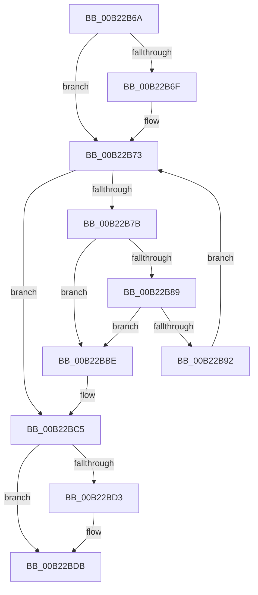

# sub_00B22B6A

- RVA: `0x00B22B6A`–`0x00B22BE9` (길이 `127` bytes)
- VA: `0x0000000140B22B6A`
- 실행 섹션: `PAGE`
- PDB 이름 있음: `아니요`; PDB Function 태그: `아니요`
- unwind 정보 RVA: `0x0008D430`
- 디코드: `36`개 명령, `127/127` bytes 표시
- 미해석 바이트: `0` (있으면 어셈블리에 `.byte`로 보존)

> 이 문서는 커널 이미지의 기계어와 PDB 기호를 분석해 생성했습니다. 4번과 5번은 함수 원형과 자료형을 바이너리 사용 방식에서 추정한 C 해석이며 원본 소스 복구 결과는 아닙니다.

## 1. Dependencies

- 직접 호출 지점: **3**; 고유 호출 대상: **3**
- 직접 호출자로 확인된 함수: **0**
- RIP 상대 이미지 참조: **0**

### Outgoing calls
- `0x00B22BB7` → [KeReleaseSemaphoreEx](../../text/34/KeReleaseSemaphoreEx_function_003468C0.md) (function, `0x003468C0`)
- `0x00B22BD6` → [ExfTryToWakePushLock](../../text/26/ExfTryToWakePushLock_function_00265DD0.md) (function, `0x00265DD0`)
- `0x00B22BDE` → [KeAbPostRelease](../../text/2E/KeAbPostRelease_function_002E1600.md) (function, `0x002E1600`)

### Direct callers
- 이 함수 시작 RVA로 연결되는 직접 call은 확인되지 않았습니다. 간접 호출은 완전히 역산할 수 없습니다.

### Static image references
- 디코드된 RIP-relative 메모리 참조가 없습니다.

## 2. Other-region calls and transfers

- 다른 실행 섹션으로 향하는 call: **3**
  - `0x00B22BB7` → [KeReleaseSemaphoreEx](../../text/34/KeReleaseSemaphoreEx_function_003468C0.md) (`PAGE` → `.text`)
  - `0x00B22BD6` → [ExfTryToWakePushLock](../../text/26/ExfTryToWakePushLock_function_00265DD0.md) (`PAGE` → `.text`)
  - `0x00B22BDE` → [KeAbPostRelease](../../text/2E/KeAbPostRelease_function_002E1600.md) (`PAGE` → `.text`)
- call이 아닌 외부 분기/꼬리 이동: **1**
  - `0x00B22BE4` → [AlpcpDoPortCleanup + 0x157](../92/AlpcpDoPortCleanup_function_00924E54.md) (`tail-transfer`)

## 3. Assembly (complete function range)

```asm
00B22B6A  48 85 ED                        test rbp, rbp
00B22B6D  74 04                           je 0x140b22b73
00B22B6F  C6 45 0A 01                     mov byte ptr [rbp + 0xa], 1
00B22B73  49 8B 0E                        mov rcx, qword ptr [r14]
00B22B76  49 3B CE                        cmp rcx, r14
00B22B79  74 4A                           je 0x140b22bc5
00B22B7B  48 83 61 F8 00                  and qword ptr [rcx - 8], 0
00B22B80  48 8B 11                        mov rdx, qword ptr [rcx]
00B22B83  48 39 4A 08                     cmp qword ptr [rdx + 8], rcx
00B22B87  75 35                           jne 0x140b22bbe
00B22B89  48 8B 41 08                     mov rax, qword ptr [rcx + 8]
00B22B8D  48 39 08                        cmp qword ptr [rax], rcx
00B22B90  75 2C                           jne 0x140b22bbe
00B22B92  48 83 64 24 28 00               and qword ptr [rsp + 0x28], 0
00B22B98  83 64 24 20 00                  and dword ptr [rsp + 0x20], 0
00B22B9D  48 89 10                        mov qword ptr [rax], rdx
00B22BA0  48 89 42 08                     mov qword ptr [rdx + 8], rax
00B22BA4  BA 01 00 00 00                  mov edx, 1
00B22BA9  48 83 21 00                     and qword ptr [rcx], 0
00B22BAD  44 8B C2                        mov r8d, edx
00B22BB0  48 81 C1 50 FF FF FF            add rcx, -0xb0
00B22BB7  E8 04 3D 82 FF                  call 0x1403468c0
00B22BBC  EB B5                           jmp 0x140b22b73
00B22BBE  B9 03 00 00 00                  mov ecx, 3
00B22BC3  CD 29                           int 0x29
00B22BC5  48 8B C3                        mov rax, rbx
00B22BC8  F0 48 0F C1 06                  lock xadd qword ptr [rsi], rax
00B22BCD  24 06                           and al, 6
00B22BCF  3C 02                           cmp al, 2
00B22BD1  75 08                           jne 0x140b22bdb
00B22BD3  48 8B CE                        mov rcx, rsi
00B22BD6  E8 F5 31 74 FF                  call 0x140265dd0
00B22BDB  48 8B CE                        mov rcx, rsi
00B22BDE  E8 1D EA 7B FF                  call 0x1402e1600
00B22BE3  90                              nop
00B22BE4  E9 C2 23 E0 FF                  jmp 0x140924fab
```

## 4. C-style interpretation (structured pseudocode)

```c
__int64 __fastcall sub_00B22B6A(__int64 a1, __int64 a2, __int64 a3, __int64 a4, __int64 a5)
{
    __int64 result;
    unsigned int v_stack_p20;

    if (v_rbp != 0) {
        *(unsigned __int8 *)(v_rbp + 10) = 1;
    }
    if ((*(unsigned __int64 *)(v_r14)) == v_r14) goto loc_00B22BC5;
    if ((*(unsigned __int64 *)(*(unsigned __int64 *)(*(unsigned __int64 *)(v_r14)) + 8)) != (*(unsigned __int64 *)(v_r14))) goto loc_00B22BBE;
    if ((*(unsigned __int64 *)(*(unsigned __int64 *)(*(unsigned __int64 *)(v_r14) + 8))) != (*(unsigned __int64 *)(v_r14))) goto loc_00B22BBE;
    *(unsigned __int64 *)(*(unsigned __int64 *)(*(unsigned __int64 *)(v_r14) + 8)) = *(unsigned __int64 *)(*(unsigned __int64 *)(v_r14));
    *(unsigned __int64 *)(*(unsigned __int64 *)(*(unsigned __int64 *)(v_r14)) + 8) = *(unsigned __int64 *)(*(unsigned __int64 *)(v_r14) + 8);
    a1 = (*(unsigned __int64 *)(v_r14)) + (-176);
    result = KeReleaseSemaphoreEx(a1, 1, 1, a4);
    goto loc_00B22B73;
loc_00B22BBE:
loc_00B22BC5:
    result = (unsigned __int8)((v_rbx) & (6));
    if (((unsigned __int8)(result)) == 2) {
        a1 = v_rsi;
        result = ExfTryToWakePushLock(a1, 1, 1, a4);
    }
    result = KeAbPostRelease(v_rsi, 1, 1, a4);
}
```

## 5. (Beta) C Style

```c
int64_t sub_00B22B6A(int64_t Arg1, int64_t Arg2, int64_t Arg3, int64_t Arg4, int64_t Arg5)
{
    int64_t result;
    uint32_t v_stack_p20;

    if (local_rbp != 0) {
        *(uint8_t *)(local_rbp + 0xA) = 1;
    }
    if ((*(uint64_t *)(local_r14)) == local_r14) goto loc_00B22BC5;
    if ((*(uint64_t *)(*(uint64_t *)(*(uint64_t *)(local_r14)) + 0x8)) != (*(uint64_t *)(local_r14))) goto loc_00B22BBE;
    if ((*(uint64_t *)(*(uint64_t *)(*(uint64_t *)(local_r14) + 0x8))) != (*(uint64_t *)(local_r14))) goto loc_00B22BBE;
    *(uint64_t *)(*(uint64_t *)(*(uint64_t *)(local_r14) + 0x8)) = *(uint64_t *)(*(uint64_t *)(local_r14));
    *(uint64_t *)(*(uint64_t *)(*(uint64_t *)(local_r14)) + 0x8) = *(uint64_t *)(*(uint64_t *)(local_r14) + 0x8);
    Arg1 = (*(uint64_t *)(local_r14)) + (-176);
    result = KeReleaseSemaphoreEx(Arg1, 1, 1, Arg4);
    goto loc_00B22B73;
loc_00B22BBE:
loc_00B22BC5:
    result = (uint8_t)((local_rbx) & (6));
    if (((uint8_t)(result)) == 2) {
        Arg1 = local_rsi;
        result = ExfTryToWakePushLock(Arg1, 1, 1, Arg4);
    }
    result = KeAbPostRelease(local_rsi, 1, 1, Arg4);
}
```

## 6. Execution-region graph

[열기: 2D/3D 그래프와 함수 탐색 컨트롤 패널](../../../control-panel.html?section=page&rva=0x00B22B6A&view=graph)

- 2D 그래프는 위에서 아래로 흐르고, 3D 그래프는 빈 공간을 드래그해 회전합니다. Shift+드래그는 이동, 휠은 확대·축소, 함수 노드 선택은 대상 보고서 이동입니다.

### Static fallback


