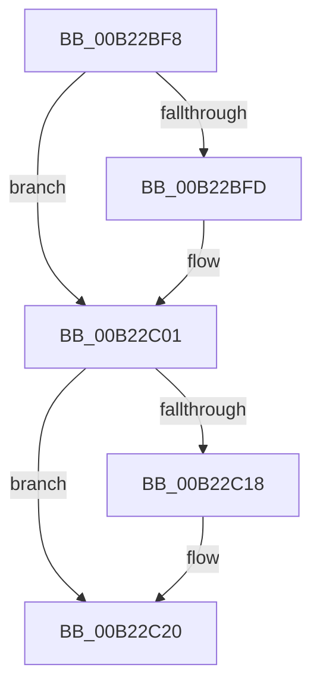

# sub_00B22BF8

- RVA: `0x00B22BF8`–`0x00B22C33` (길이 `59` bytes)
- VA: `0x0000000140B22BF8`
- 실행 섹션: `PAGE`
- PDB 이름 있음: `아니요`; PDB Function 태그: `아니요`
- unwind 정보 RVA: `0x0008D5CC`
- 디코드: `16`개 명령, `59/59` bytes 표시
- 미해석 바이트: `0` (있으면 어셈블리에 `.byte`로 보존)

> 이 문서는 커널 이미지의 기계어와 PDB 기호를 분석해 생성했습니다. 4번과 5번은 함수 원형과 자료형을 바이너리 사용 방식에서 추정한 C 해석이며 원본 소스 복구 결과는 아닙니다.

## 1. Dependencies

- 직접 호출 지점: **2**; 고유 호출 대상: **2**
- 직접 호출자로 확인된 함수: **0**
- RIP 상대 이미지 참조: **0**

### Outgoing calls
- `0x00B22C1B` → [ExfTryToWakePushLock](../../text/26/ExfTryToWakePushLock_function_00265DD0.md) (function, `0x00265DD0`)
- `0x00B22C23` → [KeAbPostRelease](../../text/2E/KeAbPostRelease_function_002E1600.md) (function, `0x002E1600`)

### Direct callers
- 이 함수 시작 RVA로 연결되는 직접 call은 확인되지 않았습니다. 간접 호출은 완전히 역산할 수 없습니다.

### Static image references
- 디코드된 RIP-relative 메모리 참조가 없습니다.

## 2. Other-region calls and transfers

- 다른 실행 섹션으로 향하는 call: **2**
  - `0x00B22C1B` → [ExfTryToWakePushLock](../../text/26/ExfTryToWakePushLock_function_00265DD0.md) (`PAGE` → `.text`)
  - `0x00B22C23` → [KeAbPostRelease](../../text/2E/KeAbPostRelease_function_002E1600.md) (`PAGE` → `.text`)
- call이 아닌 외부 분기/꼬리 이동: **1**
  - `0x00B22C2E` → [AlpcpCreateClientPort + 0xB3](../92/AlpcpCreateClientPort_function_009270AC.md) (`tail-transfer`)

## 3. Assembly (complete function range)

```asm
00B22BF8  48 85 F6                        test rsi, rsi
00B22BFB  74 04                           je 0x140b22c01
00B22BFD  44 88 7E 0A                     mov byte ptr [rsi + 0xa], r15b
00B22C01  41 0F BA B6 A0 01 00 00 0D      btr dword ptr [r14 + 0x1a0], 0xd
00B22C0A  48 8B C3                        mov rax, rbx
00B22C0D  F0 48 0F C1 07                  lock xadd qword ptr [rdi], rax
00B22C12  24 06                           and al, 6
00B22C14  3C 02                           cmp al, 2
00B22C16  75 08                           jne 0x140b22c20
00B22C18  48 8B CF                        mov rcx, rdi
00B22C1B  E8 B0 31 74 FF                  call 0x140265dd0
00B22C20  48 8B CF                        mov rcx, rdi
00B22C23  E8 D8 E9 7B FF                  call 0x1402e1600
00B22C28  4C 8B 75 E0                     mov r14, qword ptr [rbp - 0x20]
00B22C2C  33 F6                           xor esi, esi
00B22C2E  E9 2C 45 E0 FF                  jmp 0x14092715f
```

## 4. C-style interpretation (structured pseudocode)

```c
__int64 __fastcall sub_00B22BF8(void)
{
    __int64 result;
    __int64 v_rsi;

    if (v_rsi != 0) {
        *(unsigned __int8 *)(v_rsi + 10) = (unsigned __int8)(v_r15);
    }
    result = (unsigned __int8)((v_rbx) & (6));
    if (((unsigned __int8)(result)) == 2) {
        a1 = v_rdi;
        result = ExfTryToWakePushLock(a1, a2, a3, a4);
    }
    result = KeAbPostRelease(v_rdi, a2, a3, a4);
    v_rsi = 0;
}
```

## 5. (Beta) C Style

```c
void sub_00B22BF8(void)
{
    int64_t result;
    int64_t local_rsi;

    if (local_rsi != 0) {
        *(uint8_t *)(local_rsi + 0xA) = (uint8_t)(local_r15);
    }
    result = (uint8_t)((local_rbx) & (6));
    if (((uint8_t)(result)) == 2) {
        a1 = local_rdi;
        result = ExfTryToWakePushLock(a1, a2, a3, a4);
    }
    result = KeAbPostRelease(local_rdi, a2, a3, a4);
    local_rsi = 0;
}
```

## 6. Execution-region graph

[열기: 2D/3D 그래프와 함수 탐색 컨트롤 패널](../../../control-panel.html?section=page&rva=0x00B22BF8&view=graph)

- 2D 그래프는 위에서 아래로 흐르고, 3D 그래프는 빈 공간을 드래그해 회전합니다. Shift+드래그는 이동, 휠은 확대·축소, 함수 노드 선택은 대상 보고서 이동입니다.

### Static fallback


