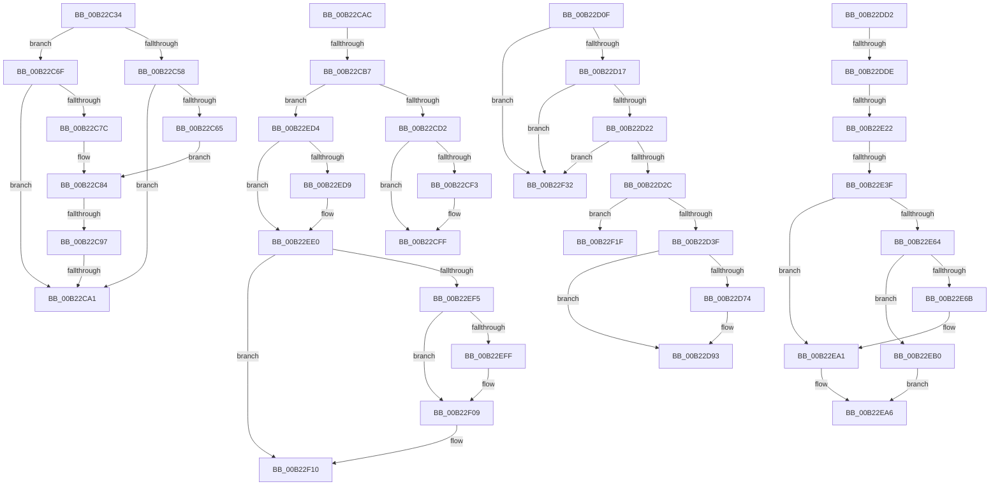

# sub_00B22C34

- RVA: `0x00B22C34`–`0x00B22F45` (길이 `785` bytes)
- VA: `0x0000000140B22C34`
- 실행 섹션: `PAGE`
- PDB 이름 있음: `아니요`; PDB Function 태그: `아니요`
- unwind 정보 RVA: `0x0008D798`
- 디코드: `202`개 명령, `785/785` bytes 표시
- 미해석 바이트: `0` (있으면 어셈블리에 `.byte`로 보존)

> 이 문서는 커널 이미지의 기계어와 PDB 기호를 분석해 생성했습니다. 4번과 5번은 함수 원형과 자료형을 바이너리 사용 방식에서 추정한 C 해석이며 원본 소스 복구 결과는 아닙니다.

## 1. Dependencies

- 직접 호출 지점: **21**; 고유 호출 대상: **10**
- 직접 호출자로 확인된 함수: **0**
- RIP 상대 이미지 참조: **0**

### Outgoing calls
- `0x00B22C45` → [wcsncpy_s](../../text/50/wcsncpy_s_function_00506650.md) (function, `0x00506650`)
- `0x00B22C5C` → [SddlpUuidFromString](../7A/SddlpUuidFromString_function_007A5300.md) (function, `0x007A5300`)
- `0x00B22C73` → [SddlpUuidFromString](../7A/SddlpUuidFromString_function_007A5300.md) (function, `0x007A5300`)
- `0x00B22CB9` → [SddlpAlloc](../92/SddlpAlloc_function_00925F88.md) (function, `0x00925F88`)
- `0x00B22CDC` → [memcpy](../../text/6C/memcpy_function_006C6840.md) (function, `0x006C6840`)
- `0x00B22CF5` → [ExFreePoolWithTag](../../poolcode/B8/ExFreePoolWithTag_function_00B82870.md) (function, `0x00B82870`)
- `0x00B22D2E` → [SddlpAlloc](../92/SddlpAlloc_function_00925F88.md) (function, `0x00925F88`)
- `0x00B22D59` → [RtlLengthSid](../../text/45/RtlLengthSid_function_0045D270.md) (function, `0x0045D270`)
- `0x00B22D67` → [RtlCopySid](../9A/RtlCopySid_function_009A9A50.md) (function, `0x009A9A50`)
- `0x00B22D79` → [RtlLengthSid](../../text/45/RtlLengthSid_function_0045D270.md) (function, `0x0045D270`)
- `0x00B22D8E` → [memcpy](../../text/6C/memcpy_function_006C6840.md) (function, `0x006C6840`)
- `0x00B22DAE` → [RtlAddAce](../92/RtlAddAce_function_00929D70.md) (function, `0x00929D70`)
- `0x00B22DBA` → [ExFreePoolWithTag](../../poolcode/B8/ExFreePoolWithTag_function_00B82870.md) (function, `0x00B82870`)
- `0x00B22E13` → [RtlAddAccessAllowedObjectAce](../78/RtlAddAccessAllowedObjectAce_function_0078D120.md) (function, `0x0078D120`)
- `0x00B22E30` → [RtlGetAce](../../text/40/RtlGetAce_function_0040FAF0.md) (function, `0x0040FAF0`)
- `0x00B22E74` → [RtlLengthSid](../../text/45/RtlLengthSid_function_0045D270.md) (function, `0x0045D270`)
- `0x00B22E9C` → [memcpy](../../text/6C/memcpy_function_006C6840.md) (function, `0x006C6840`)
- `0x00B22EB8` → [RtlLengthSid](../../text/45/RtlLengthSid_function_0045D270.md) (function, `0x0045D270`)
- `0x00B22ECD` → [memcpy](../../text/6C/memcpy_function_006C6840.md) (function, `0x006C6840`)
- `0x00B22EDB` → [ExFreePoolWithTag](../../poolcode/B8/ExFreePoolWithTag_function_00B82870.md) (function, `0x00B82870`)
- `0x00B22F04` → [ExFreePoolWithTag](../../poolcode/B8/ExFreePoolWithTag_function_00B82870.md) (function, `0x00B82870`)

### Direct callers
- 이 함수 시작 RVA로 연결되는 직접 call은 확인되지 않았습니다. 간접 호출은 완전히 역산할 수 없습니다.

### Static image references
- 디코드된 RIP-relative 메모리 참조가 없습니다.

## 2. Other-region calls and transfers

- 다른 실행 섹션으로 향하는 call: **14**
  - `0x00B22C45` → [wcsncpy_s](../../text/50/wcsncpy_s_function_00506650.md) (`PAGE` → `.text`)
  - `0x00B22CDC` → [memcpy](../../text/6C/memcpy_function_006C6840.md) (`PAGE` → `.text`)
  - `0x00B22CF5` → [ExFreePoolWithTag](../../poolcode/B8/ExFreePoolWithTag_function_00B82870.md) (`PAGE` → `POOLCODE`)
  - `0x00B22D59` → [RtlLengthSid](../../text/45/RtlLengthSid_function_0045D270.md) (`PAGE` → `.text`)
  - `0x00B22D79` → [RtlLengthSid](../../text/45/RtlLengthSid_function_0045D270.md) (`PAGE` → `.text`)
  - `0x00B22D8E` → [memcpy](../../text/6C/memcpy_function_006C6840.md) (`PAGE` → `.text`)
  - `0x00B22DBA` → [ExFreePoolWithTag](../../poolcode/B8/ExFreePoolWithTag_function_00B82870.md) (`PAGE` → `POOLCODE`)
  - `0x00B22E30` → [RtlGetAce](../../text/40/RtlGetAce_function_0040FAF0.md) (`PAGE` → `.text`)
  - `0x00B22E74` → [RtlLengthSid](../../text/45/RtlLengthSid_function_0045D270.md) (`PAGE` → `.text`)
  - `0x00B22E9C` → [memcpy](../../text/6C/memcpy_function_006C6840.md) (`PAGE` → `.text`)
  - `0x00B22EB8` → [RtlLengthSid](../../text/45/RtlLengthSid_function_0045D270.md) (`PAGE` → `.text`)
  - `0x00B22ECD` → [memcpy](../../text/6C/memcpy_function_006C6840.md) (`PAGE` → `.text`)
  - `0x00B22EDB` → [ExFreePoolWithTag](../../poolcode/B8/ExFreePoolWithTag_function_00B82870.md) (`PAGE` → `POOLCODE`)
  - `0x00B22F04` → [ExFreePoolWithTag](../../poolcode/B8/ExFreePoolWithTag_function_00B82870.md) (`PAGE` → `POOLCODE`)
- call이 아닌 외부 분기/꼬리 이동: **13**
  - `0x00B22C91` → [LocalGetAclForString + 0x417](../92/LocalGetAclForString_function_00927F30.md) (`tail-transfer`)
  - `0x00B22C9B` → [LocalGetAclForString + 0x417](../92/LocalGetAclForString_function_00927F30.md) (`tail-transfer`)
  - `0x00B22CA7` → [LocalGetAclForString + 0xBF6](../92/LocalGetAclForString_function_00927F30.md) (`tail-transfer`)
  - `0x00B22CB1` → [LocalGetAclForString + 0x511](../92/LocalGetAclForString_function_00927F30.md) (`tail-transfer`)
  - `0x00B22D0A` → [LocalGetAclForString + 0x53C](../92/LocalGetAclForString_function_00927F30.md) (`tail-transfer`)
  - `0x00B22DCD` → [LocalGetAclForString + 0x5F7](../92/LocalGetAclForString_function_00927F30.md) (`tail-transfer`)
  - `0x00B22DD8` → [LocalGetAclForString + 0x1C2](../92/LocalGetAclForString_function_00927F30.md) (`tail-transfer`)
  - `0x00B22E1C` → [LocalGetAclForString + 0x1C7](../92/LocalGetAclForString_function_00927F30.md) (`tail-transfer`)
  - `0x00B22E39` → [LocalGetAclForString + 0x1C7](../92/LocalGetAclForString_function_00927F30.md) (`tail-transfer`)
  - `0x00B22EAB` → [LocalGetAclForString + 0x5FF](../92/LocalGetAclForString_function_00927F30.md) (`tail-transfer`)
  - `0x00B22F1A` → [LocalGetAclForString + 0x2E1](../92/LocalGetAclForString_function_00927F30.md) (`tail-transfer`)
  - `0x00B22F2D` → [LocalGetAclForString + 0x1C7](../92/LocalGetAclForString_function_00927F30.md) (`tail-transfer`)
  - `0x00B22F40` → [LocalGetAclForString + 0x1C7](../92/LocalGetAclForString_function_00927F30.md) (`tail-transfer`)

## 3. Assembly (complete function range)

```asm
00B22C34  41 B9 24 00 00 00               mov r9d, 0x24
00B22C3A  48 8D 4D 00                     lea rcx, [rbp]
00B22C3E  4D 8B C7                        mov r8, r15
00B22C41  41 8D 51 01                     lea edx, [r9 + 1]
00B22C45  E8 06 3A 9E FF                  call 0x140506650
00B22C4A  33 F6                           xor esi, esi
00B22C4C  48 8D 4D 00                     lea rcx, [rbp]
00B22C50  66 89 75 48                     mov word ptr [rbp + 0x48], si
00B22C54  85 DB                           test ebx, ebx
00B22C56  75 17                           jne 0x140b22c6f
00B22C58  48 8D 55 E0                     lea rdx, [rbp - 0x20]
00B22C5C  E8 9F 26 C8 FF                  call 0x1407a5300
00B22C61  85 C0                           test eax, eax
00B22C63  74 3C                           je 0x140b22ca1
00B22C65  48 8D 45 E0                     lea rax, [rbp - 0x20]
00B22C69  48 89 45 A8                     mov qword ptr [rbp - 0x58], rax
00B22C6D  EB 15                           jmp 0x140b22c84
00B22C6F  48 8D 55 F0                     lea rdx, [rbp - 0x10]
00B22C73  E8 88 26 C8 FF                  call 0x1407a5300
00B22C78  85 C0                           test eax, eax
00B22C7A  74 25                           je 0x140b22ca1
00B22C7C  48 8D 45 F0                     lea rax, [rbp - 0x10]
00B22C80  48 89 45 A0                     mov qword ptr [rbp - 0x60], rax
00B22C84  41 0F B7 47 48                  movzx eax, word ptr [r15 + 0x48]
00B22C89  49 83 C7 48                     add r15, 0x48
00B22C8D  66 83 F8 3B                     cmp ax, 0x3b
00B22C91  0F 84 B0 56 E0 FF               je 0x140928347
00B22C97  66 83 F8 20                     cmp ax, 0x20
00B22C9B  0F 84 A6 56 E0 FF               je 0x140928347
00B22CA1  41 BE A9 06 00 00               mov r14d, 0x6a9
00B22CA7  E9 7A 5E E0 FF                  jmp 0x140928b26
00B22CAC  8D 1C 11                        lea ebx, [rcx + rdx]
00B22CAF  3B D9                           cmp ebx, ecx
00B22CB1  0F 82 8A 57 E0 FF               jb 0x140928441
00B22CB7  8B CB                           mov ecx, ebx
00B22CB9  E8 CA 32 E0 FF                  call 0x140925f88
00B22CBE  48 8B 4C 24 60                  mov rcx, qword ptr [rsp + 0x60]
00B22CC3  4C 8B F8                        mov r15, rax
00B22CC6  48 8B 09                        mov rcx, qword ptr [rcx]
00B22CC9  48 85 C0                        test rax, rax
00B22CCC  0F 84 02 02 00 00               je 0x140b22ed4
00B22CD2  44 8B 45 90                     mov r8d, dword ptr [rbp - 0x70]
00B22CD6  48 8B D1                        mov rdx, rcx
00B22CD9  48 8B C8                        mov rcx, rax
00B22CDC  E8 5F 3B BA FF                  call 0x1406c6840
00B22CE1  48 8B 44 24 60                  mov rax, qword ptr [rsp + 0x60]
00B22CE6  66 41 89 5F 02                  mov word ptr [r15 + 2], bx
00B22CEB  48 8B 08                        mov rcx, qword ptr [rax]
00B22CEE  48 85 C9                        test rcx, rcx
00B22CF1  74 0C                           je 0x140b22cff
00B22CF3  33 D2                           xor edx, edx
00B22CF5  E8 76 FB 05 00                  call 0x140b82870
00B22CFA  48 8B 44 24 60                  mov rax, qword ptr [rsp + 0x60]
00B22CFF  4C 89 38                        mov qword ptr [rax], r15
00B22D02  44 8B 7C 24 6C                  mov r15d, dword ptr [rsp + 0x6c]
00B22D07  89 5D 90                        mov dword ptr [rbp - 0x70], ebx
00B22D0A  E9 5D 57 E0 FF                  jmp 0x14092846c
00B22D0F  85 C9                           test ecx, ecx
00B22D11  0F 85 1B 02 00 00               jne 0x140b22f32
00B22D17  41 80 7D 01 01                  cmp byte ptr [r13 + 1], 1
00B22D1C  0F 85 10 02 00 00               jne 0x140b22f32
00B22D22  41 39 4D 08                     cmp dword ptr [r13 + 8], ecx
00B22D26  0F 85 06 02 00 00               jne 0x140b22f32
00B22D2C  8B CF                           mov ecx, edi
00B22D2E  E8 55 32 E0 FF                  call 0x140925f88
00B22D33  4C 8B F8                        mov r15, rax
00B22D36  48 85 C0                        test rax, rax
00B22D39  0F 84 E0 01 00 00               je 0x140b22f1f
00B22D3F  0F B6 44 24 52                  movzx eax, byte ptr [rsp + 0x52]
00B22D44  49 8B CD                        mov rcx, r13
00B22D47  41 88 07                        mov byte ptr [r15], al
00B22D4A  33 C0                           xor eax, eax
00B22D4C  41 89 47 04                     mov dword ptr [r15 + 4], eax
00B22D50  41 88 5F 01                     mov byte ptr [r15 + 1], bl
00B22D54  66 41 89 7F 02                  mov word ptr [r15 + 2], di
00B22D59  E8 12 A5 93 FF                  call 0x14045d270
00B22D5E  8B C8                           mov ecx, eax
00B22D60  49 8D 57 08                     lea rdx, [r15 + 8]
00B22D64  4D 8B C5                        mov r8, r13
00B22D67  E8 E4 6C E8 FF                  call 0x1409a9a50
00B22D6C  8B 44 24 70                     mov eax, dword ptr [rsp + 0x70]
00B22D70  85 C0                           test eax, eax
00B22D72  74 1F                           je 0x140b22d93
00B22D74  49 8B CD                        mov rcx, r13
00B22D77  8B D8                           mov ebx, eax
00B22D79  E8 F2 A4 93 FF                  call 0x14045d270
00B22D7E  48 8B 55 B0                     mov rdx, qword ptr [rbp - 0x50]
00B22D82  44 8B C3                        mov r8d, ebx
00B22D85  8B C8                           mov ecx, eax
00B22D87  48 83 C1 08                     add rcx, 8
00B22D8B  49 03 CF                        add rcx, r15
00B22D8E  E8 AD 3A BA FF                  call 0x1406c6840
00B22D93  4C 8B 6C 24 60                  mov r13, qword ptr [rsp + 0x60]
00B22D98  4D 8B CF                        mov r9, r15
00B22D9B  BA 02 00 00 00                  mov edx, 2
00B22DA0  89 7C 24 20                     mov dword ptr [rsp + 0x20], edi
00B22DA4  41 B8 FF FF FF FF               mov r8d, 0xffffffff
00B22DAA  49 8B 4D 00                     mov rcx, qword ptr [r13]
00B22DAE  E8 BD 6F E0 FF                  call 0x140929d70
00B22DB3  33 D2                           xor edx, edx
00B22DB5  49 8B CF                        mov rcx, r15
00B22DB8  8B D8                           mov ebx, eax
00B22DBA  E8 B1 FA 05 00                  call 0x140b82870
00B22DBF  0F B6 44 24 50                  movzx eax, byte ptr [rsp + 0x50]
00B22DC4  48 8B 7C 24 58                  mov rdi, qword ptr [rsp + 0x58]
00B22DC9  88 44 24 50                     mov byte ptr [rsp + 0x50], al
00B22DCD  E9 55 57 E0 FF                  jmp 0x140928527
00B22DD2  81 FF FF FF 00 00               cmp edi, 0xffff
00B22DD8  0F 83 14 53 E0 FF               jae 0x1409280f2
00B22DDE  48 8B 44 24 58                  mov rax, qword ptr [rsp + 0x58]
00B22DE3  BA 04 00 00 00                  mov edx, 4
00B22DE8  4C 8B 6C 24 60                  mov r13, qword ptr [rsp + 0x60]
00B22DED  44 0F B6 44 24 51               movzx r8d, byte ptr [rsp + 0x51]
00B22DF3  44 8B 4C 24 54                  mov r9d, dword ptr [rsp + 0x54]
00B22DF8  48 89 44 24 30                  mov qword ptr [rsp + 0x30], rax
00B22DFD  48 8B 45 A0                     mov rax, qword ptr [rbp - 0x60]
00B22E01  49 8B 4D 00                     mov rcx, qword ptr [r13]
00B22E05  48 89 44 24 28                  mov qword ptr [rsp + 0x28], rax
00B22E0A  48 8B 45 A8                     mov rax, qword ptr [rbp - 0x58]
00B22E0E  48 89 44 24 20                  mov qword ptr [rsp + 0x20], rax
00B22E13  E8 08 A3 C6 FF                  call 0x14078d120
00B22E18  8B D8                           mov ebx, eax
00B22E1A  85 C0                           test eax, eax
00B22E1C  0F 88 D5 52 E0 FF               js 0x1409280f7
00B22E22  49 8B 4D 00                     mov rcx, qword ptr [r13]
00B22E26  4C 8D 45 D0                     lea r8, [rbp - 0x30]
00B22E2A  0F B7 51 04                     movzx edx, word ptr [rcx + 4]
00B22E2E  FF CA                           dec edx
00B22E30  E8 BB CC 8E FF                  call 0x14040faf0
00B22E35  8B D8                           mov ebx, eax
00B22E37  85 C0                           test eax, eax
00B22E39  0F 88 B8 52 E0 FF               js 0x1409280f7
00B22E3F  4C 8B 7D D0                     mov r15, qword ptr [rbp - 0x30]
00B22E43  B8 09 00 00 00                  mov eax, 9
00B22E48  B9 0B 00 00 00                  mov ecx, 0xb
00B22E4D  41 80 3F 05                     cmp byte ptr [r15], 5
00B22E51  0F 44 C1                        cmove eax, ecx
00B22E54  41 88 07                        mov byte ptr [r15], al
00B22E57  66 41 89 7F 02                  mov word ptr [r15 + 2], di
00B22E5C  8B 44 24 6C                     mov eax, dword ptr [rsp + 0x6c]
00B22E60  85 C0                           test eax, eax
00B22E62  74 3D                           je 0x140b22ea1
00B22E64  8B D8                           mov ebx, eax
00B22E66  41 38 0F                        cmp byte ptr [r15], cl
00B22E69  75 45                           jne 0x140b22eb0
00B22E6B  48 8B 4C 24 58                  mov rcx, qword ptr [rsp + 0x58]
00B22E70  41 8B 7F 08                     mov edi, dword ptr [r15 + 8]
00B22E74  E8 F7 A3 93 FF                  call 0x14045d270
00B22E79  48 8B 55 80                     mov rdx, qword ptr [rbp - 0x80]
00B22E7D  8B CF                           mov ecx, edi
00B22E7F  83 E1 01                        and ecx, 1
00B22E82  8B C0                           mov eax, eax
00B22E84  48 C1 E1 04                     shl rcx, 4
00B22E88  83 E7 02                        and edi, 2
00B22E8B  49 03 CF                        add rcx, r15
00B22E8E  44 8B C3                        mov r8d, ebx
00B22E91  48 03 C8                        add rcx, rax
00B22E94  48 8D 0C F9                     lea rcx, [rcx + rdi*8]
00B22E98  48 83 C1 0C                     add rcx, 0xc
00B22E9C  E8 9F 39 BA FF                  call 0x1406c6840
00B22EA1  48 8B 7C 24 58                  mov rdi, qword ptr [rsp + 0x58]
00B22EA6  0F B6 44 24 50                  movzx eax, byte ptr [rsp + 0x50]
00B22EAB  E9 7F 56 E0 FF                  jmp 0x14092852f
00B22EB0  48 8B 7C 24 58                  mov rdi, qword ptr [rsp + 0x58]
00B22EB5  48 8B CF                        mov rcx, rdi
00B22EB8  E8 B3 A3 93 FF                  call 0x14045d270
00B22EBD  48 8B 55 80                     mov rdx, qword ptr [rbp - 0x80]
00B22EC1  4C 8B C3                        mov r8, rbx
00B22EC4  8B C8                           mov ecx, eax
00B22EC6  48 83 C1 08                     add rcx, 8
00B22ECA  49 03 CF                        add rcx, r15
00B22ECD  E8 6E 39 BA FF                  call 0x1406c6840
00B22ED2  EB D2                           jmp 0x140b22ea6
00B22ED4  48 85 C9                        test rcx, rcx
00B22ED7  74 07                           je 0x140b22ee0
00B22ED9  33 D2                           xor edx, edx
00B22EDB  E8 90 F9 05 00                  call 0x140b82870
00B22EE0  4C 8B 6C 24 60                  mov r13, qword ptr [rsp + 0x60]
00B22EE5  33 F6                           xor esi, esi
00B22EE7  0F B6 5C 24 50                  movzx ebx, byte ptr [rsp + 0x50]
00B22EEC  49 89 75 00                     mov qword ptr [r13], rsi
00B22EF0  80 FB 01                        cmp bl, 1
00B22EF3  75 1B                           jne 0x140b22f10
00B22EF5  48 8B 44 24 58                  mov rax, qword ptr [rsp + 0x58]
00B22EFA  48 85 C0                        test rax, rax
00B22EFD  74 0A                           je 0x140b22f09
00B22EFF  33 D2                           xor edx, edx
00B22F01  48 8B C8                        mov rcx, rax
00B22F04  E8 67 F9 05 00                  call 0x140b82870
00B22F09  48 89 74 24 58                  mov qword ptr [rsp + 0x58], rsi
00B22F0E  32 DB                           xor bl, bl
00B22F10  49 8B 45 00                     mov rax, qword ptr [r13]
00B22F14  41 BE 08 00 00 00               mov r14d, 8
00B22F1A  E9 F2 52 E0 FF                  jmp 0x140928211
00B22F1F  0F B6 44 24 50                  movzx eax, byte ptr [rsp + 0x50]
00B22F24  BB 17 00 00 C0                  mov ebx, 0xc0000017
00B22F29  88 44 24 50                     mov byte ptr [rsp + 0x50], al
00B22F2D  E9 C5 51 E0 FF                  jmp 0x1409280f7
00B22F32  0F B6 44 24 50                  movzx eax, byte ptr [rsp + 0x50]
00B22F37  BB 77 00 00 C0                  mov ebx, 0xc0000077
00B22F3C  88 44 24 50                     mov byte ptr [rsp + 0x50], al
00B22F40  E9 B2 51 E0 FF                  jmp 0x1409280f7
```

## 4. C-style interpretation (structured pseudocode)

```c
__int64 __fastcall sub_00B22C34(void)
{
    __int64 result;
    __int64 v_r15;
    __int64 v_rsi;
    unsigned int v_stack_p20;
    unsigned __int64 v_stack_p28;
    unsigned __int64 v_stack_p30;
    unsigned __int8 v_stack_p50;
    unsigned __int8 v_stack_p51;
    unsigned __int8 v_stack_p52;
    unsigned int v_stack_p54;
    unsigned __int64 v_stack_p58;
    unsigned __int64 v_stack_p60;
    unsigned int v_stack_p6C;
    unsigned int v_stack_p70;

    result = wcsncpy_s(v_rbp, 36 + 1, v_r15, 36);
    v_rsi = 0;
    *(unsigned __int16 *)(v_rbp + 72) = 0;
    if ((unsigned int)(v_rbx) != 0) goto loc_00B22C6F;
    result = SddlpUuidFromString(v_rbp, v_rbp - 32, v_r15, 36);
    if ((unsigned int)(result) == 0) goto loc_00B22CA1;
    *(unsigned __int64 *)(v_rbp - 88) = v_rbp - 32;
    goto loc_00B22C84;
loc_00B22C6F:
    result = SddlpUuidFromString(v_rbp, v_rbp - 16, v_r15, 36);
    if ((unsigned int)(result) == 0) goto loc_00B22CA1;
    *(unsigned __int64 *)(v_rbp - 96) = v_rbp - 16;
loc_00B22C84:
    v_r15 = (v_r15) + (72);
loc_00B22CA1:
}
```

## 5. (Beta) C Style

```c
void sub_00B22C34(void)
{
    int64_t result;
    int64_t local_r15;
    int64_t local_rsi;
    uint32_t v_stack_p20;
    uint64_t v_stack_p28;
    uint64_t v_stack_p30;
    uint8_t v_stack_p50;
    uint8_t v_stack_p51;
    uint8_t v_stack_p52;
    uint32_t v_stack_p54;
    uint64_t v_stack_p58;
    uint64_t v_stack_p60;
    uint32_t v_stack_p6C;
    uint32_t v_stack_p70;

    result = wcsncpy_s(local_rbp, 36 + 1, local_r15, 36);
    local_rsi = 0;
    *(uint16_t *)(local_rbp + 0x48) = 0;
    if ((uint32_t)(local_rbx) != 0) goto loc_00B22C6F;
    result = SddlpUuidFromString(local_rbp, local_rbp - 32, local_r15, 36);
    if ((uint32_t)(result) == 0) goto loc_00B22CA1;
    *(uint64_t *)(local_rbp - 0x58) = local_rbp - 32;
    goto loc_00B22C84;
loc_00B22C6F:
    result = SddlpUuidFromString(local_rbp, local_rbp - 16, local_r15, 36);
    if ((uint32_t)(result) == 0) goto loc_00B22CA1;
    *(uint64_t *)(local_rbp - 0x60) = local_rbp - 16;
loc_00B22C84:
    local_r15 = (local_r15) + (72);
loc_00B22CA1:
}
```

## 6. Execution-region graph

[열기: 2D/3D 그래프와 함수 탐색 컨트롤 패널](../../../control-panel.html?section=page&rva=0x00B22C34&view=graph)

- 2D 그래프는 위에서 아래로 흐르고, 3D 그래프는 빈 공간을 드래그해 회전합니다. Shift+드래그는 이동, 휠은 확대·축소, 함수 노드 선택은 대상 보고서 이동입니다.

### Static fallback


