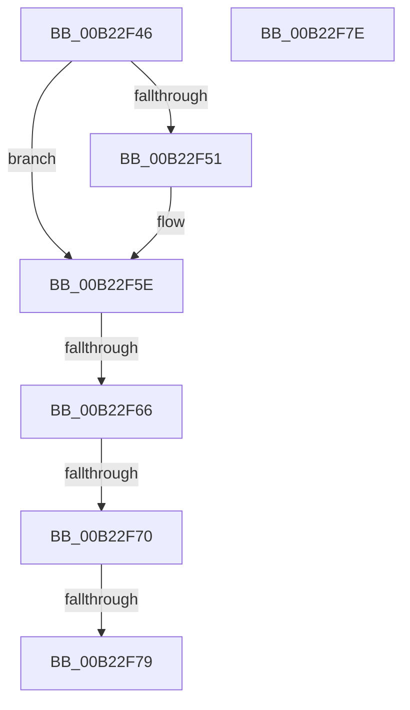

# sub_00B22F46

- RVA: `0x00B22F46`–`0x00B22F88` (길이 `66` bytes)
- VA: `0x0000000140B22F46`
- 실행 섹션: `PAGE`
- PDB 이름 있음: `아니요`; PDB Function 태그: `아니요`
- unwind 정보 RVA: `0x0008DB64`
- 디코드: `15`개 명령, `66/66` bytes 표시
- 미해석 바이트: `0` (있으면 어셈블리에 `.byte`로 보존)

> 이 문서는 커널 이미지의 기계어와 PDB 기호를 분석해 생성했습니다. 4번과 5번은 함수 원형과 자료형을 바이너리 사용 방식에서 추정한 C 해석이며 원본 소스 복구 결과는 아닙니다.

## 1. Dependencies

- 직접 호출 지점: **0**; 고유 호출 대상: **0**
- 직접 호출자로 확인된 함수: **0**
- RIP 상대 이미지 참조: **0**

### Outgoing calls
- 직접 디코드된 call 명령이 없습니다.

### Direct callers
- 이 함수 시작 RVA로 연결되는 직접 call은 확인되지 않았습니다. 간접 호출은 완전히 역산할 수 없습니다.

### Static image references
- 디코드된 RIP-relative 메모리 참조가 없습니다.

## 2. Other-region calls and transfers

- 다른 실행 섹션으로 향하는 call: **0**
- call이 아닌 외부 분기/꼬리 이동: **5**
  - `0x00B22F60` → [RtlpNewSecurityObject + 0x2152](../92/RtlpNewSecurityObject_function_0092AB50.md) (`tail-transfer`)
  - `0x00B22F6A` → [RtlpNewSecurityObject + 0x2152](../92/RtlpNewSecurityObject_function_0092AB50.md) (`tail-transfer`)
  - `0x00B22F73` → [RtlpNewSecurityObject + 0x2152](../92/RtlpNewSecurityObject_function_0092AB50.md) (`tail-transfer`)
  - `0x00B22F79` → [RtlpNewSecurityObject + 0x757](../92/RtlpNewSecurityObject_function_0092AB50.md) (`tail-transfer`)
  - `0x00B22F83` → [RtlpNewSecurityObject + 0x762](../92/RtlpNewSecurityObject_function_0092AB50.md) (`tail-transfer`)

## 3. Assembly (complete function range)

```asm
00B22F46  8B 50 0A                        mov edx, dword ptr [rax + 0xa]
00B22F49  2B 95 D0 00 00 00               sub edx, dword ptr [rbp + 0xd0]
00B22F4F  75 0D                           jne 0x140b22f5e
00B22F51  0F B7 50 0E                     movzx edx, word ptr [rax + 0xe]
00B22F55  0F B7 85 D4 00 00 00            movzx eax, word ptr [rbp + 0xd4]
00B22F5C  2B D0                           sub edx, eax
00B22F5E  85 D2                           test edx, edx
00B22F60  0F 85 3C 9D E0 FF               jne 0x14092cca2
00B22F66  80 79 09 01                     cmp byte ptr [rcx + 9], 1
00B22F6A  0F 85 32 9D E0 FF               jne 0x14092cca2
00B22F70  39 51 10                        cmp dword ptr [rcx + 0x10], edx
00B22F73  0F 85 29 9D E0 FF               jne 0x14092cca2
00B22F79  E9 29 83 E0 FF                  jmp 0x14092b2a7
00B22F7E  BB 22 00 00 C0                  mov ebx, 0xc0000022
00B22F83  E9 2A 83 E0 FF                  jmp 0x14092b2b2
```

## 4. C-style interpretation (structured pseudocode)

```c
__int64 __fastcall sub_00B22F46(__int64 a1)
{
    __int64 result;

    a2 = (unsigned int)(((unsigned int)(*(unsigned int *)(result + 10))) - (*(unsigned int *)(v_rbp + 208)));
    if (!(condition_is_not_equal)) {
        a2 = *(unsigned __int16 *)(result + 14);
        result = *(unsigned __int16 *)(v_rbp + 212);
        a2 = (unsigned int)((a2) - ((unsigned int)(result)));
    }
}
```

## 5. (Beta) C Style

```c
int64_t sub_00B22F46(void *Arg1)
{
    uint8_t *arg1 = (uint8_t *)Arg1;

    int64_t result;

    a2 = (uint32_t)(((uint32_t)(*(uint32_t *)(result + 0xA))) - (*(uint32_t *)(local_rbp + 0xD0)));
    if (!(condition_is_not_equal)) {
        a2 = *(uint16_t *)(result + 0xE);
        result = *(uint16_t *)(local_rbp + 0xD4);
        a2 = (uint32_t)((a2) - ((uint32_t)(result)));
    }
}
```

### 관측된 메모리 오프셋

구조체 형식이 확인되지 않은 접근은 인자 기준의 오프셋으로만 기록했습니다.

| 기준 인자 | 오프셋 표현 | 폭 (bit) | 접근 |
|---|---:|---:|---|
| `Arg1` | `+ 0x9` | `8` | `R` |
| `Arg1` | `+ 0x10` | `32` | `R` |

## 6. Execution-region graph

[열기: 2D/3D 그래프와 함수 탐색 컨트롤 패널](../../../control-panel.html?section=page&rva=0x00B22F46&view=graph)

- 2D 그래프는 위에서 아래로 흐르고, 3D 그래프는 빈 공간을 드래그해 회전합니다. Shift+드래그는 이동, 휠은 확대·축소, 함수 노드 선택은 대상 보고서 이동입니다.

### Static fallback


