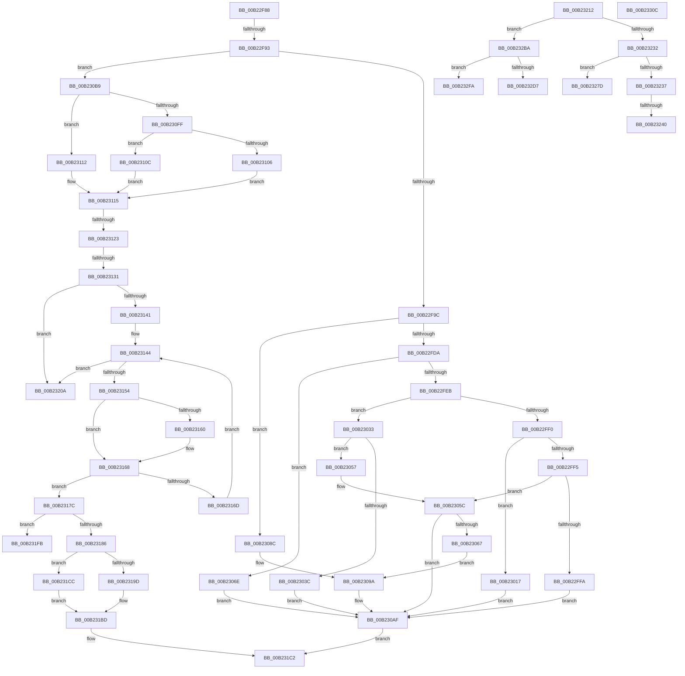

# sub_00B22F88

- RVA: `0x00B22F88`–`0x00B2333C` (길이 `948` bytes)
- VA: `0x0000000140B22F88`
- 실행 섹션: `PAGE`
- PDB 이름 있음: `아니요`; PDB Function 태그: `아니요`
- unwind 정보 RVA: `0x0008DCB4`
- 디코드: `230`개 명령, `948/948` bytes 표시
- 미해석 바이트: `0` (있으면 어셈블리에 `.byte`로 보존)

> 이 문서는 커널 이미지의 기계어와 PDB 기호를 분석해 생성했습니다. 4번과 5번은 함수 원형과 자료형을 바이너리 사용 방식에서 추정한 C 해석이며 원본 소스 복구 결과는 아닙니다.

## 1. Dependencies

- 직접 호출 지점: **5**; 고유 호출 대상: **3**
- 직접 호출자로 확인된 함수: **0**
- RIP 상대 이미지 참조: **1**

### Outgoing calls
- `0x00B22FA8` → [RtlLengthSid](../../text/45/RtlLengthSid_function_0045D270.md) (function, `0x0045D270`)
- `0x00B22FCD` → [RtlEqualPrefixSid](../92/RtlEqualPrefixSid_function_0092EBF4.md) (function, `0x0092EBF4`)
- `0x00B231AB` → [memcpy](../../text/6C/memcpy_function_006C6840.md) (function, `0x006C6840`)
- `0x00B231DA` → [memcpy](../../text/6C/memcpy_function_006C6840.md) (function, `0x006C6840`)
- `0x00B23318` → [memcpy](../../text/6C/memcpy_function_006C6840.md) (function, `0x006C6840`)

### Direct callers
- 이 함수 시작 RVA로 연결되는 직접 call은 확인되지 않았습니다. 간접 호출은 완전히 역산할 수 없습니다.

### Static image references
- `0x00B231E8` → RVA `0x00B4AD38` (`RtlBaseAceType`; read)

## 2. Other-region calls and transfers

- 다른 실행 섹션으로 향하는 call: **4**
  - `0x00B22FA8` → [RtlLengthSid](../../text/45/RtlLengthSid_function_0045D270.md) (`PAGE` → `.text`)
  - `0x00B231AB` → [memcpy](../../text/6C/memcpy_function_006C6840.md) (`PAGE` → `.text`)
  - `0x00B231DA` → [memcpy](../../text/6C/memcpy_function_006C6840.md) (`PAGE` → `.text`)
  - `0x00B23318` → [memcpy](../../text/6C/memcpy_function_006C6840.md) (`PAGE` → `.text`)
- call이 아닌 외부 분기/꼬리 이동: **12**
  - `0x00B22F8D` → [RtlpCopyEffectiveAce + 0x472](../92/RtlpCopyEffectiveAce_function_0092E530.md) (`tail-transfer`)
  - `0x00B2311D` → [RtlpCopyEffectiveAce + 0x186](../92/RtlpCopyEffectiveAce_function_0092E530.md) (`tail-transfer`)
  - `0x00B2312B` → [RtlpCopyEffectiveAce + 0x186](../92/RtlpCopyEffectiveAce_function_0092E530.md) (`tail-transfer`)
  - `0x00B231C7` → [RtlpCopyEffectiveAce + 0x186](../92/RtlpCopyEffectiveAce_function_0092E530.md) (`tail-transfer`)
  - `0x00B23205` → [RtlpCopyEffectiveAce + 0x186](../92/RtlpCopyEffectiveAce_function_0092E530.md) (`tail-transfer`)
  - `0x00B2320D` → [RtlpCopyEffectiveAce + 0xEE](../92/RtlpCopyEffectiveAce_function_0092E530.md) (`tail-transfer`)
  - `0x00B2323A` → [RtlpCopyEffectiveAce + 0x22F](../92/RtlpCopyEffectiveAce_function_0092E530.md) (`tail-transfer`)
  - `0x00B23278` → [RtlpCopyEffectiveAce + 0x239](../92/RtlpCopyEffectiveAce_function_0092E530.md) (`tail-transfer`)
  - `0x00B232B5` → [RtlpCopyEffectiveAce + 0x23E](../92/RtlpCopyEffectiveAce_function_0092E530.md) (`tail-transfer`)
  - `0x00B232F5` → [RtlpCopyEffectiveAce + 0x23E](../92/RtlpCopyEffectiveAce_function_0092E530.md) (`tail-transfer`)
  - `0x00B23307` → [RtlpCopyEffectiveAce + 0x23E](../92/RtlpCopyEffectiveAce_function_0092E530.md) (`tail-transfer`)
  - `0x00B23337` → [RtlpCopyEffectiveAce + 0x24B](../92/RtlpCopyEffectiveAce_function_0092E530.md) (`tail-transfer`)

## 3. Assembly (complete function range)

```asm
00B22F88  8D 41 F3                        lea eax, [rcx - 0xd]
00B22F8B  3C 01                           cmp al, 1
00B22F8D  0F 86 0F BA E0 FF               jbe 0x14092e9a2
00B22F93  80 F9 04                        cmp cl, 4
00B22F96  0F 85 1D 01 00 00               jne 0x140b230b9
00B22F9C  48 8D 47 0C                     lea rax, [rdi + 0xc]
00B22FA0  48 8B C8                        mov rcx, rax
00B22FA3  48 89 44 24 48                  mov qword ptr [rsp + 0x48], rax
00B22FA8  E8 C3 A2 93 FF                  call 0x14045d270
00B22FAD  8B C8                           mov ecx, eax
00B22FAF  48 8D 55 B0                     lea rdx, [rbp - 0x50]
00B22FB3  48 83 C1 0C                     add rcx, 0xc
00B22FB7  48 C7 44 24 28 0C 00 00 00      mov qword ptr [rsp + 0x28], 0xc
00B22FC0  48 03 CF                        add rcx, rdi
00B22FC3  48 89 4C 24 40                  mov qword ptr [rsp + 0x40], rcx
00B22FC8  48 8B 4C 24 48                  mov rcx, qword ptr [rsp + 0x48]
00B22FCD  E8 22 BC E0 FF                  call 0x14092ebf4
00B22FD2  84 C0                           test al, al
00B22FD4  0F 84 B2 00 00 00               je 0x140b2308c
00B22FDA  4C 8B 5C 24 48                  mov r11, qword ptr [rsp + 0x48]
00B22FDF  41 8B 4B 08                     mov ecx, dword ptr [r11 + 8]
00B22FE3  85 C9                           test ecx, ecx
00B22FE5  0F 84 83 00 00 00               je 0x140b2306e
00B22FEB  83 E9 01                        sub ecx, 1
00B22FEE  74 43                           je 0x140b23033
00B22FF0  83 E9 01                        sub ecx, 1
00B22FF3  74 22                           je 0x140b23017
00B22FF5  83 F9 01                        cmp ecx, 1
00B22FF8  75 62                           jne 0x140b2305c
00B22FFA  41 0F B6 45 01                  movzx eax, byte ptr [r13 + 1]
00B22FFF  4C 8B 4C 24 30                  mov r9, qword ptr [rsp + 0x30]
00B23004  4C 89 6C 24 48                  mov qword ptr [rsp + 0x48], r13
00B23009  8D 1C 83                        lea ebx, [rbx + rax*4]
00B2300C  83 C3 FC                        add ebx, -4
00B2300F  41 88 09                        mov byte ptr [r9], cl
00B23012  E9 98 00 00 00                  jmp 0x140b230af
00B23017  41 0F B6 44 24 01               movzx eax, byte ptr [r12 + 1]
00B2301D  4C 8B 4C 24 30                  mov r9, qword ptr [rsp + 0x30]
00B23022  4C 89 64 24 48                  mov qword ptr [rsp + 0x48], r12
00B23027  8D 1C 83                        lea ebx, [rbx + rax*4]
00B2302A  83 C3 FC                        add ebx, -4
00B2302D  41 C6 01 01                     mov byte ptr [r9], 1
00B23031  EB 7C                           jmp 0x140b230af
00B23033  4C 8B 5D 90                     mov r11, qword ptr [rbp - 0x70]
00B23037  4D 85 DB                        test r11, r11
00B2303A  74 1B                           je 0x140b23057
00B2303C  41 0F B6 43 01                  movzx eax, byte ptr [r11 + 1]
00B23041  4C 8B 4C 24 30                  mov r9, qword ptr [rsp + 0x30]
00B23046  4C 89 5C 24 48                  mov qword ptr [rsp + 0x48], r11
00B2304B  8D 1C 83                        lea ebx, [rbx + rax*4]
00B2304E  83 C3 FC                        add ebx, -4
00B23051  41 C6 01 01                     mov byte ptr [r9], 1
00B23055  EB 58                           jmp 0x140b230af
00B23057  4C 8B 5C 24 48                  mov r11, qword ptr [rsp + 0x48]
00B2305C  4C 8B 4C 24 30                  mov r9, qword ptr [rsp + 0x30]
00B23061  41 80 39 00                     cmp byte ptr [r9], 0
00B23065  75 48                           jne 0x140b230af
00B23067  41 0F B6 43 01                  movzx eax, byte ptr [r11 + 1]
00B2306C  EB 2C                           jmp 0x140b2309a
00B2306E  48 8B 45 98                     mov rax, qword ptr [rbp - 0x68]
00B23072  4C 8B 4C 24 30                  mov r9, qword ptr [rsp + 0x30]
00B23077  48 89 44 24 48                  mov qword ptr [rsp + 0x48], rax
00B2307C  0F B6 40 01                     movzx eax, byte ptr [rax + 1]
00B23080  41 C6 01 01                     mov byte ptr [r9], 1
00B23084  8D 1C 83                        lea ebx, [rbx + rax*4]
00B23087  83 C3 FC                        add ebx, -4
00B2308A  EB 23                           jmp 0x140b230af
00B2308C  48 8B 44 24 48                  mov rax, qword ptr [rsp + 0x48]
00B23091  4C 8B 4C 24 30                  mov r9, qword ptr [rsp + 0x30]
00B23096  0F B6 40 01                     movzx eax, byte ptr [rax + 1]
00B2309A  8D 04 85 14 00 00 00            lea eax, [rax*4 + 0x14]
00B230A1  48 C7 44 24 48 00 00 00 00      mov qword ptr [rsp + 0x48], 0
00B230AA  48 89 44 24 28                  mov qword ptr [rsp + 0x28], rax
00B230AF  48 89 7C 24 58                  mov qword ptr [rsp + 0x58], rdi
00B230B4  E9 09 01 00 00                  jmp 0x140b231c2
00B230B9  8B 4F 08                        mov ecx, dword ptr [rdi + 8]
00B230BC  B8 1C 00 00 00                  mov eax, 0x1c
00B230C1  44 8B D1                        mov r10d, ecx
00B230C4  48 C7 44 24 28 0C 00 00 00      mov qword ptr [rsp + 0x28], 0xc
00B230CD  41 83 E2 01                     and r10d, 1
00B230D1  0F BA E1 01                     bt ecx, 1
00B230D5  4C 89 54 24 70                  mov qword ptr [rsp + 0x70], r10
00B230DA  48 0F 43 44 24 28               cmovae rax, qword ptr [rsp + 0x28]
00B230E0  48 03 C7                        add rax, rdi
00B230E3  49 C1 E2 04                     shl r10, 4
00B230E7  4C 03 D0                        add r10, rax
00B230EA  41 8B C2                        mov eax, r10d
00B230ED  4C 89 54 24 40                  mov qword ptr [rsp + 0x40], r10
00B230F2  41 2B C3                        sub eax, r11d
00B230F5  89 44 24 28                     mov dword ptr [rsp + 0x28], eax
00B230F9  0F BA E1 01                     bt ecx, 1
00B230FD  73 13                           jae 0x140b23112
00B230FF  44 39 44 24 70                  cmp dword ptr [rsp + 0x70], r8d
00B23104  74 06                           je 0x140b2310c
00B23106  4C 8D 5F 1C                     lea r11, [rdi + 0x1c]
00B2310A  EB 09                           jmp 0x140b23115
00B2310C  4C 8D 5F 0C                     lea r11, [rdi + 0xc]
00B23110  EB 03                           jmp 0x140b23115
00B23112  4D 8B D8                        mov r11, r8
00B23115  48 89 7C 24 58                  mov qword ptr [rsp + 0x58], rdi
00B2311A  48 85 D2                        test rdx, rdx
00B2311D  0F 84 93 B5 E0 FF               je 0x14092e6b6
00B23123  48 89 7C 24 58                  mov qword ptr [rsp + 0x58], rdi
00B23128  4D 85 DB                        test r11, r11
00B2312B  0F 84 85 B5 E0 FF               je 0x14092e6b6
00B23131  48 8B 8D 90 00 00 00            mov rcx, qword ptr [rbp + 0x90]
00B23138  48 85 C9                        test rcx, rcx
00B2313B  0F 84 C9 00 00 00               je 0x140b2320a
00B23141  41 8B C0                        mov eax, r8d
00B23144  89 44 24 50                     mov dword ptr [rsp + 0x50], eax
00B23148  3B 85 98 00 00 00               cmp eax, dword ptr [rbp + 0x98]
00B2314E  0F 83 B6 00 00 00               jae 0x140b2320a
00B23154  48 8B 04 C1                     mov rax, qword ptr [rcx + rax*8]
00B23158  49 8B 0B                        mov rcx, qword ptr [r11]
00B2315B  48 2B 08                        sub rcx, qword ptr [rax]
00B2315E  75 08                           jne 0x140b23168
00B23160  49 8B 4B 08                     mov rcx, qword ptr [r11 + 8]
00B23164  48 2B 48 08                     sub rcx, qword ptr [rax + 8]
00B23168  48 85 C9                        test rcx, rcx
00B2316B  74 0F                           je 0x140b2317c
00B2316D  8B 44 24 50                     mov eax, dword ptr [rsp + 0x50]
00B23171  48 8B 8D 90 00 00 00            mov rcx, qword ptr [rbp + 0x90]
00B23178  FF C0                           inc eax
00B2317A  EB C8                           jmp 0x140b23144
00B2317C  C6 02 01                        mov byte ptr [rdx], 1
00B2317F  44 38 44 24 21                  cmp byte ptr [rsp + 0x21], r8b
00B23184  75 75                           jne 0x140b231fb
00B23186  41 C6 01 01                     mov byte ptr [r9], 1
00B2318A  48 8D 4D E0                     lea rcx, [rbp - 0x20]
00B2318E  8B 47 08                        mov eax, dword ptr [rdi + 8]
00B23191  48 8B D7                        mov rdx, rdi
00B23194  A8 01                           test al, 1
00B23196  48 8B 44 24 28                  mov rax, qword ptr [rsp + 0x28]
00B2319B  74 2F                           je 0x140b231cc
00B2319D  83 C0 F0                        add eax, -0x10
00B231A0  83 C3 F0                        add ebx, -0x10
00B231A3  44 8B C0                        mov r8d, eax
00B231A6  48 89 44 24 28                  mov qword ptr [rsp + 0x28], rax
00B231AB  E8 90 36 BA FF                  call 0x1406c6840
00B231B0  83 65 E8 FD                     and dword ptr [rbp - 0x18], 0xfffffffd
00B231B4  48 8D 45 E0                     lea rax, [rbp - 0x20]
00B231B8  48 89 44 24 58                  mov qword ptr [rsp + 0x58], rax
00B231BD  4C 8B 4C 24 30                  mov r9, qword ptr [rsp + 0x30]
00B231C2  4C 8B 54 24 40                  mov r10, qword ptr [rsp + 0x40]
00B231C7  E9 EA B4 E0 FF                  jmp 0x14092e6b6
00B231CC  83 C0 EC                        add eax, -0x14
00B231CF  83 C3 EC                        add ebx, -0x14
00B231D2  44 8B C0                        mov r8d, eax
00B231D5  48 89 44 24 28                  mov qword ptr [rsp + 0x28], rax
00B231DA  E8 61 36 BA FF                  call 0x1406c6840
00B231DF  48 8D 45 E0                     lea rax, [rbp - 0x20]
00B231E3  48 89 44 24 58                  mov qword ptr [rsp + 0x58], rax
00B231E8  48 8D 0D 49 7B 02 00            lea rcx, [rip + 0x27b49]
00B231EF  0F B6 07                        movzx eax, byte ptr [rdi]
00B231F2  0F B6 04 08                     movzx eax, byte ptr [rax + rcx]
00B231F6  88 45 E0                        mov byte ptr [rbp - 0x20], al
00B231F9  EB C2                           jmp 0x140b231bd
00B231FB  C6 44 24 20 01                  mov byte ptr [rsp + 0x20], 1
00B23200  48 89 7C 24 58                  mov qword ptr [rsp + 0x58], rdi
00B23205  E9 AC B4 E0 FF                  jmp 0x14092e6b6
00B2320A  41 8B D8                        mov ebx, r8d
00B2320D  E9 0C B4 E0 FF                  jmp 0x14092e61e
00B23212  8B 4C 24 50                     mov ecx, dword ptr [rsp + 0x50]
00B23216  48 89 4C 24 28                  mov qword ptr [rsp + 0x28], rcx
00B2321B  48 8B 4D 80                     mov rcx, qword ptr [rbp - 0x80]
00B2321F  48 89 4C 24 58                  mov qword ptr [rsp + 0x58], rcx
00B23224  4C 89 44 24 40                  mov qword ptr [rsp + 0x40], r8
00B23229  83 E8 01                        sub eax, 1
00B2322C  0F 84 88 00 00 00               je 0x140b232ba
00B23232  83 E8 01                        sub eax, 1
00B23235  74 46                           je 0x140b2327d
00B23237  83 F8 01                        cmp eax, 1
00B2323A  0F 85 1F B5 E0 FF               jne 0x14092e75f
00B23240  41 0F B6 45 01                  movzx eax, byte ptr [r13 + 1]
00B23245  44 8B 44 24 50                  mov r8d, dword ptr [rsp + 0x50]
00B2324A  4C 89 6C 24 40                  mov qword ptr [rsp + 0x40], r13
00B2324F  4C 89 54 24 48                  mov qword ptr [rsp + 0x48], r10
00B23254  8D 0C 85 FC FF FF FF            lea ecx, [rax*4 - 4]
00B2325B  4C 89 5C 24 68                  mov qword ptr [rsp + 0x68], r11
00B23260  48 8B 44 24 30                  mov rax, qword ptr [rsp + 0x30]
00B23265  03 D9                           add ebx, ecx
00B23267  48 8B 4D 80                     mov rcx, qword ptr [rbp - 0x80]
00B2326B  48 89 4C 24 58                  mov qword ptr [rsp + 0x58], rcx
00B23270  44 89 4C 24 38                  mov dword ptr [rsp + 0x38], r9d
00B23275  C6 00 01                        mov byte ptr [rax], 1
00B23278  E9 EC B4 E0 FF                  jmp 0x14092e769
00B2327D  41 0F B6 44 24 01               movzx eax, byte ptr [r12 + 1]
00B23283  4D 8B EC                        mov r13, r12
00B23286  44 8B 44 24 50                  mov r8d, dword ptr [rsp + 0x50]
00B2328B  48 89 4C 24 58                  mov qword ptr [rsp + 0x58], rcx
00B23290  4C 89 54 24 48                  mov qword ptr [rsp + 0x48], r10
00B23295  8D 14 85 FC FF FF FF            lea edx, [rax*4 - 4]
00B2329C  4C 89 5C 24 68                  mov qword ptr [rsp + 0x68], r11
00B232A1  48 8B 44 24 30                  mov rax, qword ptr [rsp + 0x30]
00B232A6  03 DA                           add ebx, edx
00B232A8  0F B6 54 24 21                  movzx edx, byte ptr [rsp + 0x21]
00B232AD  44 89 4C 24 38                  mov dword ptr [rsp + 0x38], r9d
00B232B2  C6 00 01                        mov byte ptr [rax], 1
00B232B5  E9 B4 B4 E0 FF                  jmp 0x14092e76e
00B232BA  48 8B 45 90                     mov rax, qword ptr [rbp - 0x70]
00B232BE  48 89 4C 24 58                  mov qword ptr [rsp + 0x58], rcx
00B232C3  4C 89 54 24 48                  mov qword ptr [rsp + 0x48], r10
00B232C8  4C 89 5C 24 68                  mov qword ptr [rsp + 0x68], r11
00B232CD  44 89 4C 24 38                  mov dword ptr [rsp + 0x38], r9d
00B232D2  48 85 C0                        test rax, rax
00B232D5  74 23                           je 0x140b232fa
00B232D7  0F B6 54 24 21                  movzx edx, byte ptr [rsp + 0x21]
00B232DC  4C 8B E8                        mov r13, rax
00B232DF  0F B6 40 01                     movzx eax, byte ptr [rax + 1]
00B232E3  44 8B 44 24 50                  mov r8d, dword ptr [rsp + 0x50]
00B232E8  FF C8                           dec eax
00B232EA  8D 1C 83                        lea ebx, [rbx + rax*4]
00B232ED  48 8B 44 24 30                  mov rax, qword ptr [rsp + 0x30]
00B232F2  C6 00 01                        mov byte ptr [rax], 1
00B232F5  E9 74 B4 E0 FF                  jmp 0x14092e76e
00B232FA  48 8B 44 24 30                  mov rax, qword ptr [rsp + 0x30]
00B232FF  4D 8B E8                        mov r13, r8
00B23302  44 8B 44 24 50                  mov r8d, dword ptr [rsp + 0x50]
00B23307  E9 62 B4 E0 FF                  jmp 0x14092e76e
00B2330C  41 83 C0 EC                     add r8d, -0x14
00B23310  83 C3 EC                        add ebx, -0x14
00B23313  4C 89 44 24 28                  mov qword ptr [rsp + 0x28], r8
00B23318  E8 23 35 BA FF                  call 0x1406c6840
00B2331D  0F B6 07                        movzx eax, byte ptr [rdi]
00B23320  48 8D 0D 11 7A 02 00            lea rcx, [rip + 0x27a11]
00B23327  4C 8B 44 24 28                  mov r8, qword ptr [rsp + 0x28]
00B2332C  48 8D 55 E0                     lea rdx, [rbp - 0x20]
00B23330  0F B6 04 08                     movzx eax, byte ptr [rax + rcx]
00B23334  88 45 E0                        mov byte ptr [rbp - 0x20], al
00B23337  E9 3F B4 E0 FF                  jmp 0x14092e77b
```

## 4. C-style interpretation (structured pseudocode)

```c
__int64 __fastcall sub_00B22F88(__int64 a1, __int64 a2, __int64 a3, __int64 a4, __int64 a5, __int64 a6, __int64 a7, __int64 a8, __int64 a9, unsigned int a10, __int64 a11, __int64 a12, __int64 a13, unsigned int a14)
{
    __int64 result;
    __int64 v_r10;
    __int64 v_rbx;
    unsigned __int8 v_stack_p20;
    unsigned __int8 v_stack_p21;
    unsigned __int64 v_stack_p28;
    unsigned __int64 v_stack_p30;
    unsigned int v_stack_p38;
    unsigned __int64 v_stack_p40;
    unsigned __int64 v_stack_p48;
    unsigned int v_stack_p50;
    unsigned __int64 v_stack_p58;
    unsigned __int64 v_stack_p68;
    unsigned __int64 v_stack_p70;

    if (((unsigned __int8)(a1)) != 4) goto loc_00B230B9;
    v_stack_p48 = v_rdi + 12;
    result = RtlLengthSid(v_rdi + 12, a2, a3, a4);
    a1 = ((unsigned int)((unsigned int)(result))) + (12);
    v_stack_p28 = 12;
    a1 = (a1) + (v_rdi);
    v_stack_p40 = a1;
    result = RtlEqualPrefixSid(a9, v_rbp - 80, a3, a4);
    if ((unsigned __int8)(result) == 0) goto loc_00B2308C;
    if ((unsigned int)((unsigned int)(*(unsigned int *)(a9 + 8))) == 0) goto loc_00B2306E;
    a1 = (unsigned int)(((unsigned int)(*(unsigned int *)(a9 + 8))) - (1));
    if (condition_is_equal) goto loc_00B23033;
    a1 = (unsigned int)((a1) - (1));
    if (condition_is_equal) goto loc_00B23017;
    if (((unsigned int)(a1)) != 1) goto loc_00B2305C;
    v_stack_p48 = v_r13;
    v_rbx = (unsigned int)((v_rbx + *(unsigned __int8 *)(v_r13 + 1) * 4) + (-4));
    *(unsigned __int8 *)(a6) = (unsigned __int8)(a1);
    goto loc_00B230AF;
loc_00B23017:
    v_stack_p48 = v_r12;
    v_rbx = (unsigned int)((v_rbx + *(unsigned __int8 *)(v_r12 + 1) * 4) + (-4));
    *(unsigned __int8 *)(a6) = 1;
    goto loc_00B230AF;
loc_00B23033:
    if (*(unsigned __int64 *)(v_rbp - 112) == 0) goto loc_00B23057;
    v_stack_p48 = *(unsigned __int64 *)(v_rbp - 112);
    v_rbx = (unsigned int)((v_rbx + *(unsigned __int8 *)(*(unsigned __int64 *)(v_rbp - 112) + 1) * 4) + (-4));
    *(unsigned __int8 *)(a6) = 1;
    goto loc_00B230AF;
loc_00B23057:
loc_00B2305C:
    if ((*(unsigned __int8 *)(a6)) != 0) goto loc_00B230AF;
    goto loc_00B2309A;
loc_00B2306E:
    v_stack_p48 = *(unsigned __int64 *)(v_rbp - 104);
    *(unsigned __int8 *)(a6) = 1;
    v_rbx = (unsigned int)((v_rbx + *(unsigned __int8 *)(*(unsigned __int64 *)(v_rbp - 104) + 1) * 4) + (-4));
    goto loc_00B230AF;
loc_00B2308C:
loc_00B2309A:
    v_stack_p48 = 0;
    v_stack_p28 = *(unsigned __int8 *)(a9 + 1) * 4 + 20;
loc_00B230AF:
    v_stack_p58 = v_rdi;
    goto loc_00B231C2;
loc_00B230B9:
    v_stack_p28 = 12;
    v_r10 = (unsigned int)(((unsigned int)((unsigned int)((unsigned int)(*(unsigned int *)(v_rdi + 8))))) & (1));
    v_stack_p70 = v_r10;
    result = 28;
    if (condition_is_above_or_equal) { result = a5; }
    result = (result) + (v_rdi);
    v_r10 = (v_r10) << (4);
    v_r10 = (v_r10) + (result);
    v_stack_p40 = v_r10;
    result = (unsigned int)(((unsigned int)((unsigned int)(v_r10))) - ((unsigned int)(a9)));
    v_stack_p28 = (unsigned int)(result);
    if (condition_is_above_or_equal) goto loc_00B23112;
    if (a14 == ((unsigned int)(a3))) goto loc_00B2310C;
    goto loc_00B23115;
loc_00B2310C:
    goto loc_00B23115;
loc_00B23112:
loc_00B23115:
    v_stack_p58 = v_rdi;
    v_stack_p58 = v_rdi;
    if (*(unsigned __int64 *)(v_rbp + 144) == 0) goto loc_00B2320A;
loc_00B23144:
    v_stack_p50 = (unsigned int)((unsigned int)((unsigned int)(a3)));
    if (((unsigned int)((unsigned int)((unsigned int)(a3)))) >= (*(unsigned int *)(v_rbp + 152))) goto loc_00B2320A;
    a1 = (*(unsigned __int64 *)(a3)) - (*(unsigned __int64 *)(*(unsigned __int64 *)(*(unsigned __int64 *)(v_rbp + 144) + (unsigned int)((unsigned int)(a3)) * 8)));
    if (!(condition_is_not_equal)) {
        a1 = *(unsigned __int64 *)(a3 + 8);
        a1 = (a1) - (*(unsigned __int64 *)(*(unsigned __int64 *)(*(unsigned __int64 *)(v_rbp + 144) + (unsigned int)((unsigned int)(a3)) * 8) + 8));
    }
    if (a1 == 0) goto loc_00B2317C;
    result = (unsigned int)(((unsigned int)(a10)) + 1);
    goto loc_00B23144;
loc_00B2317C:
    *(unsigned __int8 *)(v_rbp - 80) = 1;
    if (v_stack_p21 != ((unsigned __int8)(a3))) goto loc_00B231FB;
    *(unsigned __int8 *)(a6) = 1;
    if ((((unsigned __int8)((unsigned int)(*(unsigned int *)(v_rdi + 8)))) & (1)) == 0) goto loc_00B231CC;
    result = (unsigned int)((a5) + (-16));
    v_rbx = (unsigned int)((v_rbx) + (-16));
    v_stack_p28 = result;
    result = memcpy(v_rbp - 32, v_rdi, (unsigned int)((unsigned int)(result)), a6);
    v_stack_p58 = v_rbp - 32;
loc_00B231BD:
loc_00B231C2:
loc_00B231CC:
    result = (unsigned int)((v_rbp - 32) + (-20));
    v_rbx = (unsigned int)((v_rbx) + (-20));
    v_stack_p28 = result;
    result = memcpy(v_rbp - 32, v_rdi, (unsigned int)((unsigned int)(result)), a6);
    v_stack_p58 = v_rbp - 32;
    *(unsigned __int8 *)(v_rbp - 32) = (unsigned __int8)(*(unsigned __int8 *)(*(unsigned __int8 *)(v_rdi) + v_rip + 162633 * 1));
    goto loc_00B231BD;
loc_00B231FB:
    v_stack_p20 = 1;
    v_stack_p58 = v_rdi;
loc_00B2320A:
}
```

## 5. (Beta) C Style

```c
int64_t sub_00B22F88(void *Arg1, int64_t Arg2, int64_t Arg3, void *Arg4, int64_t Arg5, void *Arg6, uint64_t Arg7, int64_t Arg8, void *Arg9, uint32_t Arg10, uint64_t Arg11, uint64_t Arg12, uint64_t Arg13, uint32_t Arg14)
{
    uint8_t *arg1 = (uint8_t *)Arg1;
    uint8_t *arg4 = (uint8_t *)Arg4;
    uint8_t *arg6 = (uint8_t *)Arg6;
    uint8_t *arg9 = (uint8_t *)Arg9;

    int64_t result;
    int64_t local_r10;
    int64_t local_rbx;
    uint8_t v_stack_p20;
    uint8_t v_stack_p21;
    uint64_t v_stack_p28;
    uint64_t v_stack_p30;
    uint32_t v_stack_p38;
    uint64_t v_stack_p40;
    uint64_t v_stack_p48;
    uint32_t v_stack_p50;
    uint64_t v_stack_p58;
    uint64_t v_stack_p68;
    uint64_t v_stack_p70;

    if (((uint8_t)(Arg1)) != 4) goto loc_00B230B9;
    v_stack_p48 = local_rdi + 12;
    result = RtlLengthSid(local_rdi + 12, Arg2, Arg3, Arg4);
    Arg1 = ((uint32_t)((uint32_t)(result))) + (12);
    v_stack_p28 = 12;
    Arg1 = (Arg1) + (local_rdi);
    v_stack_p40 = Arg1;
    result = RtlEqualPrefixSid(Arg9, local_rbp - 80, Arg3, Arg4);
    if ((uint8_t)(result) == 0) goto loc_00B2308C;
    if ((uint32_t)((uint32_t)(*(uint32_t *)(arg9 + 0x8))) == 0) goto loc_00B2306E;
    Arg1 = (uint32_t)(((uint32_t)(*(uint32_t *)(arg9 + 0x8))) - (1));
    if (condition_is_equal) goto loc_00B23033;
    Arg1 = (uint32_t)((Arg1) - (1));
    if (condition_is_equal) goto loc_00B23017;
    if (((uint32_t)(Arg1)) != 1) goto loc_00B2305C;
    v_stack_p48 = local_r13;
    local_rbx = (uint32_t)((local_rbx + *(uint8_t *)(local_r13 + 0x1) * 4) + (-4));
    *(uint8_t *)(arg6) = (uint8_t)(Arg1);
    goto loc_00B230AF;
loc_00B23017:
    v_stack_p48 = local_r12;
    local_rbx = (uint32_t)((local_rbx + *(uint8_t *)(local_r12 + 0x1) * 4) + (-4));
    *(uint8_t *)(arg6) = 1;
    goto loc_00B230AF;
loc_00B23033:
    if (*(uint64_t *)(local_rbp - 0x70) == 0) goto loc_00B23057;
    v_stack_p48 = *(uint64_t *)(local_rbp - 0x70);
    local_rbx = (uint32_t)((local_rbx + *(uint8_t *)(*(uint64_t *)(local_rbp - 0x70) + 0x1) * 4) + (-4));
    *(uint8_t *)(arg6) = 1;
    goto loc_00B230AF;
loc_00B23057:
loc_00B2305C:
    if ((*(uint8_t *)(arg6)) != 0) goto loc_00B230AF;
    goto loc_00B2309A;
loc_00B2306E:
    v_stack_p48 = *(uint64_t *)(local_rbp - 0x68);
    *(uint8_t *)(arg6) = 1;
    local_rbx = (uint32_t)((local_rbx + *(uint8_t *)(*(uint64_t *)(local_rbp - 0x68) + 0x1) * 4) + (-4));
    goto loc_00B230AF;
loc_00B2308C:
loc_00B2309A:
    v_stack_p48 = 0;
    v_stack_p28 = *(uint8_t *)(arg9 + 0x1) * 4 + 20;
loc_00B230AF:
    v_stack_p58 = local_rdi;
    goto loc_00B231C2;
loc_00B230B9:
    v_stack_p28 = 12;
    local_r10 = (uint32_t)(((uint32_t)((uint32_t)((uint32_t)(*(uint32_t *)(local_rdi + 0x8))))) & (1));
    v_stack_p70 = local_r10;
    result = 28;
    if (condition_is_above_or_equal) { result = Arg5; }
    result = (result) + (local_rdi);
    local_r10 = (local_r10) << (4);
    local_r10 = (local_r10) + (result);
    v_stack_p40 = local_r10;
    result = (uint32_t)(((uint32_t)((uint32_t)(local_r10))) - ((uint32_t)(Arg9)));
    v_stack_p28 = (uint32_t)(result);
    if (condition_is_above_or_equal) goto loc_00B23112;
    if (Arg14 == ((uint32_t)(Arg3))) goto loc_00B2310C;
    goto loc_00B23115;
loc_00B2310C:
    goto loc_00B23115;
loc_00B23112:
loc_00B23115:
    v_stack_p58 = local_rdi;
    v_stack_p58 = local_rdi;
    if (*(uint64_t *)(local_rbp + 0x90) == 0) goto loc_00B2320A;
loc_00B23144:
    v_stack_p50 = (uint32_t)((uint32_t)((uint32_t)(Arg3)));
    if (((uint32_t)((uint32_t)((uint32_t)(Arg3)))) >= (*(uint32_t *)(local_rbp + 0x98))) goto loc_00B2320A;
    Arg1 = (*(uint64_t *)(Arg3)) - (*(uint64_t *)(*(uint64_t *)(*(uint64_t *)(local_rbp + 0x90) + (uint32_t)((uint32_t)(Arg3)) * 8)));
    if (!(condition_is_not_equal)) {
        Arg1 = *(uint64_t *)(Arg3 + 0x8);
        Arg1 = (Arg1) - (*(uint64_t *)(*(uint64_t *)(*(uint64_t *)(local_rbp + 0x90) + (uint32_t)((uint32_t)(Arg3)) * 8) + 0x8));
    }
    if (Arg1 == NULL) goto loc_00B2317C;
    result = (uint32_t)(((uint32_t)(Arg10)) + 1);
    goto loc_00B23144;
loc_00B2317C:
    *(uint8_t *)(local_rbp - 0x50) = 1;
    if (v_stack_p21 != ((uint8_t)(Arg3))) goto loc_00B231FB;
    *(uint8_t *)(arg6) = 1;
    if ((((uint8_t)((uint32_t)(*(uint32_t *)(local_rdi + 0x8)))) & (1)) == 0) goto loc_00B231CC;
    result = (uint32_t)((Arg5) + (-16));
    local_rbx = (uint32_t)((local_rbx) + (-16));
    v_stack_p28 = result;
    result = memcpy(local_rbp - 32, local_rdi, (uint32_t)((uint32_t)(result)), Arg6);
    v_stack_p58 = local_rbp - 32;
loc_00B231BD:
loc_00B231C2:
loc_00B231CC:
    result = (uint32_t)((local_rbp - 32) + (-20));
    local_rbx = (uint32_t)((local_rbx) + (-20));
    v_stack_p28 = result;
    result = memcpy(local_rbp - 32, local_rdi, (uint32_t)((uint32_t)(result)), Arg6);
    v_stack_p58 = local_rbp - 32;
    *(uint8_t *)(local_rbp - 0x20) = (uint8_t)(*(uint8_t *)(*(uint8_t *)(local_rdi) + v_rip + 0x27B49 * 1));
    goto loc_00B231BD;
loc_00B231FB:
    v_stack_p20 = 1;
    v_stack_p58 = local_rdi;
loc_00B2320A:
}
```

### 관측된 메모리 오프셋

구조체 형식이 확인되지 않은 접근은 인자 기준의 오프셋으로만 기록했습니다.

| 기준 인자 | 오프셋 표현 | 폭 (bit) | 접근 |
|---|---:|---:|---|
| `Arg1` | `- 0xD` | `32` | `R` |
| `Arg4` | `+ 0x0` | `8` | `W` |
| `Arg6` | `+ 0x0` | `8` | `R` |
| `Arg6` | `+ 0x0` | `8` | `W` |
| `Arg9` | `+ 0x1` | `8` | `R` |
| `Arg9` | `+ 0x8` | `32` | `R` |

## 6. Execution-region graph

[열기: 2D/3D 그래프와 함수 탐색 컨트롤 패널](../../../control-panel.html?section=page&rva=0x00B22F88&view=graph)

- 2D 그래프는 위에서 아래로 흐르고, 3D 그래프는 빈 공간을 드래그해 회전합니다. Shift+드래그는 이동, 휠은 확대·축소, 함수 노드 선택은 대상 보고서 이동입니다.

### Static fallback


