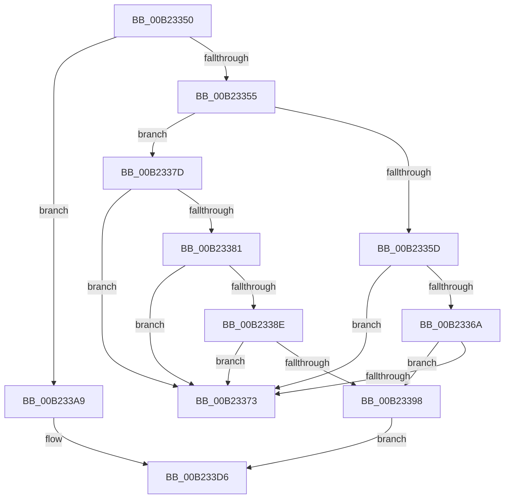

# sub_00B23350

- RVA: `0x00B23350`–`0x00B233E5` (길이 `149` bytes)
- VA: `0x0000000140B23350`
- 실행 섹션: `PAGE`
- PDB 이름 있음: `아니요`; PDB Function 태그: `아니요`
- unwind 정보 RVA: `0x0008EA00`
- 디코드: `36`개 명령, `149/149` bytes 표시
- 미해석 바이트: `0` (있으면 어셈블리에 `.byte`로 보존)

> 이 문서는 커널 이미지의 기계어와 PDB 기호를 분석해 생성했습니다. 4번과 5번은 함수 원형과 자료형을 바이너리 사용 방식에서 추정한 C 해석이며 원본 소스 복구 결과는 아닙니다.

## 1. Dependencies

- 직접 호출 지점: **2**; 고유 호출 대상: **2**
- 직접 호출자로 확인된 함수: **0**
- RIP 상대 이미지 참조: **0**

### Outgoing calls
- `0x00B233A2` → [DrvDbSetDeviceIdDriverInfMatches](../A6/DrvDbSetDeviceIdDriverInfMatches_function_00A6251C.md) (function, `0x00A6251C`)
- `0x00B233D1` → [DrvDbSetRegValueMappedProperty](../83/DrvDbSetRegValueMappedProperty_function_00834DC8.md) (function, `0x00834DC8`)

### Direct callers
- 이 함수 시작 RVA로 연결되는 직접 call은 확인되지 않았습니다. 간접 호출은 완전히 역산할 수 없습니다.

### Static image references
- 디코드된 RIP-relative 메모리 참조가 없습니다.

## 2. Other-region calls and transfers

- 다른 실행 섹션으로 향하는 call: **0**
- call이 아닌 외부 분기/꼬리 이동: **2**
  - `0x00B23378` → [DrvDbSetDeviceIdMappedProperty + 0xFD](../92/DrvDbSetDeviceIdMappedProperty_function_0092ECCC.md) (`tail-transfer`)
  - `0x00B233E0` → [DrvDbSetDeviceIdMappedProperty + 0xFD](../92/DrvDbSetDeviceIdMappedProperty_function_0092ECCC.md) (`tail-transfer`)

## 3. Assembly (complete function range)

```asm
00B23350  48 85 C0                        test rax, rax
00B23353  75 54                           jne 0x140b233a9
00B23355  81 FF 12 20 00 00               cmp edi, 0x2012
00B2335B  75 20                           jne 0x140b2337d
00B2335D  4C 8B 84 24 98 00 00 00         mov r8, qword ptr [rsp + 0x98]
00B23365  4D 85 C0                        test r8, r8
00B23368  74 09                           je 0x140b23373
00B2336A  39 84 24 A0 00 00 00            cmp dword ptr [rsp + 0xa0], eax
00B23371  75 25                           jne 0x140b23398
00B23373  BB 0D 00 00 C0                  mov ebx, 0xc000000d
00B23378  E9 4C BA E0 FF                  jmp 0x14092edc9
00B2337D  85 FF                           test edi, edi
00B2337F  75 F2                           jne 0x140b23373
00B23381  4C 8B 84 24 98 00 00 00         mov r8, qword ptr [rsp + 0x98]
00B23389  4D 85 C0                        test r8, r8
00B2338C  75 E5                           jne 0x140b23373
00B2338E  44 39 84 24 A0 00 00 00         cmp dword ptr [rsp + 0xa0], r8d
00B23396  75 DB                           jne 0x140b23373
00B23398  48 85 ED                        test rbp, rbp
00B2339B  4C 0F 45 D5                     cmovne r10, rbp
00B2339F  49 8B D2                        mov rdx, r10
00B233A2  E8 75 F1 F3 FF                  call 0x140a6251c
00B233A7  EB 2D                           jmp 0x140b233d6
00B233A9  8B 84 24 A0 00 00 00            mov eax, dword ptr [rsp + 0xa0]
00B233B0  48 85 ED                        test rbp, rbp
00B233B3  89 44 24 28                     mov dword ptr [rsp + 0x28], eax
00B233B7  44 8B CF                        mov r9d, edi
00B233BA  48 8B 84 24 98 00 00 00         mov rax, qword ptr [rsp + 0x98]
00B233C2  4C 0F 45 D5                     cmovne r10, rbp
00B233C6  49 8B D2                        mov rdx, r10
00B233C9  48 89 44 24 20                  mov qword ptr [rsp + 0x20], rax
00B233CE  4D 8B C6                        mov r8, r14
00B233D1  E8 F2 19 D1 FF                  call 0x140834dc8
00B233D6  4C 8B 94 24 88 00 00 00         mov r10, qword ptr [rsp + 0x88]
00B233DE  8B D8                           mov ebx, eax
00B233E0  E9 E4 B9 E0 FF                  jmp 0x14092edc9
```

## 4. C-style interpretation (structured pseudocode)

```c
__int64 __fastcall sub_00B23350(__int64 a1, __int64 a2, __int64 a3, __int64 a4, __int64 a5, __int64 a6, __int64 a7, __int64 a8, __int64 a9, __int64 a10, __int64 a11, __int64 a12, __int64 a13, __int64 a14, __int64 a15, __int64 a16, __int64 a17, __int64 a18, __int64 a19, unsigned int a20)
{
    __int64 result;
    __int64 v_r10;
    unsigned __int64 v_stack_p20;
    unsigned int v_stack_p28;

    if (result != 0) goto loc_00B233A9;
    if (((unsigned int)(v_rdi)) != 0x2012ULL) goto loc_00B2337D;
    if (a19 == 0) goto loc_00B23373;
    if (a20 != ((unsigned int)(result))) goto loc_00B23398;
loc_00B23373:
loc_00B2337D:
    if ((unsigned int)(v_rdi) != 0) goto loc_00B23373;
    if (a19 != 0) goto loc_00B23373;
    if (a20 != ((unsigned int)(a19))) goto loc_00B23373;
loc_00B23398:
    if (v_rbp != 0) { v_r10 = v_rbp; }
    result = DrvDbSetDeviceIdDriverInfMatches(a1, v_r10, a19, a4);
    goto loc_00B233D6;
loc_00B233A9:
    v_stack_p28 = (unsigned int)((unsigned int)(a20));
    if (v_rbp != 0) { v_r10 = v_rbp; }
    v_stack_p20 = a19;
    result = DrvDbSetRegValueMappedProperty(a1, v_r10, v_r14, (unsigned int)((unsigned int)(v_rdi)));
loc_00B233D6:
}
```

## 5. (Beta) C Style

```c
int64_t sub_00B23350(int64_t Arg1, int64_t Arg2, int64_t Arg3, int64_t Arg4, uint64_t Arg5, uint64_t Arg6, uint64_t Arg7, uint64_t Arg8, uint64_t Arg9, uint64_t Arg10, uint64_t Arg11, uint64_t Arg12, uint64_t Arg13, uint64_t Arg14, uint64_t Arg15, uint64_t Arg16, int64_t Arg17, uint64_t Arg18, int64_t Arg19, uint32_t Arg20)
{
    int64_t result;
    int64_t local_r10;
    uint64_t v_stack_p20;
    uint32_t v_stack_p28;

    if (result != 0) goto loc_00B233A9;
    if (((uint32_t)(local_rdi)) != 0x2012ULL) goto loc_00B2337D;
    if (Arg19 == 0) goto loc_00B23373;
    if (Arg20 != ((uint32_t)(result))) goto loc_00B23398;
loc_00B23373:
loc_00B2337D:
    if ((uint32_t)(local_rdi) != 0) goto loc_00B23373;
    if (Arg19 != 0) goto loc_00B23373;
    if (Arg20 != ((uint32_t)(Arg19))) goto loc_00B23373;
loc_00B23398:
    if (local_rbp != 0) { local_r10 = local_rbp; }
    result = DrvDbSetDeviceIdDriverInfMatches(Arg1, local_r10, Arg19, Arg4);
    goto loc_00B233D6;
loc_00B233A9:
    v_stack_p28 = (uint32_t)((uint32_t)(Arg20));
    if (local_rbp != 0) { local_r10 = local_rbp; }
    v_stack_p20 = Arg19;
    result = DrvDbSetRegValueMappedProperty(Arg1, local_r10, local_r14, (uint32_t)((uint32_t)(local_rdi)));
loc_00B233D6:
}
```

## 6. Execution-region graph

[열기: 2D/3D 그래프와 함수 탐색 컨트롤 패널](../../../control-panel.html?section=page&rva=0x00B23350&view=graph)

- 2D 그래프는 위에서 아래로 흐르고, 3D 그래프는 빈 공간을 드래그해 회전합니다. Shift+드래그는 이동, 휠은 확대·축소, 함수 노드 선택은 대상 보고서 이동입니다.

### Static fallback


