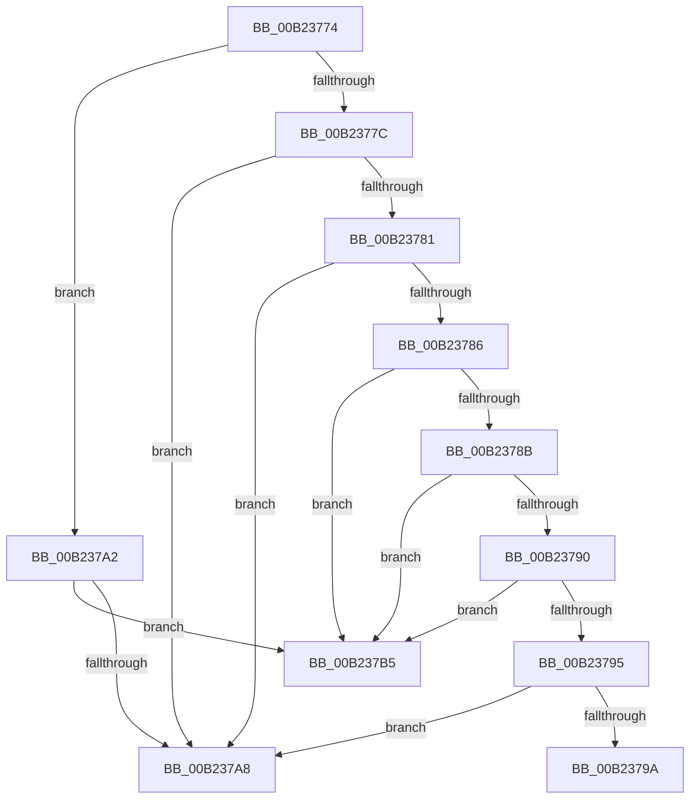

# sub_00B23774

- RVA: `0x00B23774`–`0x00B237BE` (길이 `74` bytes)
- VA: `0x0000000140B23774`
- 실행 섹션: `PAGE`
- PDB 이름 있음: `아니요`; PDB Function 태그: `아니요`
- unwind 정보 RVA: `0x0008EAA4`
- 디코드: `24`개 명령, `74/74` bytes 표시
- 미해석 바이트: `0` (있으면 어셈블리에 `.byte`로 보존)

> 이 문서는 커널 이미지의 기계어와 PDB 기호를 분석해 생성했습니다. 4번과 5번은 함수 원형과 자료형을 바이너리 사용 방식에서 추정한 C 해석이며 원본 소스 복구 결과는 아닙니다.

## 1. Dependencies

- 직접 호출 지점: **0**; 고유 호출 대상: **0**
- 직접 호출자로 확인된 함수: **0**
- RIP 상대 이미지 참조: **0**

### Outgoing calls
- 직접 디코드된 call 명령이 없습니다.

### Direct callers
- 이 함수 시작 RVA로 연결되는 직접 call은 확인되지 않았습니다. 간접 호출은 완전히 역산할 수 없습니다.

### Static image references
- 디코드된 RIP-relative 메모리 참조가 없습니다.

## 2. Other-region calls and transfers

- 다른 실행 섹션으로 향하는 call: **0**
- call이 아닌 외부 분기/꼬리 이동: **3**
  - `0x00B2379D` → [DrvDbDispatchDeviceId + 0x110](../92/DrvDbDispatchDeviceId_function_0092F490.md) (`tail-transfer`)
  - `0x00B237B0` → [DrvDbDispatchDeviceId + 0x110](../92/DrvDbDispatchDeviceId_function_0092F490.md) (`tail-transfer`)
  - `0x00B237B9` → [DrvDbDispatchDeviceId + 0x110](../92/DrvDbDispatchDeviceId_function_0092F490.md) (`tail-transfer`)

## 3. Assembly (complete function range)

```asm
00B23774  41 8B C9                        mov ecx, r9d
00B23777  41 2B CB                        sub ecx, r11d
00B2377A  74 26                           je 0x140b237a2
00B2377C  83 E9 01                        sub ecx, 1
00B2377F  74 27                           je 0x140b237a8
00B23781  83 E9 01                        sub ecx, 1
00B23784  74 22                           je 0x140b237a8
00B23786  83 E9 01                        sub ecx, 1
00B23789  74 2A                           je 0x140b237b5
00B2378B  83 E9 01                        sub ecx, 1
00B2378E  74 25                           je 0x140b237b5
00B23790  41 2B CB                        sub ecx, r11d
00B23793  74 20                           je 0x140b237b5
00B23795  83 F9 01                        cmp ecx, 1
00B23798  74 0E                           je 0x140b237a8
00B2379A  41 B0 01                        mov r8b, 1
00B2379D  E9 FE BD E0 FF                  jmp 0x14092f5a0
00B237A2  80 7B 04 00                     cmp byte ptr [rbx + 4], 0
00B237A6  74 0D                           je 0x140b237b5
00B237A8  41 C1 E8 1E                     shr r8d, 0x1e
00B237AC  41 80 E0 01                     and r8b, 1
00B237B0  E9 EB BD E0 FF                  jmp 0x14092f5a0
00B237B5  41 C1 E8 1F                     shr r8d, 0x1f
00B237B9  E9 E2 BD E0 FF                  jmp 0x14092f5a0
```

## 4. C-style interpretation (structured pseudocode)

```c
void __fastcall sub_00B23774(__int64 a1, __int64 a2, __int64 a3, int a4)
{
    a1 = (unsigned int)(((unsigned int)(a4)) - ((unsigned int)(v_r11)));
    if (condition_is_equal) goto loc_00B237A2;
    a1 = (unsigned int)((a1) - (1));
    if (condition_is_equal) goto loc_00B237A8;
    a1 = (unsigned int)((a1) - (1));
    if (condition_is_equal) goto loc_00B237A8;
    a1 = (unsigned int)((a1) - (1));
    if (condition_is_equal) goto loc_00B237B5;
    a1 = (unsigned int)((a1) - (1));
    if (condition_is_equal) goto loc_00B237B5;
    a1 = (unsigned int)((a1) - ((unsigned int)(v_r11)));
    if (condition_is_equal) goto loc_00B237B5;
    if (((unsigned int)(a1)) == 1) goto loc_00B237A8;
loc_00B237A2:
    if ((*(unsigned __int8 *)(v_rbx + 4)) == 0) goto loc_00B237B5;
loc_00B237A8:
    a3 = (unsigned int)((1) >> (30));
    a3 = (unsigned __int8)((a3) & (1));
loc_00B237B5:
    a3 = (unsigned int)((a3) >> (31));
}
```

## 5. (Beta) C Style

```c
void sub_00B23774(int64_t Arg1, int64_t Arg2, int64_t Arg3, int32_t Arg4)
{
    Arg1 = (uint32_t)(((uint32_t)(Arg4)) - ((uint32_t)(local_r11)));
    if (condition_is_equal) goto loc_00B237A2;
    Arg1 = (uint32_t)((Arg1) - (1));
    if (condition_is_equal) goto loc_00B237A8;
    Arg1 = (uint32_t)((Arg1) - (1));
    if (condition_is_equal) goto loc_00B237A8;
    Arg1 = (uint32_t)((Arg1) - (1));
    if (condition_is_equal) goto loc_00B237B5;
    Arg1 = (uint32_t)((Arg1) - (1));
    if (condition_is_equal) goto loc_00B237B5;
    Arg1 = (uint32_t)((Arg1) - ((uint32_t)(local_r11)));
    if (condition_is_equal) goto loc_00B237B5;
    if (((uint32_t)(Arg1)) == 1) goto loc_00B237A8;
loc_00B237A2:
    if ((*(uint8_t *)(local_rbx + 0x4)) == 0) goto loc_00B237B5;
loc_00B237A8:
    Arg3 = (uint32_t)((1) >> (30));
    Arg3 = (uint8_t)((Arg3) & (1));
loc_00B237B5:
    Arg3 = (uint32_t)((Arg3) >> (31));
}
```

## 6. Execution-region graph

[열기: 2D/3D 그래프와 함수 탐색 컨트롤 패널](../../../control-panel.html?section=page&rva=0x00B23774&view=graph)

- 2D 그래프는 위에서 아래로 흐르고, 3D 그래프는 빈 공간을 드래그해 회전합니다. Shift+드래그는 이동, 휠은 확대·축소, 함수 노드 선택은 대상 보고서 이동입니다.

### Static fallback


