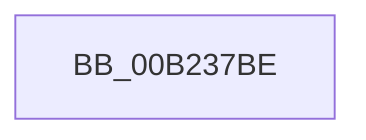

# sub_00B237BE

- RVA: `0x00B237BE`–`0x00B237E8` (길이 `42` bytes)
- VA: `0x0000000140B237BE`
- 실행 섹션: `PAGE`
- PDB 이름 있음: `아니요`; PDB Function 태그: `아니요`
- unwind 정보 RVA: `0x0008EAD0`
- 디코드: `11`개 명령, `42/42` bytes 표시
- 미해석 바이트: `0` (있으면 어셈블리에 `.byte`로 보존)

> 이 문서는 커널 이미지의 기계어와 PDB 기호를 분석해 생성했습니다. 4번과 5번은 함수 원형과 자료형을 바이너리 사용 방식에서 추정한 C 해석이며 원본 소스 복구 결과는 아닙니다.

## 1. Dependencies

- 직접 호출 지점: **1**; 고유 호출 대상: **1**
- 직접 호출자로 확인된 함수: **0**
- RIP 상대 이미지 참조: **0**

### Outgoing calls
- `0x00B237DC` → [DrvDbGetRegValueMappedProperty](../92/DrvDbGetRegValueMappedProperty_function_0092FB80.md) (function, `0x0092FB80`)

### Direct callers
- 이 함수 시작 RVA로 연결되는 직접 call은 확인되지 않았습니다. 간접 호출은 완전히 역산할 수 없습니다.

### Static image references
- 디코드된 RIP-relative 메모리 참조가 없습니다.

## 2. Other-region calls and transfers

- 다른 실행 섹션으로 향하는 call: **0**
- call이 아닌 외부 분기/꼬리 이동: **1**
  - `0x00B237E3` → [DrvDbGetDeviceIdMappedProperty + 0x19E](../92/DrvDbGetDeviceIdMappedProperty_function_0092F690.md) (`tail-transfer`)

## 3. Assembly (complete function range)

```asm
00B237BE  8B 45 70                        mov eax, dword ptr [rbp + 0x70]
00B237C1  4D 8B CC                        mov r9, r12
00B237C4  48 89 74 24 30                  mov qword ptr [rsp + 0x30], rsi
00B237C9  4C 8B C7                        mov r8, rdi
00B237CC  89 44 24 28                     mov dword ptr [rsp + 0x28], eax
00B237D0  48 8B D3                        mov rdx, rbx
00B237D3  48 8B 45 68                     mov rax, qword ptr [rbp + 0x68]
00B237D7  48 89 44 24 20                  mov qword ptr [rsp + 0x20], rax
00B237DC  E8 9F C3 E0 FF                  call 0x14092fb80
00B237E1  8B D8                           mov ebx, eax
00B237E3  E9 46 C0 E0 FF                  jmp 0x14092f82e
```

## 4. C-style interpretation (structured pseudocode)

```c
__int64 __fastcall sub_00B237BE(void)
{
    __int64 result;
    unsigned __int64 v_stack_p20;
    unsigned int v_stack_p28;
    unsigned __int64 v_stack_p30;

    v_stack_p30 = v_rsi;
    v_stack_p28 = (unsigned int)((unsigned int)(*(unsigned int *)(v_rbp + 112)));
    v_stack_p20 = *(unsigned __int64 *)(v_rbp + 104);
    result = DrvDbGetRegValueMappedProperty(a1, v_rbx, v_rdi, v_r12);
}
```

## 5. (Beta) C Style

```c
void sub_00B237BE(void)
{
    int64_t result;
    uint64_t v_stack_p20;
    uint32_t v_stack_p28;
    uint64_t v_stack_p30;

    v_stack_p30 = local_rsi;
    v_stack_p28 = (uint32_t)((uint32_t)(*(uint32_t *)(local_rbp + 0x70)));
    v_stack_p20 = *(uint64_t *)(local_rbp + 0x68);
    result = DrvDbGetRegValueMappedProperty(a1, local_rbx, local_rdi, local_r12);
}
```

## 6. Execution-region graph

[열기: 2D/3D 그래프와 함수 탐색 컨트롤 패널](../../../control-panel.html?section=page&rva=0x00B237BE&view=graph)

- 2D 그래프는 위에서 아래로 흐르고, 3D 그래프는 빈 공간을 드래그해 회전합니다. Shift+드래그는 이동, 휠은 확대·축소, 함수 노드 선택은 대상 보고서 이동입니다.

### Static fallback


