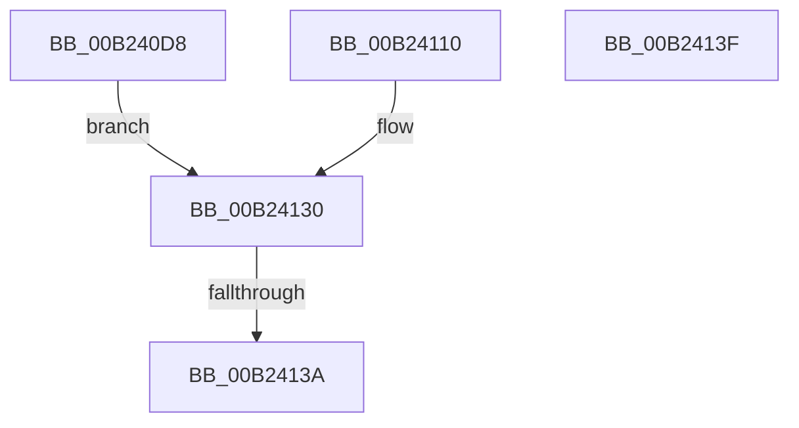

# sub_00B240D8

- RVA: `0x00B240D8`–`0x00B24163` (길이 `139` bytes)
- VA: `0x0000000140B240D8`
- 실행 섹션: `PAGE`
- PDB 이름 있음: `아니요`; PDB Function 태그: `아니요`
- unwind 정보 RVA: `0x0008EC50`
- 디코드: `28`개 명령, `139/139` bytes 표시
- 미해석 바이트: `0` (있으면 어셈블리에 `.byte`로 보존)

> 이 문서는 커널 이미지의 기계어와 PDB 기호를 분석해 생성했습니다. 4번과 5번은 함수 원형과 자료형을 바이너리 사용 방식에서 추정한 C 해석이며 원본 소스 복구 결과는 아닙니다.

## 1. Dependencies

- 직접 호출 지점: **4**; 고유 호출 대상: **4**
- 직접 호출자로 확인된 함수: **0**
- RIP 상대 이미지 참조: **1**

### Outgoing calls
- `0x00B24109` → [PnpCtxRegCreateKey](../A6/PnpCtxRegCreateKey_function_00A692E4.md) (function, `0x00A692E4`)
- `0x00B2412B` → [PnpCtxRegOpenKey](../8E/PnpCtxRegOpenKey_function_008EF7B8.md) (function, `0x008EF7B8`)
- `0x00B24146` → [ExReleaseResourceLite](../../text/25/ExReleaseResourceLite_function_0025FA10.md) (function, `0x0025FA10`)
- `0x00B24154` → [KeLeaveCriticalRegionThread](../../text/25/KeLeaveCriticalRegionThread_function_0025EFF0.md) (function, `0x0025EFF0`)

### Direct callers
- 이 함수 시작 RVA로 연결되는 직접 call은 확인되지 않았습니다. 간접 호출은 완전히 역산할 수 없습니다.

### Static image references
- `0x00B240DC` → RVA `0x000021B0` (`.rdata`; read)

## 2. Other-region calls and transfers

- 다른 실행 섹션으로 향하는 call: **2**
  - `0x00B24146` → [ExReleaseResourceLite](../../text/25/ExReleaseResourceLite_function_0025FA10.md) (`PAGE` → `.text`)
  - `0x00B24154` → [KeLeaveCriticalRegionThread](../../text/25/KeLeaveCriticalRegionThread_function_0025EFF0.md) (`PAGE` → `.text`)
- call이 아닌 외부 분기/꼬리 이동: **3**
  - `0x00B24134` → [sub_00930E38 + 0x24](../93/Unknown_function_00930E38.md) (`tail-transfer`)
  - `0x00B2413A` → [sub_00930E38 + 0x1E](../93/Unknown_function_00930E38.md) (`tail-transfer`)
  - `0x00B2415E` → [sub_00930E38 + 0x61](../93/Unknown_function_00930E38.md) (`tail-transfer`)

## 3. Assembly (complete function range)

```asm
00B240D8  49 8B 0C 24                     mov rcx, qword ptr [r12]
00B240DC  48 8D 15 CD E0 4D FF            lea rdx, [rip - 0xb21f33]
00B240E3  4C 8B 04 EA                     mov r8, qword ptr [rdx + rbp*8]
00B240E7  45 33 C9                        xor r9d, r9d
00B240EA  48 8B 57 60                     mov rdx, qword ptr [rdi + 0x60]
00B240EE  48 C7 44 24 38 00 00 00 00      mov qword ptr [rsp + 0x38], 0
00B240F7  4C 89 7C 24 30                  mov qword ptr [rsp + 0x30], r15
00B240FC  48 89 74 24 28                  mov qword ptr [rsp + 0x28], rsi
00B24101  C7 44 24 20 00 00 00 02         mov dword ptr [rsp + 0x20], 0x2000000
00B24109  E8 D6 51 F4 FF                  call 0x140a692e4
00B2410E  EB 20                           jmp 0x140b24130
00B24110  48 8B 57 60                     mov rdx, qword ptr [rdi + 0x60]
00B24114  45 33 C9                        xor r9d, r9d
00B24117  49 8B 0C 24                     mov rcx, qword ptr [r12]
00B2411B  45 33 C0                        xor r8d, r8d
00B2411E  4C 89 7C 24 28                  mov qword ptr [rsp + 0x28], r15
00B24123  C7 44 24 20 00 00 00 02         mov dword ptr [rsp + 0x20], 0x2000000
00B2412B  E8 88 B6 DC FF                  call 0x1408ef7b8
00B24130  8B D8                           mov ebx, eax
00B24132  85 C0                           test eax, eax
00B24134  0F 88 22 CD E0 FF               js 0x140930e5c
00B2413A  E9 17 CD E0 FF                  jmp 0x140930e56
00B2413F  48 8B 8F 98 00 00 00            mov rcx, qword ptr [rdi + 0x98]
00B24146  E8 C5 B8 73 FF                  call 0x14025fa10
00B2414B  65 48 8B 0C 25 88 01 00 00      mov rcx, qword ptr gs:[0x188]
00B24154  E8 97 AE 73 FF                  call 0x14025eff0
00B24159  B8 E5 00 00 C0                  mov eax, 0xc00000e5
00B2415E  E9 36 CD E0 FF                  jmp 0x140930e99
```

## 4. C-style interpretation (structured pseudocode)

```c
__int64 __fastcall sub_00B240D8(__int64 a1, __int64 a2, __int64 a3, int a4)
{
    __int64 result;
    unsigned int v_stack_p20;
    unsigned __int64 v_stack_p28;
    unsigned __int64 v_stack_p30;
    unsigned __int64 v_stack_p38;

    a4 = 0;
    v_stack_p38 = 0;
    v_stack_p30 = v_r15;
    v_stack_p28 = v_rsi;
    v_stack_p20 = 0x2000000ULL;
    result = PnpCtxRegCreateKey(*(unsigned __int64 *)(v_r12), *(unsigned __int64 *)(v_rdi + 96), *(unsigned __int64 *)(v_rip - 11673395 + v_rbp * 8), a4);
    goto loc_00B24130;
loc_00B24130:
}
```

## 5. (Beta) C Style

```c
int64_t sub_00B240D8(int64_t Arg1, int64_t Arg2, int64_t Arg3, int32_t Arg4)
{
    int64_t result;
    uint32_t v_stack_p20;
    uint64_t v_stack_p28;
    uint64_t v_stack_p30;
    uint64_t v_stack_p38;

    Arg4 = 0;
    v_stack_p38 = 0;
    v_stack_p30 = local_r15;
    v_stack_p28 = local_rsi;
    v_stack_p20 = 0x2000000ULL;
    result = PnpCtxRegCreateKey(*(uint64_t *)(local_r12), *(uint64_t *)(local_rdi + 0x60), *(uint64_t *)(v_rip - 0xB21F33 + local_rbp * 8), Arg4);
    goto loc_00B24130;
loc_00B24130:
}
```

## 6. Execution-region graph

[열기: 2D/3D 그래프와 함수 탐색 컨트롤 패널](../../../control-panel.html?section=page&rva=0x00B240D8&view=graph)

- 2D 그래프는 위에서 아래로 흐르고, 3D 그래프는 빈 공간을 드래그해 회전합니다. Shift+드래그는 이동, 휠은 확대·축소, 함수 노드 선택은 대상 보고서 이동입니다.

### Static fallback


