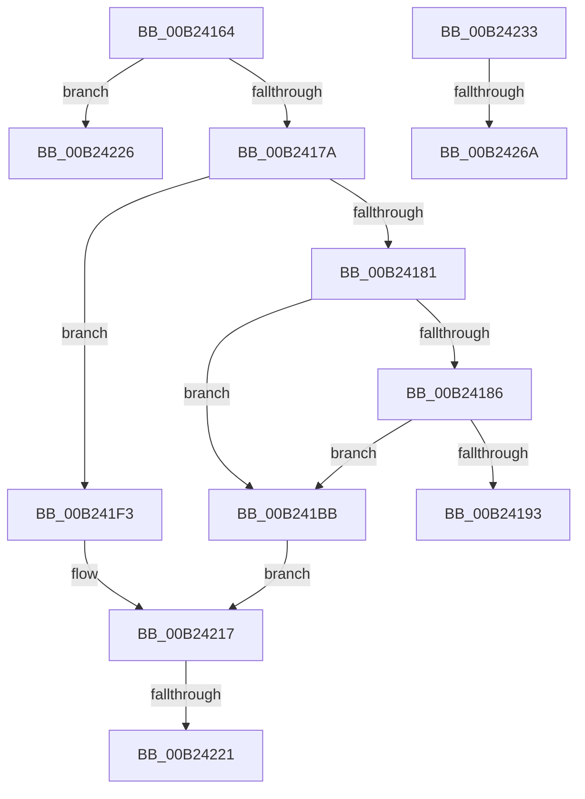

# sub_00B24164

- RVA: `0x00B24164`–`0x00B2426F` (길이 `267` bytes)
- VA: `0x0000000140B24164`
- 실행 섹션: `PAGE`
- PDB 이름 있음: `아니요`; PDB Function 태그: `아니요`
- unwind 정보 RVA: `0x0008ECF0`
- 디코드: `64`개 명령, `267/267` bytes 표시
- 미해석 바이트: `0` (있으면 어셈블리에 `.byte`로 보존)

> 이 문서는 커널 이미지의 기계어와 PDB 기호를 분석해 생성했습니다. 4번과 5번은 함수 원형과 자료형을 바이너리 사용 방식에서 추정한 C 해석이며 원본 소스 복구 결과는 아닙니다.

## 1. Dependencies

- 직접 호출 지점: **7**; 고유 호출 대상: **7**
- 직접 호출자로 확인된 함수: **0**
- RIP 상대 이미지 참조: **1**

### Outgoing calls
- `0x00B2416B` → [DrvDbLoadDatabaseNode](../93/DrvDbLoadDatabaseNode_function_00931668.md) (function, `0x00931668`)
- `0x00B24186` → [DrvDbGetRegistrarSecurityDescriptor](../83/DrvDbGetRegistrarSecurityDescriptor_function_00835728.md) (function, `0x00835728`)
- `0x00B2419A` → [ExReleaseResourceLite](../../text/25/ExReleaseResourceLite_function_0025FA10.md) (function, `0x0025FA10`)
- `0x00B241A8` → [KeLeaveCriticalRegionThread](../../text/25/KeLeaveCriticalRegionThread_function_0025EFF0.md) (function, `0x0025EFF0`)
- `0x00B241EC` → [PnpCtxRegCreateKey](../A6/PnpCtxRegCreateKey_function_00A692E4.md) (function, `0x00A692E4`)
- `0x00B24212` → [PnpCtxRegOpenKey](../8E/PnpCtxRegOpenKey_function_008EF7B8.md) (function, `0x008EF7B8`)
- `0x00B2425B` → [PnpCtxRegCreateTree](../93/PnpCtxRegCreateTree_function_00931CA0.md) (function, `0x00931CA0`)

### Direct callers
- 이 함수 시작 RVA로 연결되는 직접 call은 확인되지 않았습니다. 간접 호출은 완전히 역산할 수 없습니다.

### Static image references
- `0x00B241BF` → RVA `0x000021B0` (`.rdata`; read)

## 2. Other-region calls and transfers

- 다른 실행 섹션으로 향하는 call: **2**
  - `0x00B2419A` → [ExReleaseResourceLite](../../text/25/ExReleaseResourceLite_function_0025FA10.md) (`PAGE` → `.text`)
  - `0x00B241A8` → [KeLeaveCriticalRegionThread](../../text/25/KeLeaveCriticalRegionThread_function_0025EFF0.md) (`PAGE` → `.text`)
- call이 아닌 외부 분기/꼬리 이동: **6**
  - `0x00B241B6` → [sub_0093107C + 0x23A](../93/Unknown_function_0093107C.md) (`tail-transfer`)
  - `0x00B2421B` → [sub_0093107C + 0xEE](../93/Unknown_function_0093107C.md) (`tail-transfer`)
  - `0x00B24221` → [sub_0093107C + 0xE6](../93/Unknown_function_0093107C.md) (`tail-transfer`)
  - `0x00B2422E` → [sub_0093107C + 0xF2](../93/Unknown_function_0093107C.md) (`tail-transfer`)
  - `0x00B24264` → [sub_0093107C + 0x23A](../93/Unknown_function_0093107C.md) (`tail-transfer`)
  - `0x00B2426A` → [sub_0093107C + 0x22E](../93/Unknown_function_0093107C.md) (`tail-transfer`)

## 3. Assembly (complete function range)

```asm
00B24164  48 8B 4D 3F                     mov rcx, qword ptr [rbp + 0x3f]
00B24168  48 8B D7                        mov rdx, rdi
00B2416B  E8 F8 D4 E0 FF                  call 0x140931668
00B24170  8B D8                           mov ebx, eax
00B24172  85 C0                           test eax, eax
00B24174  0F 88 AC 00 00 00               js 0x140b24226
00B2417A  8B 45 4F                        mov eax, dword ptr [rbp + 0x4f]
00B2417D  85 C0                           test eax, eax
00B2417F  74 72                           je 0x140b241f3
00B24181  83 F8 01                        cmp eax, 1
00B24184  75 35                           jne 0x140b241bb
00B24186  E8 9D 15 D1 FF                  call 0x140835728
00B2418B  4C 8B F8                        mov r15, rax
00B2418E  48 85 C0                        test rax, rax
00B24191  75 28                           jne 0x140b241bb
00B24193  48 8B 8F 98 00 00 00            mov rcx, qword ptr [rdi + 0x98]
00B2419A  E8 71 B8 73 FF                  call 0x14025fa10
00B2419F  65 48 8B 0C 25 88 01 00 00      mov rcx, qword ptr gs:[0x188]
00B241A8  E8 43 AE 73 FF                  call 0x14025eff0
00B241AD  4C 8B 6D 3F                     mov r13, qword ptr [rbp + 0x3f]
00B241B1  BB E5 00 00 C0                  mov ebx, 0xc00000e5
00B241B6  E9 FB D0 E0 FF                  jmp 0x1409312b6
00B241BB  48 8B 57 60                     mov rdx, qword ptr [rdi + 0x60]
00B241BF  48 8D 05 EA DF 4D FF            lea rax, [rip - 0xb22016]
00B241C6  4E 8B 04 E8                     mov r8, qword ptr [rax + r13*8]
00B241CA  45 33 C9                        xor r9d, r9d
00B241CD  4C 8B 6D 3F                     mov r13, qword ptr [rbp + 0x3f]
00B241D1  4C 89 74 24 38                  mov qword ptr [rsp + 0x38], r14
00B241D6  4C 89 64 24 30                  mov qword ptr [rsp + 0x30], r12
00B241DB  4C 89 7C 24 28                  mov qword ptr [rsp + 0x28], r15
00B241E0  49 8B 4D 00                     mov rcx, qword ptr [r13]
00B241E4  C7 44 24 20 00 00 00 02         mov dword ptr [rsp + 0x20], 0x2000000
00B241EC  E8 F3 50 F4 FF                  call 0x140a692e4
00B241F1  EB 24                           jmp 0x140b24217
00B241F3  4C 8B 6D 3F                     mov r13, qword ptr [rbp + 0x3f]
00B241F7  45 33 C9                        xor r9d, r9d
00B241FA  48 8B 57 60                     mov rdx, qword ptr [rdi + 0x60]
00B241FE  45 33 C0                        xor r8d, r8d
00B24201  4C 89 64 24 28                  mov qword ptr [rsp + 0x28], r12
00B24206  C7 44 24 20 00 00 00 02         mov dword ptr [rsp + 0x20], 0x2000000
00B2420E  49 8B 4D 00                     mov rcx, qword ptr [r13]
00B24212  E8 A1 B5 DC FF                  call 0x1408ef7b8
00B24217  8B D8                           mov ebx, eax
00B24219  85 C0                           test eax, eax
00B2421B  0F 88 49 CF E0 FF               js 0x14093116a
00B24221  E9 3C CF E0 FF                  jmp 0x140931162
00B24226  4C 8B 6D 3F                     mov r13, qword ptr [rbp + 0x3f]
00B2422A  4C 8B 65 DF                     mov r12, qword ptr [rbp - 0x21]
00B2422E  E9 3B CF E0 FF                  jmp 0x14093116e
00B24233  48 8B 45 6F                     mov rax, qword ptr [rbp + 0x6f]
00B24237  45 33 C9                        xor r9d, r9d
00B2423A  48 8B 55 CF                     mov rdx, qword ptr [rbp - 0x31]
00B2423E  4C 8B C6                        mov r8, rsi
00B24241  49 8B 4D 00                     mov rcx, qword ptr [r13]
00B24245  4C 89 74 24 38                  mov qword ptr [rsp + 0x38], r14
00B2424A  48 89 44 24 30                  mov qword ptr [rsp + 0x30], rax
00B2424F  8B 45 5F                        mov eax, dword ptr [rbp + 0x5f]
00B24252  4C 89 74 24 28                  mov qword ptr [rsp + 0x28], r14
00B24257  89 44 24 20                     mov dword ptr [rsp + 0x20], eax
00B2425B  E8 40 DA E0 FF                  call 0x140931ca0
00B24260  8B D8                           mov ebx, eax
00B24262  85 C0                           test eax, eax
00B24264  0F 88 4C D0 E0 FF               js 0x1409312b6
00B2426A  E9 3B D0 E0 FF                  jmp 0x1409312aa
```

## 4. C-style interpretation (structured pseudocode)

```c
__int64 __fastcall sub_00B24164(__int64 a1, __int64 a2, __int64 a3, int a4)
{
    __int64 result;
    unsigned int v_stack_p20;
    unsigned __int64 v_stack_p28;
    unsigned __int64 v_stack_p30;
    unsigned __int64 v_stack_p38;

    result = DrvDbLoadDatabaseNode(*(unsigned __int64 *)(v_rbp + 63), v_rdi, a3, a4);
    if (sign_flag) goto loc_00B24226;
    if ((unsigned int)((unsigned int)(*(unsigned int *)(v_rbp + 79))) == 0) goto loc_00B241F3;
    if (((unsigned int)((unsigned int)(*(unsigned int *)(v_rbp + 79)))) != 1) goto loc_00B241BB;
    result = DrvDbGetRegistrarSecurityDescriptor(*(unsigned __int64 *)(v_rbp + 63), v_rdi, a3, a4);
    if (result != 0) goto loc_00B241BB;
    result = ExReleaseResourceLite(*(unsigned __int64 *)(v_rdi + 152), v_rdi, a3, a4);
    result = KeLeaveCriticalRegionThread(*(unsigned __int64 *)(gs_base + (0 + 392)), v_rdi, a3, a4);
loc_00B241BB:
    a4 = 0;
    v_stack_p38 = v_r14;
    v_stack_p30 = v_r12;
    v_stack_p28 = result;
    v_stack_p20 = 0x2000000ULL;
    result = PnpCtxRegCreateKey(*(unsigned __int64 *)(*(unsigned __int64 *)(v_rbp + 63)), *(unsigned __int64 *)(v_rdi + 96), *(unsigned __int64 *)(v_rip - 11673622 + *(unsigned __int64 *)(v_rbp + 63) * 8), a4);
    goto loc_00B24217;
loc_00B241F3:
    a4 = 0;
    a3 = 0;
    v_stack_p28 = v_r12;
    v_stack_p20 = 0x2000000ULL;
    result = PnpCtxRegOpenKey(*(unsigned __int64 *)(*(unsigned __int64 *)(v_rbp + 63)), *(unsigned __int64 *)(v_rdi + 96), a3, a4);
loc_00B24217:
loc_00B24226:
}
```

## 5. (Beta) C Style

```c
int64_t sub_00B24164(int64_t Arg1, int64_t Arg2, int64_t Arg3, int32_t Arg4)
{
    int64_t result;
    uint32_t v_stack_p20;
    uint64_t v_stack_p28;
    uint64_t v_stack_p30;
    uint64_t v_stack_p38;

    result = DrvDbLoadDatabaseNode(*(uint64_t *)(local_rbp + 0x3F), local_rdi, Arg3, Arg4);
    if (sign_flag) goto loc_00B24226;
    if ((uint32_t)((uint32_t)(*(uint32_t *)(local_rbp + 0x4F))) == 0) goto loc_00B241F3;
    if (((uint32_t)((uint32_t)(*(uint32_t *)(local_rbp + 0x4F)))) != 1) goto loc_00B241BB;
    result = DrvDbGetRegistrarSecurityDescriptor(*(uint64_t *)(local_rbp + 0x3F), local_rdi, Arg3, Arg4);
    if (result != 0) goto loc_00B241BB;
    result = ExReleaseResourceLite(*(uint64_t *)(local_rdi + 0x98), local_rdi, Arg3, Arg4);
    result = KeLeaveCriticalRegionThread(*(uint64_t *)(gs_base + (0 + 0x188)), local_rdi, Arg3, Arg4);
loc_00B241BB:
    Arg4 = 0;
    v_stack_p38 = local_r14;
    v_stack_p30 = local_r12;
    v_stack_p28 = result;
    v_stack_p20 = 0x2000000ULL;
    result = PnpCtxRegCreateKey(*(uint64_t *)(*(uint64_t *)(local_rbp + 0x3F)), *(uint64_t *)(local_rdi + 0x60), *(uint64_t *)(v_rip - 0xB22016 + *(uint64_t *)(local_rbp + 0x3F) * 8), Arg4);
    goto loc_00B24217;
loc_00B241F3:
    Arg4 = 0;
    Arg3 = 0;
    v_stack_p28 = local_r12;
    v_stack_p20 = 0x2000000ULL;
    result = PnpCtxRegOpenKey(*(uint64_t *)(*(uint64_t *)(local_rbp + 0x3F)), *(uint64_t *)(local_rdi + 0x60), Arg3, Arg4);
loc_00B24217:
loc_00B24226:
}
```

## 6. Execution-region graph

[열기: 2D/3D 그래프와 함수 탐색 컨트롤 패널](../../../control-panel.html?section=page&rva=0x00B24164&view=graph)

- 2D 그래프는 위에서 아래로 흐르고, 3D 그래프는 빈 공간을 드래그해 회전합니다. Shift+드래그는 이동, 휠은 확대·축소, 함수 노드 선택은 대상 보고서 이동입니다.

### Static fallback


