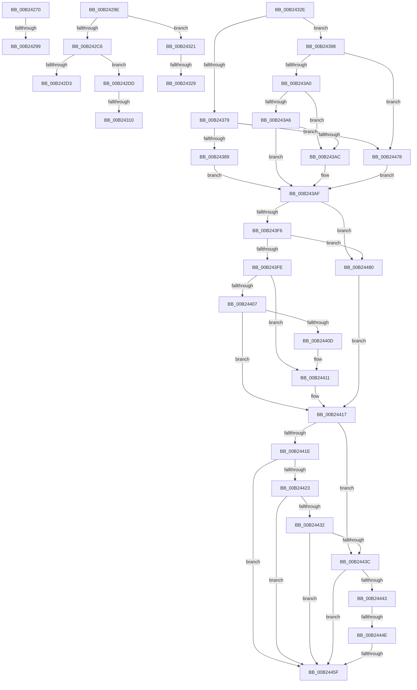

# sub_00B24270

- RVA: `0x00B24270`–`0x00B24487` (길이 `535` bytes)
- VA: `0x0000000140B24270`
- 실행 섹션: `PAGE`
- PDB 이름 있음: `아니요`; PDB Function 태그: `아니요`
- unwind 정보 RVA: `0x0008ED28`
- 디코드: `138`개 명령, `535/535` bytes 표시
- 미해석 바이트: `0` (있으면 어셈블리에 `.byte`로 보존)

> 이 문서는 커널 이미지의 기계어와 PDB 기호를 분석해 생성했습니다. 4번과 5번은 함수 원형과 자료형을 바이너리 사용 방식에서 추정한 C 해석이며 원본 소스 복구 결과는 아닙니다.

## 1. Dependencies

- 직접 호출 지점: **9**; 고유 호출 대상: **6**
- 직접 호출자로 확인된 함수: **0**
- RIP 상대 이미지 참조: **2**

### Outgoing calls
- `0x00B2428A` → [PnpCtxRegOpenKey](../8E/PnpCtxRegOpenKey_function_008EF7B8.md) (function, `0x008EF7B8`)
- `0x00B242B8` → [PnpCtxRegOpenKey](../8E/PnpCtxRegOpenKey_function_008EF7B8.md) (function, `0x008EF7B8`)
- `0x00B242C6` → [DrvDbGetSecurityDescriptor](../83/DrvDbGetSecurityDescriptor_function_0083580C.md) (function, `0x0083580C`)
- `0x00B24301` → [PnpCtxRegCreateTree](../93/PnpCtxRegCreateTree_function_00931CA0.md) (function, `0x00931CA0`)
- `0x00B24316` → [DrvDbInitializeDatabaseNodeVersion](../83/DrvDbInitializeDatabaseNodeVersion_function_00835B94.md) (function, `0x00835B94`)
- `0x00B24369` → [DrvDbGetDriverDatabaseMappedProperty](../92/DrvDbGetDriverDatabaseMappedProperty_function_0092EE28.md) (function, `0x0092EE28`)
- `0x00B24391` → [DrvDbInitializeDatabaseNodeVersion](../83/DrvDbInitializeDatabaseNodeVersion_function_00835B94.md) (function, `0x00835B94`)
- `0x00B243E4` → [DrvDbGetDriverDatabaseMappedProperty](../92/DrvDbGetDriverDatabaseMappedProperty_function_0092EE28.md) (function, `0x0092EE28`)
- `0x00B24465` → [DrvDbUnloadDatabaseNode](../93/DrvDbUnloadDatabaseNode_function_0093183C.md) (function, `0x0093183C`)

### Direct callers
- 이 함수 시작 RVA로 연결되는 직접 call은 확인되지 않았습니다. 간접 호출은 완전히 역산할 수 없습니다.

### Static image references
- `0x00B2433A` → RVA `0x000218B0` (`.rdata`; read)
- `0x00B243C4` → RVA `0x00022680` (`.rdata`; read)

## 2. Other-region calls and transfers

- 다른 실행 섹션으로 향하는 call: **0**
- call이 아닌 외부 분기/꼬리 이동: **10**
  - `0x00B24293` → [DrvDbLoadDatabaseNode + 0xAB](../93/DrvDbLoadDatabaseNode_function_00931668.md) (`tail-transfer`)
  - `0x00B24299` → [DrvDbLoadDatabaseNode + 0xB6](../93/DrvDbLoadDatabaseNode_function_00931668.md) (`tail-transfer`)
  - `0x00B242D8` → [DrvDbLoadDatabaseNode + 0x106](../93/DrvDbLoadDatabaseNode_function_00931668.md) (`tail-transfer`)
  - `0x00B2430A` → [DrvDbLoadDatabaseNode + 0x106](../93/DrvDbLoadDatabaseNode_function_00931668.md) (`tail-transfer`)
  - `0x00B2431C` → [DrvDbLoadDatabaseNode + 0xAB](../93/DrvDbLoadDatabaseNode_function_00931668.md) (`tail-transfer`)
  - `0x00B24323` → [DrvDbLoadDatabaseNode + 0x106](../93/DrvDbLoadDatabaseNode_function_00931668.md) (`tail-transfer`)
  - `0x00B24329` → [DrvDbLoadDatabaseNode + 0xAB](../93/DrvDbLoadDatabaseNode_function_00931668.md) (`tail-transfer`)
  - `0x00B24448` → [DrvDbLoadDatabaseNode + 0xB6](../93/DrvDbLoadDatabaseNode_function_00931668.md) (`tail-transfer`)
  - `0x00B24459` → [DrvDbLoadDatabaseNode + 0xB6](../93/DrvDbLoadDatabaseNode_function_00931668.md) (`tail-transfer`)
  - `0x00B24473` → [DrvDbLoadDatabaseNode + 0xB6](../93/DrvDbLoadDatabaseNode_function_00931668.md) (`tail-transfer`)

## 3. Assembly (complete function range)

```asm
00B24270  4C 8B 47 38                     mov r8, qword ptr [rdi + 0x38]
00B24274  45 33 C9                        xor r9d, r9d
00B24277  49 8B 0E                        mov rcx, qword ptr [r14]
00B2427A  48 8B D6                        mov rdx, rsi
00B2427D  4C 89 64 24 28                  mov qword ptr [rsp + 0x28], r12
00B24282  C7 44 24 20 00 00 00 02         mov dword ptr [rsp + 0x20], 0x2000000
00B2428A  E8 29 B5 DC FF                  call 0x1408ef7b8
00B2428F  8B D8                           mov ebx, eax
00B24291  85 C0                           test eax, eax
00B24293  0F 89 7A D4 E0 FF               jns 0x140931713
00B24299  E9 80 D4 E0 FF                  jmp 0x14093171e
00B2429E  4C 8B 47 38                     mov r8, qword ptr [rdi + 0x38]
00B242A2  45 33 C9                        xor r9d, r9d
00B242A5  49 8B 0E                        mov rcx, qword ptr [r14]
00B242A8  48 8B D6                        mov rdx, rsi
00B242AB  4C 89 64 24 28                  mov qword ptr [rsp + 0x28], r12
00B242B0  C7 44 24 20 00 00 00 02         mov dword ptr [rsp + 0x20], 0x2000000
00B242B8  E8 FB B4 DC FF                  call 0x1408ef7b8
00B242BD  8B D8                           mov ebx, eax
00B242BF  3D 34 00 00 C0                  cmp eax, 0xc0000034
00B242C4  75 5B                           jne 0x140b24321
00B242C6  E8 41 15 D1 FF                  call 0x14083580c
00B242CB  4C 8B E8                        mov r13, rax
00B242CE  48 85 C0                        test rax, rax
00B242D1  75 0A                           jne 0x140b242dd
00B242D3  BB E5 00 00 C0                  mov ebx, 0xc00000e5
00B242D8  E9 91 D4 E0 FF                  jmp 0x14093176e
00B242DD  4C 21 7C 24 38                  and qword ptr [rsp + 0x38], r15
00B242E2  45 33 C9                        xor r9d, r9d
00B242E5  4C 8B 47 38                     mov r8, qword ptr [rdi + 0x38]
00B242E9  48 8B D6                        mov rdx, rsi
00B242EC  49 8B 0E                        mov rcx, qword ptr [r14]
00B242EF  4C 89 64 24 30                  mov qword ptr [rsp + 0x30], r12
00B242F4  48 89 44 24 28                  mov qword ptr [rsp + 0x28], rax
00B242F9  C7 44 24 20 00 00 00 02         mov dword ptr [rsp + 0x20], 0x2000000
00B24301  E8 9A D9 E0 FF                  call 0x140931ca0
00B24306  8B D8                           mov ebx, eax
00B24308  85 C0                           test eax, eax
00B2430A  0F 88 5E D4 E0 FF               js 0x14093176e
00B24310  48 8B D7                        mov rdx, rdi
00B24313  49 8B CE                        mov rcx, r14
00B24316  E8 79 18 D1 FF                  call 0x140835b94
00B2431B  90                              nop
00B2431C  E9 F2 D3 E0 FF                  jmp 0x140931713
00B24321  85 C0                           test eax, eax
00B24323  0F 88 45 D4 E0 FF               js 0x14093176e
00B24329  E9 E5 D3 E0 FF                  jmp 0x140931713
00B2432E  4C 8B 47 60                     mov r8, qword ptr [rdi + 0x60]
00B24332  48 8D 5F 44                     lea rbx, [rdi + 0x44]
00B24336  48 8B 57 18                     mov rdx, qword ptr [rdi + 0x18]
00B2433A  4C 8D 0D 6F D5 4F FF            lea r9, [rip - 0xb02a91]
00B24341  83 C8 08                        or eax, 8
00B24344  49 8B CE                        mov rcx, r14
00B24347  89 47 40                        mov dword ptr [rdi + 0x40], eax
00B2434A  48 8D 45 50                     lea rax, [rbp + 0x50]
00B2434E  48 89 44 24 38                  mov qword ptr [rsp + 0x38], rax
00B24353  48 8D 45 48                     lea rax, [rbp + 0x48]
00B24357  C7 44 24 30 04 00 00 00         mov dword ptr [rsp + 0x30], 4
00B2435F  48 89 5C 24 28                  mov qword ptr [rsp + 0x28], rbx
00B24364  48 89 44 24 20                  mov qword ptr [rsp + 0x20], rax
00B24369  E8 BA AA E0 FF                  call 0x14092ee28
00B2436E  41 83 CC FF                     or r12d, 0xffffffff
00B24372  3D 25 02 00 C0                  cmp eax, 0xc0000225
00B24377  75 1F                           jne 0x140b24398
00B24379  41 8B 4E 08                     mov ecx, dword ptr [r14 + 8]
00B2437D  8D 41 FF                        lea eax, [rcx - 1]
00B24380  83 F8 FD                        cmp eax, -3
00B24383  0F 87 EF 00 00 00               ja 0x140b24478
00B24389  89 0B                           mov dword ptr [rbx], ecx
00B2438B  48 8B D7                        mov rdx, rdi
00B2438E  49 8B CE                        mov rcx, r14
00B24391  E8 FE 17 D1 FF                  call 0x140835b94
00B24396  EB 17                           jmp 0x140b243af
00B24398  85 C0                           test eax, eax
00B2439A  0F 88 D8 00 00 00               js 0x140b24478
00B243A0  83 7D 48 07                     cmp dword ptr [rbp + 0x48], 7
00B243A4  75 06                           jne 0x140b243ac
00B243A6  83 7D 50 04                     cmp dword ptr [rbp + 0x50], 4
00B243AA  74 03                           je 0x140b243af
00B243AC  44 89 23                        mov dword ptr [rbx], r12d
00B243AF  4C 8B 47 60                     mov r8, qword ptr [rdi + 0x60]
00B243B3  48 8D 45 50                     lea rax, [rbp + 0x50]
00B243B7  48 8B 57 18                     mov rdx, qword ptr [rdi + 0x18]
00B243BB  48 8D 77 48                     lea rsi, [rdi + 0x48]
00B243BF  48 89 44 24 38                  mov qword ptr [rsp + 0x38], rax
00B243C4  4C 8D 0D B5 E2 4F FF            lea r9, [rip - 0xb01d4b]
00B243CB  C7 44 24 30 04 00 00 00         mov dword ptr [rsp + 0x30], 4
00B243D3  48 8D 45 48                     lea rax, [rbp + 0x48]
00B243D7  48 89 74 24 28                  mov qword ptr [rsp + 0x28], rsi
00B243DC  49 8B CE                        mov rcx, r14
00B243DF  48 89 44 24 20                  mov qword ptr [rsp + 0x20], rax
00B243E4  E8 3F AA E0 FF                  call 0x14092ee28
00B243E9  8B D8                           mov ebx, eax
00B243EB  3D 25 02 00 C0                  cmp eax, 0xc0000225
00B243F0  0F 84 8A 00 00 00               je 0x140b24480
00B243F6  85 C0                           test eax, eax
00B243F8  0F 88 82 00 00 00               js 0x140b24480
00B243FE  83 7D 48 07                     cmp dword ptr [rbp + 0x48], 7
00B24402  48 8B C6                        mov rax, rsi
00B24405  75 0A                           jne 0x140b24411
00B24407  83 7D 50 04                     cmp dword ptr [rbp + 0x50], 4
00B2440B  74 0A                           je 0x140b24417
00B2440D  48 8D 47 48                     lea rax, [rdi + 0x48]
00B24411  44 89 26                        mov dword ptr [rsi], r12d
00B24414  48 8B F0                        mov rsi, rax
00B24417  8B 4F 44                        mov ecx, dword ptr [rdi + 0x44]
00B2441A  85 C9                           test ecx, ecx
00B2441C  74 1E                           je 0x140b2443c
00B2441E  41 3B CC                        cmp ecx, r12d
00B24421  74 3C                           je 0x140b2445f
00B24423  BA 00 00 FF FF                  mov edx, 0xffff0000
00B24428  23 CA                           and ecx, edx
00B2442A  81 F9 00 00 02 06               cmp ecx, 0x6020000
00B24430  72 2D                           jb 0x140b2445f
00B24432  41 8B 46 08                     mov eax, dword ptr [r14 + 8]
00B24436  23 C2                           and eax, edx
00B24438  3B C8                           cmp ecx, eax
00B2443A  77 23                           ja 0x140b2445f
00B2443C  8B 06                           mov eax, dword ptr [rsi]
00B2443E  41 3B C4                        cmp eax, r12d
00B24441  74 1C                           je 0x140b2445f
00B24443  3D 01 00 01 00                  cmp eax, 0x10001
00B24448  0F 82 D0 D2 E0 FF               jb 0x14093171e
00B2444E  C1 E8 10                        shr eax, 0x10
00B24451  B9 01 00 00 00                  mov ecx, 1
00B24456  66 3B C1                        cmp ax, cx
00B24459  0F 84 BF D2 E0 FF               je 0x14093171e
00B2445F  48 8B D7                        mov rdx, rdi
00B24462  49 8B CE                        mov rcx, r14
00B24465  E8 D2 D3 E0 FF                  call 0x14093183c
00B2446A  83 4F 40 04                     or dword ptr [rdi + 0x40], 4
00B2446E  BB 67 04 00 C0                  mov ebx, 0xc0000467
00B24473  E9 A6 D2 E0 FF                  jmp 0x14093171e
00B24478  83 23 00                        and dword ptr [rbx], 0
00B2447B  E9 2F FF FF FF                  jmp 0x140b243af
00B24480  83 26 00                        and dword ptr [rsi], 0
00B24483  33 DB                           xor ebx, ebx
00B24485  EB 90                           jmp 0x140b24417
```

## 4. C-style interpretation (structured pseudocode)

```c
__int64 __fastcall sub_00B24270(__int64 a1, __int64 a2, __int64 a3, int a4)
{
    __int64 result;
    unsigned int v_stack_p20;
    unsigned __int64 v_stack_p28;
    unsigned __int64 v_stack_p30;
    unsigned __int64 v_stack_p38;

    a4 = 0;
    v_stack_p28 = v_r12;
    v_stack_p20 = 0x2000000ULL;
    result = PnpCtxRegOpenKey(*(unsigned __int64 *)(v_r14), v_rsi, *(unsigned __int64 *)(v_rdi + 56), a4);
}
```

## 5. (Beta) C Style

```c
int64_t sub_00B24270(int64_t Arg1, int64_t Arg2, int64_t Arg3, int32_t Arg4)
{
    int64_t result;
    uint32_t v_stack_p20;
    uint64_t v_stack_p28;
    uint64_t v_stack_p30;
    uint64_t v_stack_p38;

    Arg4 = 0;
    v_stack_p28 = local_r12;
    v_stack_p20 = 0x2000000ULL;
    result = PnpCtxRegOpenKey(*(uint64_t *)(local_r14), local_rsi, *(uint64_t *)(local_rdi + 0x38), Arg4);
}
```

## 6. Execution-region graph

[열기: 2D/3D 그래프와 함수 탐색 컨트롤 패널](../../../control-panel.html?section=page&rva=0x00B24270&view=graph)

- 2D 그래프는 위에서 아래로 흐르고, 3D 그래프는 빈 공간을 드래그해 회전합니다. Shift+드래그는 이동, 휠은 확대·축소, 함수 노드 선택은 대상 보고서 이동입니다.

### Static fallback


