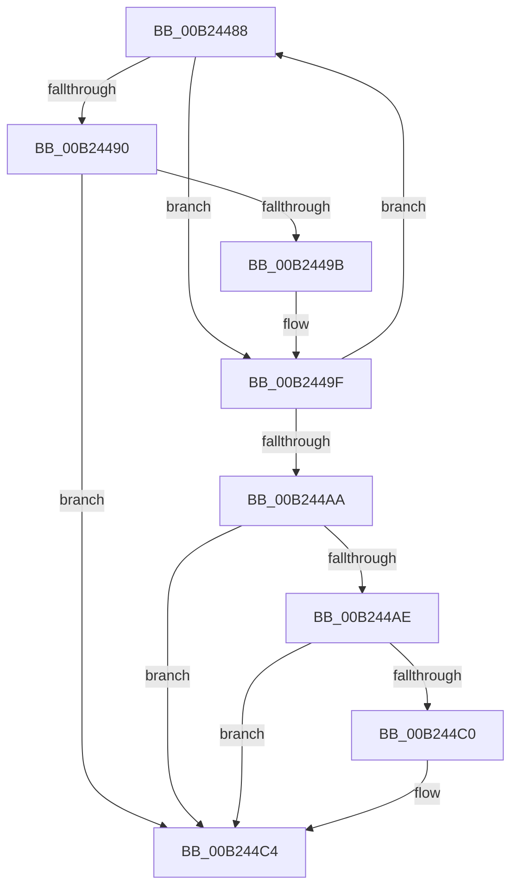

# sub_00B24488

- RVA: `0x00B24488`–`0x00B244D0` (길이 `72` bytes)
- VA: `0x0000000140B24488`
- 실행 섹션: `PAGE`
- PDB 이름 있음: `아니요`; PDB Function 태그: `아니요`
- unwind 정보 RVA: `0x0008ED54`
- 디코드: `23`개 명령, `72/72` bytes 표시
- 미해석 바이트: `0` (있으면 어셈블리에 `.byte`로 보존)

> 이 문서는 커널 이미지의 기계어와 PDB 기호를 분석해 생성했습니다. 4번과 5번은 함수 원형과 자료형을 바이너리 사용 방식에서 추정한 C 해석이며 원본 소스 복구 결과는 아닙니다.

## 1. Dependencies

- 직접 호출 지점: **2**; 고유 호출 대상: **1**
- 직접 호출자로 확인된 함수: **0**
- RIP 상대 이미지 참조: **1**

### Outgoing calls
- `0x00B24490` → [ZwClose](../../text/6A/ZwClose_function_006AD2B0.md) (function, `0x006AD2B0`)
- `0x00B244B5` → [ZwClose](../../text/6A/ZwClose_function_006AD2B0.md) (function, `0x006AD2B0`)

### Direct callers
- 이 함수 시작 RVA로 연결되는 직접 call은 확인되지 않았습니다. 간접 호출은 완전히 역산할 수 없습니다.

### Static image references
- `0x00B244C4` → RVA `0x00931980` (`PiDrvDbNodeActionCallback`; read)

## 2. Other-region calls and transfers

- 다른 실행 섹션으로 향하는 call: **2**
  - `0x00B24490` → [ZwClose](../../text/6A/ZwClose_function_006AD2B0.md) (`PAGE` → `.text`)
  - `0x00B244B5` → [ZwClose](../../text/6A/ZwClose_function_006AD2B0.md) (`PAGE` → `.text`)
- call이 아닌 외부 분기/꼬리 이동: **1**
  - `0x00B244CB` → [DrvDbUnloadDatabaseNode + 0x8C](../93/DrvDbUnloadDatabaseNode_function_0093183C.md) (`tail-transfer`)

## 3. Assembly (complete function range)

```asm
00B24488  49 8B 0E                        mov rcx, qword ptr [r14]
00B2448B  48 85 C9                        test rcx, rcx
00B2448E  74 0F                           je 0x140b2449f
00B24490  E8 1B 8E B8 FF                  call 0x1406ad2b0
00B24495  8B D8                           mov ebx, eax
00B24497  85 C0                           test eax, eax
00B24499  78 29                           js 0x140b244c4
00B2449B  49 83 26 00                     and qword ptr [r14], 0
00B2449F  FF C5                           inc ebp
00B244A1  49 83 C6 08                     add r14, 8
00B244A5  83 FD 06                        cmp ebp, 6
00B244A8  72 DE                           jb 0x140b24488
00B244AA  85 DB                           test ebx, ebx
00B244AC  78 16                           js 0x140b244c4
00B244AE  4C 8D 77 60                     lea r14, [rdi + 0x60]
00B244B2  49 8B 0F                        mov rcx, qword ptr [r15]
00B244B5  E8 F6 8D B8 FF                  call 0x1406ad2b0
00B244BA  8B D8                           mov ebx, eax
00B244BC  85 C0                           test eax, eax
00B244BE  78 04                           js 0x140b244c4
00B244C0  49 83 26 00                     and qword ptr [r14], 0
00B244C4  4C 8D 35 B5 D4 E0 FF            lea r14, [rip - 0x1f2b4b]
00B244CB  E9 F8 D3 E0 FF                  jmp 0x1409318c8
```

## 4. C-style interpretation (structured pseudocode)

```c
__int64 __fastcall sub_00B24488(void)
{
    __int64 result;
    __int64 v_r14;
    __int64 v_rbp;

    if (*(unsigned __int64 *)(v_r14) == 0) goto loc_00B2449F;
    result = ZwClose(*(unsigned __int64 *)(v_r14), a2, a3, a4);
    if (sign_flag) goto loc_00B244C4;
loc_00B2449F:
    v_rbp = (unsigned int)((v_rbp) + 1);
    v_r14 = (v_r14) + (8);
    if (((unsigned int)(v_rbp)) < 6) goto loc_00B24488;
    if (sign_flag) goto loc_00B244C4;
    result = ZwClose(*(unsigned __int64 *)(v_r15), a2, a3, a4);
    if (!(sign_flag)) {
    }
}
```

## 5. (Beta) C Style

```c
void sub_00B24488(void)
{
    int64_t result;
    int64_t local_r14;
    int64_t local_rbp;

    if (*(uint64_t *)(local_r14) == 0) goto loc_00B2449F;
    result = ZwClose(*(uint64_t *)(local_r14), a2, a3, a4);
    if (sign_flag) goto loc_00B244C4;
loc_00B2449F:
    local_rbp = (uint32_t)((local_rbp) + 1);
    local_r14 = (local_r14) + (8);
    if (((uint32_t)(local_rbp)) < 6) goto loc_00B24488;
    if (sign_flag) goto loc_00B244C4;
    result = ZwClose(*(uint64_t *)(local_r15), a2, a3, a4);
    if (!(sign_flag)) {
    }
}
```

## 6. Execution-region graph

[열기: 2D/3D 그래프와 함수 탐색 컨트롤 패널](../../../control-panel.html?section=page&rva=0x00B24488&view=graph)

- 2D 그래프는 위에서 아래로 흐르고, 3D 그래프는 빈 공간을 드래그해 회전합니다. Shift+드래그는 이동, 휠은 확대·축소, 함수 노드 선택은 대상 보고서 이동입니다.

### Static fallback


