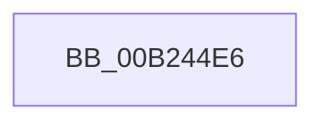

# sub_00B244E6

- RVA: `0x00B244E6`–`0x00B2452B` (길이 `69` bytes)
- VA: `0x0000000140B244E6`
- 실행 섹션: `PAGE`
- PDB 이름 있음: `아니요`; PDB Function 태그: `아니요`
- unwind 정보 RVA: `0x0008EF44`
- 디코드: `15`개 명령, `69/69` bytes 표시
- 미해석 바이트: `0` (있으면 어셈블리에 `.byte`로 보존)

> 이 문서는 커널 이미지의 기계어와 PDB 기호를 분석해 생성했습니다. 4번과 5번은 함수 원형과 자료형을 바이너리 사용 방식에서 추정한 C 해석이며 원본 소스 복구 결과는 아닙니다.

## 1. Dependencies

- 직접 호출 지점: **1**; 고유 호출 대상: **1**
- 직접 호출자로 확인된 함수: **0**
- RIP 상대 이미지 참조: **1**

### Outgoing calls
- `0x00B24520` → [tlgWriteTransfer_EtwWriteTransfer](../../text/42/tlgWriteTransfer_EtwWriteTransfer_function_004260E0.md) (function, `0x004260E0`)

### Direct callers
- 이 함수 시작 RVA로 연결되는 직접 call은 확인되지 않았습니다. 간접 호출은 완전히 역산할 수 없습니다.

### Static image references
- `0x00B244FA` → RVA `0x00E0A630` (`.data`; read)

## 2. Other-region calls and transfers

- 다른 실행 섹션으로 향하는 call: **1**
  - `0x00B24520` → [tlgWriteTransfer_EtwWriteTransfer](../../text/42/tlgWriteTransfer_EtwWriteTransfer_function_004260E0.md) (`PAGE` → `.text`)
- call이 아닌 외부 분기/꼬리 이동: **1**
  - `0x00B24526` → [VrpPreOpenOrCreate + 0x2CD](../93/VrpPreOpenOrCreate_function_00932B84.md) (`tail-transfer`)

## 3. Assembly (complete function range)

```asm
00B244E6  48 89 45 00                     mov qword ptr [rbp], rax
00B244EA  4C 8D 45 B8                     lea r8, [rbp - 0x48]
00B244EE  48 8D 44 24 50                  lea rax, [rsp + 0x50]
00B244F3  89 4D 08                        mov dword ptr [rbp + 8], ecx
00B244F6  48 89 45 10                     mov qword ptr [rbp + 0x10], rax
00B244FA  48 8D 0D 2F 61 2E 00            lea rcx, [rip + 0x2e612f]
00B24501  48 8D 45 D0                     lea rax, [rbp - 0x30]
00B24505  89 75 0C                        mov dword ptr [rbp + 0xc], esi
00B24508  48 89 44 24 28                  mov qword ptr [rsp + 0x28], rax
00B2450D  45 33 C9                        xor r9d, r9d
00B24510  C7 44 24 20 05 00 00 00         mov dword ptr [rsp + 0x20], 5
00B24518  48 C7 45 18 04 00 00 00         mov qword ptr [rbp + 0x18], 4
00B24520  E8 BB 1B 90 FF                  call 0x1404260e0
00B24525  90                              nop
00B24526  E9 26 E9 E0 FF                  jmp 0x140932e51
```

## 4. C-style interpretation (structured pseudocode)

```c
__int64 __fastcall sub_00B244E6(int a1, __int64 a2, __int64 a3, int a4, __int64 a5, __int64 a6, __int64 a7, __int64 a8, __int64 a9, __int64 a10)
{
    __int64 result;
    unsigned int v_stack_p20;
    unsigned __int64 v_stack_p28;

    *(unsigned __int64 *)(v_rbp) = result;
    *(unsigned int *)(v_rbp + 8) = a1;
    *(unsigned __int64 *)(v_rbp + 16) = a10;
    *(unsigned int *)(v_rbp + 12) = (unsigned int)(v_rsi);
    v_stack_p28 = v_rbp - 48;
    a4 = 0;
    v_stack_p20 = 5;
    *(unsigned __int64 *)(v_rbp + 24) = 4;
    result = tlgWriteTransfer_EtwWriteTransfer(v_rip + 3039535, a2, v_rbp - 72, a4);
}
```

## 5. (Beta) C Style

```c
int64_t sub_00B244E6(int32_t Arg1, int64_t Arg2, int64_t Arg3, int32_t Arg4, uint64_t Arg5, uint64_t Arg6, uint64_t Arg7, uint64_t Arg8, uint64_t Arg9, int64_t Arg10)
{
    int64_t result;
    uint32_t v_stack_p20;
    uint64_t v_stack_p28;

    *(uint64_t *)(local_rbp) = result;
    *(uint32_t *)(local_rbp + 0x8) = Arg1;
    *(uint64_t *)(local_rbp + 0x10) = Arg10;
    *(uint32_t *)(local_rbp + 0xC) = (uint32_t)(local_rsi);
    v_stack_p28 = local_rbp - 48;
    Arg4 = 0;
    v_stack_p20 = 5;
    *(uint64_t *)(local_rbp + 0x18) = 4;
    result = tlgWriteTransfer_EtwWriteTransfer(v_rip + 3039535, Arg2, local_rbp - 72, Arg4);
}
```

## 6. Execution-region graph

[열기: 2D/3D 그래프와 함수 탐색 컨트롤 패널](../../../control-panel.html?section=page&rva=0x00B244E6&view=graph)

- 2D 그래프는 위에서 아래로 흐르고, 3D 그래프는 빈 공간을 드래그해 회전합니다. Shift+드래그는 이동, 휠은 확대·축소, 함수 노드 선택은 대상 보고서 이동입니다.

### Static fallback


