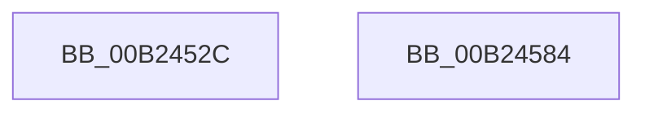

# sub_00B2452C

- RVA: `0x00B2452C`–`0x00B245ED` (길이 `193` bytes)
- VA: `0x0000000140B2452C`
- 실행 섹션: `PAGE`
- PDB 이름 있음: `아니요`; PDB Function 태그: `아니요`
- unwind 정보 RVA: `0x0008F074`
- 디코드: `40`개 명령, `193/193` bytes 표시
- 미해석 바이트: `0` (있으면 어셈블리에 `.byte`로 보존)

> 이 문서는 커널 이미지의 기계어와 PDB 기호를 분석해 생성했습니다. 4번과 5번은 함수 원형과 자료형을 바이너리 사용 방식에서 추정한 C 해석이며 원본 소스 복구 결과는 아닙니다.

## 1. Dependencies

- 직접 호출 지점: **2**; 고유 호출 대상: **1**
- 직접 호출자로 확인된 함수: **0**
- RIP 상대 이미지 참조: **4**

### Outgoing calls
- `0x00B24573` → [tlgWriteTransfer_EtwWriteTransfer](../../text/42/tlgWriteTransfer_EtwWriteTransfer_function_004260E0.md) (function, `0x004260E0`)
- `0x00B245E2` → [tlgWriteTransfer_EtwWriteTransfer](../../text/42/tlgWriteTransfer_EtwWriteTransfer_function_004260E0.md) (function, `0x004260E0`)

### Direct callers
- 이 함수 시작 RVA로 연결되는 직접 call은 확인되지 않았습니다. 간접 호출은 완전히 역산할 수 없습니다.

### Static image references
- `0x00B2454D` → RVA `0x0005AB9C` (`.rdata`; read)
- `0x00B24559` → RVA `0x00E0A630` (`.data`; read)
- `0x00B24578` → RVA `0x00002F28` (`.rdata`; read)
- `0x00B2459C` → RVA `0x0005AC1D` (`.rdata`; read)

## 2. Other-region calls and transfers

- 다른 실행 섹션으로 향하는 call: **2**
  - `0x00B24573` → [tlgWriteTransfer_EtwWriteTransfer](../../text/42/tlgWriteTransfer_EtwWriteTransfer_function_004260E0.md) (`PAGE` → `.text`)
  - `0x00B245E2` → [tlgWriteTransfer_EtwWriteTransfer](../../text/42/tlgWriteTransfer_EtwWriteTransfer_function_004260E0.md) (`PAGE` → `.text`)
- call이 아닌 외부 분기/꼬리 이동: **2**
  - `0x00B2457F` → [VrpPostQueryKey + 0xF4](../93/VrpPostQueryKey_function_009338F0.md) (`tail-transfer`)
  - `0x00B245E8` → [VrpPostQueryKey + 0x8D](../93/VrpPostQueryKey_function_009338F0.md) (`tail-transfer`)

## 3. Assembly (complete function range)

```asm
00B2452C  0F B7 08                        movzx ecx, word ptr [rax]
00B2452F  48 8D 55 0F                     lea rdx, [rbp + 0xf]
00B24533  48 8B 40 08                     mov rax, qword ptr [rax + 8]
00B24537  4C 8D 45 B7                     lea r8, [rbp - 0x49]
00B2453B  48 89 45 07                     mov qword ptr [rbp + 7], rax
00B2453F  45 33 C9                        xor r9d, r9d
00B24542  48 8D 45 C7                     lea rax, [rbp - 0x39]
00B24546  48 89 55 F7                     mov qword ptr [rbp - 9], rdx
00B2454A  89 4D 0F                        mov dword ptr [rbp + 0xf], ecx
00B2454D  48 8D 15 48 66 53 FF            lea rdx, [rip - 0xac99b8]
00B24554  48 89 44 24 28                  mov qword ptr [rsp + 0x28], rax
00B24559  48 8D 0D D0 60 2E 00            lea rcx, [rip + 0x2e60d0]
00B24560  C7 44 24 20 05 00 00 00         mov dword ptr [rsp + 0x20], 5
00B24568  48 C7 45 FF 02 00 00 00         mov qword ptr [rbp - 1], 2
00B24570  89 75 13                        mov dword ptr [rbp + 0x13], esi
00B24573  E8 68 1B 90 FF                  call 0x1404260e0
00B24578  48 8D 0D A9 E9 4D FF            lea rcx, [rip - 0xb21657]
00B2457F  E9 60 F4 E0 FF                  jmp 0x1409339e4
00B24584  48 8D 45 FF                     lea rax, [rbp - 1]
00B24588  48 C7 45 EF 02 00 00 00         mov qword ptr [rbp - 0x11], 2
00B24590  48 89 45 E7                     mov qword ptr [rbp - 0x19], rax
00B24594  4C 8D 45 B7                     lea r8, [rbp - 0x49]
00B24598  48 8B 41 08                     mov rax, qword ptr [rcx + 8]
00B2459C  48 8D 15 7A 66 53 FF            lea rdx, [rip - 0xac9986]
00B245A3  48 89 45 F7                     mov qword ptr [rbp - 9], rax
00B245A7  45 33 C9                        xor r9d, r9d
00B245AA  0F B7 01                        movzx eax, word ptr [rcx]
00B245AD  48 8D 0D 7C 60 2E 00            lea rcx, [rip + 0x2e607c]
00B245B4  89 45 FF                        mov dword ptr [rbp - 1], eax
00B245B7  48 8D 45 8F                     lea rax, [rbp - 0x71]
00B245BB  48 89 45 07                     mov qword ptr [rbp + 7], rax
00B245BF  48 8D 45 C7                     lea rax, [rbp - 0x39]
00B245C3  48 89 44 24 28                  mov qword ptr [rsp + 0x28], rax
00B245C8  C7 44 24 20 05 00 00 00         mov dword ptr [rsp + 0x20], 5
00B245D0  C7 45 03 00 00 00 00            mov dword ptr [rbp + 3], 0
00B245D7  89 5D 8F                        mov dword ptr [rbp - 0x71], ebx
00B245DA  48 C7 45 0F 04 00 00 00         mov qword ptr [rbp + 0xf], 4
00B245E2  E8 F9 1A 90 FF                  call 0x1404260e0
00B245E7  90                              nop
00B245E8  E9 90 F3 E0 FF                  jmp 0x14093397d
```

## 4. C-style interpretation (structured pseudocode)

```c
__int64 __fastcall sub_00B2452C(__int64 a1, __int64 a2, __int64 a3, int a4)
{
    __int64 result;
    unsigned int v_stack_p20;
    unsigned __int64 v_stack_p28;

    *(unsigned __int64 *)(v_rbp + 7) = *(unsigned __int64 *)(result + 8);
    a4 = 0;
    *(unsigned __int64 *)(v_rbp - 9) = v_rbp + 15;
    *(unsigned int *)(v_rbp + 15) = (unsigned int)(*(unsigned __int16 *)(result));
    v_stack_p28 = v_rbp - 57;
    v_stack_p20 = 5;
    *(unsigned __int64 *)(v_rbp - 1) = 2;
    *(unsigned int *)(v_rbp + 19) = (unsigned int)(v_rsi);
    result = tlgWriteTransfer_EtwWriteTransfer(v_rip + 3039440, v_rip - 11311544, v_rbp - 73, a4);
}
```

## 5. (Beta) C Style

```c
int64_t sub_00B2452C(int64_t Arg1, int64_t Arg2, int64_t Arg3, int32_t Arg4)
{
    int64_t result;
    uint32_t v_stack_p20;
    uint64_t v_stack_p28;

    *(uint64_t *)(local_rbp + 0x7) = *(uint64_t *)(result + 0x8);
    Arg4 = 0;
    *(uint64_t *)(local_rbp - 0x9) = local_rbp + 15;
    *(uint32_t *)(local_rbp + 0xF) = (uint32_t)(*(uint16_t *)(result));
    v_stack_p28 = local_rbp - 57;
    v_stack_p20 = 5;
    *(uint64_t *)(local_rbp - 0x1) = 2;
    *(uint32_t *)(local_rbp + 0x13) = (uint32_t)(local_rsi);
    result = tlgWriteTransfer_EtwWriteTransfer(v_rip + 3039440, v_rip - 11311544, local_rbp - 73, Arg4);
}
```

## 6. Execution-region graph

[열기: 2D/3D 그래프와 함수 탐색 컨트롤 패널](../../../control-panel.html?section=page&rva=0x00B2452C&view=graph)

- 2D 그래프는 위에서 아래로 흐르고, 3D 그래프는 빈 공간을 드래그해 회전합니다. Shift+드래그는 이동, 휠은 확대·축소, 함수 노드 선택은 대상 보고서 이동입니다.

### Static fallback


